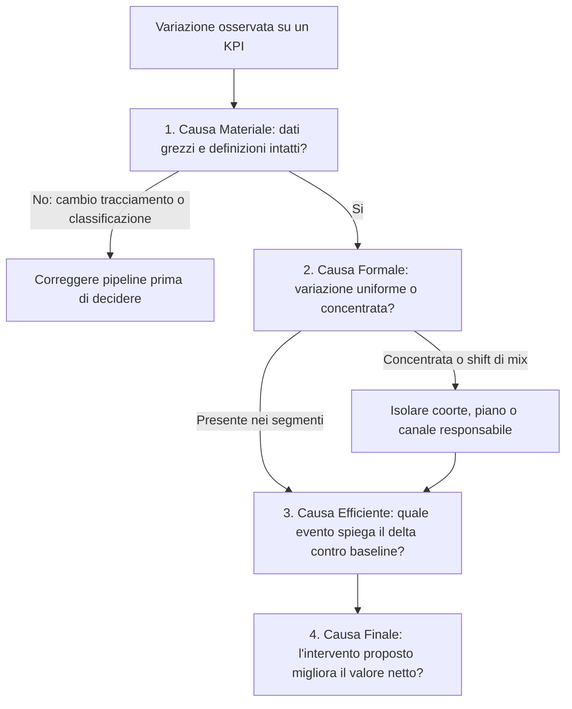

Consideriamo uno scenario costruito ma ricorrente nei comitati settimanali di prodotto: in un servizio SaaS B2B con 18.000 abbonati attivi, il tasso di abbandono mensile (churn) balza nel giro di un singolo trimestre dal 4,0% al 7,0%. Il numero sulla dashboard appare netto, rosso e urgente. Nel giro di mezz'ora emergono due ricette opposte: il team prodotto chiede uno sprint immediato per ridisegnare il flusso di attivazione iniziale, mentre la direzione commerciale spinge per offrire uno sconto di permanenza del 20% a tutti gli utenti in scadenza. Entrambe le proposte trattano il numero in dashboard come effetto di un'unica causa semplice, senza aver controllato se parte di quel balzo nasca nei dati grezzi, si concentri in una sola coorte oppure risponda a più leve simultanee.

Quando si legge un indicatore aziendale senza scomporlo, si compie lo stesso errore che Aristotele criticava nei filosofi naturalisti prima di lui: cercare una spiegazione unica per fenomeni che rispondono a quattro domande diverse. Nella *Fisica* (libro II, capitolo 3) e nella *Metafisica* (libro V, capitolo 2), Aristotele mostrò che spiegare davvero un ente o un cambiamento richiede quattro tipi di risposta simultanei: di che materia è fatto, quale forma o struttura assume, quale meccanismo efficiente lo ha generato e a quale fine o scopo risponde. Applicata alle metriche moderne, questa griglia antica funziona come un protocollo forense per evitare cure sbagliate su sintomi mal letti.

## Perché una spiegazione monocausale distorce quasi sempre una metrica

La tentazione davanti a un picco o a un crollo di KPI è scegliere la prima storia coerente con i sospetti del momento. Se il team ha appena lanciato una nuova funzione, ogni movimento negativo diventa colpa del rilascio; se il mercato è fermo, ogni flessione diventa colpa della congiuntura. La mente umana preferisce storie lineari con un solo colpevole perché riducono l'ansia decisionale, ma una metrica di business è quasi sempre un oggetto stratificato: mescola la qualità dei record raccolti, la composizione dei segmenti sotto la media, gli eventi operativi recenti e il criterio con cui la metrica stessa guida le scelte.

> **Idea chiave:** Leggere una metrica attraverso le quattro cause aristoteliche — materiale, formale, efficiente e finale — impedisce di scambiare un errore di tracciamento, uno spostamento di mix tra segmenti o un cambio di obiettivo strategico per un guasto unico del prodotto.

Separare i quattro piani non rallenta il lavoro dell'analista: al contrario, abbatte i costi degli interventi inutili. Spendere settimane a riprogettare un'interfaccia quando il problema risiede nella classificazione dei pagamenti falliti o nell'ingresso di una coorte promozionale a bassa intenzione costa molto di più di un'indagine diagnostica strutturata in trenta minuti.

## Anatomia delle quattro cause applicate a un indicatore aziendale

Tradurre la filosofia aristotelica nel linguaggio delle tabelle e delle pipeline significa associare ciascuna causa a un controllo tecnico preciso e a una domanda di verifica che non si sovrappone alle altre tre.

| Causa aristotelica | Significato nell'analisi dei dati | Controllo tecnico prioritario | Errore tipico se viene saltata |
| --- | --- | --- | --- |
| Causa materiale | Dati grezzi, definizioni, log, coperture, campi nulli e regole ETL | Verificare integrità delle sorgenti, cambi di schema, duplicati e riclassificazioni | Curare il business mentre è cambiato soltanto lo script di raccolta |
| Causa formale | Struttura distributiva, segmentazione per piano, canale, coorte e area | Scomporre l'aggregato per segmenti chiave e pesi di mix tra gruppi | Trattare una media globale come rappresentativa di tutta la base clienti |
| Causa efficiente | Evento, modifica di prodotto, rincaro, bug o campagna che innesca la variazione | Confrontare coorti esposte e non esposte rispetto a una baseline temporale | Attribuire il fenomeno all'ultimo rilascio solo perché cronologicamente vicino |
| Causa finale | Decisione che la metrica governa e valore economico o strategico perseguito | Allineare la metrica a margine netto, rischio e incentivo organizzativo | Ridurre il churn perdendo profitti o gonfiando segmenti in perdita |

Il flusso diagnostico segue un ordine preciso, perché non ha senso indagare i meccanismi causali (causa efficiente) se la materia prima del dato è corrotta o se il cambiamento dipende soltanto dal peso relativo di un nuovo segmento.

Quando questo schema diventa abitudine di squadra, le riunioni cambiano tono: invece di discutere su chi abbia ragione tra prodotto e marketing, il gruppo controlla insieme quale dei quattro piani sta generando il movimento osservato.

## Scomposizione numerica di un balzo del churn dal quattro al sette percento

Riprendiamo i numeri di esempio del servizio SaaS B2B con 18.000 abbonati attivi per osservare quanto cambia la diagnosi quando applichiamo le quattro cause in sequenza. Alla baseline storica del 4,0%, ci attendevamo 18.000 × 4,0% = 720 cancellazioni mensili. Nel trimestre osservato il cruscotto mostra invece il 7,0% di churn, pari a 18.000 × 7,0% = 1.260 cancellazioni: l'eccesso netto da spiegare ammonta esattamente a 1.260 - 720 = 540 clienti persi in più (+3,0 punti percentuali).

1. **Controllo della causa materiale:** esaminando le tabelle dei pagamenti, l'analista scopre che un aggiornamento del gateway bancario ha iniziato a marcare le carte scadute non ancora ritentate come disdette definitive anziché come sospesi in recupero. Questo errore di classificazione riguarda esattamente 180 account. Pertanto, 180 / 540 = 33,3% dell'eccesso apparente è puro rumore di misurazione. Le cancellazioni reali ammontano a 1.260 - 180 = 1.080 clienti, portando il tasso di churn reale al 1.080 / 18.000 = 6,0% e riducendo l'eccesso effettivo da spiegare a 360 utenti (+2,0 punti percentuali oltre i 720 attesi).
2. **Controllo della causa formale:** segmentando i 18.000 abbonati per piano tariffario e canale di acquisizione, emerge che i 10.000 clienti sul piano Pro registrano 410 cancellazioni reali (4,1%, praticamente identico alla baseline del 4,0%). I restanti 8.000 clienti sul piano Starter concentrano invece 670 cancellazioni rispetto alle 320 attese al 4,0%, spiegando +350 delle +360 disdette reali in eccesso. Dentro il piano Starter, un ulteriore spaccato rivela che 3.000 utenti arrivati negli ultimi 90 giorni da una campagna su social a pagamento generano da soli 270 disdette extra su 360 — cioè il 75,0% dell'eccesso reale è concentrato in appena il 16,7% della base clienti.
3. **Controllo della causa efficiente:** su quel segmento da 3.000 utenti Starter acquisiti di recente, nei trenta giorni precedenti si sono verificati due eventi simultanei: un aumento del listino del 15% e un bug nell'importazione CSV durante l'onboarding che ha fatto scendere il tasso di attivazione iniziale dal 64% al 48%. Confrontando la coorte esposta al bug contro la coorte della settimana precedente colpita solo dal nuovo listino, la stima isola circa 165 disdette attribuibili al bug tecnico e circa 105 disdette legate alla maggiore sensibilità al prezzo del listino aumentato.
4. **Controllo della causa finale:** prima di annullare l'aumento di listino, occorre chiedere a quale obiettivo serve la metrica. I 105 utenti usciti per il rincaro generavano un ricavo medio con margine lordo di 8 € al mese ma assorbivano 11 € al mese di assistenza tecnica, producendo un margine operativo negativo di -3 € al mese per cliente: perderli evita una perdita annua di 105 × 3 € × 12 = 3.780 €. Al contrario, i 165 utenti persi a causa del bug di importazione erano account in target con margine operativo netto di 35 € al mese ciascuno, rappresentando un valore annuo distrutto di 165 × 35 € × 12 = 69.300 €.

La scomposizione numerica ribalta entrambe le proposte istintive della riunione iniziale: non serve alcuno sconto generalizzato sul listino né un redesign completo dell'interfaccia, ma occorre correggere subito la regola di classificazione del gateway (causa materiale), riparare il bug dell'importatore CSV (causa efficiente sul segmento Starter) e mantenere il nuovo listino che ha migliorato la sostenibilità economica (causa finale).

## Il caso Qwikster e il costo di trascurare le cause congiunte

La storia industriale offre un esempio noto di cosa accade quando si legge una decisione complessa senza tenere insieme tutte e quattro le cause. Nell'estate e nell'autunno del 2011 Netflix annunciò la separazione tra l'abbonamento streaming e il servizio di noleggio DVD per posta, ribattezzato poi Qwikster, accompagnata da un cambio tariffario che per chi manteneva entrambi i servizi portava la spesa mensile da circa 10 dollari a 15,98 dollari (circa il 60% in più). Come documentato nei rapporti trimestrali Netflix del terzo trimestre 2011, l'azienda perse in un solo trimestre circa 800.000 abbonati negli Stati Uniti e il titolo azionario crollò da un picco vicino a 300 dollari nel luglio 2011 fino a scendere sotto i 70 dollari prima della fine dell'anno, bruciando oltre il 75% della capitalizzazione di picco.

Letto superficialmente, l'episodio viene ridotto a una sola causa: "alzare i prezzi fa perdere clienti". Applicando le quattro cause aristoteliche, la diagnosi diventa molto più istruttiva per un analista moderno:
- Sul piano materiale, la base utenti mescolava abbonati già passati interamente allo streaming con utenti ibridi che usavano ancora i DVD fisici come parte centrale dell'abitudine di consumo.
- Sul piano formale, l'impatto non fu uniforme su tutta la clientela: colpì in modo sproporzionato i clienti storici dual-plan e quelli meno digitalizzati.
- Sul piano efficiente, la causa non fu soltanto il listino ma la frizione operativa simultanea: due siti separati, due liste di attesa e due fatturazioni distinte per chi voleva continuare a fare ciò che il giorno prima richiedeva un solo login.
- Sul piano finale, la direzione strategica di lungo periodo (spostare il baricentro sullo streaming) era corretta, tanto che negli anni successivi Netflix costruì su quella transizione la propria crescita globale, ma il mezzo scelto per raggiungerla mancò la calibrazione di transizione e dovette essere ritirato dopo poche settimane nell'ottobre 2011.

Distinguere ciò che è sbagliato nello strumento operativo (causa efficiente) da ciò che è giusto nella direzione strategica (causa finale) evita di buttare via obiettivi sani solo perché la prima esecuzione ha prodotto un contraccolpo visibile.

## Scheda di indagine in quattro passaggi prima di proporre un intervento

Per trasformare la griglia di Aristotele in un'abitudine operativa nei tuoi documenti di analisi, conviene imporre una scheda sintetica obbligatoria ogni volta che una metrica varia oltre la propria fascia storica. Il documento costringe chi analizza a dichiarare tutti e quattro i piani prima di suggerire una soluzione ai decisori.

> **Protocollo diagnostico delle quattro cause:**
> - Verifica materiale: nessun cambio di schema, finestra temporale, fuso orario, filtro di esclusione o definizione SQL spiega più del 10% della variazione osservata.
> - Verifica formale: la variazione è stata scomposta per almeno tre dimensioni strutturali (coorte di ingresso, piano o fascia di prezzo, canale di acquisizione o piattaforma) calcolando il contributo di mix.
> - Verifica efficiente: gli eventi interni ed esterni della finestra esaminata sono stati confrontati con una coorte o un gruppo di controllo non esposto.
> - Verifica finale: l'intervento proposto è valutato rispetto all'obiettivo economico di sistema e non al solo ripristino estetico della singola metrica.

Portare questa scheda in riunione sposta immediatamente la conversazione dalle opinioni personali alle verifiche condivise. Anche quando manca tempo per un esperimento controllato completo, aver escluso un artefatto di pipeline e un effetto di composizione di mix protegge il team dagli errori più grossolani.

## Trappole frequenti nell'interpretazione monocausale

### Incolpare il prodotto quando è cambiata la materia prima del dato

Il sintomo è l'allarme immediato su un calo di conversione o un picco di errori subito dopo un aggiornamento minore dell'app o del sito, senza verificare i log di ingestione. Questo inganna perché il linguaggio delle dashboard presenta ogni metrica come una misurazione fisica diretta, nascondendo le decine di regole di join, deduplica e mapping che la producono. Prima di aprire una segnalazione di prodotto, controlla sempre i volumi grezzi a monte, le distribuzioni dei valori nulli e le ultime modifiche ai campi di stato o di pagamento.

### Calcolare la media globale ignorando la forma della distribuzione

Il sintomo emerge quando un KPI aggregato peggiora anche se ogni singolo segmento preso separatamente è rimasto stabile o è persino migliorato. L'inganno nasce dallo spostamento del peso relativo tra segmenti (effetto mix o paradosso di Simpson): se raddoppi l'acquisizione di un segmento naturalmente più volatile o con retention più bassa, la media complessiva scende anche senza alcun deterioramento del prodotto. Controlla sempre la tabella dei pesi di ciascun segmento accanto ai tassi specifici prima di dichiarare un peggioramento generale.

### Ottimizzare una metrica dimenticando la causa finale

Il sintomo si manifesta quando un team celebra di aver abbattuto un indicatore negativo — per esempio aver dimezzato il churn o i resi — ma i conti economici mostrano una contrazione del margine netto. L'errore sta nel trasformare la metrica intermedia in fine ultimo: offrire sconti aggressivi o bloccare selettivamente l'ingresso dei clienti difficili migliora la percentuale in dashboard ma distrugge valore economico complessivo. Collega sempre ogni KPI operativo a una coppia di metriche di guardia su margine, costo operativo o qualità del servizio.

## Verifica diagnostica sulle tue metriche

1. Qual è la funzione specifica della causa materiale quando ricevi una dashboard che segnala un improvviso salto di una metrica aziendale?

Mostra risposta

La causa materiale verifica l'integrità dei dati grezzi che compongono il numero prima di interpretare il fenomeno di business: controlla eventuali cambi di definizione, modifiche nei gateway o negli stati di evento, valori nulli, duplicati, fusi orari o filtri ETL alterati che possono generare variazioni interamente artificiali.

2. Nell'esempio del churn SaaS salito dal 4,0% al 7,0% su 18.000 clienti, perché la sola riparazione del bug di onboarding non avrebbe spiegato tutte le 540 disdette in eccesso?

Mostra risposta

Perché 180 disdette su 540 (il 33,3%) erano dovute a un errore di classificazione delle carte scadute nel gateway (causa materiale), mentre delle restanti 360 disdette reali concentrate sul piano Starter circa 105 derivavano dall'aumento del listino su clienti a margine negativo e circa 165 dal bug dell'importatore CSV (con poche decine distribuite altrove). Le quattro cause mostrano che più fattori agivano contemporaneamente.

3. In che modo il caso Netflix Qwikster del 2011 illustra la differenza tra causa efficiente e causa finale?

Mostra risposta

La causa finale — orientare l'azienda verso lo streaming digitale come modello dominante — si rivelò strategicamente coerente sul lungo periodo, ma la causa efficiente immediata (rincaro simultaneo fino a circa il 60% per gli utenti ibridi unito alla separazione tecnica in due portali distinti) generò un'enorme frizione operativa, causando la perdita di circa 800.000 abbonati negli Stati Uniti nel terzo trimestre 2011.

4. Come puoi accorgerti che una variazione negativa di una metrica dipende dalla causa formale (effetto mix) anziché da un peggioramento del servizio?

Mostra risposta

Scomponendo il KPI per le principali dimensioni strutturali (piano, coorte di acquisizione, canale, area geografica): se all'interno di ciascun segmento i tassi restano sostanzialmente stabili ma è cresciuta molto la quota di utenti appartenenti a un segmento naturalmente più rischioso o a bassa retention, il peggioramento della media globale deriva dalla nuova composizione del portafoglio (causa formale) e non da un guasto del prodotto.

