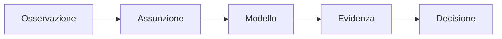

# Aristotele e le quattro cause

Un dashboard mostra che le vendite sono scese, ma il team confonde quattro domande diverse: che cosa stiamo misurando, di quali dati è fatta la metrica, quale processo l'ha prodotta e a quale scopo serve. **Aristotele e le quattro cause** aiuta a separare questi livelli prima che una spiegazione troppo rapida diventi una decisione sbagliata.

## Una scena da cui partire

Leggi questa lezione come una griglia di diagnosi. Le quattro cause non sono storia antica da citare: sono un modo per evitare che forma del dato, materiale informativo, processo generativo e obiettivo business vengano trattati come se fossero la stessa cosa.

- **Contesto:** Quale domanda stai confondendo con una causa?
- **Metodo:** Quale causa spiega il dato e quale spiega solo la sua forma?
- **Applicazione:** Quale decisione diventerebbe più prudente dopo questa distinzione?

## Le quattro cause di Aristotele

Nella *Fisica* e nella *Metafisica*, Aristotele identifica quattro tipi di spiegazione per qualsiasi fenomeno:

| Causa | Domanda | Significato |
|-------|---------|-------------|
| **Materiale** | Di cosa è fatto? | Il substrato, i dati grezzi |
| **Formale** | Qual è la sua forma/struttura? | Il design, l'algoritmo, il modello |
| **Efficiente** | Cosa l'ha prodotto? | L'agente che causa il cambiamento |
| **Finale** | A quale scopo? | L'obiettivo, il telos |

Nessuna delle quattro è "quella giusta". Una spiegazione completa le include tutte. Nel mondo dei dati, questa distinzione è rivoluzionaria perché la maggior parte delle analisi risponde solo alla causa efficiente ("X ha causato Y"), ignorando le altre tre e producendo insight incompleti.

## Applicazione all'analisi dati: il caso del churn in aumento

Scenario: un servizio SaaS vede il churn mensile salire dal 4% al 7%. Ecco come le quattro cause producono quattro analisi diverse:

### Causa materiale (di cosa è fatto il churn?)
**Domanda:** Cosa costituisce il churn che stiamo misurando?
**Analisi:** Controlla la qualità dei dati. I clienti che appaiono come "churnati" hanno davvero cancellato? O il sistema di billing ha un bug che marca come cancellati clienti che hanno solo cambiato carta di credito? Il 30% dei presunti churnati potrebbe non esserlo.
**Azione:** Data quality audit prima di ogni altra analisi.

### Causa formale (qual è la struttura del churn?)
**Domanda:** Come si manifesta il churn? Qual è il pattern?
**Analisi:** Segmentazione per coorte, piano, canale di acquisizione. Il churn non è uniforme: è concentrato nei clienti acquisiti da Facebook Ads con piano base. C'è un pattern temporale: il churn avviene quasi sempre dopo il terzo mese.
**Azione:** Capire cosa succede al terzo mese che fa scappare i clienti.

### Causa efficiente (cosa ha prodotto l'aumento?)
**Domanda:** Quale cambiamento specifico ha causato l'aumento dal 4% al 7%?
**Analisi:** Confronto temporale. L'aumento coincide con: (1) un aumento del 15% del prezzo base, (2) il lancio di un competitor con funzionalità simili a metà prezzo, (3) un bug nell'onboarding che ha impedito a nuovi utenti di completare il setup per 5 giorni.
**Azione:** Modellare l'impatto relativo di ciascuno di questi fattori (es. difference-in-differences).

### Causa finale (qual è lo scopo del churn?)
**Domanda:** Il churn è solo un problema o anche un segnale utile?
**Analisi:** I clienti che churnano sono quelli con il minor tasso di utilizzo delle feature avanzate e il maggior numero di ticket di supporto. Costavano più in supporto di quanto generassero in revenue. Il churn potrebbe essere un meccanismo di pulizia naturale.
**Azione:** Non combattere il churn indiscriminatamente. Concentrarsi sui clienti profittevoli, lasciar andare quelli non profittevoli.

Solo la combinazione delle quattro analisi produce una risposta completa. Un'azienda che guarda solo la causa efficiente ("colpa del competitor!") risponde con una guerra di prezzi che distrugge il margine. Un'azienda che guarda solo la causa finale ("è churn naturale") ignora un problema di onboarding. Un'azienda che guarda solo la causa materiale ("sono dati sporchi") risolve un terzo del problema.

## Caso reale: Netflix e la cancellazione dei DVD

Nel 2011, Netflix annunciò Qwikster, la separazione del servizio DVD dal servizio streaming. La reazione fu furiosa: 800.000 abbonati cancellarono in un trimestre, le azioni crollarono del 77%. L'analisi post-mortem di Netflix (descritta nel libro *That Will Never Work* di Marc Randolph) rivelò che le quattro cause erano tutte in gioco:

- **Materiale:** La comunicazione fu confusa. Molti clienti pensavano che il servizio DVD venisse *eliminato*, non separato.
- **Formale:** La struttura dei due servizi era diversa (abbonamento unico vs due abbonamenti separati), creando attrito per i clienti che usavano entrambi.
- **Efficiente:** L'annuncio fu percepito come un aumento di prezzo del 60% per chi usava entrambi i servizi.
- **Finale:** Netflix perseguiva il futuro dello streaming. I clienti DVD, per quanto rumorosi, erano in declino strutturale. La migrazione era inevitabile, ma l'esecuzione fu terribile.

Netflix imparò la lezione. Due anni dopo, quando lanciò le prime produzioni originali (*House of Cards*), usò un approccio radicalmente diverso: spiegò tutte e quattro le cause ai clienti (perché lo facciamo, come funziona, cosa cambia per voi, perché è meglio per il futuro dell'intrattenimento). Le cancellazioni furono minime.

## Come usare il framework nel tuo lavoro quotidiano

Ogni volta che presenti un insight, chiediti:

1. Ho verificato la **causa materiale**? (I dati sono puliti? La metrica è definita correttamente?)
2. Ho descritto la **causa formale**? (Qual è il pattern? È uniforme o segmentato?)
3. Ho identificato la **causa efficiente**? (Cosa specificamente ha causato il cambiamento?)
4. Ho considerato la **causa finale**? (Questo fenomeno è solo un problema o anche un segnale? Qual è il contesto strategico?)

Se manca anche una sola di queste risposte, la tua analisi è incompleta — non tecnicamente, ma filosoficamente. E nel mondo reale, le analisi filosoficamente incomplete sono quelle che portano a decisioni sbagliate.

---

*Riferimenti:*
- Aristotele. *Fisica*, Libro II, Capitolo 3. (ca. 350 a.C.)
- Aristotele. *Metafisica*, Libro V, Capitolo 2. (ca. 350 a.C.)
- Falcon, A. (2019). "Aristotle on Causality." *Stanford Encyclopedia of Philosophy.*
- Randolph, M. (2019). *That Will Never Work: The Birth of Netflix.* Little, Brown and Company.

## Controllo di qualità

Prima di usare aristotele e le quattro cause in una decisione, controlla sempre completezza, duplicati, timezone, definizioni cambiate e segmenti esclusi. Molte analisi apparentemente sofisticate falliscono perché il dato di partenza misura un comportamento diverso da quello che il team crede di osservare.

## Interpretazione per segmenti

La media aggregata è solo il punto di partenza. Segmenta per canale, coorte, piano, paese, device e maturità dell'utente. Se due segmenti si muovono in direzioni opposte, la media non rappresenta nessuno dei due e può portare a una decisione sbagliata.

## Decisione operativa

Ogni analisi deve terminare con una scelta possibile: continuare, fermare, iterare, investire, rimuovere o approfondire. Se aristotele e le quattro cause non cambia una decisione, probabilmente manca ancora il collegamento tra metrica e azione.

## Problema reale

Nel lavoro su fondamenti filosofici dell'analisi dati, **Aristotele e le quattro cause** serve a risolvere un problema concreto: capire quando un dato sostiene davvero una decisione e quando invece nasconde assunzioni, bias, causalità fragile o una domanda formulata male. La domanda non è se il concetto sia interessante in astratto, ma quale decisione migliora quando lo applichi con dati affidabili e con una soglia di errore esplicita.

Questa lezione va studiata come uno strumento operativo: entro la fine devi saper Comprendere il problema analitico e il contesto decisionale; Applicare esempi, metriche e controlli a casi reali. Se non riesci a collegare il concetto a una scelta reale, la conoscenza resta decorativa e non diventa competenza.

## Modello concettuale

Il modello mentale e sequenziale: prima si formula la domanda, poi si traduce in unità osservabili, quindi si valuta la qualità del dato e solo alla fine si decide. Saltare un passaggio produce analisi eleganti ma fragili.

| Passaggio | Domanda guida | Output atteso |
|---|---|---|
| Framing | Quale decisione deve cambiare? | Una scelta concreta, non una curiosità |
| Misura | Quale segnale rappresenta il fenomeno? | Metrica, fonte e granularità |
| Confronto | Rispetto a quale baseline interpreto il risultato? | Benchmark o controfattuale plausibile |
| Azione | Che cosa faccio se il segnale supera la soglia? | Decisione, owner e prossimo controllo |

## Formalizzazione rigorosa

Formalizza **Aristotele e le quattro cause** come una relazione tra quattro elementi: unità di analisi, segnale, baseline e decisione. Nel contesto di questa lezione l'unità principale e **osservazione, ipotesi, variabile, meccanismo causale o criterio di evidenza**. Il segnale da osservare deve essere collegato a **forza dell evidenza, coerenza causale, robustezza delle assunzioni e costo dell errore decisionale**, mentre la baseline deve essere scelta tra **spiegazione alternativa, controfattuale, gruppo comparabile o scenario senza intervento**.

Una formulazione robusta segue questa logica:

| Elemento | Definizione operativa per questa lezione |
|---|---|
| Unità | osservazione, ipotesi, variabile, meccanismo causale o criterio di evidenza |
| Segnale | forza dell evidenza, coerenza causale, robustezza delle assunzioni e costo dell errore decisionale |
| Baseline | spiegazione alternativa, controfattuale, gruppo comparabile o scenario senza intervento |
| Decisione | accettare, rifiutare o riformulare una spiegazione prima di usarla in un contesto aziendale |
| Rischio | Confondere correlazione, qualità del dato e causalità decisionale |

La regola pratica e semplice: una misura e utile solo se riduce l'incertezza su una decisione specifica. Se non cambia una scelta, e documentazione; se cambia una scelta senza controlli, e rischio.

## Esempio o caso studio

Un comitato interpreta una crescita di retention come prova che una nuova iniziativa abbia funzionato. La lezione costringe a distinguere osservazione, spiegazione, assunzione e decisione prima di trasformare il dato in azione.

Applicando **Aristotele e le quattro cause**, il team costruisce una lettura in tre colonne: cosa sappiamo, cosa assumiamo e quale decisione prendiamo. Questo formato impedisce di presentare un numero come se fosse una conclusione autosufficiente.

| Evidenza | Interpretazione prudente | Decisione conseguente |
|---|---|---|
| Segnale positivo ma non isolato | Il fenomeno esiste, ma la causa e ancora incerta | Cercare baseline o holdout |
| Segmento con risposta diversa | L'effetto medio nasconde eterogeneita | Analizzare coorti o sottogruppi |
| Costo operativo crescente | Il risultato va valutato sul margine | Applicare soglie economiche |

## Lab / esercizio

### Livello base

Prendi una decisione reale collegata a **Aristotele e le quattro cause** e scrivi in cinque righe: obiettivo, metrica primaria, baseline, rischio principale e azione prevista. Non usare più di una metrica primaria.

### Livello intermedio

Costruisci una tabella con almeno tre segmenti o scenari. Per ciascuno indica segnale, possibile spiegazione alternativa e controllo necessario prima di decidere.

### Livello research-grade

Disegna un piano di validazione: ipotesi, dati necessari, criterio di esclusione, soglia decisionale e controllo post-decisione. Specifica anche che cosa ti farebbe cambiare idea.

### Dataset e materiali consigliati

Usa case study decisionali, metriche prodotto, risultati di esperimenti, DAG semplici, report analitici e serie storiche simulate. Se non hai dati reali, crea un dataset sintetico con 200-500 righe e almeno una colonna temporale, una colonna segmento, una metrica di outcome e una variabile di esposizione.

## Errore tipico da evitare

L'errore più frequente e trattare **Aristotele e le quattro cause** come una definizione da ricordare invece che come un protocollo decisionale. In pratica succede quando si presenta una metrica senza baseline, un grafico senza ipotesi, o una raccomandazione senza costo dell'errore.

Un controllo utile è chiedersi: "se questo risultato fosse falso o instabile, quale decisione sbaglierei?". Se la risposta non è chiara, la lezione non è ancora stata applicata davvero.

## Quiz o checkpoint

1. Qual è la decisione concreta che questa lezione dovrebbe migliorare?
2. Quale baseline rende interpretabile il risultato?
3. Quale assunzione, se sbagliata, cambierebbe la conclusione?
4. Quale controllo minimo useresti prima di presentare la raccomandazione?

## Riepilogo operativo

**Aristotele e le quattro cause** e una competenza utile quando collega concetto, dato e decisione. Studiala partendo da un problema reale, formalizza il segnale, cerca una baseline credibile, costruisci un esempio e chiudi con un controllo pratico. Categoria: Fondamenti. Difficoltà: advanced. Tempo stimato: 18 min.
