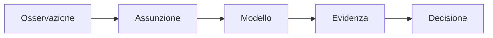

# Caso studio: pensiero filosofico e decisione di business


Immagina un analista che non vuole scambiare correlazione, misura e causalita per verita assolute quando un dato sembra evidente, ma la domanda vera e cosa possiamo legittimamente concludere. Sul tavolo non c'è un esercizio astratto: c'è la pressione concreta di rendere esplicite assunzioni, limiti e responsabilita. **Caso studio: pensiero filosofico e decisione di business** entra qui, nel punto in cui una scelta deve diventare più chiara, più misurabile e più difendibile.

## Una scena da cui partire

La lezione va letta con questo atteggiamento: non collezionare frasi da ricordare, ma cercare il passaggio che trasforma un pensiero critico che rende l'analisi più onesta in lavoro reale. Leggila come un banco di prova: ogni passaggio deve trasformare un dato, un dubbio o un vincolo in una decisione verificabile. Il livello è avanzato: non cercare una ricetta unica, cerca i vincoli che cambiano la risposta.

- **Contesto:** Quale contesto rende il caso difficile?
- **Metodo:** Quale evidenza cambia davvero la decisione?
- **Applicazione:** Quale lezione resta valida fuori dal caso specifico?

## Il contesto

QuickBite: 3 milioni di utenti attivi, 12 città europee, mercato stagnante (+3% anno). Il CEO vuole il programma fedeltà per aumentare la retention. Il CFO è scettico: "15 milioni sono il nostro profitto annuale."

Dati disponibili:

1. Un test pilota del programma fedeltà su 50.000 utenti a Milano, durato 3 mesi. Risultato: retention +4.7% (p=0.03), ordini medi +1.8%.

2. I dati storici mostrano una correlazione positiva tra frequenza d'ordine e retention, ma non è mai stato testato se aumentare la frequenza CAUSI retention.

3. Il competitor principale (FoodRacer) ha lanciato un programma simile 6 mesi fa e ha riportato +2.3% di retention in una earnings call. Nessun dato pubblico su come l'hanno misurato.

I tre stakeholder:
- **CEO**: "Dobbiamo crescere. Se il competitor lo fa, dobbiamo farlo anche noi."
- **CFO**: "15 milioni sono tanti. Datemi numeri solidi o non approvo."
- **Head of Product**: "Il test di Milano è poco. 3 mesi sono pochi, il campione è solo una città."

## Applicazione del framework filosofico

### Aristotele — Le quattro cause del problema
- **Materiale**: il test ha dati puliti? Il tracking della retention è affidabile? Ci sono bug nel sistema di loyalty del pilota?
- **Formale**: com'è distribuito l'effetto? Tutti gli utenti hanno +4.7% o è concentrato in un segmento specifico?
- **Efficiente**: l'effetto è causato dal programma fedeltà o dalla novità (novelty effect di 3 mesi)?
- **Finale**: qual è il vero obiettivo? Retention o profitto? Se il programma aumenta retention ma riduce margine (costi delle reward), qual è il net impact?

### Hume — Il problema dell'induzione
Il test di Milano ha funzionato per 3 mesi su 50.000 utenti. Questo NON garantisce che funzioni per 12 mesi su 3 milioni di utenti in 12 città con abitudini alimentari diverse. L'induzione funziona — fino a che non funziona più.

### Popper — Falsificabilità
L'ipotesi "il programma fedeltà aumenta la retention" deve essere falsificabile. Cosa ci farebbe concludere che è falsa? Un test su scala più ampia con gruppo di controllo e durata minima di 6 mesi (per escludere novelty effect). Solo se sopravvive a questo test, l'accettiamo provvisoriamente.

### Pearl — DAG e confondenti
```
Novelty Effect ──► Retention Apparente
       │
Intensità App ──► Retention Reale
       │
Città (Milano vs altre) ──► Comportamento base
```

Il DAG mostra che l'effetto misurato potrebbe essere contaminato dal novelty effect e dalla specificità di Milano (città con alta densità di ristoranti e abitudini di delivery diverse da altre città). Per isolare l'effetto causale, serve controllare per città e durata del test.

### Kuhn — Paradigmi
Il CEO opera nel paradigma "dobbiamo crescere a tutti i costi." Il CFO nel paradigma "profitto prima di tutto." Il Product nel paradigma "test rigorosi prima di scalare." Tre paradigmi incommensurabili. La soluzione non è tecnica: è tradurre tra paradigmi. "Investiamo 5 milioni in un test più ampio (soddisfa Product), se funziona generiamo 25 milioni di profitto incrementale in 18 mesi (soddisfa CFO), e superiamo FoodRacer (soddisfa CEO)."

## La raccomandazione

Applicando il framework filosofico, la raccomandazione è:

- **NON investire subito 15 milioni.**
- **Investire 5 milioni in un test su scala più ampia**: 300.000 utenti in 4 città diverse, durata minima 6 mesi, con gruppo di controllo.
- **Criterio di decisione predefinito** (popperiano): se dopo 6 mesi l'effetto sulla retention è ≥3% e il net margin impact è positivo, si scala alle altre città. Altrimenti si abbandona.
- **Documentare il dissenso**: il CEO dissente dalla cautela, ma accetta il commit. Il CFO approva il test ridotto.

---

*Riferimenti:*
- Tutti i filosofi e i paper citati nelle lezioni precedenti del modulo.

## Controllo di qualità

Prima di usare \"caso studio: pensiero filosofico e decisione di business\ in una decisione, controlla sempre completezza, duplicati, timezone, definizioni cambiate e segmenti esclusi. Molte analisi apparentemente sofisticate falliscono perché il dato di partenza misura un comportamento diverso da quello che il team crede di osservare.


## Interpretazione per segmenti

La media aggregata è solo il punto di partenza. Segmenta per canale, coorte, piano, paese, device e maturità dell'utente. Se due segmenti si muovono in direzioni opposte, la media non rappresenta nessuno dei due e può portare a una decisione sbagliata.


## Decisione operativa

Ogni analisi deve terminare con una scelta possibile: continuare, fermare, iterare, investire, rimuovere o approfondire. Se \"caso studio: pensiero filosofico e decisione di business\ non cambia una decisione, probabilmente manca ancora il collegamento tra metrica e azione.


## Metriche di verifica

Dopo l'intervento, definisci una metrica primaria e due guardrail. La metrica primaria misura il miglioramento atteso; le guardrail impediscono di ottenere quel miglioramento distruggendo retention, fiducia, qualità del dato o sostenibilità operativa.

## Problema reale

Nel lavoro su fondamenti filosofici dell'analisi dati, **Caso studio: pensiero filosofico e decisione di business** serve a risolvere un problema concreto: capire quando un dato sostiene davvero una decisione e quando invece nasconde assunzioni, bias, causalità fragile o una domanda formulata male. La domanda non e se il concetto sia interessante in astratto, ma quale decisione migliora quando lo applichi con dati affidabili e con una soglia di errore esplicita.

Questa lezione va studiata come uno strumento operativo: entro la fine devi saper Comprendere il problema analitico e il contesto decisionale; Applicare esempi, metriche e controlli a casi reali. Se non riesci a collegare il concetto a una scelta reale, la conoscenza resta decorativa e non diventa competenza.

## Modello concettuale



Il modello mentale e sequenziale: prima si formula la domanda, poi si traduce in unità osservabili, quindi si valuta la qualità del dato e solo alla fine si decide. Saltare un passaggio produce analisi eleganti ma fragili.

| Passaggio | Domanda guida | Output atteso |
|---|---|---|
| Framing | Quale decisione deve cambiare? | Una scelta concreta, non una curiosita |
| Misura | Quale segnale rappresenta il fenomeno? | Metrica, fonte e granularita |
| Confronto | Rispetto a quale baseline interpreto il risultato? | Benchmark o controfattuale plausibile |
| Azione | Che cosa faccio se il segnale supera la soglia? | Decisione, owner e prossimo controllo |

## Formalizzazione rigorosa

Formalizza **Caso studio: pensiero filosofico e decisione di business** come una relazione tra quattro elementi: unità di analisi, segnale, baseline e decisione. Nel contesto di questa lezione l'unità principale e **osservazione, ipotesi, variabile, meccanismo causale o criterio di evidenza**. Il segnale da osservare deve essere collegato a **forza dell evidenza, coerenza causale, robustezza delle assunzioni e costo dell errore decisionale**, mentre la baseline deve essere scelta tra **spiegazione alternativa, controfattuale, gruppo comparabile o scenario senza intervento**.

Una formulazione robusta segue questa logica:

| Elemento | Definizione operativa per questa lezione |
|---|---|
| Unità | osservazione, ipotesi, variabile, meccanismo causale o criterio di evidenza |
| Segnale | forza dell evidenza, coerenza causale, robustezza delle assunzioni e costo dell errore decisionale |
| Baseline | spiegazione alternativa, controfattuale, gruppo comparabile o scenario senza intervento |
| Decisione | accettare, rifiutare o riformulare una spiegazione prima di usarla in un contesto aziendale |
| Rischio | Confondere correlazione, qualità del dato e causalità decisionale |

La regola pratica e semplice: una misura e utile solo se riduce l'incertezza su una decisione specifica. Se non cambia una scelta, e documentazione; se cambia una scelta senza controlli, e rischio.

## Esempio o caso studio

Un comitato interpreta una crescita di retention come prova che una nuova iniziativa abbia funzionato. La lezione costringe a distinguere osservazione, spiegazione, assunzione e decisione prima di trasformare il dato in azione.

Applicando **Caso studio: pensiero filosofico e decisione di business**, il team costruisce una lettura in tre colonne: cosa sappiamo, cosa assumiamo e quale decisione prendiamo. Questo formato impedisce di presentare un numero come se fosse una conclusione autosufficiente.

| Evidenza | Interpretazione prudente | Decisione conseguente |
|---|---|---|
| Segnale positivo ma non isolato | Il fenomeno esiste, ma la causa e ancora incerta | Cercare baseline o holdout |
| Segmento con risposta diversa | L'effetto medio nasconde eterogeneita | Analizzare coorti o sottogruppi |
| Costo operativo crescente | Il risultato va valutato sul margine | Applicare soglie economiche |

## Lab / esercizio

### Livello base

Prendi una decisione reale collegata a **Caso studio: pensiero filosofico e decisione di business** e scrivi in cinque righe: obiettivo, metrica primaria, baseline, rischio principale e azione prevista. Non usare più di una metrica primaria.

### Livello intermedio

Costruisci una tabella con almeno tre segmenti o scenari. Per ciascuno indica segnale, possibile spiegazione alternativa e controllo necessario prima di decidere.

### Livello research-grade

Disegna un piano di validazione: ipotesi, dati necessari, criterio di esclusione, soglia decisionale e controllo post-decisione. Specifica anche che cosa ti farebbe cambiare idea.

### Dataset e materiali consigliati

Usa case study decisionali, metriche prodotto, risultati di esperimenti, DAG semplici, report analitici e serie storiche simulate. Se non hai dati reali, crea un dataset sintetico con 200-500 righe e almeno una colonna temporale, una colonna segmento, una metrica di outcome e una variabile di esposizione.

## Errore tipico da evitare

L'errore più frequente e trattare **Caso studio: pensiero filosofico e decisione di business** come una definizione da ricordare invece che come un protocollo decisionale. In pratica succede quando si presenta una metrica senza baseline, un grafico senza ipotesi, o una raccomandazione senza costo dell'errore.

Un controllo utile e chiedersi: "se questo risultato fosse falso o instabile, quale decisione sbaglierei?". Se la risposta non e chiara, la lezione non e ancora stata applicata davvero.

## Quiz o checkpoint

1. Qual e la decisione concreta che questa lezione dovrebbe migliorare?
2. Quale baseline rende interpretabile il risultato?
3. Quale assunzione, se sbagliata, cambierebbe la conclusione?
4. Quale controllo minimo useresti prima di presentare la raccomandazione?

## Riepilogo operativo

**Caso studio: pensiero filosofico e decisione di business** e una competenza utile quando collega concetto, dato e decisione. Studiala partendo da un problema reale, formalizza il segnale, cerca una baseline credibile, costruisci un esempio e chiudi con un controllo pratico. Categoria: Lab. Difficoltà: advanced. Tempo stimato: 28 min.
