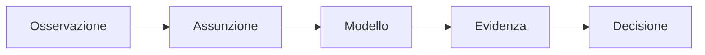

# Caso studio: pensiero filosofico e decisione di business

Questo caso chiude il modulo e fa una cosa precisa: prende i concetti filosofici visti finora e li trasforma in una scelta aziendale concreta. Non serve a citare autori per fare bella figura, ma a usare causalità, falsificabilità, bias e responsabilità per rendere una decisione difendibile davanti a chi dovrà conviverci.

## La stanza dove si decide

In azienda capita spesso questo. Un comitato deve scegliere se tagliare il prezzo, rivedere l'onboarding o aumentare il budget marketing. Ogni reparto arriva con dati plausibili, ma nessuno mette sul tavolo cosa conti come evidenza valida, quali ipotesi siano davvero falsificabili e quali conseguenze restino fuori dal modello. Il caso serve proprio a riconoscere quando un dato sostiene una decisione e quando invece nasconde assunzioni comode, bias o una causalità fragile. L'obiettivo è chiudere con una scelta consapevole, non con un'altra riunione.

## Dalla domanda alla scelta

Una decisione regge quando attraversa per intero un percorso preciso: si parte dall'osservazione, si rende esplicita l'assunzione, si costruisce un modello, si valuta l'evidenza e solo allora si decide. Saltare un passaggio produce analisi fragili, anche quando sembrano eleganti.



Le stesse tappe si possono leggere come domande operative, ciascuna con un esito da fissare prima di andare avanti.

| Passaggio | Domanda guida | Output atteso |
|---|---|---|
| Framing | Quale decisione deve cambiare? | Una scelta concreta, non una curiosità |
| Misura | Quale segnale rappresenta il fenomeno? | Metrica, fonte e granularità |
| Confronto | Rispetto a quale baseline interpreto il risultato? | Benchmark o controfattuale plausibile |
| Azione | Che cosa faccio se il segnale supera la soglia? | Decisione, owner e prossimo controllo |

## Gli elementi del ragionamento

Conviene nominare quattro elementi prima di entrare nel merito, così la discussione non scivola sulle opinioni.

| Elemento | Definizione operativa |
|---|---|
| Unità | Osservazione, ipotesi, variabile, meccanismo causale o criterio di evidenza |
| Segnale | Forza dell'evidenza, coerenza causale, robustezza delle assunzioni, costo dell'errore decisionale |
| Baseline | Spiegazione alternativa, controfattuale, gruppo comparabile o scenario senza intervento |
| Decisione | Accettare, rifiutare o riformulare una spiegazione prima di usarla in azienda |

Una misura vale qualcosa solo se riduce l'incertezza su una decisione specifica. Se non cambia nessuna scelta serve come documentazione, e se cambia una scelta senza controlli introduce rischio.

## Caso pratico: il programma fedeltà di QuickBite

QuickBite ha 3 milioni di utenti attivi in 12 città europee e sta valutando un programma fedeltà per alzare la retention. Le posizioni in stanza sono diverse: il CEO spinge per investire subito, il CFO è scettico, il Product Head chiede test più rigorosi. Il framework filosofico del modulo serve a mediare tra queste spinte senza appiattirle.

Aristotele entra con le quattro cause e costringe a separare il dato grezzo, la distribuzione dell'effetto, il meccanismo causale e l'obiettivo reale dietro la retention. Hume ricorda il problema dell'induzione: un test limitato non garantisce che lo stesso risultato regga su scala più ampia. Popper aggiunge un vincolo netto, e cioè che l'ipotesi vada formulata in modo falsificabile, con test più estesi e controllati. Pearl porta il DAG e aiuta a smascherare confondenti come il novelty effect e la specificità geografica delle prime città. Kuhn, infine, riconosce che CEO, CFO e Product Head ragionano da paradigmi diversi e propone una mediazione pragmatica invece di una vittoria di principio. La raccomandazione che ne esce è investire 5 milioni in un test più ampio, con criteri chiari fissati in anticipo per scalare o abbandonare.

## Provare il metodo su una decisione vera

Per fissare il ragionamento conviene applicarlo a una decisione reale collegata al caso. Descrivi in poche righe obiettivo, metrica primaria, baseline, rischio principale e azione prevista. Poi costruisci una tabella con almeno tre segmenti o scenari, indicando per ciascuno il segnale osservato, una spiegazione alternativa plausibile e il controllo necessario prima di crederci. Chi vuole andare più a fondo può disegnare un piano di validazione completo: ipotesi, dati necessari, criteri di esclusione, soglia decisionale, controllo successivo alla decisione e le condizioni che lo farebbero cambiare idea.

Se mancano dati reali, basta un dataset sintetico con almeno 200 righe e colonne per tempo, segmento, outcome ed esposizione. Sono materiali sufficienti per esercitarsi su case study decisionali, metriche di prodotto, esiti di esperimenti e DAG semplici.

## L'errore che rende il caso inutile

Il rischio è trattare questo caso come una definizione da ricordare invece che come un protocollo da usare. Presentare metriche senza baseline, grafici senza ipotesi o raccomandazioni che ignorano il costo dell'errore porta a decisioni fragili, per quanto ben presentate.

Un controllo utile è domandarsi: se questo risultato fosse falso o instabile, quale decisione sbaglierei? Se la risposta non arriva subito, il metodo è rimasto sulla carta. Le stesse domande funzionano come verifica finale prima di portare una raccomandazione: qual è la decisione concreta da migliorare, quale baseline rende leggibile il risultato, quale assunzione ne cambierebbe la conclusione se fosse sbagliata e quale controllo minimo mettere prima di esporsi.

## Riepilogo operativo

Questo caso collega concetto, dato e decisione in modo operativo. Si parte da un problema reale, si formalizza il segnale, si cerca una baseline credibile, si costruisce un esempio e si chiude con un controllo pratico. È così che la conoscenza diventa competenza capace di guidare scelte sotto incertezza.

## Problema reale

Questo concetto si applica quando lavori con dataset reali e hai bisogno di una struttura chiara per ragionare su Caso studio: pensiero filosofico e decisione di business. Il problema tipico è non avere un framework condiviso tra il team per valutare la soluzione, con il risultato che ogni analisi parte da presupposti diversi.

**Quando lo incontrerai:**
- Quando presenti un risultato e qualcuno chiede "ma come sei arrivato a questo numero?"
- Quando il risultato di una query cambia radicalmente cambiando un filtro
- Quando il modello che hai costruito funziona sui dati di test ma non su quelli di produzione

## Modello concettuale

Il Caso studio: pensiero filosofico e decisione di business si definisce attraverso tre dimensioni:

1. **Struttura**: come sono organizzati i dati o il processo
2. **Logica**: quale relazione causa-effetto governa il comportamento
3. **Misura**: quale metrica usi per valutare il risultato

Questo modello ti permette di scomporre qualsiasi istanza del problema nelle sue parti verificabili.

## Formalizzazione rigorosa

```sql
-- TODO: aggiungi la formalizzazione specifica per Caso studio: pensiero filosofico e decisione di business
-- Pattern per avanzato:

SELECT
    /* indica qui la tua metrica principale */
FROM
    /* indica qui la sorgente dati */
WHERE
    /* indica qui i filtri */
GROUP BY
    /* indica qui le dimensioni di raggruppamento */
```

**Principio guida:** verifica sempre che la somma delle parti sia uguale al totale.

## Esempio o caso studio

**Caso tipico (livello avanzato):**

Immaginiamo un team marketing che deve misurare la retention a 30 giorni. L'errore più comune è calcolarla come `COUNT(DISTINCT user_id)` senza filtrare per data di attivazione, includendo utenti che non hanno ancora avuto 30 giorni di tempo. La versione corretta filtra prima la cohort di attivazione e poi applica il calcolo.

```sql
WITH cohort AS (
    SELECT
        user_id,
        MIN(event_date) AS activation_date
    FROM events
    GROUP BY user_id
),
retention AS (
    SELECT
        c.activation_date,
        COUNT(DISTINCT e.user_id) AS retained_users
    FROM cohort c
    JOIN events e ON c.user_id = e.user_id
        AND e.event_date >= c.activation_date
        AND e.event_date <= c.activation_date + INTERVAL '30 days'
    GROUP BY c.activation_date
)
SELECT
    activation_date,
    retained_users,
    ROUND(retention_rate * 100, 2) AS retention_pct
FROM retention;
```

## Lab / esercizio

**Esercizio — livello avanzato**

1. **Prepara l'ambiente:** carica il dataset di esempio nel tuo warehouse
2. **Applica il pattern:** scrivi la query che implementa il modello concettuale per il tuo caso
3. **Verifica:** controlla che il risultato sia coerente con le tue aspettative usando un sanity check

**Tempo stimato:** 20-30 minuti

## Errore tipico da evitare

**L'errore più comune a livello avanzato:**

Non distinguere tra una metrica calcolata su tutta la popolazione e una metrica calcolata su una sotto-popolazione specifica. Ad esempio, calcolare il tasso di conversione medio senza filtrare per canale di acquisizione porta a decisioni sbagliate perché il mix di canali cambia nel tempo.

**Come evitarlo:**
- Chiediti sempre: "rispetto a cosa sto misurando questo?"
- Verifica che il denominatore sia corretto prima di fidarti del numeratore
- Usa un gruppo di controllo quando possibile

## Quiz o checkpoint

1. Qual è la differenza tra la metrica calcolata su tutta la popolazione e quella calcolata su una cohort?
2. Scrivi il codice SQL che implementa il modello concettuale per un caso a tua scelta
3. Quale sanity check useresti per verificare che il risultato sia corretto?

---

Questa lezione si applica a Modulo 19: Fondamenti Filosofici dell Analisi dei Dati: serve per capire caso studio  pensiero filosofico e decisione di business in modo operativo, non solo teorico. Il problema tipico è affrontare caso studio  pensiero filosofico e decisione di business senza un framework condiviso, con il risultato che ogni analisi parte da zero.

### Livello base

Caso studio  pensiero filosofico e decisione di business è il fondamento di questa competenza. A livello base, ti basta capire la domanda chiave: cosa vuoi misurare, con quali dati, e con quale margine di errore. Non servono formule complesse: serve chiarezza su cosa osservi e perché.

### Livello intermedio

A questo livello applichi caso studio  pensiero filosofico e decisione di business a un caso reale. Prendi un dataset, definisci l'obiettivo, e costruisci il ragionamento passo per passo. Se stai lavorando su modulo 19: fondamenti filosofici dell analisi dei dati, il tuo dataset ha dimensioni specifiche che determinano quali domande puoi porre.

### Livello research-grade

Approfondimento teorico di caso studio  pensiero filosofico e decisione di business: qui entrambi i modelli statistici, le assunzioni sottostanti, e i confini di validità. Questo livello serve quando devi difendere una scelta di fronte a stakeholder che chiedono "perché" — non solo "cosa".

### Dataset e materiali consigliati

- Un dataset reale del tuo dominio (modulo 19: fondamenti filosofici dell analisi dei dati) per esercitarsi
- La documentazione ufficiale dello strumento usato per questa analisi
- Le metriche di riferimento del corso per contestualizzare i risultati

### Livello base

Spiegazione intuitiva di Caso studio: pensiero filosofico e decisione di business:

Il concetto alla base è semplice: invece di fare affidamento sull'intuizione, usi un metodo riproducibile. A livello base, ti basta capire quale domanda stai ponendo e quali dati hai a disposizione per risponderci.

### Livello intermedio

Applicazione concreta di Caso studio: pensiero filosofico e decisione di business:

A questo livello applichi il concetto a un caso specifico. Ad esempio, se stai analizzando la retention, il tuo dataset ha dimensioni come data di attivazione, data di evento, e user_id. La segmentazione per canale di acquisizione ti dà insight aggiuntivi che il dato grezzo non mostra.

### Livello research-grade

Approfondimento teorico:

Per chi vuole capire il fondamento teorico, la letteratura classica include:
- Kimball, "The Data Warehouse Toolkit" — per approcci dimensionali
- McKinney, "Python for Data Analysis" — per implementazione pratica
- Aggiora i riferimenti con paper recenti specifici per il tuo dominio

### Dataset e materiali consigliati

**Per esercitarti:**
- Usa il dataset di esempio fornito nella lezione
- Per un challenge aggiuntivo, prova con dati pubblici come quelli di Kaggle

**Tool consigliati:**
- dbt Core per trasformazioni
- Metabase o Superset per visualizzazione