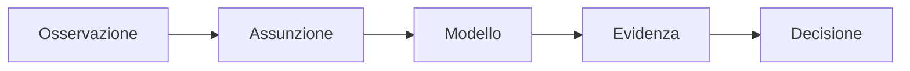

# Caso studio: pensiero filosofico e decisione di business

Questo caso chiude il modulo trasformando i concetti filosofici in una scelta aziendale concreta. L'obiettivo non e citare autori, ma usare causalita, falsificabilita, bias e responsabilita per rendere una decisione difendibile.

## Problema reale

In un contesto aziendale, un comitato deve decidere se tagliare il prezzo, modificare l'onboarding o aumentare il budget marketing. Ogni reparto presenta dati plausibili, ma nessuno chiarisce cosa costituisce evidenza valida, quali ipotesi sono falsificabili e quali conseguenze restano fuori dal modello. Questo caso studio serve a capire quando un dato sostiene davvero una decisione e quando invece nasconde assunzioni, bias o causalità fragile. L'obiettivo è trasformare un dato in una scelta concreta e consapevole, non in una semplice discussione.

## Modello concettuale

Il processo decisionale parte dalla formulazione della domanda, passa per la traduzione in unità osservabili, valuta la qualità del dato e termina con la decisione. Saltare un passaggio produce analisi fragili, anche se eleganti.

| Passaggio | Domanda guida | Output atteso |
|---|---|---|
| Framing | Quale decisione deve cambiare? | Una scelta concreta, non una curiosità |
| Misura | Quale segnale rappresenta il fenomeno? | Metrica, fonte e granularità |
| Confronto | Rispetto a quale baseline interpreto il risultato? | Benchmark o controfattuale plausibile |
| Azione | Che cosa faccio se il segnale supera la soglia? | Decisione, owner e prossimo controllo |

## Formalizzazione rigorosa

Formalizziamo il caso come una relazione tra quattro elementi fondamentali:

| Elemento | Definizione operativa |
|---|---|
| Unità | Osservazione, ipotesi, variabile, meccanismo causale o criterio di evidenza |
| Segnale | Forza dell'evidenza, coerenza causale, robustezza delle assunzioni, costo dell'errore decisionale |
| Baseline | Spiegazione alternativa, controfattuale, gruppo comparabile o scenario senza intervento |
| Decisione | Accettare, rifiutare o riformulare una spiegazione prima di usarla in azienda |

Una misura è utile solo se riduce l'incertezza su una decisione specifica. Se non cambia una scelta, serve documentazione; se cambia una scelta senza controlli, si introduce rischio.

## Esempio o caso studio

QuickBite, con 3 milioni di utenti attivi in 12 città europee, valuta un programma fedeltà per aumentare la retention. Il CEO spinge per l'investimento immediato, il CFO è scettico e il Product Head chiede test più rigorosi.

Applicando il framework filosofico:

- **Aristotele**: analizza le quattro cause (materiale, formale, efficiente, finale) per valutare dati, distribuzione dell'effetto, causalità e obiettivi reali.
- **Hume**: mette in guardia sul problema dell'induzione, ricordando che un test limitato non garantisce risultati su scala più ampia.
- **Popper**: richiede che l'ipotesi sia falsificabile con test più estesi e controllati.
- **Pearl**: usa un DAG per identificare confondenti come novelty effect e specificità geografica.
- **Kuhn**: riconosce i diversi paradigmi dei decisori e propone una mediazione pragmatica.

La raccomandazione è di investire 5 milioni in un test più ampio, con criteri chiari per scalare o abbandonare.

## Lab / esercizio

### Livello base

Scrivi in cinque righe una decisione reale collegata al caso: obiettivo, metrica primaria, baseline, rischio principale e azione prevista.

### Livello intermedio

Costruisci una tabella con almeno tre segmenti o scenari. Per ciascuno indica segnale, possibile spiegazione alternativa e controllo necessario.

### Livello research-grade

Progetta un piano di validazione: ipotesi, dati necessari, criteri di esclusione, soglia decisionale e controllo post-decisione. Specifica cosa ti farebbe cambiare idea.

### Dataset e materiali consigliati

Usa case study decisionali, metriche prodotto, risultati di esperimenti, DAG semplici, report analitici e serie storiche simulate. Se non hai dati reali, crea un dataset sintetico con almeno 200 righe e colonne temporali, segmenti, outcome e variabile di esposizione.

## Errore tipico da evitare

Trattare il caso come una definizione da ricordare anziché come un protocollo decisionale. Presentare metriche senza baseline, grafici senza ipotesi o raccomandazioni senza costo dell'errore porta a decisioni fragili.

Un controllo utile è chiedersi: "Se questo risultato fosse falso o instabile, quale decisione sbaglierei?" Se la risposta non è chiara, la lezione non è stata applicata davvero.

## Quiz o checkpoint

1. Qual è la decisione concreta che questa lezione dovrebbe migliorare?
2. Quale baseline rende interpretabile il risultato?
3. Quale assunzione, se sbagliata, cambierebbe la conclusione?
4. Quale controllo minimo useresti prima di presentare la raccomandazione?

## Riepilogo operativo

Questo caso studio collega concetto, dato e decisione in modo operativo. Studialo partendo da un problema reale, formalizza il segnale, cerca una baseline credibile, costruisci un esempio e chiudi con un controllo pratico. Solo così la conoscenza diventa competenza e guida decisioni sotto incertezza.
