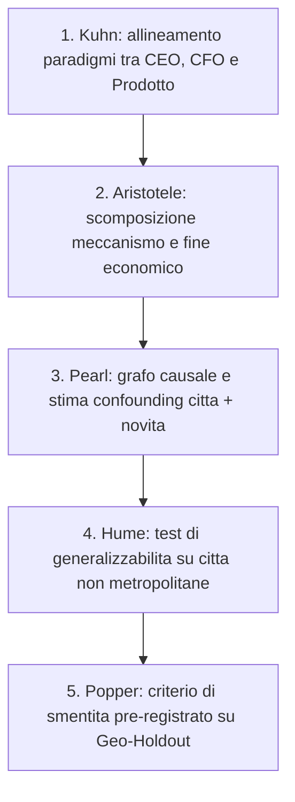

Considera uno scenario costruito con numeri di esempio per mettere alla prova tutte le lenti epistemologiche sviluppate lungo il percorso. La piattaforma di consegna alimentare **QuickBite** conta 3 milioni di utenti attivi in 12 città europee e sta discutendo il lancio di un nuovo programma fedeltà dal budget annuale di **5 milioni di euro** per aumentare la retention a 90 giorni. Sul tavolo c'è un test pilota condotto per 4 settimane a Milano e Amsterdam su 250.000 utenti, che mostra un incremento grezzo della frequenza d'ordine dell'**8,0%**.

In consiglio di amministrazione scoppia lo stallo. Il CEO chiede il lancio immediato in tutte le 12 città per anticipare i concorrenti, sostenendo che i numeri parlano chiaro. Il CFO blocca la firma perché durante le stesse 4 settimane i sussidi promozionali e i costi operativi legati al programma sono cresciuti del **14,0%** sul campione pilota, minacciando di erodere il margine annuale. La responsabile di Prodotto avverte che 4 settimane di pilota sono dominate dall'effetto novità e che Milano e Amsterdam hanno utenti più giovani e abituali rispetto alle altre 10 città. Il tuo ruolo non è schierarti politicamente, ma trasformare questa guerra di opinioni in una decisione razionale e verificabile.

## Cinque lenti filosofiche su un conflitto aziendale

> **Idea chiave:** Quando due dirigenti leggono la stessa tabella di numeri e arrivano a conclusioni opposte, il blocco non si supera con una media politica del budget, ma applicando in sequenza l'analisi delle cause, il controllo del confounding, i limiti dell'induzione, una soglia di falsificazione e un protocollo comune tra reparti.

Spesso i team di analisi trattano la filosofia come un esercizio astratto separato dalle riunioni di bilancio. In realtà, ciascuno dei cinque conflitti che paralizzano il comitato esecutivo di QuickBite corrisponde con precisione chirurgica a un problema filosofico classico.

Attraverso la lente di **Thomas Kuhn** sui paradigmi organizzativi incommensurabili, si comprende subito che CEO, CFO e Prodotto non stanno guardando errori di aritmetica, ma interpretano gli stessi dati dentro tre paradigmi differenti: crescita di quota di mercato, protezione della cassa e costruzione di valore comportamentale nel lungo periodo. Senza un protocollo di traduzione comune sulle metriche di successo e sulle soglie di salvaguardia, discuteranno all'infinito parlando lingue incompatibili.

Applicando la scomposizione delle **quattro cause di Aristotele**, il programma fedeltà smette di essere una scatola nera ("loyalty = +8%") e rivela meccanismi distinti. La causa materiale coincide con i 250.000 utenti esposti a Milano e Amsterdam; la causa formale sta nella regola di accumulo punti e soglie di premio; la causa efficiente è lo stimolo economico o psicologico che spinge l'ordine in più; la causa finale consiste nell'aumentare la retention profittevole a 90 giorni, non semplicemente nel comprare ordini in perdita tramite sussidi.

Le ultime tre lenti completano il quadro decisionale prima ancora di aprire una riga di calcolo. Con **Judea Pearl**, riconosciamo che il +8,0% osservato mescola l'effetto reale del programma con due confondenti evidenti: la composizione geografica di città già ad alta frequenza digitale e l'effetto novità delle prime settimane. Con **David Hume** ricordiamo il problema dell'induzione: proiettare linearmente 4 settimane di due metropoli su 52 settimane in altre 10 città provinciali assume senza prove l'uniformità futura dello spazio e del tempo. Con **Karl Popper**, infine, imponiamo la falsificabilità fissando *prima* dell'estensione su larga scala quali numeri dimostreranno che il programma distrugge valore e obbligheranno alla chiusura immediata.

| Lente filosofica | Domanda diagnostica sul caso QuickBite | Bias o confondente smascherato | Azione concreta per il comitato |
|---|---|---|---|
| Kuhn (Paradigmi) | Quale definizione condivisa di successo unisce crescita, margine e prodotto? | Dialogo tra sordi con KPI incompatibili per ciascuna direzione | Adozione di un'unica metrica netta con guardrail di cassa |
| Aristotele (4 Cause) | Quale componente del programma spinge davvero i nuovi ordini? | Confondere lo sconto pagato col valore duraturo del servizio | Separare ordini stimolati dal sussidio da retention organica |
| Pearl (Confounding) | Quanto del +8,0% dipende dal programma rispetto a città e novità? | Effetto composizione e picco iniziale delle prime 4 settimane | Scomposizione per coorte e controllo tramite città gemelle |
| Hume (Induzione) | Perché il comportamento di Milano/Amsterdam dovrebbe valere nelle altre 10 città? | Generalizzazione indebita da 2 metropoli a tutto il network | Test randomizzato su città eterogenee prima del lancio totale |
| Popper (Falsificabilità) | Quale risultato numerico ci obbliga a fermare il programma senza appelli? | Spostamento continuo del traguardo dopo aver speso il budget | Soglia vincolante di stop fissata prima di lanciare il geo-test |

## Scomposizione causale ed economica del pilota QuickBite

Prima di approvare o bocciare i 5 milioni di euro, il team dati deve tradurre i sospetti filosofici in un'aritmetica trasparente partendo dai numeri osservati sul campione pilota di 250.000 utenti in 4 settimane e confrontandoli con una baseline di città simili non trattate. Confrontando le città pilota con le serie di controllo stagionali emerge prima di tutto che la crescita organica del periodo e l'alta propensione digitale di Milano e Amsterdam spiegano **+2,4 punti percentuali** dell'incremento osservato (confounding geografico-stagionale). Un'ulteriore analisi settimana per settimana mostra inoltre che nelle settimane 1 e 2 gli ordini salgono per curiosità verso il nuovo badge, mentre nelle settimane 3 e 4 si sgonfiano: l'effetto novità transitorio pesa per altri **+2,8 punti percentuali**. Sottraendo entrambe le componenti dal +8,0% grezzo, il guadagno causale strutturale reale si riduce a: 8,0% - 2,4% - 2,8% = **+2,8 punti percentuali**.

Proiettiamo ora questa stima depurata sulla scala completa di QuickBite, che conta 3 milioni di utenti attivi e **12.000.000 di ordini annui** di baseline (4 ordini annui per utente). Ogni ordine genera un margine di contribuzione medio lordo pari a **4,50 euro**, portando il margine base annuo a **54.000.000 euro**. Un incremento causale reale del **+2,8%** sugli ordini aggiunge esattamente 12.000.000 × 0,028 = **336.000 ordini incrementali** all'anno, i quali generano un margine lordo aggiuntivo pari a 336.000 × 4,50 euro = **1.512.000 euro** all'anno.

Sul lato dei costi, tuttavia, il programma fedeltà richiede un budget complessivo di **5.000.000 euro** tra sussidi, premi e infrastruttura. Confrontando ricavi incrementali e costo diretto del programma al lancio cieco su tutta l'azienda otteniamo **1.512.000 euro** di margine aggiuntivo meno **5.000.000 euro** di costo totale, pari a **-3.488.000 euro** di perdita netta nel primo anno. Anche ipotizzando che la retention a lungo termine aumentasse gli ordini incrementali fino a **+4,5%** (12.000.000 × 0,045 = 540.000 ordini aggiuntivi × 4,50 euro = **2.430.000 euro**), il programma a copertura totale resterebbe comunque in perdita di oltre 2,5 milioni di euro rispetto al budget richiesto. Per andare anche solo in pareggio economico sul budget di 5.000.000 euro, il programma avrebbe bisogno di almeno 5.000.000 / 4,50 = **1.111.111 ordini incrementali**, cioè un aumento causale netto pari ad almeno il **+9,26%** stabile su 12 mesi, ben oltre l'8,0% grezzo registrato nelle sole 4 settimane iniziali delle metropoli più ricche.

| Scenario decisionale | Incremento causale ordini | Ordini incrementali annui | Margine aggiuntivo lordo (4,50 €/ordine) | Costo programma | Impatto netto annuo |
|---|---:|---:|---:|---:|---:|
| Lancio globale immediato (stima depurata) | +2,80% | 336.000 | +1.512.000 euro | -5.000.000 euro | -3.488.000 euro |
| Lancio globale ottimistico (effetto retention extra) | +4,50% | 540.000 | +2.430.000 euro | -5.000.000 euro | -2.570.000 euro |
| Soglia minima di pareggio economico (break-even) | +9,26% | 1.111.111 | +5.000.000 euro | -5.000.000 euro | 0 euro |
| Test controllato Geo-Holdout (4 città, 12 settimane) | Da misurare | Campione limitato | Campione limitato | -420.000 euro cap | Perdita max limitata a 420.000 euro |

## Il precedente di Berkeley 1973 e il rischio dell'aggregazione cieca

La lezione più dura per il CEO di QuickBite viene direttamente dal confronto con la storia della statistica applicata, a partire dal celebre studio di Peter Bickel, Eugene Hammel e J. William O'Connell sulle ammissioni a **Berkeley del 1973** (pubblicato su *Science* nel 1975). A livello aggregato sembrava esistere un divario netto (44% di uomini ammessi contro 35% di donne), ma l'analisi per singolo dipartimento ribaltò il verdetto rivelando come la composizione delle domande tra facoltà molto selettive e facoltà meno selettive spiegasse la distorsione.

Nel caso di QuickBite avviene il simmetrico geografico: Milano e Amsterdam rappresentano i "dipartimenti ad alta propensione" di un servizio di delivery urbano, dove gli utenti usano già l'app frequentemente e rispondono con facilità a qualunque stimolo iniziale. Estendere il +8,0% ottenuto in due metropoli alle restanti 10 città europee (che includono centri medi dove gli ordini si concentrano nel fine settimana e i costi logistici per consegna sono più alti) ripete esattamente l'errore di chi legge una media di composizione favorevole come una legge universale di comportamento del consumatore. La combinazione di Berkeley 1973 (confounding di struttura), Hume 1748 (salto induttivo non giustificato) e Popper 1934 (assenza di soglia di falsificazione) dimostra che il consenso in consiglio si costruisce limitando il rischio tramite un esperimento disegnato per smentire, non per confermare.

## Il mandato decisionale per sbloccare l'impasse

Invece di scegliere tra un "sì" cieco da 5 milioni di euro e un "no" definitivo che lascerebbe il CEO convinto di aver perso un'opportunità storica, l'analista propone al comitato esecutivo un protocollo formale che soddisfa i bisogni legittimi di tutte e tre le direzioni dentro un perimetro scientifico rigoroso.

> **Documento di mandato decisionale — Test Geo-Holdout QuickBite:**
> - **Disegno sperimentale (Pearl & Hume):** selezioniamo 4 coppie di città comparabili tra le 10 città restanti; in ogni coppia sorteggiamo 1 città di trattamento e 1 città gemella di controllo (Geo-Holdout), escludendo effetti di spill-over tra quartieri vicini.
> - **Durata e budget protetto (CFO & Prodotto):** l'esperimento dura **12 settimane** (per lasciare estinguere l'effetto novità delle prime 4 settimane) con un tetto massimo invalicabile di spesa pari a **420.000 euro**, riducendo di oltre il 91% l'esposizione rispetto al lancio globale.
> - **Criterio popperiano di successo e arresto (pre-registrato):** il programma viene esteso alle altre città (in versione mirata ai soli segmenti persuadibili) **solo se** nelle settimane 5–12 (al netto dell'effetto novità iniziale) l'incremento causale rispetto alle città di controllo supera il **+6,0%** con margine di contribuzione netto positivo dopo i costi dei sussidi e tasso di disinstallazione invariato (guardrail). Sotto questa soglia, il programma viene chiuso senza appelli o ricalibrato sulla sola fascia a più alta frequenza.

Questo documento trasforma una disputa personale di potere in una scommessa disciplinata. Il CEO ottiene la possibilità reale di provare l'ipotesi di crescita su mercati rappresentativi entro tre mesi; il CFO protegge 4,58 milioni di euro da un rischio cieco di distruzione di cassa; la responsabile di Prodotto ottiene la finestra temporale adeguata per separare la curiosità iniziale dal cambiamento reale di abitudine.

Quando l'analisi dei dati assume questo ruolo di mediazione razionale tra paradigmi aziendali diversi, il professionista smette di essere un semplice fornitore di grafici a posteriori per diventare garante della qualità epistemica della scelta. Ogni euro investito in un disegno sperimentale pulito previene mesi di conflitti politici sterili e restituisce all'organizzazione la capacità di imparare dai propri errori a un costo controllato e sostenibile.

## Tre errori strategici nei casi reali di decisione sui dati

### Cercare un compromesso politico dimezzando il budget senza ipotesi falsificabile

Il sintomo si verifica quando, davanti allo scontro tra CEO e CFO, qualcuno propone "invece di spendere 5 milioni subito, spendiamone 2,5 milioni e vediamo come va". Sembra una soluzione saggia ed equilibrata di buon senso manageriale. In realtà è la peggiore delle opzioni possibili sul piano epistemico: si sprecano 2,5 milioni di euro senza un gruppo di controllo gemello, senza una durata minima per superare l'effetto novità e senza una soglia numerica che stabilisca quando fermarsi, garantendo che dopo sei mesi i due schieramenti continueranno a litigare esattamente sugli stessi dati ambigui. Si evita sostituendo sempre il compromesso sulle cifre di spesa con un compromesso sul **disegno della prova** (campione controllato, budget piccolo vincolato, regola di stop pre-registrata).

### Generalizzare un pilota urbano "amico" all'intera base clienti (fallacia induttiva e Simpson)

Il sintomo nasce dalla prassi aziendale di lanciare i progetti pilota nelle città o nei segmenti più ricettivi ("early adopters" o mercati metropolitani) per mostrare risultati incoraggianti al consiglio, e poi usare proprio quel tasso di crescita come input del business plan nazionale o globale. Sembra pratico perché testa la tecnologia dove è più facile integrarla. Tuttavia, poiché il segmento pilota è sia più reattivo sia strutturalmente diverso dal resto del mercato, proiettarne i tassi moltiplica gli errori di scala e inverte la redditività economica al momento dell'espansione. Si previene imponendo nel calcolo del business case la stratificazione per classi di città o coorti e includendo sempre mercati rappresentativi della media reale nei test di validazione.

### Cambiare le regole di successo a test avviato per salvare il lancio

Il sintomo si manifesta intorno alla sesta o ottava settimana del test di controllo, quando i numeri della metrica principale risultano deludenti ma il team promotore scopre un miglioramento secondario (ad esempio "aumenta il tempo speso sull'app" o "crescono gli ordini in una sola fascia oraria") e chiede di cambiare il criterio di promozione del programma. Sembra flessibilità agile orientata alla scoperta di opportunità inattese. In realtà distrugge la falsificabilità popperiana dell'esperimento e introduce bias di selezione multipla sulle metriche. Si evita trattando qualsiasi segnale secondario emerso durante il test come materia per una **nuova** ipotesi da testare separatamente, mantenendo intatta la decisione di arresto sul programma originale se i criteri primari non sono stati soddisfatti.

## Verifica finale sul caso QuickBite

1. Perché il dato del +8,0% emerso nelle 4 settimane del pilota tra Milano e Amsterdam non giustifica da solo né il sì immediato del CEO né l'accusa di manipolazione dei numeri?

Mostra risposta

Il +8,0% è un risultato numericamente autentico ma causalmente grezzo: mescola insieme un eventuale effetto reale del programma fedeltà, la crescita stagionale e la maggiore reattività strutturale di due grandi città metropolitane (+2,4 pp), e l'effetto novità temporaneo delle prime settimane (+2,8 pp). Depurando queste due componenti il guadagno strutturale stimato scende al +2,8%, ben al di sotto del +9,26% necessario a ripagare il budget di 5 milioni di euro.

2. Qual è il contributo specifico della lente di Thomas Kuhn rispetto a quella di Judea Pearl nella risoluzione dello stallo tra CEO, CFO e Prodotto?

Mostra risposta

Pearl fornisce lo strumento tecnico-causale per isolare il confounding geografico e l'effetto novità tramite gruppi di controllo e scomposizione dei fattori. Kuhn spiega invece perché la sola evidenza di un reparto non convinca gli altri due: ogni direzione opera dentro un paradigma valutativo diverso (crescita, cassa, abitudine d'uso). Serve quindi un contratto decisionale condiviso a monte che traduca i tre obiettivi in un'unica regola di promozione composta da metrica netta economica e metriche guardrail.

3. Nel calcolo economico mostrato per QuickBite, qual è il valore minimo di incremento causale degli ordini necessario a raggiungere il pareggio sul budget di 5 milioni di euro (con margine per ordine di 4,50 euro su 12 milioni di ordini base) e come cambia l'esposizione al rischio con il Geo-Holdout?

Mostra risposta

Per generare 5.000.000 euro di margine lordo aggiuntivo a 4,50 euro per ordine servono almeno 1.111.111 ordini incrementali, pari a un aumento causale stabile del +9,26% sull'intera base di 12 milioni di ordini annui. Passando dal lancio globale cieco al test controllato Geo-Holdout su 4 coppie di città per 12 settimane con cap a 420.000 euro, la perdita massima possibile scende da oltre 3,4 milioni di euro a 420.000 euro, mantenendo intatta la capacità di imparare in condizioni reali eterogenee.

4. Se alla dodicesima settimana del test Geo-Holdout l'incremento causale netto nelle settimane 5–12 risultasse pari al +3,2% (sotto la soglia pre-registrata del +6,0%), ma emergesse che gli ordini di dolci il giovedì sera sono cresciuti del +14%, quale decisione rispetta il metodo scientifico di Popper?

Mostra risposta

Il programma fedeltà globale va chiuso o sospeso come previsto dalla regola pre-registrata di smentita, perché non ha raggiunto la soglia minima necessaria alla sostenibilità economica (+6,0% al netto dell'effetto novità). L'anomalia del +14% sui dolci il giovedì sera non va usata per salvare retroattivamente il programma da 5 milioni di euro, ma può essere annotata come nuova ipotesi esplorativa da verificare con un piccolo test mirato e separato sul solo segmento interessato.

