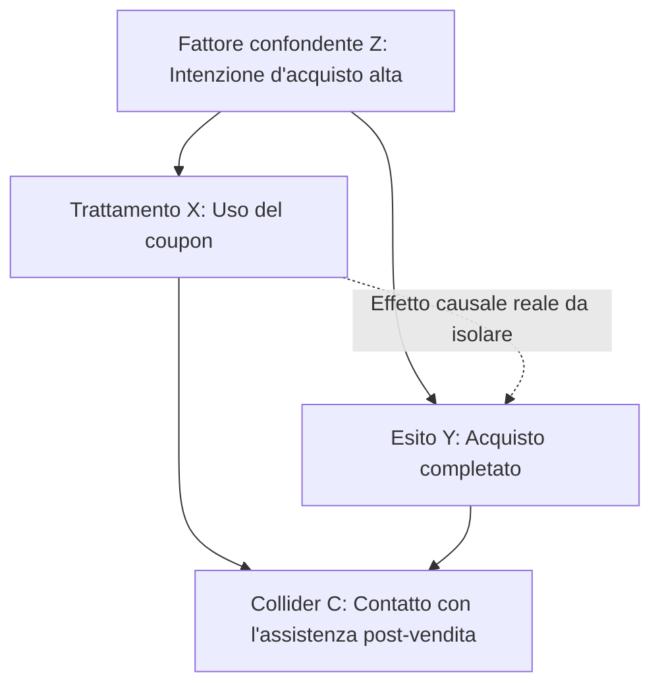

Sul binario tabellare quasi tutte le query SQL e i modelli di machine learning operano benissimo su un solo mestiere: stimare probabilità condizionate a partire da associazioni storiche. Quando però il management guarda una tabella o un grafico, la domanda reale quasi non riguarda mai il passato osservato, bensì una modifica del futuro: se aumentiamo il prezzo del 10%, se inviamo questo sconto, se blocchiamo quella funzionalità, cosa accadrà ai ricavi.

Tra prevedere chi comprerà e capire cosa fa vendere di più esiste un salto logico profondo. La correlazione descrive cosa tende a presentarsi insieme mentre nessuno tocca il sistema; la causalità descrive come reagisce il sistema quando introduci un intervento deliberato. Confondere i due piani porta a finanziare campagne che premiano clienti già convinti, a tagliare servizi essenziali o ad attribuire a un aggiornamento grafico ciò che è dipeso soltanto dalla stagione.

## Perché chi usa lo sconto avrebbe comprato anche a prezzo pieno

Partiamo da un caso ricostruito su numeri di esempio tipici del commercio elettronico. Un team di crescita invia via email un buono sconto del 15% a tutti gli utenti che hanno visitato almeno tre schede prodotto negli ultimi sette giorni. A fine settimana, i report mostrano che tra i destinatari che hanno aperto l'email e applicato il coupon il tasso di acquisto raggiunge il 24%, contro appena il 7% registrato tra gli utenti che non hanno aperto il messaggio. Entusiasta per uno scarto di diciassette punti percentuali, il responsabile propone di triplicare il budget promozionale.

Un controllo più attento rivela però il meccanismo nascosto. L'intenzione d'acquisto preesistente agisce da causa comune: i clienti già decisi a comprare cercano attivamente conferme, aprono le email del marchio, trovano il codice promozionale e lo applicano al carrello risparmiando su un ordine che avrebbero comunque concluso a prezzo pieno. Chi invece stava soltanto curiosando ignora l'email e non acquista. La correlazione tra apertura dello sconto e conversione è fortissima, ma la leva causale è quasi nulla e sta bruciando margine.

> **Idea chiave:** La causalità non emerge dalla forza della correlazione nei dati osservati, ma dalla differenza tra ciò che accade quando intervieni sul sistema e ciò che sarebbe accaduto nello scenario controfattuale in cui lo stesso soggetto non avesse ricevuto l'intervento.

Accettare questa definizione obbliga a cambiare l'architettura stessa delle nostre analisi: prima di calcolare una regressione o una differenza tra medie, devi disegnare il grafo delle relazioni che possono aver generato i dati.

## La scala della causalità e la logica del controfattuale

Per mettere ordine tra statistica descrittiva e inferenza causale conviene usare i due riferimenti teorici oggi dominanti: i risultati potenziali di Donald Rubin e Paul Holland e la scala della causalità formulata da Judea Pearl. Nel modello dei risultati potenziali, ogni unità osservata possiede due esiti possibili: `Y(1)`, l'esito che si osserverebbe se ricevesse il trattamento, e `Y(0)`, l'esito che si osserverebbe se non lo ricevesse. Poiché nello stesso istante un cliente può solo ricevere oppure non ricevere il trattamento, non possiamo mai osservare entrambi i valori sullo stesso individuo. È quello che Holland definì nel 1986 il problema fondamentale dell'inferenza causale.

Judea Pearl ha espresso questa gerarchia attraverso tre gradini distinti di conoscenza. Al primo gradino sta l'**associazione** (osservare): calcoli come cambia la probabilità di vendita sapendo che un utente ha visualizzato una pagina. Al secondo gradino sta l'**intervento** (agire): stimi cosa accade alla probabilità di vendita se costringi l'intero sistema ad assegnare lo sconto o a rimuoverlo, passando dalla distribuzione osservata `P(Y | X)` alla distribuzione interventistica `P(Y | do(X))`. Al terzo gradino sta il **controfattuale** (immaginare a posteriori): dato che un cliente ha ricevuto lo sconto e ha acquistato, cosa sarebbe successo se quello stesso cliente, con tutta la sua storia specifica, non avesse ricevuto lo sconto.

Leggere il diagramma causale (DAG) protegge da errori che nessuna formula statistica individua da sola. Una freccia che esce da un nodo comune `Z` verso `X` e `Y` crea una correlazione spuria che va bloccata stratificando o randomizzando. Una freccia che entra da `X` e da `Y` nello stesso nodo `C` crea invece un **collider**: condizionare l'analisi su `C` (ad esempio analizzando solo i clienti che hanno scritto al supporto) apre un percorso distorto e inventa una correlazione fittizia anche dove `X` e `Y` sono indipendenti.

| Livello / Disegno di studio | Domanda a cui risponde | Come affronta i confondenti | Limite principale nel lavoro pratico |
|---|---|---|---|
| Esperimento randomizzato (RCT / A/B test) | Qual è l'effetto medio di assegnare X invece del controllo? | L'assegnazione casuale rompe il legame tra Z e X | Costoso, talvolta lento o impraticabile per ragioni etiche |
| Differenze-nelle-differenze (DiD) | Quanto è cambiato il gruppo trattato oltre il trend parallelo? | Elimina differenze fisse nel tempo tra i due gruppi | Richiede l'ipotesi di trend paralleli prima dell'intervento |
| Stratificazione / Propensity score | Qual è l'effetto a parità di caratteristiche osservate? | Bilancia i due gruppi sui soli fattori misurati in tabella | Resta vulnerabile a qualunque confondente non misurato |
| Variabile strumentale (IV) | Qual è l'effetto indotto da una variazione esogena esterna? | Isola una spinta casuale verso X priva di legami diretti con Y | Difficile trovare strumenti davvero validi e interpretabili sul locale |

## Quantificare l'errore di selezione rispetto a un gruppo holdout

Vediamo con numeri concreti quanto può costare la confusione tra confronto osservazionale e stima causale. Immagina una campagna promozionale che coinvolge complessivamente 10.000 clienti eleggibili. Per misurare in modo serio l'impatto economico dello sconto, l'analista imposta un esperimento controllato semplice: assegna in modo casuale 8.000 clienti al gruppo trattato (che riceve il coupon da € 12 per ordine) e lascia 2.000 clienti in un gruppo holdout di controllo che non riceve alcun incentivo.

Nel gruppo trattato di 8.000 utenti, 2.400 aprono l'email e utilizzano effettivamente il coupon, generando 600 ordini (tasso di conversione del 25,0%), mentre i restanti 5.600 non usano il coupon e generano 448 ordini (tasso di conversione dell'8,0%). Se un analista confronta in modo ingenuo questi due sottogruppi interni al gruppo trattato, registra una differenza di 25,0% - 8,0% = 17,0 punti percentuali (`+17 pp`) e conclude che il coupon quasi triplica gli acquisti.

Passiamo ora al confronto causale corretto, valutando l'intero gruppo trattato contro l'intero gruppo holdout (principio *intention-to-treat*, che evita il bias di autoselezione di chi apre l'email). Sul totale degli 8.000 clienti trattati, gli ordini complessivi sono 600 + 448 = 1.048 ordini, pari a un tasso di conversione del 1.048 / 8.000 = 13,1%. Nel gruppo holdout di 2.000 clienti non esposti al buono sconto si registrano comunque 232 ordini spontanei a prezzo pieno, corrispondenti a un tasso base di 232 / 2.000 = 11,6%.

L'effetto causale medio reale dell'invio della campagna è dunque 13,1% - 11,6% = 1,5 punti percentuali (`+1,5 pp`), non 17 punti. Applicato agli 8.000 destinatari trattati, questo incremento reale genera 8.000 × 0,015 = 120 ordini incrementali effettivi rispetto a quanto sarebbe accaduto senza promozione. Considerando un margine lordo unitario prima dello sconto pari a € 40 per ordine, i 120 ordini incrementali producono 120 × € 40 = € 4.800 di margine lordo aggiuntivo. Tuttavia il buono sconto da € 12 è stato riscattato su tutti i 600 ordini del gruppo che ha usato il codice, comportando un costo diretto di 600 × € 12 = € 7.200. Il risultato economico netto dell'intervento è quindi € 4.800 - € 7.200 = -€ 2.400 di perdita secca: la campagna sta regalando sconti a 480 ordini che si sarebbero chiusi comunque a margine pieno.

## Da Broad Street agli esperimenti naturali

Molto prima dell'avvento dei database distribuiti, la riflessione filosofica ed epidemiologica aveva già individuato sia il limite dell'osservazione passiva sia il potere dei confronti quasi-sperimentali. Nel 1748 David Hume distinse con lucidità la congiunzione costante tra due eventi dalla necessità causale: il fatto che un fenomeno preceda e accompagni regolarmente un altro non dimostra quale dei due produca il cambiamento, né esclude una causa nascosta che governa entrambi.

La dimostrazione empirica più famosa di come si possa isolare una causa nel mondo reale senza disporre di un laboratorio risale al 1854 a Londra, durante un'epidemia di colera nel quartiere di Soho. La teoria medica dominante attribuiva il contagio ai miasmi dell'aria cattiva. Il medico John Snow mappò geograficamente i decessi attorno a Broad Street e notò una concentrazione intorno a una specifica pompa dell'acqua, ma il vero salto metodologico arrivò confrontando due compagnie idriche, la Southwark and Vauxhall e la Lambeth, che servivano spesso case sullo stesso isolato. Nel 1852 la compagnia Lambeth aveva spostato il punto di prelievo a monte degli scarichi fognari lungo il Tamigi, mentre l'altra continuava a prelevare acqua contaminata. Per famiglie con identico reddito, esposizione all'aria e abitudini di quartiere, la compagnia idrica assegnata alle condutture domestiche funzionò come un esperimento naturale quasi casuale: la mortalità nelle case servite dall'acqua a valle risultò oltre otto volte superiore, fornendo un'evidenza causale schiacciante molto prima dell'isolamento del batterio in laboratorio.

Lo stesso principio guida oggi gli esperimenti naturali e le analisi di differenza-nelle-differenze nei dati aziendali: quando un'interruzione tecnica, un cambio normativo regionale o un rilascio graduale per aree geografiche espone gruppi simili a condizioni diverse per motivi estranei alla loro volontà, i dati osservazionali si avvicinano alla qualità inferenziale di un test controllato.

## Protocollo operativo per valutare una pretesa causale in azienda

Ogni volta che un collega o un documento strategico afferma che una certa azione ha prodotto un risultato, è opportuno sottoporre la tesi a un protocollo rapido prima di allocare risorse economiche. Il metodo segue cinque verifiche consecutive:

1. Traduci l'affermazione verbale in un confronto controfattuale esplicito: chi sono i soggetti trattati e quale gruppo rappresenta ciò che sarebbe accaduto loro in assenza dell'intervento.
2. Disegna il diagramma causale delle cinque variabili più rilevanti del processo, segnalando possibili cause comuni non osservate come intenzione, stagionalità o capacità di spesa.
3. Controlla se l'intervento analizzato sia stato assegnato dal sistema o scelto dagli utenti stessi: l'autoselezione rende quasi sempre inutilizzabile il confronto diretto tra chi usa e chi non usa una funzione.
4. Calcola sempre i risultati sull'intero gruppo a cui l'opzione è stata offerta e confronta il margine incrementale con il costo completo sostenuto anche sui clienti che avrebbero agito comunque.
5. Verifica almeno una previsione negativa di controllo (placebo test), accertandoti che il modello o il gruppo trattato non mostri vantaggi già prima che l'intervento abbia avuto inizio.

Prima di chiudere il rapporto di valutazione, riassumi le conclusioni in un riquadro sintetico di prova causale come questo.

> **Scheda di verifica causale — Campagna sconto carrello Q2**
> **Domanda decisionale:** l'invio del buono del 15% genera margine incrementale positivo al netto della cannibalizzazione sugli ordini spontanei?
> **Identificazione usata:** confronto randomizzato tra 8.000 utenti esposti e 2.000 utenti in holdout su base *intention-to-treat*.
> **Principali minacce residue:** possibile contaminazione se utenti holdout condividono codici coupon pubblici su browser o forum esterni.
> **Verdetto operativo:** sospendere l'invio indiscriminato (perdita netta -€ 2.400) e limitare eventuali test futuri ai soli utenti con bassa probabilità di acquisto spontaneo.

## Tre errori strutturali che distruggono l'inferenza causale

Nel lavoro quotidiano sui modelli tabellari l'istinto del machine learning predittivo — inserire tutte le colonne disponibili per massimizzare la bontà di adattamento — diventa controproducente quando la domanda è causale. Esistono tre trappole che trasformano una stima plausibile in un errore di segno o di scala.

### Condizionare su un collider e generare correlazioni fantasma

Il sintomo si manifesta quando un'analisi filtra o controlla per una variabile che è conseguenza comune sia della causa studiata sia dell'esito finale. Questo gesto sembra virtuoso perché segue la regola generica di tenere costanti tutte le variabili correlate nel dataset. In realtà, come accade nel paradosso di Berkson osservato in ambito ospedaliero, bloccare un effetto comune mette artificialmente in relazione le sue cause: se analizzi soltanto i clienti che hanno aperto un reclamo o soltanto i progetti finanziati, puoi vedere emergere una correlazione negativa fittizia tra qualità del prodotto e fidelizzazione. Si evita disegnando le frecce temporali prima di filtrare o includere covariate: tutto ciò che accade dopo trattamento ed esito non deve mai entrare tra le variabili di controllo.

### Controllare per un mediatore cancellando l'effetto reale

L'errore opposto accade quando, per stimare l'effetto totale di un cambiamento, aggiungi nella regressione una variabile intermedia che trasmette l'azione dalla causa all'esito. Sembra rigoroso voler spiegare ogni passaggio del modello inserendo più dati possibili sul cliente dopo l'intervento. Ma se vuoi misurare quanto una migliore pagina di prodotto aumenta gli acquisti e inserisci tra i controlli il numero di clic sul pulsante "aggiungi al carrello", assorbi proprio il meccanismo attraverso cui la pagina agisce, facendo crollare il coefficiente stimato della variabile principale quasi a zero. Per prevenirlo, separa sempre i confondenti pre-trattamento dai mediatori post-trattamento e controlla solo sui primi quando cerchi l'effetto totale.

### Confondere l'effetto medio con la risposta eterogenea dei segmenti

Un terzo sbaglio frequente consiste nel bloccare o scalare un'iniziativa guardando soltanto la media aggregata su tutta la base utenti. Appare razionale riassumere un esperimento con un unico numero chiaro per il comitato esecutivo. Eppure un intervento con effetto medio nullo o leggermente negativo può generare forte valore positivo su un segmento specifico (ad esempio nuovi utenti indecisi) mentre distrugge margine su un altro segmento (clienti abituali che acquistano comunque). Prima di archiviare o generalizzare un risultato sperimentale, verifica l'eterogeneità dell'effetto almeno lungo due o tre segmenti strategici predefiniti prima del lancio, evitando però la ricerca retrospettiva di sottogruppi casuali a esperimento concluso.

## Verifica causale sulle tue analisi prima di allocare budget

Metti alla prova la tua capacità di separare associazione e causalità rispondendo a queste quattro domande operative.

1. Perché confrontare le vendite tra chi ha applicato un buono sconto e chi ha ignorato l'email promozionale non misura l'effetto causale dello sconto?

Mostra risposta

Chi apre l'email e riscatta il codice sconto presenta già un'intenzione d'acquisto molto più alta della media. Questo fattore confondente non osservato spinge sia l'uso del coupon sia l'acquisto finale, gonfiando artificialmente la differenza osservata rispetto a quanto accadrebbe assegnando lo sconto in modo casuale.

2. Che differenza passa tra condizionare su un confondente e condizionare su un collider all'interno di un modello osservazionale?

Mostra risposta

Un confondente è una causa comune che precede sia il trattamento sia l'esito; controllarlo chiude un percorso spurio e riduce il bias. Un collider è invece un effetto comune causato sia dal trattamento sia dall'esito; includerlo nei controlli o filtrare il dataset su di esso apre una correlazione artificiale che prima non esisteva.

3. Nel calcolo dell'esempio promozionale con gruppo holdout, perché la campagna chiude in perdita pur aumentando gli acquisti totali di 120 unità?

Mostra risposta

Perché la valutazione causale *intention-to-treat* mostra che soltanto 120 dei 600 ordini scontati sono davvero incrementali (€ 4.800 di margine nuovo), mentre i restanti 480 ordini si sarebbero realizzati anche senza promozione; pagare € 12 di sconto su tutti i 600 ordini costa € 7.200, producendo una perdita netta di € 2.400.

4. Perché non devi inserire un mediatore post-trattamento tra le variabili di controllo quando vuoi stimare l'effetto totale di un intervento di prodotto?

Mostra risposta

Il mediatore è il canale intermedio attraverso cui l'intervento produce il suo risultato sull'esito finale. Tenerlo fisso statisticamente blocca proprio la trasmissione dell'effetto che stai cercando di misurare, sottostimando gravemente l'impatto reale dell'intervento principale.

