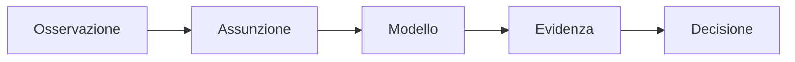

# Correlazione, causalità e controfattuali

La campagna coincide con un aumento delle conversioni e il team vorrebbe dichiarare vittoria. Il problema è che nello stesso periodo sono cambiati prezzo, traffico organico e composizione degli utenti. **Correlazione, causalità e controfattuali** parte da qui: per dire "ha causato" devi chiederti che cosa sarebbe successo senza l'intervento.

## Una scena da cui partire

Leggi questa lezione come una protezione contro conclusioni troppo comode. Correlazione, confronto e controfattuale sono tre livelli diversi: confonderli rende la storia più semplice, ma anche più rischiosa.

- **Contesto:** Quale evento alternativo potrebbe spiegare lo stesso risultato?
- **Metodo:** Quale confronto rende credibile il controfattuale?
- **Applicazione:** Quando diresti "associato a" invece di "causato da"?

## Le condizioni per la causalità

La filosofia della scienza e la statistica hanno convergito su tre condizioni necessarie (anche se non sempre sufficienti) per stabilire causalità:

### 1. Temporalità
**La causa deve precedere l'effetto.** Ovvio, ma spesso violato. Un analyst nota che i clienti che hanno un alto NPS hanno anche alto LTV. Questo NON significa che aumentare NPS aumenti LTV. Potrebbe essere il contrario: clienti con alto LTV (perché il prodotto li serve bene) danno NPS alto. O potrebbe esserci un terzo fattore (qualità del prodotto) che causa entrambi. La temporalità richiede di stabilire *cosa viene prima*.

### 2. Associazione empirica
**Deve esistere una correlazione statisticamente rilevabile tra causa ed effetto.** Se non c'è associazione, non può esserci causalità. Ma come abbiamo visto con Simpson's paradox, l'associazione può essere visibile o invisibile a seconda di come aggreghi i dati.

### 3. Assenza di confondenti (o controllo degli stessi)
**Non devono esistere variabili che causano sia X che Y e che spiegano la loro correlazione.** Questo è il punto più difficile. Non puoi mai dimostrare l'assenza di TUTTI i confondenti — puoi solo controllare quelli che conosci. E quelli che non conosci restano una minaccia.

La combinazione di queste tre condizioni definisce il "gold standard": l'esperimento randomizzato controllato (RCT). L'RCT soddisfa la temporalità (tu decidi quando applicare il trattamento), garantisce l'associazione (misuri l'effetto medio), e elimina i confondenti (la randomizzazione li bilancia tra i gruppi).

## Il framework controfattuale di Rubin

Donald Rubin (1974) ha formulato il problema causale in modo elegantemente semplice: il **modello dei risultati potenziali**.

Per ogni unità (es. cliente), esistono DUE risultati potenziali:
- Y(1): cosa succederebbe se ricevesse il trattamento
- Y(0): cosa succederebbe se NON ricevesse il trattamento

L'effetto causale individuale è Y(1) - Y(0). Il problema fondamentale dell'inferenza causale: **non puoi mai osservare entrambi per la stessa unità.** O ricevi il trattamento, o non lo ricevi. Il controfattuale è inosservabile per definizione.

Tutta l'inferenza causale è un tentativo di stimare l'effetto medio (ATE: Average Treatment Effect) senza poter misurare i controfattuali individuali:

Nel framework controfattuale di Rubin, l'effetto medio del trattamento si legge cosi: **ATE = E[Y(1) - Y(0)]**.

La parte difficile non è la formula, ma il fatto che per ogni unità osserviamo solo uno dei due mondi possibili: trattato o non trattato. Tutto il design causale serve a rendere credibile il confronto con il mondo mancante.

Con un esperimento randomizzato, la randomizzazione garantisce che il gruppo di controllo sia un buon proxy del controfattuale: E[Y(0) | T=1] ≈ E[Y(0) | T=0].

## Caso reale: l'effetto delle notifiche push

Un'app mobile vuole sapere se le notifiche push aumentano la retention. Domanda causale: "Se mando una notifica, l'utente torna più spesso di quanto tornerebbe senza notifica?"

- Y(1) = retention se riceve notifica
- Y(0) = retention se NON riceve notifica

Problema: non puoi mandare E non mandare la notifica allo stesso utente nello stesso momento.

Un A/B test risolve: metà utenti ricevono notifiche, metà no. Dopo 30 giorni, retention gruppo notifiche = 42%. Retention gruppo no-notifiche = 38%. ATE stimato = +4%.

Ma attenzione: questo è l'effetto *medio*. Magari per power user le notifiche sono fastidiose e riducono la retention, mentre per utenti dormienti la aumentano. L'effetto medio nasconde eterogeneità. Pearl (Causality, 2000) direbbe: hai stimato P(Y|do(X)), ma non hai un modello causale completo che spieghi *perché* l'effetto è +4%. Senza il modello, non sai prevedere cosa succede se cambi il tipo di notifica, la frequenza, o il target.

## Come applicare il controfattuale alle tue analisi

1. **Per ogni insight "X è correlato a Y", chiediti:** se potessi manipolare X sperimentalmente, Y cambierebbe? Qual è il controfattuale che non sto vedendo?

2. **Quando presenti un effetto, specifica:** è un effetto medio? Qual è l'eterogeneità? Chi beneficia e chi no?

3. **Disegna i due mondi paralleli:** nel mondo A, faccio X. Nel mondo B, non faccio X. La differenza tra i due mondi è l'effetto causale. Se non riesci a immaginare il mondo B con dati alla mano, stai facendo associazione, non causalità.

---

*Riferimenti:*
- Rubin, D.B. (1974). "Estimating Causal Effects of Treatments." *Journal of Educational Psychology*, 66(5).
- Hernán, M.A. & Robins, J.M. (2020). *Causal Inference: What If.* Chapman & Hall.
- Pearl, J. (2000). *Causality.* Cambridge University Press.

## Controllo di qualità

Prima di usare correlazione, causalità e controfattuali in una decisione, controlla sempre completezza, duplicati, timezone, definizioni cambiate e segmenti esclusi. Molte analisi apparentemente sofisticate falliscono perché il dato di partenza misura un comportamento diverso da quello che il team crede di osservare.

## Interpretazione per segmenti

La media aggregata è solo il punto di partenza. Segmenta per canale, coorte, piano, paese, device e maturità dell'utente. Se due segmenti si muovono in direzioni opposte, la media non rappresenta nessuno dei due e può portare a una decisione sbagliata.

## Decisione operativa

Ogni analisi deve terminare con una scelta possibile: continuare, fermare, iterare, investire, rimuovere o approfondire. Se correlazione, causalità e controfattuali non cambia una decisione, probabilmente manca ancora il collegamento tra metrica e azione.

## Problema reale

Nel lavoro su fondamenti filosofici dell'analisi dati, **Correlazione, causalità e controfattuali** serve a risolvere un problema concreto: capire quando un dato sostiene davvero una decisione e quando invece nasconde assunzioni, bias, causalità fragile o una domanda formulata male. La domanda non è se il concetto sia interessante in astratto, ma quale decisione migliora quando lo applichi con dati affidabili e con una soglia di errore esplicita.

Questa lezione va studiata come uno strumento operativo: entro la fine devi saper Comprendere il problema analitico e il contesto decisionale; Applicare esempi, metriche e controlli a casi reali. Se non riesci a collegare il concetto a una scelta reale, la conoscenza resta decorativa e non diventa competenza.

## Modello concettuale

Il modello mentale e sequenziale: prima si formula la domanda, poi si traduce in unità osservabili, quindi si valuta la qualità del dato e solo alla fine si decide. Saltare un passaggio produce analisi eleganti ma fragili.

| Passaggio | Domanda guida | Output atteso |
|---|---|---|
| Framing | Quale decisione deve cambiare? | Una scelta concreta, non una curiosità |
| Misura | Quale segnale rappresenta il fenomeno? | Metrica, fonte e granularità |
| Confronto | Rispetto a quale baseline interpreto il risultato? | Benchmark o controfattuale plausibile |
| Azione | Che cosa faccio se il segnale supera la soglia? | Decisione, owner e prossimo controllo |

## Formalizzazione rigorosa

Formalizza **Correlazione, causalità e controfattuali** come una relazione tra quattro elementi: unità di analisi, segnale, baseline e decisione. Nel contesto di questa lezione l'unità principale e **osservazione, ipotesi, variabile, meccanismo causale o criterio di evidenza**. Il segnale da osservare deve essere collegato a **forza dell evidenza, coerenza causale, robustezza delle assunzioni e costo dell errore decisionale**, mentre la baseline deve essere scelta tra **spiegazione alternativa, controfattuale, gruppo comparabile o scenario senza intervento**.

Una formulazione robusta segue questa logica:

| Elemento | Definizione operativa per questa lezione |
|---|---|
| Unità | osservazione, ipotesi, variabile, meccanismo causale o criterio di evidenza |
| Segnale | forza dell evidenza, coerenza causale, robustezza delle assunzioni e costo dell errore decisionale |
| Baseline | spiegazione alternativa, controfattuale, gruppo comparabile o scenario senza intervento |
| Decisione | accettare, rifiutare o riformulare una spiegazione prima di usarla in un contesto aziendale |
| Rischio | Confondere correlazione, qualità del dato e causalità decisionale |

La regola pratica e semplice: una misura e utile solo se riduce l'incertezza su una decisione specifica. Se non cambia una scelta, e documentazione; se cambia una scelta senza controlli, e rischio.

## Esempio o caso studio

Un comitato interpreta una crescita di retention come prova che una nuova iniziativa abbia funzionato. La lezione costringe a distinguere osservazione, spiegazione, assunzione e decisione prima di trasformare il dato in azione.

Applicando **Correlazione, causalità e controfattuali**, il team costruisce una lettura in tre colonne: cosa sappiamo, cosa assumiamo e quale decisione prendiamo. Questo formato impedisce di presentare un numero come se fosse una conclusione autosufficiente.

| Evidenza | Interpretazione prudente | Decisione conseguente |
|---|---|---|
| Segnale positivo ma non isolato | Il fenomeno esiste, ma la causa e ancora incerta | Cercare baseline o holdout |
| Segmento con risposta diversa | L'effetto medio nasconde eterogeneita | Analizzare coorti o sottogruppi |
| Costo operativo crescente | Il risultato va valutato sul margine | Applicare soglie economiche |

## Lab / esercizio

### Livello base

Prendi una decisione reale collegata a **Correlazione, causalità e controfattuali** e scrivi in cinque righe: obiettivo, metrica primaria, baseline, rischio principale e azione prevista. Non usare più di una metrica primaria.

### Livello intermedio

Costruisci una tabella con almeno tre segmenti o scenari. Per ciascuno indica segnale, possibile spiegazione alternativa e controllo necessario prima di decidere.

### Livello research-grade

Disegna un piano di validazione: ipotesi, dati necessari, criterio di esclusione, soglia decisionale e controllo post-decisione. Specifica anche che cosa ti farebbe cambiare idea.

### Dataset e materiali consigliati

Usa case study decisionali, metriche prodotto, risultati di esperimenti, DAG semplici, report analitici e serie storiche simulate. Se non hai dati reali, crea un dataset sintetico con 200-500 righe e almeno una colonna temporale, una colonna segmento, una metrica di outcome e una variabile di esposizione.

## Errore tipico da evitare

L'errore più frequente e trattare **Correlazione, causalità e controfattuali** come una definizione da ricordare invece che come un protocollo decisionale. In pratica succede quando si presenta una metrica senza baseline, un grafico senza ipotesi, o una raccomandazione senza costo dell'errore.

Un controllo utile è chiedersi: "se questo risultato fosse falso o instabile, quale decisione sbaglierei?". Se la risposta non è chiara, la lezione non è ancora stata applicata davvero.

## Quiz o checkpoint

1. Qual è la decisione concreta che questa lezione dovrebbe migliorare?
2. Quale baseline rende interpretabile il risultato?
3. Quale assunzione, se sbagliata, cambierebbe la conclusione?
4. Quale controllo minimo useresti prima di presentare la raccomandazione?

## Riepilogo operativo

**Correlazione, causalità e controfattuali** e una competenza utile quando collega concetto, dato e decisione. Studiala partendo da un problema reale, formalizza il segnale, cerca una baseline credibile, costruisci un esempio e chiudi con un controllo pratico. Categoria: Fondamenti. Difficoltà: advanced. Tempo stimato: 18 min.
