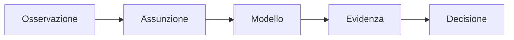

# Correlazione, causalità e controfattuali

"Correlazione non implica causalità" è la frase che tutti conoscono e quasi nessuno applica fino in fondo. Quando si decide sui dati, distinguere le due cose è la differenza tra una conclusione che regge e una che convince solo finché nessuno la mette alla prova. Il pezzo che di solito manca è il controfattuale: per dire che qualcosa ha causato un effetto, bisogna chiedersi cosa sarebbe successo senza quella causa.

## L'aumento che vuole un padre

Immagina un team che vede le conversioni salire durante una campagna e vorrebbe attribuirsene il merito. Il problema è che nello stesso periodo sono cambiati anche il prezzo, il traffico organico e la composizione degli utenti. Come si fa a sapere se l'aumento viene davvero dalla campagna? Qui la distinzione tra correlazione, causalità e controfattuale smette di essere teoria. Per affermare "ha causato" serve immaginare lo scenario in cui l'intervento non c'è stato e confrontarlo con quello osservato.

## Dalla domanda alla decisione

Il ragionamento causale segue un percorso ordinato: si formula la domanda, la si traduce in dati osservabili, si valuta la qualità del dato e solo alla fine si decide. Saltare uno di questi passaggi porta a conclusioni fragili.



Le stesse tappe si possono leggere come domande operative, ognuna con un esito da fissare prima di proseguire.

| Passaggio | Domanda guida | Output atteso |
|---|---|---|
| Framing | Quale decisione deve cambiare? | Una scelta concreta, non una curiosità |
| Misura | Quale segnale rappresenta il fenomeno? | Metrica, fonte e granularità |
| Confronto | Rispetto a quale baseline interpreto il risultato? | Benchmark o controfattuale plausibile |
| Azione | Che cosa faccio se il segnale supera la soglia? | Decisione, owner e prossimo controllo |

## Gli elementi della causalità

La causalità si lascia formalizzare come una relazione tra quattro elementi, utili da nominare prima di interpretare qualsiasi numero.

| Elemento | Definizione operativa |
|---|---|
| Unità | osservazione, ipotesi, variabile, meccanismo causale o criterio di evidenza |
| Segnale | forza dell'evidenza, coerenza causale, robustezza delle assunzioni e costo dell'errore decisionale |
| Baseline | spiegazione alternativa, controfattuale, gruppo comparabile o scenario senza intervento |
| Decisione | accettare, rifiutare o riformulare una spiegazione prima di usarla in un contesto aziendale |

Una misura vale qualcosa solo se riduce l'incertezza su una decisione specifica. Se non cambia nessuna scelta è documentazione, e se cambia una scelta senza controlli è rischio.

## Caso pratico: la retention che cresce

Un team legge una crescita di retention come prova che una nuova iniziativa ha funzionato. È un salto comprensibile e quasi sempre prematuro. Applicando la distinzione tra correlazione, causalità e controfattuale, conviene mettere in colonna ciò che è evidenza, ciò che è interpretazione prudente e ciò che ne consegue per la decisione.

| Evidenza | Interpretazione prudente | Decisione conseguente |
|---|---|---|
| Segnale positivo ma non isolato | Il fenomeno esiste, ma la causa è incerta | Cercare baseline o holdout |
| Segmento con risposta diversa | L'effetto medio nasconde eterogeneità | Analizzare coorti o sottogruppi |
| Costo operativo crescente | Il risultato va valutato sul margine | Applicare soglie economiche |

La tabella tiene separate tre cose che la fretta tende a fondere: che il segnale ci sia, che abbia una causa precisa e che valga la pena agire.

## Provare il metodo su una decisione vera

Per fissare il ragionamento conviene legarlo a una decisione reale. Descrivi in poche righe obiettivo, metrica primaria, baseline, rischio principale e azione prevista. Poi costruisci una tabella con almeno tre segmenti o scenari, indicando per ciascuno il segnale, una spiegazione alternativa plausibile e il controllo necessario prima di decidere. Chi vuole spingersi oltre può disegnare un piano di validazione con ipotesi, dati necessari, criteri di esclusione, soglia decisionale, controllo successivo alla decisione e le condizioni che lo farebbero cambiare idea.

Se non hai dati reali va bene un dataset sintetico con almeno 200 righe e colonne per tempo, segmento, outcome ed esposizione. Bastano per allenarsi su case study decisionali, metriche di prodotto, esiti di esperimenti e DAG semplici.

## L'errore che svuota il concetto

Il rischio più comune è trattare correlazione, causalità e controfattuali come concetti astratti da memorizzare invece che come protocolli da applicare. Presentare metriche senza baseline, grafici senza ipotesi o raccomandazioni che ignorano il costo dell'errore porta a decisioni fragili.

Un controllo utile è domandarsi: se questo risultato fosse falso o instabile, quale decisione sbaglierei? Se la risposta non è chiara, il concetto è rimasto sulla pagina. Le stesse domande servono come verifica finale: qual è la decisione concreta da migliorare, quale baseline rende leggibile il risultato, quale assunzione ne cambierebbe la conclusione se fosse sbagliata e quale controllo minimo mettere prima di esporre la raccomandazione.

## Riepilogo operativo

Saper distinguere correlazione, causalità e controfattuale serve a collegare concetto, dato e decisione. Si parte da un problema reale, si formalizza il segnale, si cerca una baseline credibile, si costruisce un esempio e si chiude con un controllo pratico. È così che la conoscenza diventa competenza operativa.

## Problema reale

Questo concetto si applica quando lavori con dataset reali e hai bisogno di una struttura chiara per ragionare su Correlazione, causalità e controfattuali. Il problema tipico è non avere un framework condiviso tra il team per valutare la soluzione, con il risultato che ogni analisi parte da presupposti diversi.

**Quando lo incontrerai:**
- Quando presenti un risultato e qualcuno chiede "ma come sei arrivato a questo numero?"
- Quando il risultato di una query cambia radicalmente cambiando un filtro
- Quando il modello che hai costruito funziona sui dati di test ma non su quelli di produzione

## Modello concettuale

Il Correlazione, causalità e controfattuali si definisce attraverso tre dimensioni:

1. **Struttura**: come sono organizzati i dati o il processo
2. **Logica**: quale relazione causa-effetto governa il comportamento
3. **Misura**: quale metrica usi per valutare il risultato

Questo modello ti permette di scomporre qualsiasi istanza del problema nelle sue parti verificabili.

## Formalizzazione rigorosa

```sql
-- TODO: aggiungi la formalizzazione specifica per Correlazione, causalità e controfattuali
-- Pattern per avanzato:

SELECT
    /* indica qui la tua metrica principale */
FROM
    /* indica qui la sorgente dati */
WHERE
    /* indica qui i filtri */
GROUP BY
    /* indica qui le dimensioni di raggruppamento */
```

**Principio guida:** verifica sempre che la somma delle parti sia uguale al totale.

## Esempio o caso studio

**Caso tipico (livello avanzato):**

Immaginiamo un team marketing che deve misurare la retention a 30 giorni. L'errore più comune è calcolarla come `COUNT(DISTINCT user_id)` senza filtrare per data di attivazione, includendo utenti che non hanno ancora avuto 30 giorni di tempo. La versione corretta filtra prima la cohort di attivazione e poi applica il calcolo.

```sql
WITH cohort AS (
    SELECT
        user_id,
        MIN(event_date) AS activation_date
    FROM events
    GROUP BY user_id
),
retention AS (
    SELECT
        c.activation_date,
        COUNT(DISTINCT e.user_id) AS retained_users
    FROM cohort c
    JOIN events e ON c.user_id = e.user_id
        AND e.event_date >= c.activation_date
        AND e.event_date <= c.activation_date + INTERVAL '30 days'
    GROUP BY c.activation_date
)
SELECT
    activation_date,
    retained_users,
    ROUND(retention_rate * 100, 2) AS retention_pct
FROM retention;
```

## Lab / esercizio

**Esercizio — livello avanzato**

1. **Prepara l'ambiente:** carica il dataset di esempio nel tuo warehouse
2. **Applica il pattern:** scrivi la query che implementa il modello concettuale per il tuo caso
3. **Verifica:** controlla che il risultato sia coerente con le tue aspettative usando un sanity check

**Tempo stimato:** 20-30 minuti

## Errore tipico da evitare

**L'errore più comune a livello avanzato:**

Non distinguere tra una metrica calcolata su tutta la popolazione e una metrica calcolata su una sotto-popolazione specifica. Ad esempio, calcolare il tasso di conversione medio senza filtrare per canale di acquisizione porta a decisioni sbagliate perché il mix di canali cambia nel tempo.

**Come evitarlo:**
- Chiediti sempre: "rispetto a cosa sto misurando questo?"
- Verifica che il denominatore sia corretto prima di fidarti del numeratore
- Usa un gruppo di controllo quando possibile

## Quiz o checkpoint

1. Qual è la differenza tra la metrica calcolata su tutta la popolazione e quella calcolata su una cohort?
2. Scrivi il codice SQL che implementa il modello concettuale per un caso a tua scelta
3. Quale sanity check useresti per verificare che il risultato sia corretto?

---

*Queste sezioni sono placeholder generici. Sostituisci con contenuto specifico per la lezione.*

### Livello base

Spiegazione intuitiva di Correlazione, causalità e controfattuali:

Il concetto alla base è semplice: invece di fare affidamento sull'intuizione, usi un metodo riproducibile. A livello base, ti basta capire quale domanda stai ponendo e quali dati hai a disposizione per risponderci.

### Livello intermedio

Applicazione concreta di Correlazione, causalità e controfattuali:

A questo livello applichi il concetto a un caso specifico. Ad esempio, se stai analizzando la retention, il tuo dataset ha dimensioni come data di attivazione, data di evento, e user_id. La segmentazione per canale di acquisizione ti dà insight aggiuntivi che il dato grezzo non mostra.

### Livello research-grade

Approfondimento teorico:

Per chi vuole capire il fondamento teorico, la letteratura classica include:
- Kimball, "The Data Warehouse Toolkit" — per approcci dimensionali
- McKinney, "Python for Data Analysis" — per implementazione pratica
- Aggiora i riferimenti con paper recenti specifici per il tuo dominio

### Dataset e materiali consigliati

**Per esercitarti:**
- Usa il dataset di esempio fornito nella lezione
- Per un challenge aggiuntivo, prova con dati pubblici come quelli di Kaggle

**Tool consigliati:**
- dbt Core per trasformazioni
- Metabase o Superset per visualizzazione