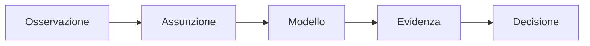

# Modelli, assunzioni e misspecification

Un modello può sbagliare in modo silenzioso, e questo è il caso più pericoloso. Una regressione che prevede bene le vendite medie ma fallisce sistematicamente nei weekend, durante le promozioni o sui clienti nuovi non è semplicemente imprecisa: risponde a una domanda più ristretta di quella che interessa al business. Questo scarto ha un nome, misspecification, e questa lezione serve a riconoscerlo prima che si trasformi in una decisione sbagliata.

## Quando il modello risponde alla domanda sbagliata

Il punto centrale è distinguere quando un dato o un modello sostiene davvero una decisione e quando invece nasconde assunzioni fragili, bias o una domanda mal formulata. In un contesto aziendale la conoscenza diventa utile solo se riduce l'incertezza su una scelta concreta e mette in chiaro dove si annida il rischio di errore.

## Dalla domanda alla decisione

Il percorso mentale è sequenziale: si formula la domanda, si traducono i concetti in unità osservabili, si valuta la qualità del dato e solo alla fine si decide. Saltare passaggi produce analisi fragili.



Le stesse tappe diventano domande operative, ognuna con un esito da fissare prima di proseguire.

| Passaggio | Domanda guida | Output atteso |
|---|---|---|
| Framing | Quale decisione deve cambiare? | Scelta concreta, non curiosità |
| Misura | Quale segnale rappresenta il fenomeno? | Metrica, fonte, granularità |
| Confronto | Rispetto a quale baseline interpreto il risultato? | Benchmark o controfattuale |
| Azione | Che cosa faccio se il segnale supera la soglia? | Decisione, owner, prossimo controllo |

## Gli elementi del ragionamento

Conviene nominare gli elementi in gioco, incluso il rischio specifico di confondere piani diversi.

| Elemento | Definizione operativa |
|---|---|
| Unità | osservazione, ipotesi, variabile, meccanismo causale o criterio di evidenza |
| Segnale | forza dell'evidenza, coerenza causale, robustezza delle assunzioni, costo dell'errore decisionale |
| Baseline | spiegazione alternativa, controfattuale, gruppo comparabile, scenario senza intervento |
| Decisione | accettare, rifiutare o riformulare una spiegazione prima dell'uso aziendale |
| Rischio | confondere correlazione, qualità del dato e causalità decisionale |

Una misura vale qualcosa solo se riduce l'incertezza su una decisione specifica. Se non cambia nessuna scelta è decorativa, e se cambia una scelta senza controlli è rischiosa.

## Le assunzioni nascoste in ogni modello

Ogni modello è una semplificazione della realtà che poggia su assunzioni, esplicite o implicite. La regressione lineare OLS, per esempio, si regge su quattro assunzioni note come proprietà BLUE: linearità, indipendenza degli errori, omoschedasticità e normalità degli errori. Quando queste vengono violate compaiono bias e inferenze sbagliate.

Nel machine learning il discorso non cambia, cambiano le assunzioni. Quella di dati indipendenti e identicamente distribuiti (IID) e quella di stazionarietà sono spesso date per scontate e altrettanto spesso violate nel mondo reale, ed è da lì che nasce il model drift.

## Riconoscere i sintomi prima del danno

La misspecification raramente arriva con un fallimento clamoroso. Di solito manda segnali più discreti. C'è una discrepanza tra le metriche di fit e la performance sui dati nuovi, il classico overfitting. I coefficienti si fanno instabili a causa della multicollinearità. Nei residui compaiono pattern che violano l'ipotesi di rumore bianco. Oppure la performance offline e quella online divergono, segno che qualche assunzione chiave è saltata. Imparare a leggere questi indizi è ciò che separa un modello monitorato da uno che si rompe in silenzio.

## Caso pratico: Netflix e Stripe alle prese con assunzioni che saltano

Netflix convive con la non stazionarietà dei gusti, che cambiano nel tempo e mandano in crisi qualsiasi modello addestrato sul passato. La risposta combina più strumenti: un decadimento temporale che dà più peso ai dati recenti, un ensemble di modelli specializzati su aspetti diversi e un'esplorazione attiva tramite contextual bandits per adattarsi ai cambiamenti man mano che emergono. È così che le raccomandazioni restano rilevanti e il churn resta sotto controllo.

Stripe Radar affronta un problema diverso, la multicollinearità tra le variabili predittive nelle frodi. Qui servono modelli robusti come il Gradient Boosting e un feature engineering accurato, che insieme migliorano la capacità di intercettare le frodi senza far esplodere i falsi positivi. In entrambi i casi il punto non è il modello in sé, ma la consapevolezza dell'assunzione che potrebbe cedere.

## Validare e monitorare sul serio

La validazione non si esaurisce con un semplice split tra training e test. Sulle serie temporali serve un time-series split, altrimenti si rischia di far "vedere il futuro" al modello in fase di addestramento. Una volta in produzione, il monitoraggio continuo deve intercettare data drift e concept drift, e per farlo si appoggia a test statistici come quello di Kolmogorov-Smirnov.

Un controllo operativo per il data drift si può descrivere anche senza scrivere codice, ragionando per domande.

| Passaggio | Domanda | Decisione |
|---|---|---|
| Campione storico | Quale distribuzione rappresenta il comportamento atteso? | Definire il riferimento |
| Campione recente | La produzione si comporta ancora nello stesso modo? | Misurare lo scarto |
| Test statistico | Lo scarto e compatibile con rumore normale? | Aprire o chiudere l'allarme |
| Impatto business | Lo scarto cambia la decisione o solo una metrica tecnica? | Intervenire, monitorare o ignorare |

## Provare il metodo su una decisione vera

Per fissare il ragionamento conviene legarlo a una decisione reale su modelli e assunzioni. Descrivi in poche righe obiettivo, metrica primaria, baseline, rischio e azione. Poi costruisci una tabella con almeno tre segmenti o scenari, indicando per ciascuno il segnale, una spiegazione alternativa e il controllo necessario. Chi vuole approfondire può disegnare un piano di validazione completo: ipotesi, dati, criteri di esclusione, soglia decisionale, controllo successivo alla decisione e le condizioni che lo farebbero cambiare idea.

Se mancano dati reali basta un dataset sintetico con almeno una colonna temporale, una di segmento, una metrica di outcome e una variabile di esposizione. Sono materiali sufficienti per esercitarsi su case study decisionali, metriche di prodotto, esperimenti e DAG.

## L'errore che svuota il metodo

L'errore tipico è trattare modelli e assunzioni come definizioni astratte invece che come protocolli da usare. Presentare metriche senza baseline o raccomandazioni che ignorano il costo dell'errore è più comune di quanto si pensi. La domanda da tenere sempre in tasca è semplice: se questo risultato fosse falso, quale decisione sbaglierei? Vale la pena ripercorrerla anche come verifica finale, chiedendosi qual è la decisione concreta da migliorare, quale baseline rende leggibile il risultato, quale assunzione ne cambierebbe la conclusione se fosse sbagliata e quale controllo minimo mettere prima di portare la raccomandazione a chi decide.

## Riepilogo operativo

Gestire modelli, assunzioni e misspecification significa collegare concetto, dato e decisione. Si parte da un problema reale, si formalizza il segnale, si sceglie una baseline credibile, si costruiscono esempi e si chiude con controlli pratici. È questa la competenza che rende affidabili le decisioni prese sotto incertezza.

## Problema reale

Questo concetto si applica quando lavori con dataset reali e hai bisogno di una struttura chiara per ragionare su Modelli, assunzioni e misspecification. Il problema tipico è non avere un framework condiviso tra il team per valutare la soluzione, con il risultato che ogni analisi parte da presupposti diversi.

**Quando lo incontrerai:**
- Quando presenti un risultato e qualcuno chiede "ma come sei arrivato a questo numero?"
- Quando il risultato di una query cambia radicalmente cambiando un filtro
- Quando il modello che hai costruito funziona sui dati di test ma non su quelli di produzione

## Modello concettuale

Il Modelli, assunzioni e misspecification si definisce attraverso tre dimensioni:

1. **Struttura**: come sono organizzati i dati o il processo
2. **Logica**: quale relazione causa-effetto governa il comportamento
3. **Misura**: quale metrica usi per valutare il risultato

Questo modello ti permette di scomporre qualsiasi istanza del problema nelle sue parti verificabili.

## Formalizzazione rigorosa

```sql
-- TODO: aggiungi la formalizzazione specifica per Modelli, assunzioni e misspecification
-- Pattern per avanzato:

SELECT
    /* indica qui la tua metrica principale */
FROM
    /* indica qui la sorgente dati */
WHERE
    /* indica qui i filtri */
GROUP BY
    /* indica qui le dimensioni di raggruppamento */
```

**Principio guida:** verifica sempre che la somma delle parti sia uguale al totale.

## Esempio o caso studio

**Caso tipico (livello avanzato):**

Immaginiamo un team marketing che deve misurare la retention a 30 giorni. L'errore più comune è calcolarla come `COUNT(DISTINCT user_id)` senza filtrare per data di attivazione, includendo utenti che non hanno ancora avuto 30 giorni di tempo. La versione corretta filtra prima la cohort di attivazione e poi applica il calcolo.

```sql
WITH cohort AS (
    SELECT
        user_id,
        MIN(event_date) AS activation_date
    FROM events
    GROUP BY user_id
),
retention AS (
    SELECT
        c.activation_date,
        COUNT(DISTINCT e.user_id) AS retained_users
    FROM cohort c
    JOIN events e ON c.user_id = e.user_id
        AND e.event_date >= c.activation_date
        AND e.event_date <= c.activation_date + INTERVAL '30 days'
    GROUP BY c.activation_date
)
SELECT
    activation_date,
    retained_users,
    ROUND(retention_rate * 100, 2) AS retention_pct
FROM retention;
```

## Lab / esercizio

**Esercizio — livello avanzato**

1. **Prepara l'ambiente:** carica il dataset di esempio nel tuo warehouse
2. **Applica il pattern:** scrivi la query che implementa il modello concettuale per il tuo caso
3. **Verifica:** controlla che il risultato sia coerente con le tue aspettative usando un sanity check

**Tempo stimato:** 20-30 minuti

## Errore tipico da evitare

**L'errore più comune a livello avanzato:**

Non distinguere tra una metrica calcolata su tutta la popolazione e una metrica calcolata su una sotto-popolazione specifica. Ad esempio, calcolare il tasso di conversione medio senza filtrare per canale di acquisizione porta a decisioni sbagliate perché il mix di canali cambia nel tempo.

**Come evitarlo:**
- Chiediti sempre: "rispetto a cosa sto misurando questo?"
- Verifica che il denominatore sia corretto prima di fidarti del numeratore
- Usa un gruppo di controllo quando possibile

## Quiz o checkpoint

1. Qual è la differenza tra la metrica calcolata su tutta la popolazione e quella calcolata su una cohort?
2. Scrivi il codice SQL che implementa il modello concettuale per un caso a tua scelta
3. Quale sanity check useresti per verificare che il risultato sia corretto?

---

Questa lezione si applica a Modulo 19: Fondamenti Filosofici dell Analisi dei Dati: serve per capire modelli, assunzioni e misspecification in modo operativo, non solo teorico. Il problema tipico è affrontare modelli, assunzioni e misspecification senza un framework condiviso, con il risultato che ogni analisi parte da zero.

### Livello base

Modelli, assunzioni e misspecification è il fondamento di questa competenza. A livello base, ti basta capire la domanda chiave: cosa vuoi misurare, con quali dati, e con quale margine di errore. Non servono formule complesse: serve chiarezza su cosa osservi e perché.

### Livello intermedio

A questo livello applichi modelli, assunzioni e misspecification a un caso reale. Prendi un dataset, definisci l'obiettivo, e costruisci il ragionamento passo per passo. Se stai lavorando su modulo 19: fondamenti filosofici dell analisi dei dati, il tuo dataset ha dimensioni specifiche che determinano quali domande puoi porre.

### Livello research-grade

Approfondimento teorico di modelli, assunzioni e misspecification: qui entrambi i modelli statistici, le assunzioni sottostanti, e i confini di validità. Questo livello serve quando devi difendere una scelta di fronte a stakeholder che chiedono "perché" — non solo "cosa".

### Dataset e materiali consigliati

- Un dataset reale del tuo dominio (modulo 19: fondamenti filosofici dell analisi dei dati) per esercitarsi
- La documentazione ufficiale dello strumento usato per questa analisi
- Le metriche di riferimento del corso per contestualizzare i risultati

### Livello base

Spiegazione intuitiva di Modelli, assunzioni e misspecification:

Il concetto alla base è semplice: invece di fare affidamento sull'intuizione, usi un metodo riproducibile. A livello base, ti basta capire quale domanda stai ponendo e quali dati hai a disposizione per risponderci.

### Livello intermedio

Applicazione concreta di Modelli, assunzioni e misspecification:

A questo livello applichi il concetto a un caso specifico. Ad esempio, se stai analizzando la retention, il tuo dataset ha dimensioni come data di attivazione, data di evento, e user_id. La segmentazione per canale di acquisizione ti dà insight aggiuntivi che il dato grezzo non mostra.

### Livello research-grade

Approfondimento teorico:

Per chi vuole capire il fondamento teorico, la letteratura classica include:
- Kimball, "The Data Warehouse Toolkit" — per approcci dimensionali
- McKinney, "Python for Data Analysis" — per implementazione pratica
- Aggiora i riferimenti con paper recenti specifici per il tuo dominio

### Dataset e materiali consigliati

**Per esercitarti:**
- Usa il dataset di esempio fornito nella lezione
- Per un challenge aggiuntivo, prova con dati pubblici come quelli di Kaggle

**Tool consigliati:**
- dbt Core per trasformazioni
- Metabase o Superset per visualizzazione