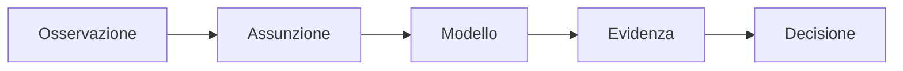

# Measurement theory: cosa significa misurare bene

Misurare non vuol dire contare, vuol dire catturare il concetto che ci interessa davvero. Capita spesso che un team voglia misurare l'engagement contando i minuti passati nell'app, salvo accorgersi che un utente confuso resta dentro più a lungo di uno soddisfatto. La metrica è precisa, ma misura la cosa sbagliata. Qui sta il problema che la measurement theory aiuta a riconoscere: la differenza tra ciò che misuri e ciò che vorresti misurare.

## Il problema da risolvere

La domanda pratica è una sola: quando un dato sostiene davvero una decisione, e quando invece nasconde un'assunzione, un bias o una domanda formulata male? Un dato interessante in astratto non basta. Deve cambiare una scelta concreta, poggiare su una fonte affidabile e portare con sé una soglia di errore dichiarata. Senza questi tre ingredienti resta un numero che fa scena in una slide.

## Come ragionare sul dato

Il percorso ha un ordine preciso. Prima si formula la domanda, poi la si traduce in qualcosa di osservabile, quindi si valuta quanto è buono il dato e solo a quel punto si decide. Quando si salta un passaggio l'analisi può sembrare elegante e restare comunque fragile, perché manca il pezzo che la rende affidabile.

| Passaggio | Domanda guida | Output atteso |
|---|---|---|
| Framing | Quale decisione deve cambiare? | Una scelta concreta |
| Misura | Quale segnale rappresenta il fenomeno? | Metrica, fonte, granularità |
| Confronto | Rispetto a quale baseline interpreto il risultato? | Benchmark o controfattuale |
| Azione | Che cosa faccio se il segnale supera la soglia? | Decisione e prossimo controllo |

## I quattro elementi della misura

La measurement theory tiene insieme quattro elementi, e conviene definirli in modo operativo invece che astratto.

| Elemento | Definizione operativa |
|---|---|
| Unità | osservazione, ipotesi, variabile, meccanismo causale o criterio di evidenza |
| Segnale | forza dell'evidenza, coerenza causale, robustezza delle assunzioni, costo dell'errore decisionale |
| Baseline | spiegazione alternativa, controfattuale, gruppo comparabile o scenario senza intervento |
| Decisione | accettare, rifiutare o riformulare una spiegazione prima di usarla |

La regola che lega tutto è semplice: una misura serve solo se riduce l'incertezza su una decisione specifica. Se non cambia una scelta, allora è documentazione, e va bene così purché lo si sappia. Se cambia una scelta ma non è stata sottoposta a controlli, è un rischio mascherato da evidenza.

## Un caso pratico

Immagina un comitato che legge una crescita della retention come prova che la nuova iniziativa ha funzionato. La measurement theory chiede di separare tre piani che di solito vengono confusi: cosa mostra l'evidenza, come la interpretiamo con prudenza e cosa decidiamo di conseguenza.

| Evidenza | Interpretazione prudente | Decisione conseguente |
|---|---|---|
| Segnale positivo ma non isolato | Fenomeno esiste, causa incerta | Cercare baseline o holdout |
| Segmento con risposta diversa | Effetto medio nasconde eterogeneità | Analizzare coorti o sottogruppi |
| Costo operativo crescente | Valutare risultato sul margine | Applicare soglie economiche |

Letto così, il numero smette di essere una conclusione che si regge da sola e torna a essere quello che è: un indizio dentro un ragionamento più ampio.

## L'errore da evitare

L'errore più frequente è trattare la measurement theory come una definizione da ricordare invece che come un protocollo da applicare. Si riconosce subito: una metrica presentata senza baseline, un grafico senza l'ipotesi che dovrebbe verificare, una raccomandazione che non dice quanto costa sbagliare. La domanda di controllo è sempre la stessa: se questo risultato fosse falso o instabile, quale decisione sbaglierei? Se non sai rispondere, la lezione non è ancora entrata nel lavoro.

## Riepilogo

La measurement theory tiene insieme tre cose che tendiamo a confondere: il concetto che vogliamo cogliere, il dato che usiamo per coglierlo e la decisione che ne dipende. Conviene studiarla partendo da un problema reale, dare forma al segnale, cercare una baseline credibile, lavorarla su un esempio e chiudere con un controllo concreto. È il passaggio che trasforma una definizione in qualcosa che usi davvero quando devi decidere sotto incertezza.
