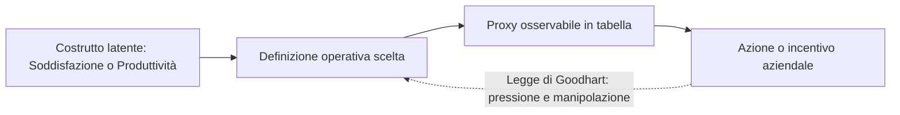

Quasi tutto ciò che conta davvero in un'organizzazione o nella società non possiede una bilancia naturale. Puoi pesare con precisione un pacco spedito dal magazzino o contare i millisecondi di risposta di un server, ma concetti decisivi come soddisfazione del cliente, rischio di credito, apprendimento di uno studente o qualità del lavoro non esistono come oggetti fisici misurabili direttamente. Per portarli dentro una tabella o un modello dobbiamo costruire una traduzione numerica: chiamiamo questo ponte **teoria della misurazione**.

Quando una metrica fallisce, quasi nessuno mette in discussione la qualità della traduzione; si discute piuttosto del modello o della presentazione. Eppure nessun algoritmo avanzato può compensare un indicatore costruito male. Misurare bene significa garantire tre condizioni simultanee: che il numero rappresenti fedelmente il concetto latente che dichiariamo di osservare, che le operazioni matematiche applicate rispettino la natura della scala usata e che trasformare quella misura in un obiettivo operativo non distrugga il fenomeno stesso.

## Quando un indicatore sale proprio perché l'utente si è perso

Esaminiamo uno scenario costruito con numeri di esempio realistici per una squadra di prodotto digitale. Un'applicazione di servizi al cittadino adotta come misura principale di coinvolgimento e gradimento la durata media della sessione in minuti. Dopo una ristrutturazione dei menu principali, la metrica sale da 4,2 minuti a 6,8 minuti in un solo mese, segnando un incremento del 62% che viene presentato come prova di maggiore interesse da parte degli utenti.

Nello stesso mese, però, il centro assistenza registra il raddoppio dei ticket per mancato completamento delle pratiche e il tasso di ritorno a trenta giorni cala di nove punti percentuali. Analizzando alcune registrazioni qualitative, il team scopre che i nuovi menu nascondono il modulo di invio e costringono le persone a navigare a vuoto per più di due minuti extra prima di arrendersi. Il tempo speso in app era una proxy ambigua: misurava insieme due fenomeni opposti, l'interesse autentico e la frustrazione da smarrimento. La metrica era tecnicamente precisa al secondo, ma concettualmente priva di validità.

> **Idea chiave:** Misurare non significa soltanto attribuire numeri con coerenza tecnica: significa dimostrare che la proxy osservabile risponde alle variazioni del costrutto latente senza confonderlo con fenomeni opposti e rispettando le operazioni consentite dalla propria scala.

Separare l'affidabilità tecnica della registrazione dalla validità sostanziale del concetto è il primo passo per smettere di guidare un'organizzazione attraverso indicatori ingannevoli.

## Costrutti latenti, validità e le quattro scale di Stevens

In metrologia e nelle scienze sociali si distinguono due proprietà fondamentali di ogni indicatore. L'**affidabilità** (*reliability*) misura la stabilità e riproducibilità dello strumento: se misuri due volte lo stesso fenomeno identico nelle stesse condizioni, ottieni lo stesso numero? Un orologio digitale che segna sempre tre minuti avanti è molto affidabile ma poco accurato. La **validità di costrutto** (*construct validity*) verifica invece se l'indicatore misuri davvero il concetto astratto che hai in mente, e non un effetto collaterale o un fenomeno estraneo.

Accanto al legame tra concetto e proxy sta la struttura matematica dei numeri raccolti. Nel 1946 lo psicofisico Stanley Smith Stevens propose su *Science* una classificazione in quattro livelli di scala che resta la bussola essenziale per chiunque elabori tabelle: **nominale**, **ordinale**, **a intervalli** e **a rapporto**. Ogni livello autorizza un insieme preciso di trasformazioni e vieta le operazioni arbitrarie che creano illusioni numeriche.

La scala **nominale** usa i numeri soltanto come etichette di equivalenza o diversità (codici regione, tipi di abbonamento, identificativi di categoria): l'unica statistica sensata è il conteggio delle frequenze o la moda. La scala **ordinale** stabilisce un ordine di rango tra valori (stelline da 1 a 5, livelli di gravità basso-medio-alto), ma non garantisce che la distanza tra 1 e 2 sia uguale alla distanza tra 4 e 5: le statistiche coerenti sono mediana e percentili, non la media aritmetica spinta ai decimali. La scala **a intervalli** (come la temperatura in gradi Celsius o le date di calendario) possiede unità di distanza costanti ma uno zero convenzionale, permettendo somme di differenze e medie ma non rapporti di moltiplicazione. Solo la scala **a rapporto** (tempi di elaborazione, importi in euro, conteggi fisici) possiede uno zero assoluto che rende sensato affermare che un valore è il doppio di un altro.

| Livello di scala (Stevens 1946) | Proprietà empirica preservata | Operazioni statistiche legittime | Errore tipico nelle dashboard aziendali |
|---|---|---|---|
| Nominale | Uguaglianza o differenza tra categorie | Conteggi, frequenze relative, moda | Sommare o fare medie di codici numerici di segmento o stato |
| Ordinale | Ordinamento lineare di rango | Mediana, quantili, correlazione per ranghi | Calcolare la media a due decimali su sondaggi Likert da 1 a 5 |
| A intervalli | Uguaglianza delle differenze e intervalli | Media aritmetica, deviazione standard, differenze | Dire che 20 gradi Celsius è il doppio più caldo di 10 gradi |
| A rapporto | Uguaglianza dei rapporti con zero assoluto | Tutte le precedenti più rapporti geometrici e coefficienti di variazione | Confondere una proxy di conteggio con un valore qualitativo lineare |

## Quantificare lo scarto tra proxy e costrutto su un campione etichettato

Per non restare su giudizi intuitivi sulla validità di una metrica, puoi misurare concretamente quanto la tua proxy diverge dal costrutto reale etichettando un piccolo campione di controllo insieme agli esperti di dominio o attraverso osservazione diretta.

Riprendiamo l'esempio dell'applicazione digitale e costruiamo i conti passo-passo su un audit qualitativo di 500 sessioni campionate in modo stratificato. Supponiamo che l'analista utilizzi la regola operativa "durata sessione superiore a 5 minuti" come proxy per classificare una sessione come soddisfatta e produttiva. Esaminando manualmente il comportamento e gli esiti reali di tutte le 500 sessioni nel campione di controllo, emerge che 300 sessioni sono effettivamente concluse con successo dall'utente (60,0% di soddisfazione reale), mentre le restanti 200 sessioni corrispondono a utenti bloccati in un ciclo di errori o confusione.

Vediamo come si comporta la proxy proposta su questi due sottogruppi reali. Tra le 300 sessioni realmente produttive, 240 superano i 5 minuti e vengono classificate correttamente come positive dalla metrica (tasso di intercettazione o *recall* pari a 240 / 300 = 80,0%). Purtroppo, tra le 200 sessioni di utenti bloccati nei nuovi menu, ben 120 superano a loro volta i 5 minuti mentre l'utente cerca la funzione giusta, finendo classificate dalla proxy come successi (tasso di falsi positivi pari a 120 / 200 = 60,0%).

Sommiamo ora tutte le sessioni che la dashboard etichetta come "soddisfatte": 240 vere positive + 120 false positive = 360 sessioni positive su 500, ossia un tasso apparente di 360 / 500 = 72,0%. Rispetto al tasso reale del 60,0% (300 / 500), la proxy sovrastima la salute del prodotto di 72,0% - 60,0% = 12,0 punti percentuali (`+12 pp`). Ancora più grave è il valore predittivo positivo (precisione della misura): su 360 sessioni dichiarate positive, solo 240 lo sono davvero, pari a 240 / 360 = 66,7%. Un segnale su tre etichettato dalla dashboard come esperienza positiva nasconde in realtà attrito e fallimento. Trasferendo questa proporzione su un volume ordinario di 20.000 sessioni settimanali (dove il 24% totale di falsi positivi osservato sul campione corrisponde a 120 / 500 = 24,0%), l'azienda prende decisioni settimanali basandosi su 20.000 × 0,24 = 4.800 falsi segnali di successo generati ogni sette giorni dalla metrica sbagliata.

## La legge di Goodhart e i limiti etici dell'inferenza indiretta

Anche quando una proxy mostra un'ottima correlazione storica con il fenomeno di interesse, la sua validità può sgretolarsi rapidamente nel momento in cui l'organizzazione la trasforma in un traguardo premiato o sanzionato. Nel 1975 l'economista britannico Charles Goodhart osservò in ambito monetario che ogni regolarità statistica osservata tende a collassare non appena viene sottoposta a pressione per scopi di controllo. L'antropologa Marilyn Strathern rese celebre nel 1997 la formulazione sintetica oggi nota come **legge di Goodhart**: quando una misura diventa un bersaglio, cessa di essere una buona misura. Parallelamente, già nel 1979 lo psicologo e metodologo Donald Campbell aveva formulato una legge analoga sugli indicatori sociali usati nelle politiche pubbliche e scolastiche: più un indicatore quantitativo diventa strumento per decisioni amministrative ad alta posta, più sarà soggetto a pressioni corruttive e più finirà per distorcere i processi che doveva monitorare.

Se un servizio clienti viene premiato soltanto sul tempo medio di chiusura delle chiamate, gli operatori imparano a chiudere i ticket complessi in modo prematuro costringendo il cliente a richiamare: la metrica scende e la qualità reale precipita. Lo stesso accade negli algoritmi quando si ottimizza un singolo punteggio surrogato come i clic immediati anziché la soddisfazione duratura.

Esiste però anche il rischio speculare: una misura indiretta può diventare straordinariamente efficace sul piano predittivo e proprio per questo violare la proporzionalità etica delle azioni che abilita. Il caso industriale più celebre risale al 2012, quando il giornalista Charles Duhigg raccontò sul *New York Times Magazine* il lavoro dello statistico Andrew Pole per la catena commerciale Target. Analizzando le variazioni negli acquisti di circa venticinque prodotti comuni — tra cui lozioni senza profumo, integratori di calcio e magnesio e borse più capienti — il modello attribuiva un punteggio di probabilità di gravidanza e stimava persino la data presunta del parto per inviare buoni sconto mirati con mesi di anticipo rispetto alla concorrenza.

Il sistema divenne famoso quando un padre furioso si presentò in un punto vendita vicino a Minneapolis chiedendo perché la figlia liceale ricevesse per posta cataloghi per neonati, scoprendo solo giorni dopo che la ragazza era effettivamente incinta e non lo aveva ancora detto in famiglia. La proxy di Target era statisticamente valida e ad alta precisione, ma mancava di proporzionalità e rispetto della sfera privata: trasformare un'inferenza probabilistica intima in un'azione di marketing intrusiva ha trasformato un successo tecnico in un grave incidente di fiducia. Misurare bene richiede sempre di chiedersi non solo se la proxy funzioni sui numeri, ma anche se l'uso che ne discende sia legittimo e proporzionato per la persona misurata.

## Protocollo di validazione e proporzionalità della misura

Prima di promuovere una nuova metrica a indicatore guida o a variabile bersaglio di un modello, è utile sottoporla a un controllo strutturato in cinque passi:

1. Definisci in due righe il costrutto reale che ti interessa senza usare il nome della metrica o della colonna SQL.
2. Verifica il livello di scala secondo Stevens e vieta esplicitamente le operazioni matematiche incompatibili negli script di aggregazione.
3. Esegui un campionamento etichettato di controllo su almeno 200-500 casi reali per calcolare precisione, copertura e tassi di falso positivo tra proxy e costrutto.
4. Affianca sempre all'indicatore principale almeno una contro-metrica di controllo che renda immediatamente visibili eventuali comportamenti opportunistici alla Goodhart (ad esempio tasso di riapertura dei ticket accanto al tempo di chiusura).
5. Valuta la proporzionalità e l'accettabilità dell'intervento che scatta automaticamente quando la misura supera la soglia prevista.

Questo controllo può essere cristallizzato in una scheda breve come nell'esempio seguente.

> **Scheda di validità della misura — Indice di sessione produttiva v2**
> **Costrutto latente:** l'utente completa con successo la pratica prevista senza blocchi di navigazione né richieste di supporto.
> **Proxy scelta e scala:** completamento verificato lato server (scala nominale binaria) combinato con l'assenza di ticket entro 48 ore; rimossa la durata sessione come proxy positiva.
> **Controllo su campione:** precisione verificata al 91% su 500 sessioni auditate manualmente rispetto al 66,7% della precedente proxy basata sui soli minuti.
> **Contro-metrica anti-Goodhart e limiti etici:** monitoraggio congiunto del tasso di abbandono al primo passaggio; divieto di dedurre attributi personali sensibili dai percorsi di errore degli utenti.

## Tre distorsioni silenziose nella progettazione delle metriche

Molti indicatori aziendali falliscono pur provenendo da query impeccabili e pipeline prive di errori di esecuzione. Riconoscere queste tre derive tipiche protegge l'affidabilità delle decisioni.

### Trattare punteggi ordinali come scale a rapporto

Il sintomo si presenta quando una valutazione espressa su scala a cinque livelli (da molto insoddisfatto a molto soddisfatto) viene mediata fino al secondo decimale e confrontata con variazioni percentuali come "soddisfazione aumentata del 14%". Appare naturale perché i numeri da 1 a 5 occupano colonne intere in SQL ed Excel calcola medie e percentuali senza alcun avviso. Tuttavia la distanza psicologica tra 1 e 2 può essere molto diversa da quella tra 4 e 5, e non esiste uno zero assoluto naturale che giustifichi rapporti moltiplicativi. L'analisi resta rigorosa quando usi mediane, distribuzioni percentuali per classe (come la quota di punteggi pari a 4 o 5) e test non parametrici per ranghi.

### Ottimizzare direttamente la proxy attivando la legge di Goodhart

L'errore esplode quando una variabile nata come segnale diagnostico passivo viene collegata ai bonus individuali o trasformata in obiettivo unico di un modello di ottimizzazione. Sembra efficiente allineare gli incentivi su un numero semplice e visibile a tutti. Ma appena il sistema sa quale numero viene premiato, ottimizza la forma dell'indicatore sacrificando il contenuto sostanziale: un modello di raccomandazione premiato solo sui clic promuove titoli sensazionalistici; un team premiato sul numero di deploy spezza piccole modifiche innocue invece di risolvere problemi complessi. Per prevenirlo, usa coppie bilanciate di metriche di valore e contro-metriche di qualità, ruotando periodicamente gli audit qualitativi indipendenti.

### Confondere la precisione tecnica del log con la validità del concetto

Questo abbaglio si verifica quando un team difende la solidità di un indice solo perché il tracciamento automatico non perde eventi e i numeri tornano al centesimo tra due tabelle diverse. Sembra rassicurante perché i test tecnici di riconciliazione e integrità dei dati sono tutti verdi. Ma la coerenza interna di uno strumento di misura garantisce soltanto la sua affidabilità meccanica, non dice nulla sul fatto che la cosa misurata corrisponda al concetto ricercato. Un test di unità sulla pipeline non sostituisce mai la verifica esterna della validità di costrutto su casi reali annotati da chi conosce il dominio.

## Audit sulla validità delle metriche che governano le tue scelte

Verifica di saper applicare i principi della teoria della misurazione rispondendo a queste quattro domande critiche.

1. Perché una metrica raccolta in modo tecnicamente affidabile e priva di dati mancanti può comunque risultare priva di validità di costrutto?

Mostra risposta

L'affidabilità indica solo che lo strumento produce risultati coerenti e ripetibili a parità di condizioni, mentre la validità verifica se l'indicatore rispecchia davvero il concetto latente dichiarato. Una proxy come la durata della sessione può essere misurata al millisecondo con perfetta affidabilità, ma aumentare sia quando l'utente è coinvolto sia quando è perso e frustrato.

2. Quale errore concettuale si commette quando si afferma che un punteggio medio di gradimento passato da 2,0 a 4,0 su una scala da 1 a 5 indica una soddisfazione raddoppiata?

Mostra risposta

Una scala Likert da 1 a 5 è una scala ordinale, non una scala a rapporto: garantisce soltanto l'ordine tra i gradi ma non assicura intervalli uguali né possiede uno zero assoluto reale, per cui i rapporti moltiplicativi e le variazioni percentuali sulle medie non hanno significato empirico rigoroso.

3. Nel caso Target del 2012, perché un modello costruito su proxy statisticamente molto accurate generò comunque un incidente grave?

Mostra risposta

Il modello di predizione basato sul paniere di acquisto funzionava bene sul piano predittivo, ma usava proxy indirette per inferire una condizione personale sensibile (la gravidanza) e tradurla in comunicazioni postali dirette senza consenso né valutazione della proporzionalità etica, violando la sfera privata della cliente e della sua famiglia.

4. Come puoi difendere un indicatore operativo dal collasso previsto dalla legge di Goodhart e dalla legge di Campbell quando diventa un obiettivo aziendale?

Mostra risposta

Devi affiancare sempre all'indicatore principale almeno una contro-metrica di qualità o equilibrio che catturi gli effetti collaterali della manipolazione, oltre a condurre audit qualitativi periodici su campioni etichettati per verificare che la proxy continui a correlare con il costrutto reale nel tempo.

