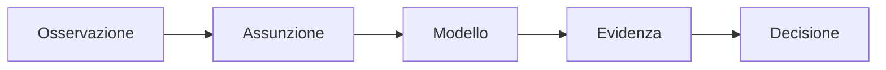

# Measurement theory: cosa significa misurare bene

Misurare non vuol dire contare, vuol dire catturare il concetto che ci interessa davvero. Capita spesso che un team voglia misurare l'engagement contando i minuti passati nell'app, salvo accorgersi che un utente confuso resta dentro più a lungo di uno soddisfatto. La metrica è precisa, ma misura la cosa sbagliata. Qui sta il problema che la measurement theory aiuta a riconoscere: la differenza tra ciò che misuri e ciò che vorresti misurare.

## Il problema da risolvere

La domanda pratica è una sola: quando un dato sostiene davvero una decisione, e quando invece nasconde un'assunzione, un bias o una domanda formulata male? Un dato interessante in astratto non basta. Deve cambiare una scelta concreta, poggiare su una fonte affidabile e portare con sé una soglia di errore dichiarata. Senza questi tre ingredienti resta un numero che fa scena in una slide.

## Come ragionare sul dato



Il percorso ha un ordine preciso. Prima si formula la domanda, poi la si traduce in qualcosa di osservabile, quindi si valuta quanto è buono il dato e solo a quel punto si decide. Quando si salta un passaggio l'analisi può sembrare elegante e restare comunque fragile, perché manca il pezzo che la rende affidabile.

| Passaggio | Domanda guida | Output atteso |
|---|---|---|
| Framing | Quale decisione deve cambiare? | Una scelta concreta |
| Misura | Quale segnale rappresenta il fenomeno? | Metrica, fonte, granularità |
| Confronto | Rispetto a quale baseline interpreto il risultato? | Benchmark o controfattuale |
| Azione | Che cosa faccio se il segnale supera la soglia? | Decisione e prossimo controllo |

## I quattro elementi della misura

La measurement theory tiene insieme quattro elementi, e conviene definirli in modo operativo invece che astratto.

| Elemento | Definizione operativa |
|---|---|
| Unità | osservazione, ipotesi, variabile, meccanismo causale o criterio di evidenza |
| Segnale | forza dell'evidenza, coerenza causale, robustezza delle assunzioni, costo dell'errore decisionale |
| Baseline | spiegazione alternativa, controfattuale, gruppo comparabile o scenario senza intervento |
| Decisione | accettare, rifiutare o riformulare una spiegazione prima di usarla |

La regola che lega tutto è semplice: una misura serve solo se riduce l'incertezza su una decisione specifica. Se non cambia una scelta, allora è documentazione, e va bene così purché lo si sappia. Se cambia una scelta ma non è stata sottoposta a controlli, è un rischio mascherato da evidenza.

## Un caso pratico

Immagina un comitato che legge una crescita della retention come prova che la nuova iniziativa ha funzionato. La measurement theory chiede di separare tre piani che di solito vengono confusi: cosa mostra l'evidenza, come la interpretiamo con prudenza e cosa decidiamo di conseguenza.

| Evidenza | Interpretazione prudente | Decisione conseguente |
|---|---|---|
| Segnale positivo ma non isolato | Fenomeno esiste, causa incerta | Cercare baseline o holdout |
| Segmento con risposta diversa | Effetto medio nasconde eterogeneità | Analizzare coorti o sottogruppi |
| Costo operativo crescente | Valutare risultato sul margine | Applicare soglie economiche |

Letto così, il numero smette di essere una conclusione che si regge da sola e torna a essere quello che è: un indizio dentro un ragionamento più ampio.

## Esercizi per metterla in pratica

Parti dal livello base. Scrivi in cinque righe una decisione reale che dipende da una misura: obiettivo, metrica primaria, baseline, rischio principale e azione prevista. Il vincolo delle cinque righe serve a costringerti a essere concreto.

Al livello intermedio costruisci una tabella con almeno tre segmenti o scenari. Per ognuno indica il segnale che osservi, una possibile spiegazione alternativa e il controllo che faresti prima di decidere. È l'esercizio che allena a non fermarsi alla prima lettura del dato.

Il livello research-grade chiede un piano di validazione vero: ipotesi, dati necessari, criteri di esclusione, soglia decisionale e un controllo da fare dopo aver deciso. Scrivi anche cosa ti farebbe cambiare idea, perché un'analisi che non può essere smentita non sta misurando nulla.

Per i materiali vanno bene case study decisionali, metriche di prodotto, risultati di esperimenti, DAG semplici, report analitici e serie storiche simulate. Se non hai dati reali, costruisci un dataset sintetico con 200-500 righe, una colonna temporale, una colonna di segmento, una metrica di outcome e una variabile di esposizione.

## L'errore da evitare

L'errore più frequente è trattare la measurement theory come una definizione da ricordare invece che come un protocollo da applicare. Si riconosce subito: una metrica presentata senza baseline, un grafico senza l'ipotesi che dovrebbe verificare, una raccomandazione che non dice quanto costa sbagliare. La domanda di controllo è sempre la stessa: se questo risultato fosse falso o instabile, quale decisione sbaglierei? Se non sai rispondere, la lezione non è ancora entrata nel lavoro.

## Domande di controllo

1. Qual è la decisione concreta che questa lezione dovrebbe migliorare?
2. Quale baseline rende interpretabile il risultato?
3. Quale assunzione, se sbagliata, cambierebbe la conclusione?
4. Quale controllo minimo useresti prima di presentare la raccomandazione?

## Riepilogo

La measurement theory tiene insieme tre cose che tendiamo a confondere: il concetto che vogliamo cogliere, il dato che usiamo per coglierlo e la decisione che ne dipende. Conviene studiarla partendo da un problema reale, dare forma al segnale, cercare una baseline credibile, lavorarla su un esempio e chiudere con un controllo concreto. È il passaggio che trasforma una definizione in qualcosa che usi davvero quando devi decidere sotto incertezza.

## Problema reale

Questo concetto si applica quando lavori con dataset reali e hai bisogno di una struttura chiara per ragionare su Measurement theory: cosa significa misurare bene. Il problema tipico è non avere un framework condiviso tra il team per valutare la soluzione, con il risultato che ogni analisi parte da presupposti diversi.

**Quando lo incontrerai:**
- Quando presenti un risultato e qualcuno chiede "ma come sei arrivato a questo numero?"
- Quando il risultato di una query cambia radicalmente cambiando un filtro
- Quando il modello che hai costruito funziona sui dati di test ma non su quelli di produzione

## Modello concettuale

Il Measurement theory: cosa significa misurare bene si definisce attraverso tre dimensioni:

1. **Struttura**: come sono organizzati i dati o il processo
2. **Logica**: quale relazione causa-effetto governa il comportamento
3. **Misura**: quale metrica usi per valutare il risultato

Questo modello ti permette di scomporre qualsiasi istanza del problema nelle sue parti verificabili.

## Formalizzazione rigorosa

```sql
-- TODO: aggiungi la formalizzazione specifica per Measurement theory: cosa significa misurare bene
-- Pattern per avanzato:

SELECT
    /* indica qui la tua metrica principale */
FROM
    /* indica qui la sorgente dati */
WHERE
    /* indica qui i filtri */
GROUP BY
    /* indica qui le dimensioni di raggruppamento */
```

**Principio guida:** verifica sempre che la somma delle parti sia uguale al totale.

## Esempio o caso studio

**Caso tipico (livello avanzato):**

Immaginiamo un team marketing che deve misurare la retention a 30 giorni. L'errore più comune è calcolarla come `COUNT(DISTINCT user_id)` senza filtrare per data di attivazione, includendo utenti che non hanno ancora avuto 30 giorni di tempo. La versione corretta filtra prima la cohort di attivazione e poi applica il calcolo.

```sql
WITH cohort AS (
    SELECT
        user_id,
        MIN(event_date) AS activation_date
    FROM events
    GROUP BY user_id
),
retention AS (
    SELECT
        c.activation_date,
        COUNT(DISTINCT e.user_id) AS retained_users
    FROM cohort c
    JOIN events e ON c.user_id = e.user_id
        AND e.event_date >= c.activation_date
        AND e.event_date <= c.activation_date + INTERVAL '30 days'
    GROUP BY c.activation_date
)
SELECT
    activation_date,
    retained_users,
    ROUND(retention_rate * 100, 2) AS retention_pct
FROM retention;
```

## Lab / esercizio

**Esercizio — livello avanzato**

1. **Prepara l'ambiente:** carica il dataset di esempio nel tuo warehouse
2. **Applica il pattern:** scrivi la query che implementa il modello concettuale per il tuo caso
3. **Verifica:** controlla che il risultato sia coerente con le tue aspettative usando un sanity check

**Tempo stimato:** 20-30 minuti

## Errore tipico da evitare

**L'errore più comune a livello avanzato:**

Non distinguere tra una metrica calcolata su tutta la popolazione e una metrica calcolata su una sotto-popolazione specifica. Ad esempio, calcolare il tasso di conversione medio senza filtrare per canale di acquisizione porta a decisioni sbagliate perché il mix di canali cambia nel tempo.

**Come evitarlo:**
- Chiediti sempre: "rispetto a cosa sto misurando questo?"
- Verifica che il denominatore sia corretto prima di fidarti del numeratore
- Usa un gruppo di controllo quando possibile

## Quiz o checkpoint

1. Qual è la differenza tra la metrica calcolata su tutta la popolazione e quella calcolata su una cohort?
2. Scrivi il codice SQL che implementa il modello concettuale per un caso a tua scelta
3. Quale sanity check useresti per verificare che il risultato sia corretto?

---

Questa lezione si applica a Modulo 19: Fondamenti Filosofici dell Analisi dei Dati: serve per capire measurement theory  cosa significa misurare bene in modo operativo, non solo teorico. Il problema tipico è affrontare measurement theory  cosa significa misurare bene senza un framework condiviso, con il risultato che ogni analisi parte da zero.

### Livello base

Measurement theory  cosa significa misurare bene è il fondamento di questa competenza. A livello base, ti basta capire la domanda chiave: cosa vuoi misurare, con quali dati, e con quale margine di errore. Non servono formule complesse: serve chiarezza su cosa osservi e perché.

### Livello intermedio

A questo livello applichi measurement theory  cosa significa misurare bene a un caso reale. Prendi un dataset, definisci l'obiettivo, e costruisci il ragionamento passo per passo. Se stai lavorando su modulo 19: fondamenti filosofici dell analisi dei dati, il tuo dataset ha dimensioni specifiche che determinano quali domande puoi porre.

### Livello research-grade

Approfondimento teorico di measurement theory  cosa significa misurare bene: qui entrambi i modelli statistici, le assunzioni sottostanti, e i confini di validità. Questo livello serve quando devi difendere una scelta di fronte a stakeholder che chiedono "perché" — non solo "cosa".

### Dataset e materiali consigliati

- Un dataset reale del tuo dominio (modulo 19: fondamenti filosofici dell analisi dei dati) per esercitarsi
- La documentazione ufficiale dello strumento usato per questa analisi
- Le metriche di riferimento del corso per contestualizzare i risultati

### Livello base

Spiegazione intuitiva di Measurement theory: cosa significa misurare bene:

Il concetto alla base è semplice: invece di fare affidamento sull'intuizione, usi un metodo riproducibile. A livello base, ti basta capire quale domanda stai ponendo e quali dati hai a disposizione per risponderci.

### Livello intermedio

Applicazione concreta di Measurement theory: cosa significa misurare bene:

A questo livello applichi il concetto a un caso specifico. Ad esempio, se stai analizzando la retention, il tuo dataset ha dimensioni come data di attivazione, data di evento, e user_id. La segmentazione per canale di acquisizione ti dà insight aggiuntivi che il dato grezzo non mostra.

### Livello research-grade

Approfondimento teorico:

Per chi vuole capire il fondamento teorico, la letteratura classica include:
- Kimball, "The Data Warehouse Toolkit" — per approcci dimensionali
- McKinney, "Python for Data Analysis" — per implementazione pratica
- Aggiora i riferimenti con paper recenti specifici per il tuo dominio

### Dataset e materiali consigliati

**Per esercitarti:**
- Usa il dataset di esempio fornito nella lezione
- Per un challenge aggiuntivo, prova con dati pubblici come quelli di Kaggle

**Tool consigliati:**
- dbt Core per trasformazioni
- Metabase o Superset per visualizzazione