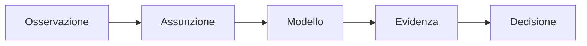

# Measurement theory: cosa significa misurare bene

Nel lavoro quotidiano con i dati, misurare non significa solo contare, ma catturare il concetto giusto. Spesso il team vuole misurare "engagement" con i minuti trascorsi nell'app, ma utenti confusi possono restare più a lungo di utenti soddisfatti. La metrica è precisa ma non valida. Questa distinzione è il cuore della **measurement theory: cosa significa misurare bene**.

## Problema reale

Il problema concreto è capire quando un dato sostiene davvero una decisione e quando invece nasconde assunzioni, bias o una domanda formulata male. Non basta che il dato sia interessante in astratto: deve migliorare una scelta reale, con dati affidabili e una soglia di errore esplicita.

## Modello concettuale

Il processo è sequenziale: si formula la domanda, si traduce in unità osservabili, si valuta la qualità del dato e solo alla fine si decide. Saltare un passaggio produce analisi fragili.

| Passaggio | Domanda guida | Output atteso |
|---|---|---|
| Framing | Quale decisione deve cambiare? | Una scelta concreta |
| Misura | Quale segnale rappresenta il fenomeno? | Metrica, fonte, granularità |
| Confronto | Rispetto a quale baseline interpreto il risultato? | Benchmark o controfattuale |
| Azione | Che cosa faccio se il segnale supera la soglia? | Decisione e prossimo controllo |

## Formalizzazione rigorosa

La measurement theory si formalizza come relazione tra quattro elementi:

| Elemento | Definizione operativa |
|---|---|
| Unità | osservazione, ipotesi, variabile, meccanismo causale o criterio di evidenza |
| Segnale | forza dell'evidenza, coerenza causale, robustezza delle assunzioni, costo dell'errore decisionale |
| Baseline | spiegazione alternativa, controfattuale, gruppo comparabile o scenario senza intervento |
| Decisione | accettare, rifiutare o riformulare una spiegazione prima di usarla |

Una misura è utile solo se riduce l'incertezza su una decisione specifica. Se non cambia una scelta, serve documentazione; se cambia una scelta senza controlli, si corre un rischio.

## Esempio o caso studio

Un comitato interpreta una crescita di retention come prova che una nuova iniziativa abbia funzionato. Applicando la measurement theory, distingue chiaramente tra evidenza, interpretazione e decisione:

| Evidenza | Interpretazione prudente | Decisione conseguente |
|---|---|---|
| Segnale positivo ma non isolato | Fenomeno esiste, causa incerta | Cercare baseline o holdout |
| Segmento con risposta diversa | Effetto medio nasconde eterogeneità | Analizzare coorti o sottogruppi |
| Costo operativo crescente | Valutare risultato sul margine | Applicare soglie economiche |

Questo evita di presentare un numero come conclusione autosufficiente.

## Lab / esercizio

### Livello base

Scrivi in cinque righe: obiettivo, metrica primaria, baseline, rischio principale e azione prevista per una decisione reale collegata alla measurement theory.

### Livello intermedio

Costruisci una tabella con almeno tre segmenti o scenari. Per ciascuno indica segnale, possibile spiegazione alternativa e controllo necessario prima di decidere.

### Livello research-grade

Disegna un piano di validazione: ipotesi, dati necessari, criteri di esclusione, soglia decisionale e controllo post-decisione. Specifica cosa ti farebbe cambiare idea.

### Dataset e materiali consigliati

Usa case study decisionali, metriche prodotto, risultati di esperimenti, DAG semplici, report analitici e serie storiche simulate. Se non hai dati reali, crea un dataset sintetico con 200-500 righe, una colonna temporale, una colonna segmento, una metrica di outcome e una variabile di esposizione.

## Errore tipico da evitare

Trattare la measurement theory come una definizione da ricordare invece che come un protocollo decisionale. Succede quando si presenta una metrica senza baseline, un grafico senza ipotesi o una raccomandazione senza costo dell'errore. Chiediti sempre: "Se questo risultato fosse falso o instabile, quale decisione sbaglierei?" Se la risposta non è chiara, la lezione non è stata applicata davvero.

## Quiz o checkpoint

1. Qual è la decisione concreta che questa lezione dovrebbe migliorare?
2. Quale baseline rende interpretabile il risultato?
3. Quale assunzione, se sbagliata, cambierebbe la conclusione?
4. Quale controllo minimo useresti prima di presentare la raccomandazione?

## Riepilogo operativo

La measurement theory collega concetto, dato e decisione. Studiala partendo da un problema reale, formalizza il segnale, cerca una baseline credibile, costruisci un esempio e chiudi con un controllo pratico. Solo così la conoscenza diventa competenza utile per decisioni sotto incertezza.
