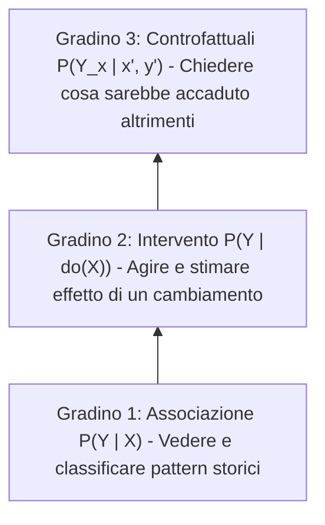

Considera uno scenario costruito con numeri di esempio tratto da una situazione ormai ricorrente nei team di data science. Un'azienda di servizi digitali addestra un modello di machine learning per prevedere l'abbandono dei clienti (churn) mescolando casualmente due anni di storico in cross-validation e raggiunge un'eccellente area sotto la curva (AUC) pari a 0,91. Entusiasta dell'accuratezza, il team collega il modello a un sistema automatico che invia un buono sconto di 15 euro ai 2.000 utenti con la probabilità di abbandono stimata più alta del mese. Dopo sessanta giorni, il tasso di abbandono del segmento bersaglio non scende affatto rispetto a un controllo non trattato, mentre i margini aziendali calano di decine di migliaia di euro.

Cosa ha tradito un modello così preciso sui test interni? Il modello sapeva riconoscere benissimo i segnali passivi di un cliente già deciso ad andarsene (come la disattivazione del rinnovo automatico o il calo di accessi nelle ultime settimane), rispondendo alla domanda associativa "chi sta per uscire?". Ma l'azienda lo ha usato per decidere un **intervento** ("a chi conviene dare 15 euro per farlo restare?"), scoprendo a proprie spese che prevedere bene il futuro osservato non equivale affatto a sapere cosa accade quando si modifica il sistema.

## Da Hume alla scala della causalità di Pearl

> **Idea chiave:** La previsione statistica pura, anche potenziata da reti neurali profonde o modelli linguistici, rimane confinata al primo gradino dell'associazione passiva; per decidere un'azione e resistere al cambio di regime occorrono un grafo causale e la stima esplicita dell'intervento.

Per quasi tre secoli la metodologia empirica ha oscillato tra lo scetticismo di David Hume e la prudenza positivista. Nel 1748 Hume osservò che l'esperienza diretta non ci mostra mai un "legame necessario" tra due eventi, ma soltanto una **congiunzione costante** nel tempo: vediamo la palla da biliardo A urtare la B e poi vediamo la B muoversi, ma ciò che chiamiamo causa è un'inferenza della nostra mente costruita sull'abitudine. Per evitare metafisiche arbitrarie, la statistica classica del primo Novecento (da Karl Pearson in poi) arrivò quasi a bandire la parola "causalità" fuori dagli esperimenti controllati randomizzati, riducendo l'analisi osservazionale alla ricerca di correlazioni e regressioni predittive.

Questa rinuncia ha mostrato tutti i suoi limiti nell'era del machine learning su larga scala. Come ha sintetizzato Judea Pearl insieme a Dana Mackenzie in *The Book of Why* (2018), la conoscenza causale non si riduce alla distribuzione statistica congiunta dei dati, ma si articola su tre gradini qualitativamente distinti della cosiddetta **Scala della Causalità** (*Ladder of Causation*). Nessuna quantità di dati raccolti passivamente sul gradino inferiore permette di rispondere alle domande del gradino superiore senza introdurre assunzioni strutturali sul meccanismo generatore.

Sul primo gradino operano quasi tutti i modelli predittivi standard: leggono la probabilità condizionata `P(Y | X)`, stimando quanto è probabile che un cliente compri o abbandoni dato ciò che osserviamo nel suo profilo. Sul secondo gradino opera la logica dell'intervento `P(Y | do(X))`, dove non osserviamo passivamente un attributo, ma modifichiamo attivamente il sistema (ad esempio cambiando un prezzo, somministrando un farmaco o inviando un incentivo) recidendone le cause precedenti. Sul terzo gradino risiedono i ragionamenti controfattuali e la responsabilità retrospettiva ("questo specifico cliente avrebbe rinnovato comunque se non gli avessimo inviato lo sconto?").

| Approccio analitico | Gradino di Pearl | Domanda a cui risponde | Metodo di verifica valido | Punto di rottura tipico |
|---|---|---|---|---|
| Machine learning predittivo | Gradino 1 (Associazione) | Chi presenta il segnale associato all'esito nello storico? | Validazione temporale strictly out-of-time | Drift di contesto e targeting errato sugli interventi |
| Esperimento controllato (A/B test) | Gradino 2 (Intervento) | Qual è l'effetto medio di questa azione rispetto al controllo? | Randomizzazione pulita, SRM check e metriche guardrail | Costi alti, interferenza di rete o impossibilità etica |
| Inferenza causale con DAG / Uplift | Gradino 2–3 (Intervento / CATE) | Su quali segmenti l'azione produce valore incrementale netto? | Grafi causali espliciti, falsificazioni e holdout di verifica | Confondenti non misurati o errori nella struttura causale |
| Workflow assistiti da LLM e AutoML | Gradino 1 automatizzato | Quali ipotesi, query o feature candidate emergono dal testo/dati? | Audit umano di causalità, leakage e definizione metrica | Automazione cieca di correlazioni spurie e data leakage |

## Propensione predittiva contro effetto incrementale: il calcolo svolto

Per toccare con mano perché il Gradino 1 e il Gradino 2 portano a decisioni economiche opposte, esaminiamo con i numeri la gestione della campagna di retention accennata in apertura. Supponiamo di avere una base di **10.000 clienti** prossimi al rinnovo annuale. Ogni cliente che rinnova genera un margine annuo netto pari a **60 euro**, mentre il buono sconto per trattenerlo costa **15 euro** (erogato a ogni cliente trattato che rinnova e applica il coupon, o ipotizziamo un costo netto di incentivo di **15 euro** per cliente a cui il buono viene effettivamente concesso e riscattato, oppure per semplicità un costo diretto di campagna e sconto pari a **15 euro** per ciascuno dei clienti selezionati).

Dietro i dati apparentemente omogenei dei 10.000 clienti si nascondono quattro popolazioni causali molto diverse in termini di risposta all'intervento (modello **uplift**). I **clienti fedeli ("Sure Things")** sono 5.000 e rinnovano all'85% senza incentivo e all'86% con incentivo: l'effetto causale è quasi nullo, quindi lo sconto rappresenta un costo sprecato su chi avrebbe rinnovato comunque. I **clienti irrecuperabili ("Lost Causes")** sono 2.000 e hanno già deciso di chiudere l'account, rinnovando al 5% senza incentivo e al 6% con incentivo: mostrano un'altissima probabilità di churn, ma restano insensibili allo sconto. I **clienti persuadibili ("Persuadables")** sono 2.500 utenti indecisi sul valore del servizio: senza sconto rinnovano al 40%, ma con il buono sconto da 15 euro salgono al **75%** di rinnovo, realizzando un salto causale di **+35 punti percentuali**. Infine, i **clienti disturbati ("Sleeping Dogs")** sono 500 utenti che non pensavano alla disdetta, ma ricevendo la mail promozionale controllano la spesa e riducono il rinnovo dal 70% al 50% (-20 pp).

Vediamo cosa succede se usiamo il modello predittivo di churn del Gradino 1 per colpire i **2.000 clienti con rischio di abbandono più alto** (cioè esattamente i 2.000 "Lost Causes", che mostrano il 95% di probabilità di uscita). Senza intervento avrebbero rinnovato il 5% di 2.000 = **100 clienti**, generando 100 × 60 euro = **6.000 euro** di margine. Con l'invio dello sconto a tutti i 2.000 utenti (costo diretto = 2.000 × 15 euro = **30.000 euro**), il tasso di rinnovo sale appena al 6%, portando a 120 rinnovi × 60 euro = **7.200 euro** di margine lordo. Il bilancio netto dell'intervento rispetto al non fare nulla è: incremento lordo di (7.200 - 6.000) = **+1.200 euro**, meno il costo di 30.000 euro → una perdita netta di **-28.800 euro** (ROI fortemente negativo).

Ora confrontiamo questa scelta con un modello causale di **uplift** (Gradino 2) che mira invece ai **2.500 clienti persuadibili**, i quali non avevano la probabilità assoluta di churn più estrema, ma presentavano il massimo effetto incrementale `P(Rinnovo | do(Sconto)) - P(Rinnovo | do(No Sconto))` = 75% - 40% = **+35 punti percentuali**. Senza intervento avrebbero rinnovato 2.500 × 40% = **1.000 clienti** (60.000 euro di margine). Con lo sconto a tutti i 2.500 clienti (costo = 2.500 × 15 euro = **37.500 euro**), rinnovano 2.500 × 75% = **1.875 clienti**, generando 1.875 × 60 euro = **112.500 euro** di margine lordo. L'incremento lordo generato dall'azione è 112.500 - 60.000 = **+52.500 euro** (ovvero 875 salvataggi incrementali × 60 euro = 52.500 euro). Sottratto il costo di 37.500 euro, l'azienda ottiene un guadagno netto reale di 52.500 - 37.500 = **+15.000 euro**. La distanza tra scegliere sulla sola previsione passiva (-28.800 euro) e scegliere sull'effetto causale dell'intervento (+15.000 euro) vale **43.800 euro** sullo stesso identico portafoglio utenti.

## Google Flu Trends 2013: la lezione sull'arroganza dei big data

La convinzione che enormi volumi di correlazioni possano sostituire la comprensione causale dei meccanismi ha ricevuto una smentita clamorosa nel caso di **Google Flu Trends (GFT)**. Lanciato nel 2008, il progetto utilizzava decine di milioni di ricerche quotidiane sul motore di ricerca per stimare in tempo reale la diffusione dell'influenza negli Stati Uniti più velocemente dei report ufficiali dei Centers for Disease Control and Prevention (CDC). Nei primi anni l'adattamento statistico sui dati storici sembrava prodigioso, alimentando l'entusiasmo verso una scienza puramente guidata dai dati senza bisogno di ipotesi teoriche.

Tra l'inverno **2012 e il 2013**, tuttavia, il modello andò completamente fuori strada: secondo l'analisi pubblicata nel **2014** su *Science* da David Lazer, Ryan Kennedy, Gary King e Alessandro Vespignani, Google Flu Trends sovrastimò l'incidenza influenzale di oltre il **doppio** rispetto alle rilevazioni cliniche effettive del CDC (con errori sistematici per oltre 100 settimane consecutive).

Le cause del fallimento erano due e perfettamente istruttive per chi progetta modelli oggi. Prima di tutto, l'algoritmo aveva catturato correlazioni di stagione ("ricerche invernali generiche") insieme alle parole legate all'influenza, senza distinguere la malattia dal semplice allarme mediatico generato dai notiziari. Secondo, il sistema stesso non era stabile nel tempo: le modifiche apportate dagli ingegneri di Google ai suggerimenti automatici di ricerca ("autocomplete") cambiavano la frequenza con cui gli utenti digitavano certi sintomi indipendentemente dall'epidemia reale. Come ricordava il celebre aforisma di George Box del **1976** ("tutti i modelli sono sbagliati, ma alcuni sono utili"), un modello associativo privo di ancoraggio causale e di ricalibrazione continua contro misure indipendenti crolla non appena il meccanismo di generazione dei dati muta leggermente.

## Il futuro dell'analisi dati nell'era dei modelli linguistici e agentici

L'arrivo di AutoML, modelli fondazionali e agenti basati su Large Language Models (LLM) sta automatizzando a ritmi rapidissimi la parte meccanica del lavoro analitico: scrivere query SQL, generare grafici esplorativi, pulire tabelle e persino lanciare decine di regressioni o alberi decisionali in pochi minuti. Chi pensava che il valore dell'analista risiedesse nella sola sintassi o nella velocità di esecuzione di un modello predittivo standard vede ridursi drasticamente il proprio spazio.

Al contrario, l'automazione rende ancora più preziose le competenze filosofiche e metodologiche al centro di questo percorso. Un agente AI può generare dieci spiegazioni eleganti per una correlazione spuria in trenta secondi, e un tool di AutoML può ottimizzare automaticamente una metrica costruita su una colonna che contiene informazioni del futuro (**data leakage**), producendo un'accuratezza da capogiro su test impossibili da replicare in produzione. Nel futuro dell'analisi dati, il professionista non è il compilatore umano di script, ma l'**architetto epistemico e causale** che formula le domande giuste, definisce i confini di validità dell'evidenza, impone l'audit sul tempo e sulla casualità, e si assume la responsabilità etica e strategica delle decisioni automatizzate.

> **Contratto di rilascio e vigilanza per modelli in produzione:**
> - **Validazione rigorosamente temporale (out-of-time):** ogni modello che opera su processi che evolvono nel tempo va testato esclusivamente su finestre future mai viste durante l'addestramento, vietando suddivisioni casuali tra passato e futuro.
> - **Audit di causalità e leakage:** verifica per ogni variabile ad alto potere predittivo che sia nota prima del momento della decisione e chiarisci se esprime una causa, un proxy comportamentale o un artefatto procedurale.
> - **Soglia di arresto su drift e calibrazione:** imposta un monitoraggio continuo della distribuzione degli ingressi e della calibrazione reale sugli esiti recenti, con blocco automatico degli interventi automatizzati se l'errore supera la soglia pattuita.

## Tre trappole moderne tra predizione e automazione

### Validare modelli temporali con split casuale mescolando futuro e passato

Il sintomo compare quando un modello predittivo raggiunge metriche quasi perfette in laboratorio (come AUC superiore a 0,90 o R² vicino a 0,95), ma crolla nella prima settimana dopo il rilascio su dati freschi. Sembra inspiegabile perché l'esecuzione della cross-validation a 5 fold era formalmente corretta dal punto di vista del codice. In realtà, dividere casualmente le righe di una serie temporale o di uno storico clienti permette al modello di imparare nel training informazioni provenienti dal futuro dello stesso periodo o dallo stesso contesto di campagna del test set, creando data leakage temporale. Si evita imponendo una partizione cronologica netta ("train sul passato, validazione su finestra successiva separata da eventuale gap temporale").

### Usare una probabilità predittiva per scegliere chi trattare senza stimare l'uplift

Il sintomo si manifesta quando un team costruisce un punteggio di rischio (abbandono, insolvenza, mancata conversione) e applica automaticamente sconti, telefonate o blocchi ai casi con punteggio estremo. Sembra logico perché si interviene "dove il problema è più grave". In realtà, come dimostrato nel calcolo svolto sopra, i casi a rischio estremo sono spesso "Lost Causes" che non cambiano comportamento nemmeno sotto incentivo, oppure clienti che avrebbero agito comunque; colpire chi ha alto rischio di base invece di chi ha alto beneficio incrementale brucia budget e può persino irritare i clienti "Sleeping Dogs". Si evita progettando un test randomizzato con gruppo di controllo (anche piccolo) per stimare la risposta differenziale al trattamento prima di scalare qualsiasi automazione.

### Delegare a LLM e AutoML la selezione delle variabili senza un grafo causale a monte

Il sintomo emerge quando si chiede a un assistente automatizzato o a una pipeline AutoML di "trovare i migliori predittori" dentro un database ricco di centinaia di tabelle operative e promuovere i risultati direttamente in dashboard decisionali. Sembra produttivo perché riduce i tempi di esplorazione da settimane a minuti. In realtà, gli algoritmi statistici non distinguono tra un antecedente causale e una colonna aggiornata dopo l'evento (come "numero di ticket di cancellazione" o "flag di chiusura pratica"), promuovendo variabili inutilizzabili o fuorvianti al momento reale della scelta. Si previene imponendo una revisione causale a monte di qualsiasi pipeline automatica per escludere variabili post-trattamento, collider e proxy futuri.

## Verifica epistemica sull'inferenza causale e sul futuro dell'AI

1. Un'azienda di e-commerce addestra un modello predittivo per stimare quali ordini hanno la probabilità più alta di essere resi, e decide di mostrare un avviso di "prodotto spesso restituito" soltanto a quegli ordini prima del checkout per ridurre i resi. Su quale gradino della Scala di Pearl è costruito il modello, e quale errore concettuale sta commettendo il team?

Mostra risposta

Il modello predittivo opera sul Gradino 1 (Associazione: `P(Reso | Caratteristiche Ordine)`), mentre il team sta progettando un'azione attiva sul Gradino 2 (Intervento: `P(Reso | do(Mostra Avviso))`). L'errore sta nel dare per scontato che l'avviso riduca i resi senza verificare l'effetto causale dell'intervento: l'avviso potrebbe far abbandonare completamente l'acquisto a clienti che non avrebbero reso nulla, riducendo il fatturato netto invece di migliorare i margini. Serve un esperimento controllato A/B per misurare l'effetto incrementale su resi e margine netto.

2. Nel confronto numerico sui 10.000 clienti con buono sconto da 15 euro e margine di 60 euro, perché indirizzare lo sconto ai 2.000 clienti a rischio più elevato ("Lost Causes") ha generato una perdita netta di -28.800 euro, mentre puntare sui 2.500 clienti persuadibili ha reso +15.000 euro netti?

Mostra risposta

Perché la probabilità di base di abbandonare non misura la sensibilità allo sconto. I 2.000 "Lost Causes" avevano un tasso di rinnovo base del 5% che saliva appena al 6% con l'incentivo (+20 rinnovi, pari a +1.200 euro lordi a fronte di 30.000 euro di costo sconti). I 2.500 "Persuadables", pur partendo da un rischio intermedio (40% di rinnovo base), rispondevano all'incentivo salendo al 75% (+35 punti percentuali, pari a +875 rinnovi incrementali e +52.500 euro lordi a fronte di 37.500 euro di costi).

3. Quali due lezioni fondamentali lascia il fallimento di Google Flu Trends tra il 2012 e il 2013 a chi oggi costruisce sistemi predittivi basati su big data e segnali comportamentali online?

Mostra risposta

Primo, l'abbondanza di dati correlati non sostituisce la distinzione causale tra fenomeno reale (contagio clinico) e segnali spuri o stagionali (panico mediatico e ricerche invernali). Secondo, i dati generati da piattaforme digitali non sono stazionari: ogni modifica dell'interfaccia utente o dell'algoritmo (come l'autocomplete) altera il processo generatore dei dati, rendendo necessaria una ricalibrazione costante contro una misura di riferimento indipendente.

4. Perché, nonostante la crescente automatizzazione di query SQL, grafici e addestramento di modelli tramite strumenti di intelligenza artificiale, il ruolo dell'analista umano resta decisivo sul piano epistemico?

Mostra risposta

Perché gli strumenti automatici eccellono nell'ottimizzazione sintattica e nella ricerca di associazioni sul Gradino 1, ma non possiedono la conoscenza contestuale necessaria a definire la struttura causale del problema, individuare data leakage temporali o post-trattamento, stabilire metriche guardrail etiche ed economiche e assumersi la responsabilità della decisione finale davanti agli stakeholder.

