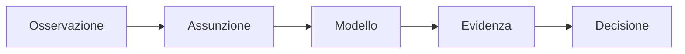

# Dalla causalità classica al futuro dell'analisi dati

Esperimenti, DAG, modelli predittivi e sistemi di AI promettono decisioni più rapide. La domanda di fondo però non cambia: quale legame tra un intervento e un risultato possiamo davvero sostenere? Avere strumenti più moderni non ci dispensa dal pensare con rigore alle cause, semmai rende più facile sbagliare in fretta.

## Il problema da risolvere

Il problema concreto è sempre lo stesso: capire quando un dato sostiene davvero una decisione e quando invece nasconde un'assunzione, un bias, una causalità fragile o una domanda posta male. Non interessa apprezzare il pensiero causale in astratto. Interessa usarlo per prendere decisioni migliori, con dati affidabili e una soglia di errore dichiarata.

Conviene quindi leggere questa lezione come uno strumento di lavoro. Alla fine dovresti saper inquadrare il problema analitico nel suo contesto decisionale e applicare esempi, metriche e controlli a casi reali. Finché il concetto non si collega a una scelta concreta, resta un'idea decorativa.

## Come ragionare sul dato



Il ragionamento segue un ordine. Prima si formula la domanda, poi la si traduce in unità osservabili, si valuta la qualità del dato e solo alla fine si decide. Quando si salta un passaggio l'analisi può restare elegante sulla carta e crollare alla prima verifica.

| Passaggio | Domanda guida | Output atteso |
|---|---|---|
| Framing | Quale decisione deve cambiare? | Una scelta concreta, non una curiosità |
| Misura | Quale segnale rappresenta il fenomeno? | Metrica, fonte e granularità |
| Confronto | Rispetto a quale baseline interpreto il risultato? | Benchmark o controfattuale plausibile |
| Azione | Che cosa faccio se il segnale supera la soglia? | Decisione, owner e prossimo controllo |

## I quattro elementi della misura

Possiamo descrivere il pensiero causale come una relazione tra quattro elementi: unità di analisi, segnale, baseline e decisione. L'unità può essere un'osservazione, un'ipotesi, una variabile, un meccanismo causale o un criterio di evidenza. Il segnale tiene conto della forza dell'evidenza, della coerenza causale, della robustezza delle assunzioni e del costo che pagheremmo sbagliando. La baseline è ciò rispetto a cui leggiamo il risultato: una spiegazione alternativa, un controfattuale, un gruppo comparabile o uno scenario senza intervento.

| Elemento | Definizione operativa |
|---|---|
| Unità | osservazione, ipotesi, variabile, meccanismo causale o criterio di evidenza |
| Segnale | forza dell'evidenza, coerenza causale, robustezza delle assunzioni e costo dell'errore decisionale |
| Baseline | spiegazione alternativa, controfattuale, gruppo comparabile o scenario senza intervento |
| Decisione | accettare, rifiutare o riformulare una spiegazione prima di usarla in azienda |
| Rischio | confondere correlazione, qualità del dato e causalità decisionale |

La regola pratica resta semplice: una misura serve solo se riduce l'incertezza su una decisione specifica. Se non cambia una scelta è documentazione; se cambia una scelta senza essere passata da controlli è un rischio.

## Un caso pratico

Prendi un comitato che legge una crescita della retention come prova che la nuova iniziativa ha funzionato. Prima di trasformare quel numero in azione bisogna separare quattro piani che di solito si sovrappongono: cosa abbiamo osservato, come lo spieghiamo, cosa stiamo assumendo e cosa decidiamo.

Una lettura in tre colonne aiuta: cosa sappiamo, cosa assumiamo, quale decisione ne ricaviamo. È un formato banale, ma impedisce di spacciare un dato per una conclusione che si regge da sola.

| Evidenza | Interpretazione prudente | Decisione conseguente |
|---|---|---|
| Segnale positivo ma non isolato | Il fenomeno esiste, ma la causa è incerta | Cercare baseline o holdout |
| Segmento con risposta diversa | L'effetto medio nasconde eterogeneità | Analizzare coorti o sottogruppi |
| Costo operativo crescente | Il risultato va valutato sul margine | Applicare soglie economiche |

## Esercizi per metterla in pratica

Comincia dal livello base. In cinque righe descrivi una decisione reale legata al pensiero causale: obiettivo, metrica primaria, baseline, rischio principale e azione prevista. Tieni una sola metrica primaria, perché due metriche primarie significano che non hai ancora deciso cosa conta.

Al livello intermedio costruisci una tabella con almeno tre segmenti o scenari. Per ognuno scrivi il segnale, una spiegazione alternativa plausibile e il controllo che faresti prima di decidere.

Il livello research-grade chiede un piano di validazione completo: ipotesi, dati necessari, criterio di esclusione, soglia decisionale e un controllo da fare dopo la decisione. Aggiungi cosa ti farebbe cambiare idea, altrimenti stai solo cercando conferme.

Come materiali usa case study decisionali, metriche di prodotto, risultati di esperimenti, DAG semplici, report analitici e serie storiche simulate. In assenza di dati reali, genera un dataset sintetico con 200-500 righe, una colonna temporale, una di segmento, una metrica di outcome e una variabile di esposizione.

## L'errore da evitare

L'errore più comune è trattare il pensiero causale come una definizione da memorizzare invece che come un protocollo da seguire. Lo si vede quando arriva una metrica senza baseline, un grafico senza l'ipotesi che dovrebbe testare o una raccomandazione che ignora quanto costa sbagliare.

Il controllo è sempre lo stesso: se questo risultato fosse falso o instabile, quale decisione sbaglierei? Quando la risposta non è chiara, la lezione non è ancora diventata pratica.

## Domande di controllo

1. Qual è la decisione concreta che questa lezione dovrebbe migliorare?
2. Quale baseline rende interpretabile il risultato?
3. Quale assunzione, se sbagliata, cambierebbe la conclusione?
4. Quale controllo minimo useresti prima di presentare la raccomandazione?

## Riepilogo

Il pensiero causale conta quando lega tra loro il concetto, il dato e la decisione. Conviene studiarlo partendo da un problema reale, dando forma al segnale, cercando una baseline credibile, lavorando su un esempio e chiudendo con un controllo concreto. Gli strumenti cambiano, dagli esperimenti ai sistemi di AI, ma è questo lavoro a fare la differenza tra una decisione consapevole e un esercizio accademico.

## Problema reale

Questo concetto si applica quando lavori con dataset reali e hai bisogno di una struttura chiara per ragionare su Dalla causalità classica al futuro dell'analisi dati. Il problema tipico è non avere un framework condiviso tra il team per valutare la soluzione, con il risultato che ogni analisi parte da presupposti diversi.

**Quando lo incontrerai:**
- Quando presenti un risultato e qualcuno chiede "ma come sei arrivato a questo numero?"
- Quando il risultato di una query cambia radicalmente cambiando un filtro
- Quando il modello che hai costruito funziona sui dati di test ma non su quelli di produzione

## Modello concettuale

Il Dalla causalità classica al futuro dell'analisi dati si definisce attraverso tre dimensioni:

1. **Struttura**: come sono organizzati i dati o il processo
2. **Logica**: quale relazione causa-effetto governa il comportamento
3. **Misura**: quale metrica usi per valutare il risultato

Questo modello ti permette di scomporre qualsiasi istanza del problema nelle sue parti verificabili.

## Formalizzazione rigorosa

```sql
-- TODO: aggiungi la formalizzazione specifica per Dalla causalità classica al futuro dell'analisi dati
-- Pattern per avanzato:

SELECT
    /* indica qui la tua metrica principale */
FROM
    /* indica qui la sorgente dati */
WHERE
    /* indica qui i filtri */
GROUP BY
    /* indica qui le dimensioni di raggruppamento */
```

**Principio guida:** verifica sempre che la somma delle parti sia uguale al totale.

## Esempio o caso studio

**Caso tipico (livello avanzato):**

Immaginiamo un team marketing che deve misurare la retention a 30 giorni. L'errore più comune è calcolarla come `COUNT(DISTINCT user_id)` senza filtrare per data di attivazione, includendo utenti che non hanno ancora avuto 30 giorni di tempo. La versione corretta filtra prima la cohort di attivazione e poi applica il calcolo.

```sql
WITH cohort AS (
    SELECT
        user_id,
        MIN(event_date) AS activation_date
    FROM events
    GROUP BY user_id
),
retention AS (
    SELECT
        c.activation_date,
        COUNT(DISTINCT e.user_id) AS retained_users
    FROM cohort c
    JOIN events e ON c.user_id = e.user_id
        AND e.event_date >= c.activation_date
        AND e.event_date <= c.activation_date + INTERVAL '30 days'
    GROUP BY c.activation_date
)
SELECT
    activation_date,
    retained_users,
    ROUND(retention_rate * 100, 2) AS retention_pct
FROM retention;
```

## Lab / esercizio

**Esercizio — livello avanzato**

1. **Prepara l'ambiente:** carica il dataset di esempio nel tuo warehouse
2. **Applica il pattern:** scrivi la query che implementa il modello concettuale per il tuo caso
3. **Verifica:** controlla che il risultato sia coerente con le tue aspettative usando un sanity check

**Tempo stimato:** 20-30 minuti

## Errore tipico da evitare

**L'errore più comune a livello avanzato:**

Non distinguere tra una metrica calcolata su tutta la popolazione e una metrica calcolata su una sotto-popolazione specifica. Ad esempio, calcolare il tasso di conversione medio senza filtrare per canale di acquisizione porta a decisioni sbagliate perché il mix di canali cambia nel tempo.

**Come evitarlo:**
- Chiediti sempre: "rispetto a cosa sto misurando questo?"
- Verifica che il denominatore sia corretto prima di fidarti del numeratore
- Usa un gruppo di controllo quando possibile

## Quiz o checkpoint

1. Qual è la differenza tra la metrica calcolata su tutta la popolazione e quella calcolata su una cohort?
2. Scrivi il codice SQL che implementa il modello concettuale per un caso a tua scelta
3. Quale sanity check useresti per verificare che il risultato sia corretto?

---

*Queste sezioni sono placeholder generici. Sostituisci con contenuto specifico per la lezione.*

### Livello base

Spiegazione intuitiva di Dalla causalità classica al futuro dell'analisi dati:

Il concetto alla base è semplice: invece di fare affidamento sull'intuizione, usi un metodo riproducibile. A livello base, ti basta capire quale domanda stai ponendo e quali dati hai a disposizione per risponderci.

### Livello intermedio

Applicazione concreta di Dalla causalità classica al futuro dell'analisi dati:

A questo livello applichi il concetto a un caso specifico. Ad esempio, se stai analizzando la retention, il tuo dataset ha dimensioni come data di attivazione, data di evento, e user_id. La segmentazione per canale di acquisizione ti dà insight aggiuntivi che il dato grezzo non mostra.

### Livello research-grade

Approfondimento teorico:

Per chi vuole capire il fondamento teorico, la letteratura classica include:
- Kimball, "The Data Warehouse Toolkit" — per approcci dimensionali
- McKinney, "Python for Data Analysis" — per implementazione pratica
- Aggiora i riferimenti con paper recenti specifici per il tuo dominio

### Dataset e materiali consigliati

**Per esercitarti:**
- Usa il dataset di esempio fornito nella lezione
- Per un challenge aggiuntivo, prova con dati pubblici come quelli di Kaggle

**Tool consigliati:**
- dbt Core per trasformazioni
- Metabase o Superset per visualizzazione