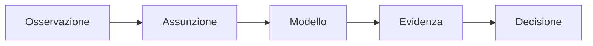

# Dalla causalità classica al futuro dell'analisi dati

Esperimenti, DAG, modelli predittivi e sistemi di AI promettono decisioni più rapide. La domanda di fondo però non cambia: quale legame tra un intervento e un risultato possiamo davvero sostenere? Avere strumenti più moderni non ci dispensa dal pensare con rigore alle cause, semmai rende più facile sbagliare in fretta.

## Il problema da risolvere

Il problema concreto è sempre lo stesso: capire quando un dato sostiene davvero una decisione e quando invece nasconde un'assunzione, un bias, una causalità fragile o una domanda posta male. Non interessa apprezzare il pensiero causale in astratto. Interessa usarlo per prendere decisioni migliori, con dati affidabili e una soglia di errore dichiarata.

Conviene quindi leggere questa lezione come uno strumento di lavoro. Alla fine dovresti saper inquadrare il problema analitico nel suo contesto decisionale e applicare esempi, metriche e controlli a casi reali. Finché il concetto non si collega a una scelta concreta, resta un'idea decorativa.

## Come ragionare sul dato

Il ragionamento segue un ordine. Prima si formula la domanda, poi la si traduce in unità osservabili, si valuta la qualità del dato e solo alla fine si decide. Quando si salta un passaggio l'analisi può restare elegante sulla carta e crollare alla prima verifica.

| Passaggio | Domanda guida | Output atteso |
|---|---|---|
| Framing | Quale decisione deve cambiare? | Una scelta concreta, non una curiosità |
| Misura | Quale segnale rappresenta il fenomeno? | Metrica, fonte e granularità |
| Confronto | Rispetto a quale baseline interpreto il risultato? | Benchmark o controfattuale plausibile |
| Azione | Che cosa faccio se il segnale supera la soglia? | Decisione, owner e prossimo controllo |

## I quattro elementi della misura

Possiamo descrivere il pensiero causale come una relazione tra quattro elementi: unità di analisi, segnale, baseline e decisione. L'unità può essere un'osservazione, un'ipotesi, una variabile, un meccanismo causale o un criterio di evidenza. Il segnale tiene conto della forza dell'evidenza, della coerenza causale, della robustezza delle assunzioni e del costo che pagheremmo sbagliando. La baseline è ciò rispetto a cui leggiamo il risultato: una spiegazione alternativa, un controfattuale, un gruppo comparabile o uno scenario senza intervento.

| Elemento | Definizione operativa |
|---|---|
| Unità | osservazione, ipotesi, variabile, meccanismo causale o criterio di evidenza |
| Segnale | forza dell'evidenza, coerenza causale, robustezza delle assunzioni e costo dell'errore decisionale |
| Baseline | spiegazione alternativa, controfattuale, gruppo comparabile o scenario senza intervento |
| Decisione | accettare, rifiutare o riformulare una spiegazione prima di usarla in azienda |
| Rischio | confondere correlazione, qualità del dato e causalità decisionale |

La regola pratica resta semplice: una misura serve solo se riduce l'incertezza su una decisione specifica. Se non cambia una scelta è documentazione; se cambia una scelta senza essere passata da controlli è un rischio.

## Un caso pratico

Prendi un comitato che legge una crescita della retention come prova che la nuova iniziativa ha funzionato. Prima di trasformare quel numero in azione bisogna separare quattro piani che di solito si sovrappongono: cosa abbiamo osservato, come lo spieghiamo, cosa stiamo assumendo e cosa decidiamo.

Una lettura in tre colonne aiuta: cosa sappiamo, cosa assumiamo, quale decisione ne ricaviamo. È un formato banale, ma impedisce di spacciare un dato per una conclusione che si regge da sola.

| Evidenza | Interpretazione prudente | Decisione conseguente |
|---|---|---|
| Segnale positivo ma non isolato | Il fenomeno esiste, ma la causa è incerta | Cercare baseline o holdout |
| Segmento con risposta diversa | L'effetto medio nasconde eterogeneità | Analizzare coorti o sottogruppi |
| Costo operativo crescente | Il risultato va valutato sul margine | Applicare soglie economiche |

## Esercizi per metterla in pratica

Comincia dal livello base. In cinque righe descrivi una decisione reale legata al pensiero causale: obiettivo, metrica primaria, baseline, rischio principale e azione prevista. Tieni una sola metrica primaria, perché due metriche primarie significano che non hai ancora deciso cosa conta.

Al livello intermedio costruisci una tabella con almeno tre segmenti o scenari. Per ognuno scrivi il segnale, una spiegazione alternativa plausibile e il controllo che faresti prima di decidere.

Il livello research-grade chiede un piano di validazione completo: ipotesi, dati necessari, criterio di esclusione, soglia decisionale e un controllo da fare dopo la decisione. Aggiungi cosa ti farebbe cambiare idea, altrimenti stai solo cercando conferme.

Come materiali usa case study decisionali, metriche di prodotto, risultati di esperimenti, DAG semplici, report analitici e serie storiche simulate. In assenza di dati reali, genera un dataset sintetico con 200-500 righe, una colonna temporale, una di segmento, una metrica di outcome e una variabile di esposizione.

## L'errore da evitare

L'errore più comune è trattare il pensiero causale come una definizione da memorizzare invece che come un protocollo da seguire. Lo si vede quando arriva una metrica senza baseline, un grafico senza l'ipotesi che dovrebbe testare o una raccomandazione che ignora quanto costa sbagliare.

Il controllo è sempre lo stesso: se questo risultato fosse falso o instabile, quale decisione sbaglierei? Quando la risposta non è chiara, la lezione non è ancora diventata pratica.

## Domande di controllo

1. Qual è la decisione concreta che questa lezione dovrebbe migliorare?
2. Quale baseline rende interpretabile il risultato?
3. Quale assunzione, se sbagliata, cambierebbe la conclusione?
4. Quale controllo minimo useresti prima di presentare la raccomandazione?

## Riepilogo

Il pensiero causale conta quando lega tra loro il concetto, il dato e la decisione. Conviene studiarlo partendo da un problema reale, dando forma al segnale, cercando una baseline credibile, lavorando su un esempio e chiudendo con un controllo concreto. Gli strumenti cambiano, dagli esperimenti ai sistemi di AI, ma è questo lavoro a fare la differenza tra una decisione consapevole e un esercizio accademico.
