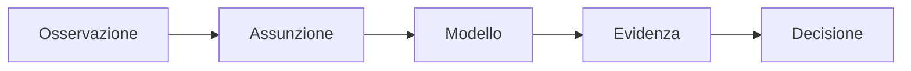

# David Hume: esperienza, abitudine mentale e scetticismo

Immagina un analista che non vuole scambiare correlazione, misura e causalita per verita assolute quando un dato sembra evidente, ma la domanda vera e cosa possiamo legittimamente concludere. Sul tavolo non c'è un esercizio astratto: c'è la pressione concreta di rendere esplicite assunzioni, limiti e responsabilita. **David Hume: esperienza, abitudine mentale e scetticismo** entra qui, nel punto in cui una scelta deve diventare più chiara, più misurabile e più difendibile.

## Una scena da cui partire

La lezione va letta con questo atteggiamento: non collezionare frasi da ricordare, ma cercare il passaggio che trasforma un pensiero critico che rende l'analisi più onesta in lavoro reale. Trattala come una lente mentale: il valore sta nel cambiare il modo in cui osservi un problema prima ancora di aprire un tool. Il livello è avanzato: non cercare una ricetta unica, cerca i vincoli che cambiano la risposta.

- **Contesto:** Quale intuizione deve restare dopo la lettura?
- **Metodo:** Quale esempio rende concreto il concetto?
- **Applicazione:** Quale errore diventa più facile evitare?

## Il problema dell'induzione

Hume parte da una distinzione semplice ma devastante. Ci sono due tipi di conoscenza:

- **Relazioni di idee**: verità logiche e matematiche. "2+2=4" è vero per definizione, non dipende dall'esperienza. È certo, ma non dice nulla sul mondo.
- **Questioni di fatto**: verità sul mondo. "Il sole sorge ogni mattina" è basato sull'esperienza passata. È utile, ma non è certo.

Il problema: passare dall'esperienza passata a una previsione futura richiede il *principio di uniformità della natura* — l'assunzione che il futuro assomiglierà al passato. Ma come giustifichi questa assunzione? Se dici "perché in passato il futuro ha sempre assomigliato al passato", stai usando l'induzione per giustificare l'induzione. È un circolo vizioso.

Tradotto in linguaggio moderno: il tuo modello di churn predice che i clienti che non loggano da 30 giorni churneranno. Funziona perché in passato è stato così. Ma cosa ti garantisce che domani i clienti non cambieranno comportamento? Nulla. Solo l'abitudine mentale di Hume: abbiamo visto X molte volte, e la nostra mente *si aspetta* che X continui. Non è logica: è psicologia.

## Cosa significa per l'analisi dati

Lo scetticismo di Hume non è paralizzante. È liberatorio. Significa che il tuo lavoro non è trovare "la verità", ma costruire modelli *utili* sapendo che sono provvisori. Tre implicazioni pratiche:

### 1. Ogni modello è una scommessa, non una verità

Un modello predittivo non "ha ragione" o "ha torto". Ha una probabilità di essere utile dato il contesto attuale. Quando il contesto cambia (nuovo competitor, cambiamento di mercato, pandemia), il modello può diventare inutile senza che il modello stesso sia cambiato. I dati di training erano validi, il mondo non lo è più.

### 2. Il backtesting non è una garanzia

"Funzionava sul backtest" non significa "funzionerà in futuro". Il backtest ti dice che il modello era adatto al passato. Ma il problema dell'induzione di Hume ti ricorda che il passato non garantisce il futuro. Il vero test è il forward performance in produzione.

### 3. La replicabilità è un sintomo, non una prova

Se 5 analyst ottengono lo stesso risultato su 5 dataset diversi, è un buon segno. Ma Hume ti ricorda che l'uniformità osservata non dimostra l'uniformità futura. La scienza dei dati ha una crisi di riproducibilità proprio perché confonde "ho replicato il risultato 3 volte" con "il risultato è vero".

## Caso reale: i modelli di trading durante la crisi del 2008

Nell'estate 2007, i modelli quantitativi di Goldman Sachs e altri fondi funzionavano perfettamente. I backtest mostravano Sharpe ratio elevati, il rischio era "sotto controllo". Meno di 12 mesi dopo, molti di quei modelli erano falliti catastroficamente. Cos'era successo?

I modelli assumevano che la distribuzione dei rendimenti fosse stazionaria — che il futuro assomigliasse al passato. Assumevano l'uniformità della natura di Hume. Ma la crisi del 2008 fu un "cigno nero" (Taleb, 2007): un evento che i dati passati non potevano prevedere perché non si era mai verificato prima. L'induzione fallì.

Il CFO di Goldman Sachs, David Viniar, disse una frase rimasta celebre: "Abbiamo visto eventi che secondo i nostri modelli avrebbero dovuto accadere una volta ogni 10.000 anni, accadere per diversi giorni consecutivi." I modelli non erano "sbagliati". Erano basati su un'induzione che Hume aveva smascherato 270 anni prima.

## Come applicare lo scetticismo humeano in modo produttivo

Lo scetticismo non significa paralisi. Significa consapevolezza. Ecco tre pratiche:

1. **Stress test**: non chiedere solo "quanto è accurato il modello nel caso base?" ma "cosa succede se l'assunzione chiave non è più vera?" Se il churn smette di correlare con i giorni di inattività, il modello regge?

2. **Drift detection**: monitora non solo l'accuratezza del modello ma anche la distribuzione dei dati in input. Se la distribuzione cambia (data drift), il modello è a rischio anche se l'accuratezza non è ancora calata.

3. **Bayesian updating**: invece di credere ciecamente al modello, aggiorna le tue credenze man mano che arrivano nuovi dati. Il modello dice 80% di probabilità di churn. Domani, con nuovi dati, potrebbe dire 60%. Il numero non è una verità: è una scommessa aggiornabile.

---

*Riferimenti:*
- Hume, D. (1739). *A Treatise of Human Nature.* Libro I, Parte III.
- Hume, D. (1748). *An Enquiry Concerning Human Understanding.* Sezioni IV-V.
- Taleb, N.N. (2007). *The Black Swan: The Impact of the Highly Improbable.* Random House.
- Morris, W.E. & Brown, C.R. (2023). "David Hume." *Stanford Encyclopedia of Philosophy.*

## Controllo di qualità

Prima di usare \"david hume: esperienza, abitudine mentale e scetticismo\ in una decisione, controlla sempre completezza, duplicati, timezone, definizioni cambiate e segmenti esclusi. Molte analisi apparentemente sofisticate falliscono perché il dato di partenza misura un comportamento diverso da quello che il team crede di osservare.

## Interpretazione per segmenti

La media aggregata è solo il punto di partenza. Segmenta per canale, coorte, piano, paese, device e maturità dell'utente. Se due segmenti si muovono in direzioni opposte, la media non rappresenta nessuno dei due e può portare a una decisione sbagliata.

## Decisione operativa

Ogni analisi deve terminare con una scelta possibile: continuare, fermare, iterare, investire, rimuovere o approfondire. Se \"david hume: esperienza, abitudine mentale e scetticismo\ non cambia una decisione, probabilmente manca ancora il collegamento tra metrica e azione.

## Problema reale

Nel lavoro su fondamenti filosofici dell'analisi dati, **David Hume: esperienza, abitudine mentale e scetticismo** serve a risolvere un problema concreto: capire quando un dato sostiene davvero una decisione e quando invece nasconde assunzioni, bias, causalità fragile o una domanda formulata male. La domanda non e se il concetto sia interessante in astratto, ma quale decisione migliora quando lo applichi con dati affidabili e con una soglia di errore esplicita.

Questa lezione va studiata come uno strumento operativo: entro la fine devi saper Comprendere il problema analitico e il contesto decisionale; Applicare esempi, metriche e controlli a casi reali. Se non riesci a collegare il concetto a una scelta reale, la conoscenza resta decorativa e non diventa competenza.

## Modello concettuale

Il modello mentale e sequenziale: prima si formula la domanda, poi si traduce in unità osservabili, quindi si valuta la qualità del dato e solo alla fine si decide. Saltare un passaggio produce analisi eleganti ma fragili.

| Passaggio | Domanda guida | Output atteso |
|---|---|---|
| Framing | Quale decisione deve cambiare? | Una scelta concreta, non una curiosita |
| Misura | Quale segnale rappresenta il fenomeno? | Metrica, fonte e granularita |
| Confronto | Rispetto a quale baseline interpreto il risultato? | Benchmark o controfattuale plausibile |
| Azione | Che cosa faccio se il segnale supera la soglia? | Decisione, owner e prossimo controllo |

## Formalizzazione rigorosa

Formalizza **David Hume: esperienza, abitudine mentale e scetticismo** come una relazione tra quattro elementi: unità di analisi, segnale, baseline e decisione. Nel contesto di questa lezione l'unità principale e **osservazione, ipotesi, variabile, meccanismo causale o criterio di evidenza**. Il segnale da osservare deve essere collegato a **forza dell evidenza, coerenza causale, robustezza delle assunzioni e costo dell errore decisionale**, mentre la baseline deve essere scelta tra **spiegazione alternativa, controfattuale, gruppo comparabile o scenario senza intervento**.

Una formulazione robusta segue questa logica:

| Elemento | Definizione operativa per questa lezione |
|---|---|
| Unità | osservazione, ipotesi, variabile, meccanismo causale o criterio di evidenza |
| Segnale | forza dell evidenza, coerenza causale, robustezza delle assunzioni e costo dell errore decisionale |
| Baseline | spiegazione alternativa, controfattuale, gruppo comparabile o scenario senza intervento |
| Decisione | accettare, rifiutare o riformulare una spiegazione prima di usarla in un contesto aziendale |
| Rischio | Confondere correlazione, qualità del dato e causalità decisionale |

La regola pratica e semplice: una misura e utile solo se riduce l'incertezza su una decisione specifica. Se non cambia una scelta, e documentazione; se cambia una scelta senza controlli, e rischio.

## Esempio o caso studio

Un comitato interpreta una crescita di retention come prova che una nuova iniziativa abbia funzionato. La lezione costringe a distinguere osservazione, spiegazione, assunzione e decisione prima di trasformare il dato in azione.

Applicando **David Hume: esperienza, abitudine mentale e scetticismo**, il team costruisce una lettura in tre colonne: cosa sappiamo, cosa assumiamo e quale decisione prendiamo. Questo formato impedisce di presentare un numero come se fosse una conclusione autosufficiente.

| Evidenza | Interpretazione prudente | Decisione conseguente |
|---|---|---|
| Segnale positivo ma non isolato | Il fenomeno esiste, ma la causa e ancora incerta | Cercare baseline o holdout |
| Segmento con risposta diversa | L'effetto medio nasconde eterogeneita | Analizzare coorti o sottogruppi |
| Costo operativo crescente | Il risultato va valutato sul margine | Applicare soglie economiche |

## Lab / esercizio

### Livello base

Prendi una decisione reale collegata a **David Hume: esperienza, abitudine mentale e scetticismo** e scrivi in cinque righe: obiettivo, metrica primaria, baseline, rischio principale e azione prevista. Non usare più di una metrica primaria.

### Livello intermedio

Costruisci una tabella con almeno tre segmenti o scenari. Per ciascuno indica segnale, possibile spiegazione alternativa e controllo necessario prima di decidere.

### Livello research-grade

Disegna un piano di validazione: ipotesi, dati necessari, criterio di esclusione, soglia decisionale e controllo post-decisione. Specifica anche che cosa ti farebbe cambiare idea.

### Dataset e materiali consigliati

Usa case study decisionali, metriche prodotto, risultati di esperimenti, DAG semplici, report analitici e serie storiche simulate. Se non hai dati reali, crea un dataset sintetico con 200-500 righe e almeno una colonna temporale, una colonna segmento, una metrica di outcome e una variabile di esposizione.

## Errore tipico da evitare

L'errore più frequente e trattare **David Hume: esperienza, abitudine mentale e scetticismo** come una definizione da ricordare invece che come un protocollo decisionale. In pratica succede quando si presenta una metrica senza baseline, un grafico senza ipotesi, o una raccomandazione senza costo dell'errore.

Un controllo utile e chiedersi: "se questo risultato fosse falso o instabile, quale decisione sbaglierei?". Se la risposta non e chiara, la lezione non e ancora stata applicata davvero.

## Quiz o checkpoint

1. Qual e la decisione concreta che questa lezione dovrebbe migliorare?
2. Quale baseline rende interpretabile il risultato?
3. Quale assunzione, se sbagliata, cambierebbe la conclusione?
4. Quale controllo minimo useresti prima di presentare la raccomandazione?

## Riepilogo operativo

**David Hume: esperienza, abitudine mentale e scetticismo** e una competenza utile quando collega concetto, dato e decisione. Studiala partendo da un problema reale, formalizza il segnale, cerca una baseline credibile, costruisci un esempio e chiudi con un controllo pratico. Categoria: Fondamenti. Difficoltà: advanced. Tempo stimato: 18 min.
