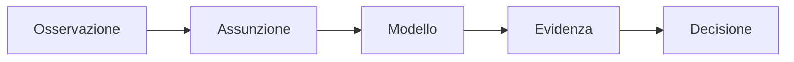

# David Hume: esperienza, abitudine mentale e scetticismo

Hume aiuta a tenere separate due cose che tendiamo a fondere: l'esperienza che ci è utile e la certezza che ci immaginiamo. Quando lavoriamo con i dati, è proprio questa distinzione a decidere se un pattern storico diventa un'ipotesi da mettere alla prova oppure una regola fragile che il team segue senza accorgersene.

## Il problema da risolvere

Capita spesso di dare per scontato che una relazione vista nei dati storici sia una legge universale. Se ogni volta che lo sconto sale le vendite salgono, il team tratta quel legame come certo. Hume invita a fermarsi un attimo e a chiedersi se stiamo osservando una necessità reale o solo un'abitudine mentale che l'esperienza ha costruito a forza di ripetizioni. È una domanda che evita decisioni costruite su assunzioni fragili e che ci ricorda i limiti dell'induzione.

## Come ragionare sul dato

Il ragionamento parte dalla domanda, passa per la traduzione in unità osservabili, valuta la qualità del dato e solo alla fine arriva alla decisione. Quando si salta uno di questi passaggi il risultato è fragile e a volte fuorviante, perché manca il controllo che lo terrebbe in piedi.

| Passaggio | Domanda guida | Output atteso |
|---|---|---|
| Framing | Quale decisione deve cambiare? | Una scelta concreta, non una curiosità |
| Misura | Quale segnale rappresenta il fenomeno? | Metrica, fonte e granularità |
| Confronto | Rispetto a quale baseline interpreto il risultato? | Benchmark o controfattuale plausibile |
| Azione | Che cosa faccio se il segnale supera la soglia? | Decisione, owner e prossimo controllo |

## I quattro elementi della misura

La lettura humeana ci spinge a guardare la relazione tra quattro elementi.

| Elemento | Definizione operativa |
|---|---|
| Unità | Osservazione, ipotesi, variabile, meccanismo causale o criterio di evidenza |
| Segnale | Forza dell'evidenza, coerenza causale, robustezza delle assunzioni e costo dell'errore decisionale |
| Baseline | Spiegazione alternativa, controfattuale, gruppo comparabile o scenario senza intervento |
| Decisione | Accettare, rifiutare o riformulare una spiegazione prima di usarla in un contesto aziendale |

La regola pratica resta semplice: una misura serve solo se riduce l'incertezza su una decisione specifica. Se non cambia una scelta è documentazione; se cambia una scelta senza essere passata da controlli è un rischio.

## Un caso pratico

Durante la crisi finanziaria del 2008 molti modelli quantitativi costruiti su dati storici fallirono perché assumevano che il futuro avrebbe somigliato al passato. Goldman Sachs e altri fondi videro accadere più volte eventi che i loro modelli classificavano come estremamente rari. È l'illustrazione più netta del punto di Hume: l'induzione senza una giustificazione solida porta a errori che possono essere catastrofici.

Lo stesso vale, su scala più piccola, per un comitato che legge una crescita della retention come prova del successo di una nuova iniziativa. Anche qui serve separare osservazione, spiegazione, assunzione e decisione. Una tabella che tiene distinto ciò che si sa da ciò che si assume e dalle decisioni che ne seguono basta a rendere il ragionamento esplicito.

| Evidenza | Interpretazione prudente | Decisione conseguente |
|---|---|---|
| Segnale positivo ma non isolato | Il fenomeno esiste, ma la causa è ancora incerta | Cercare baseline o holdout |
| Segmento con risposta diversa | L'effetto medio nasconde eterogeneità | Analizzare coorti o sottogruppi |
| Costo operativo crescente | Il risultato va valutato sul margine | Applicare soglie economiche |

## L'errore da evitare

L'errore più comune è trattare Hume come un concetto astratto da ricordare invece che come un protocollo da applicare. Metriche senza baseline, grafici senza ipotesi, raccomandazioni che ignorano il costo dell'errore: tutte strade verso decisioni fragili. La domanda di controllo resta una: se questo risultato fosse falso o instabile, quale decisione sbaglierei? Se non sai rispondere, non hai ancora applicato la lezione.

## Riepilogo

Hume ci ricorda che l'esperienza e l'abitudine mentale non bastano a garantire la verità di una previsione. Tradotto nel lavoro sui dati, significa riconoscere che ogni modello è una scommessa provvisoria, che il backtesting non mette al riparo dal futuro e che la replicabilità è un indizio, non una prova. Applicare questo scetticismo vuol dire costruire modelli utili, aggiornabili e controllati sul serio, con l'unico scopo di prendere decisioni migliori.
