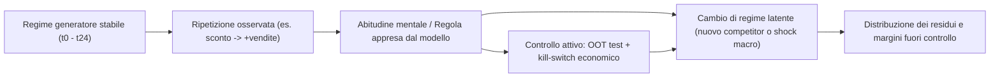

Prendiamo un caso ricostruito che si ripete ogni anno nei reparti di pricing e crescita: un team e-commerce addestra un modello su ventiquattro mesi di vendite storiche (2024-2025) durante un periodo di bassa concorrenza e domanda stabile. Nei dati passati, ogni volta che l'azienda attiva uno sconto del 15% su una categoria ad alto margine, il tasso di conversione sale con regolarità attorno a +2,5 punti percentuali e l'utile netto della campagna risulta positivo. La regola entra in produzione come automazione fissa. Tre mesi dopo, un nuovo operatore entra nel mercato con spedizione gratuita e programma fedeltà aggressivo: il modello continua a raccomandare sconti del 15% basandosi sulla propria sicurezza storica, ma i volumi aggiuntivi non compensano più la riduzione di margine e ogni weekend promozionale brucia cassa.

Nel 1739 con il *Trattato sulla natura umana* e nel 1748 con la *Ricerca sull'intelletto umano*, David Hume formulò il problema che spiega esattamente perché quell'automazione si rompe senza preavviso. Hume non negava l'utilità dell'esperienza; al contrario, mostrò che nella vita pratica e nell'analisi empirica ci muoviamo quasi sempre per abitudine mentale (*custom* o *habit*). Il pericolo nasce quando trasformiamo psicologicamente una regolarità osservata molte volte in una legge necessaria garantita per il futuro.

## Il nodo della forchetta di Hume: impressioni passate contro necessità futura

Hume divise ogni conoscenza umana in due grandi famiglie — distinzione passata alla storia come la "forchetta di Hume". Da un lato stanno le **relazioni tra idee**, cioè verità logiche e matematiche il cui contrario implica contraddizione (per esempio che la somma degli angoli interni di un triangolo euclideo vale 180 gradi, o che `400 × 50 €` fa sempre `20.000 €`). Dall'altro lato stanno le **materie di fatto**, cioè tutto ciò che riguarda il mondo empirico, le vendite, i clic, i prezzi e i comportamenti umani, il cui contrario rimane sempre logicamente concepibile senza contraddizione.

> **Idea chiave:** L'induzione empirica non dimostra che il futuro assomiglierà al passato: trasforma la ripetizione osservata in abitudine mentale, valida come ipotesi operativa provvisoria soltanto finché il regime che genera i dati resta stabile.

Quando passiamo dalle serie storiche alla previsione di ciò che accadrà la settimana prossima, compiamo un salto logico silenzioso chiamato **principio di uniformità della natura**: assumiamo che le cause nascoste continuino a operare domani esattamente come hanno operato ieri. Hume fece notare un ostacolo insuperabile: quel principio non si può dimostrare per via puramente logica (perché un cambio di regime è sempre possibile senza contraddizione), né si può dimostrare tramite l'esperienza passata senza cadere in un ragionamento circolare, perché dire "in passato il futuro ha sempre assomigliato al passato, quindi accadrà ancora" presuppone già l'uniformità che si vorrebbe provare. Nei modelli tabellari questo significa che nessuna accuratezza `R²` o `AUC` misurata sullo storico può garantire da sola la tenuta fuori regime.

## Dai dati storici all'abitudine operativa: la catena della fragilità

Comprendere il meccanismo psicologico descritto da Hume aiuta a individuare il punto esatto in cui un team analitico smette di fare scienza dei dati e inizia a fidarsi ciecamente di un'abitudine statisticamente confezionata.

La tabella seguente mette a confronto i quattro gradi di sicurezza che un analista può attribuire a una relazione osservata, chiarendo quali prove servono per passare dall'uno all'altro e quale difesa operativa accompagna ciascun livello.

| Livello epistemico | Natura della relazione | Cosa garantisce davvero | Limite strutturale | Difesa operativa obbligatoria |
| --- | --- | --- | --- | --- |
| Coincidenza locale | Poche osservazioni allineate in una finestra breve | Nessuna estrapolazione oltre il campione visto | Elevato rumore casuale e overfitting temporale | Esigere replica su finestra indipendente prima di agire |
| Abitudine induttiva | Pattern ripetuto con costanza su mesi storici | Stabilità condizionata al mantenimento dello stesso regime | Vulnerabile a shift competitivi, macro o di prodotto | Validazione out-of-time e monitoraggio mensile del drift |
| Ipotesi meccanica | Regolarità sostenuta da un modello causale o comportamentale esplicito | Previsione robusta a piccole variazioni controllate | Sensibile alle assunzioni su confondenti non misurati | Esperimenti randomizzati periodici di ricalibrazione |
| Relazione tra idee | Identità contabile o vincolo matematico definitorio | Certezza deduttiva interna alle definizioni adottate | Non dice nulla sulle reazioni reali degli utenti | Usarla per calcolare soglie di pareggio e vincoli di coerenza |

Tenere separati i quattro piani impedisce di trattare una regolarità empirica del secondo livello come se possedesse la certezza aritmetica del quarto.

## Venticinque deviazioni standard e il crollo dei modelli di rischio nell'agosto 2007

Un caso finanziario celebre mostra cosa accade quando istituzioni altamente sofisticate trattano l'abitudine induttiva recente come una legge di natura stazionaria. Nell'agosto del 2007, mentre iniziavano le prime scosse della crisi dei mutui subprime, diversi grandi fondi quantitativi azionari subirono perdite violente e simultanee in pochi giorni di contrattazione. Il direttore finanziario di Goldman Sachs, David Viniar, dichiarò pubblicamente al *Financial Times* e ai media finanziari internazionali che alcuni fondi gestiti dalla banca stavano registrando per diversi giorni consecutivi movimenti descritti dai modelli interni come eventi da "25 deviazioni standard".

In una distribuzione normale gaussiana calibrata su una finestra storica tranquilla, un evento da 25 deviazioni standard ha una probabilità teorica così vicina allo zero da non dover accadere nemmeno una volta nell'intera età dell'universo; osservarlo per più giorni consecutivi nella stessa settimana costituisce la prova aritmetica che non era la realtà a essere assurda, ma il modello gaussiano a essere cieco al cambio di regime. Come analizzato successivamente nella letteratura quantitativa (inclusi gli studi di Amir Khandani e Andrew Lo del MIT nel 2007 sul *quant meltdown* di agosto 2007 e le riflessioni di Nassim Nicholas Taleb sui cigni neri), i modelli avevano stimato volatilità e correlazioni tra strategie su un regime storico di liquidità abbondante e bassa correlazione incrociata. Nel momento in cui un operatore iniziò a liquidare posizioni affollate, le correlazioni storiche collassarono verso l'unità e tutti gli algoritmi addestrati sullo stesso passato subirono perdite simultanee.

La lezione humiana di agosto 2007 vale identica per il rischio credito, il forecasting della domanda o il churn: quando calibri un modello esclusivamente su anni normali senza stress test di cambio regime, non stai misurando l'incertezza futura del mondo, ma soltanto la varianza interna del tuo passato tranquillo.

## Stress test economico di una regola promozionale fuori regime

Torniamo ora ai numeri di esempio della regola e-commerce per misurare matematicamente quanto velocemente un'abitudine storica profittevole possa diventare una perdita netta appena cambia il contesto competitivo. Immaginiamo una categoria di prodotti con prezzo pieno pari a 100 € e costo variabile unitario pari a 50 €: ogni vendita a prezzo pieno genera dunque 100 € - 50 € = 50 € di margine di contribuzione. Quando attiviamo lo sconto del 15%, il prezzo scende a 85 €, mentre il costo variabile rimane fisso a 50 €, riducendo il margine unitario per ordine a 85 € - 50 € = 35 € (una contrazione del margine unitario del 30%).

Su un traffico standard di 10.000 sessioni mensili, ricostruiamo il comportamento nei due regimi:
1. **Regime storico A (2024-2025, bassa pressione competitiva):** senza sconto il tasso di conversione è del 4,0%, producendo 400 ordini × 50 € = 20.000 € di margine totale. Con lo sconto del 15%, l'esperienza passata mostra una conversione media del 6,5%, pari a 650 ordini × 35 € = 22.750 € di margine totale. La regola genera +2.750 € rispetto alla baseline (+13,75% di margine). Ripetuta per ventiquattro mesi, questa evidenza consolida la convinzione incrollabile del team che lo sconto del 15% convenga sempre.
2. **Cambio di regime B (ingresso di un competitor con programma fedeltà):** la conversione organica senza sconto scende leggermente al 3,5%, pari a 350 ordini × 50 € = 17.500 € di margine di riferimento. Sotto la pressione delle offerte concorrenti, molti clienti sensibili al prezzo migrano comunque e lo sconto del 15% porta la conversione soltanto al 4,6%, cioè 460 ordini. Calcolando il nuovo risultato economico: 460 ordini × 35 € = 16.100 € di margine totale. Il confronto con la nuova baseline di non-intervento mostra una differenza netta di 16.100 € - 17.500 € = -1.400 €, pari a una perdita dell'8,0% rispetto al non fare nulla.

La soglia matematica di pareggio nel Regime B si ottiene dividendo il margine base di 17.500 € per il margine unitario scontato di 35 €: servono almeno 17.500 € / 35 € = 500 ordini, cioè una conversione minima del 5,0% per non perdere soldi. L'errore non sta nell'aver appreso la regola nel Regime A — dove funzionava davvero — ma nell'averla automatizzata senza una soglia di controllo che la disattivi automaticamente appena il lift osservato su un gruppo holdout scende sotto il punto di pareggio del 5,0%.

## Monitoraggio anti-abitudine: soglie di sospensione e piano alternativo

Lo scetticismo costruttivo di Hume non invita a buttare via i modelli storici, ma a trattare ogni modello come un contratto a tempo determinato: funziona fino a prova contraria di cambio regime, ed esige un piano di ripiegamento già scritto prima che il cambiamento avvenga.

> **Clausola di validità fuori regime per modelli e regole:**
> - Finestra e assunzione di stabilità: dichiarare su quali mesi storici è stata appresa la regola e quali variabili macro o competitive devono restare stabili perché resti valida.
> - Holdout permanente: mantenere almeno il 5%-10% del traffico o dei clienti non esposto alla regola automatica per misurare in continuo il differenziale contro baseline reale.
> - Soglia di sospensione (kill-switch): fissare il livello minimo di margine o di calibrazione sotto cui la regola si spegne in automatico o scala all'intervento umano.
> - Piano alternativo: definire in anticipo quale regola prudenziale più semplice subentra quando il modello viene sospeso.

Accanto al contratto, il monitoraggio quotidiano deve distinguere quattro segnali precoci di rottura dell'abitudine statistica.

| Segnale di monitoraggio | Cosa misura operativamente | Cosa indica rispetto a Hume | Azione immediata alla violazione |
| --- | --- | --- | --- |
| Shift delle covariate (PSI) | Cambiamento nella distribuzione delle feature in ingresso rispetto al training | Il mondo osservato non assomiglia più al campione su cui si è formata l'abitudine | Ridurre confidenza delle previsioni e rivedere segmenti nuovi |
| Errore di calibrazione | Scarto tra probabilità prevista dal modello e frequenza reale osservata | La mappatura storica tra segnale e risultato ha perso aderenza | Ricalibrare le soglie o sospendere decisioni automatizzate |
| Deriva dei residui per coorte | Aumento sistematico degli errori su nuovi clienti o nuove aree geografiche | Sta emergendo un nuovo regime locale non rappresentato nello storico | Isolare la coorte anomala dal modello globale |
| Lift netto sul gruppo holdout | Differenza economica reale tra trattati dalla regola e controllo non trattato | Verifica se l'abitudine storica produce ancora valore nel regime attuale | Attivare kill-switch e tornare alla baseline di fallback |

## Errori classici dello scetticismo mancato o malinteso

### Scambiare lo split casuale per prova fuori campione

Il sintomo è presentare una validazione incrociata casuale (random k-fold) sullo stesso intervallo storico del 2024-2025 come dimostrazione che il modello "generalizza sul futuro". Ciò inganna perché mescolare righe estratte dagli stessi mesi condivide il medesimo regime competitivo e macroeconomico tra training e test, verificando soltanto la stabilità interna di quella finestra. Per testare davvero l'abitudine induttiva, usa sempre split rigorosamente temporali (out-of-time) e prove su segmenti geografici o canali esclusi dal training (out-of-domain).

### Cadere nel nichilismo analitico

Il sintomo opposto compare quando un team, scoperto che l'induzione non dà certezze matematiche, conclude che "i modelli non servono e conviene decidere a intuito". Hume stesso rigettava questa lettura paralizzante: senza l'abitudine tratta dall'esperienza non potremmo fare un passo nel mondo quotidiano né in azienda. Lo scetticismo corretto non elimina i dati, ma sostituisce la falsa sicurezza assoluta con intervalli di confidenza onesti, margini di sicurezza economici e verifiche continue sul campo.

### Riadattare la finestra storica fino a far tornare i conti

Il sintomo emerge quando, dopo un trimestre negativo, l'analista esclude i mesi sfavorevoli etichettandoli come "anomalie irripetibili" per ripristinare le metriche storiche del modello. Questa operazione distrugge l'unica informazione davvero preziosa dello shock: la prova empirica che il sistema può entrare in un regime avverso e che i parametri futuri devono contemplare anche la probabilità di transizione verso fasi turbolente. Documenta sempre gli shock nel registro dei regimi invece di cancellarli dal dataset.

## Domande di controllo sullo stato delle tue assunzioni

1. Qual è la distinzione tracciata da David Hume nella cosiddetta "forchetta" tra relazioni tra idee e materie di fatto, e perché riguarda i modelli predittivi?

Mostra risposta

Le relazioni tra idee sono verità logiche e matematiche il cui contrario è contraddittorio (certezza deduttiva indipendente dall'esperienza), mentre le materie di fatto riguardano i fenomeni empirici, il cui contrario resta sempre concepibile senza contraddizione. I modelli predittivi operano su materie di fatto: anche un'accuratezza molto alta sui dati passati non può dimostrare per via logica che la distribuzione dei dati futuri resterà identica.

2. Perché l'episodio dei movimenti da "25 deviazioni standard" nell'agosto 2007 dimostra un errore epistemologico prima ancora che matematico?

Mostra risposta

Perché un evento statisticamente impossibile per più giorni di fila sotto una distribuzione gaussiana calibrata su anni stabili indica che le assunzioni del modello (volatilità costante e correlazioni indipendenti) non valevano più nel nuovo regime di liquidità. Il modello trattava un'abitudine induttiva di un periodo calmo come legge stazionaria del mercato.

3. Nell'esempio della promozione del 15% (prezzo 100 €, costo 50 €), per quale motivo nel Regime B una conversione promozionale del 4,6% superiore al 3,5% senza sconto genera comunque una perdita rispetto al non scontare?

Mostra risposta

Perché lo sconto del 15% riduce il prezzo a 85 € e il margine unitario da 50 € a 35 € (-30%). Con 3,5% di conversione organica su 10.000 visite si ottengono 350 × 50 € = 17.500 € di margine; al 4,6% scontato si fanno 460 × 35 € = 16.100 €, perdendo 1.400 €. Per compensare il taglio del margine unitario servirebbe una conversione minima di pareggio pari a 500 / 10.000 = 5,0%.

4. Qual è la differenza tra una validazione k-fold casuale e una validazione out-of-time rispetto al problema dell'induzione?

Mostra risposta

Uno split k-fold casuale estrae righe di test dallo stesso periodo storico del training, quindi verifica soltanto che il modello abbia catturato bene la regolarità all'interno di quel medesimo regime. Una validazione out-of-time mette invece il modello alla prova su periodi successivi mai visti durante l'addestramento, esponendo direttamente la vulnerabilità a cambi di regime e shift temporali.

