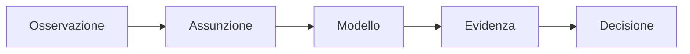

# David Hume: esperienza, abitudine mentale e scetticismo

Hume aiuta a tenere separate due cose che tendiamo a fondere: l'esperienza che ci è utile e la certezza che ci immaginiamo. Quando lavoriamo con i dati, è proprio questa distinzione a decidere se un pattern storico diventa un'ipotesi da mettere alla prova oppure una regola fragile che il team segue senza accorgersene.

## Il problema da risolvere

Capita spesso di dare per scontato che una relazione vista nei dati storici sia una legge universale. Se ogni volta che lo sconto sale le vendite salgono, il team tratta quel legame come certo. Hume invita a fermarsi un attimo e a chiedersi se stiamo osservando una necessità reale o solo un'abitudine mentale che l'esperienza ha costruito a forza di ripetizioni. È una domanda che evita decisioni costruite su assunzioni fragili e che ci ricorda i limiti dell'induzione.

## Come ragionare sul dato



Il ragionamento parte dalla domanda, passa per la traduzione in unità osservabili, valuta la qualità del dato e solo alla fine arriva alla decisione. Quando si salta uno di questi passaggi il risultato è fragile e a volte fuorviante, perché manca il controllo che lo terrebbe in piedi.

| Passaggio | Domanda guida | Output atteso |
|---|---|---|
| Framing | Quale decisione deve cambiare? | Una scelta concreta, non una curiosità |
| Misura | Quale segnale rappresenta il fenomeno? | Metrica, fonte e granularità |
| Confronto | Rispetto a quale baseline interpreto il risultato? | Benchmark o controfattuale plausibile |
| Azione | Che cosa faccio se il segnale supera la soglia? | Decisione, owner e prossimo controllo |

## I quattro elementi della misura

La lettura humeana ci spinge a guardare la relazione tra quattro elementi.

| Elemento | Definizione operativa |
|---|---|
| Unità | Osservazione, ipotesi, variabile, meccanismo causale o criterio di evidenza |
| Segnale | Forza dell'evidenza, coerenza causale, robustezza delle assunzioni e costo dell'errore decisionale |
| Baseline | Spiegazione alternativa, controfattuale, gruppo comparabile o scenario senza intervento |
| Decisione | Accettare, rifiutare o riformulare una spiegazione prima di usarla in un contesto aziendale |

La regola pratica resta semplice: una misura serve solo se riduce l'incertezza su una decisione specifica. Se non cambia una scelta è documentazione; se cambia una scelta senza essere passata da controlli è un rischio.

## Un caso pratico

Durante la crisi finanziaria del 2008 molti modelli quantitativi costruiti su dati storici fallirono perché assumevano che il futuro avrebbe somigliato al passato. Goldman Sachs e altri fondi videro accadere più volte eventi che i loro modelli classificavano come estremamente rari. È l'illustrazione più netta del punto di Hume: l'induzione senza una giustificazione solida porta a errori che possono essere catastrofici.

Lo stesso vale, su scala più piccola, per un comitato che legge una crescita della retention come prova del successo di una nuova iniziativa. Anche qui serve separare osservazione, spiegazione, assunzione e decisione. Una tabella che tiene distinto ciò che si sa da ciò che si assume e dalle decisioni che ne seguono basta a rendere il ragionamento esplicito.

| Evidenza | Interpretazione prudente | Decisione conseguente |
|---|---|---|
| Segnale positivo ma non isolato | Il fenomeno esiste, ma la causa è ancora incerta | Cercare baseline o holdout |
| Segmento con risposta diversa | L'effetto medio nasconde eterogeneità | Analizzare coorti o sottogruppi |
| Costo operativo crescente | Il risultato va valutato sul margine | Applicare soglie economiche |

## Esercizi per metterla in pratica

Parti dal livello base. Descrivi in poche righe una decisione reale in cui applichi lo scetticismo di Hume: obiettivo, metrica primaria, baseline, rischio principale e azione prevista.

Al livello intermedio costruisci una tabella con almeno tre segmenti o scenari. Per ognuno indica il segnale, una possibile spiegazione alternativa e il controllo da fare prima di decidere. È l'esercizio che allena a non scambiare un'abitudine osservata per una necessità.

Il livello research-grade chiede un piano di validazione: ipotesi, dati necessari, criteri di esclusione, soglia decisionale e un controllo da fare dopo aver deciso. Scrivi anche cosa ti farebbe cambiare idea, perché è la parte che Hume considererebbe decisiva.

Per i materiali vanno bene case study decisionali, metriche di prodotto, risultati di esperimenti, DAG semplici, report analitici e serie storiche simulate. Se non hai dati reali, costruisci un dataset sintetico con almeno 200 righe e colonne per tempo, segmento, metrica di outcome e variabile di esposizione.

## L'errore da evitare

L'errore più comune è trattare Hume come un concetto astratto da ricordare invece che come un protocollo da applicare. Metriche senza baseline, grafici senza ipotesi, raccomandazioni che ignorano il costo dell'errore: tutte strade verso decisioni fragili. La domanda di controllo resta una: se questo risultato fosse falso o instabile, quale decisione sbaglierei? Se non sai rispondere, non hai ancora applicato la lezione.

## Domande di controllo

1. Qual è la decisione concreta che questa lezione dovrebbe migliorare?
2. Quale baseline rende interpretabile il risultato?
3. Quale assunzione, se sbagliata, cambierebbe la conclusione?
4. Quale controllo minimo useresti prima di presentare la raccomandazione?

## Riepilogo

Hume ci ricorda che l'esperienza e l'abitudine mentale non bastano a garantire la verità di una previsione. Tradotto nel lavoro sui dati, significa riconoscere che ogni modello è una scommessa provvisoria, che il backtesting non mette al riparo dal futuro e che la replicabilità è un indizio, non una prova. Applicare questo scetticismo vuol dire costruire modelli utili, aggiornabili e controllati sul serio, con l'unico scopo di prendere decisioni migliori.

## Problema reale

Questo concetto si applica quando lavori con dataset reali e hai bisogno di una struttura chiara per ragionare su David Hume: esperienza, abitudine mentale e scetticismo. Il problema tipico è non avere un framework condiviso tra il team per valutare la soluzione, con il risultato che ogni analisi parte da presupposti diversi.

**Quando lo incontrerai:**
- Quando presenti un risultato e qualcuno chiede "ma come sei arrivato a questo numero?"
- Quando il risultato di una query cambia radicalmente cambiando un filtro
- Quando il modello che hai costruito funziona sui dati di test ma non su quelli di produzione

## Modello concettuale

Il David Hume: esperienza, abitudine mentale e scetticismo si definisce attraverso tre dimensioni:

1. **Struttura**: come sono organizzati i dati o il processo
2. **Logica**: quale relazione causa-effetto governa il comportamento
3. **Misura**: quale metrica usi per valutare il risultato

Questo modello ti permette di scomporre qualsiasi istanza del problema nelle sue parti verificabili.

## Formalizzazione rigorosa

```sql
-- TODO: aggiungi la formalizzazione specifica per David Hume: esperienza, abitudine mentale e scetticismo
-- Pattern per avanzato:

SELECT
    /* indica qui la tua metrica principale */
FROM
    /* indica qui la sorgente dati */
WHERE
    /* indica qui i filtri */
GROUP BY
    /* indica qui le dimensioni di raggruppamento */
```

**Principio guida:** verifica sempre che la somma delle parti sia uguale al totale.

## Esempio o caso studio

**Caso tipico (livello avanzato):**

Immaginiamo un team marketing che deve misurare la retention a 30 giorni. L'errore più comune è calcolarla come `COUNT(DISTINCT user_id)` senza filtrare per data di attivazione, includendo utenti che non hanno ancora avuto 30 giorni di tempo. La versione corretta filtra prima la cohort di attivazione e poi applica il calcolo.

```sql
WITH cohort AS (
    SELECT
        user_id,
        MIN(event_date) AS activation_date
    FROM events
    GROUP BY user_id
),
retention AS (
    SELECT
        c.activation_date,
        COUNT(DISTINCT e.user_id) AS retained_users
    FROM cohort c
    JOIN events e ON c.user_id = e.user_id
        AND e.event_date >= c.activation_date
        AND e.event_date <= c.activation_date + INTERVAL '30 days'
    GROUP BY c.activation_date
)
SELECT
    activation_date,
    retained_users,
    ROUND(retention_rate * 100, 2) AS retention_pct
FROM retention;
```

## Lab / esercizio

**Esercizio — livello avanzato**

1. **Prepara l'ambiente:** carica il dataset di esempio nel tuo warehouse
2. **Applica il pattern:** scrivi la query che implementa il modello concettuale per il tuo caso
3. **Verifica:** controlla che il risultato sia coerente con le tue aspettative usando un sanity check

**Tempo stimato:** 20-30 minuti

## Errore tipico da evitare

**L'errore più comune a livello avanzato:**

Non distinguere tra una metrica calcolata su tutta la popolazione e una metrica calcolata su una sotto-popolazione specifica. Ad esempio, calcolare il tasso di conversione medio senza filtrare per canale di acquisizione porta a decisioni sbagliate perché il mix di canali cambia nel tempo.

**Come evitarlo:**
- Chiediti sempre: "rispetto a cosa sto misurando questo?"
- Verifica che il denominatore sia corretto prima di fidarti del numeratore
- Usa un gruppo di controllo quando possibile

## Quiz o checkpoint

1. Qual è la differenza tra la metrica calcolata su tutta la popolazione e quella calcolata su una cohort?
2. Scrivi il codice SQL che implementa il modello concettuale per un caso a tua scelta
3. Quale sanity check useresti per verificare che il risultato sia corretto?

---

*Queste sezioni sono placeholder generici. Sostituisci con contenuto specifico per la lezione.*

### Livello base

Spiegazione intuitiva di David Hume: esperienza, abitudine mentale e scetticismo:

Il concetto alla base è semplice: invece di fare affidamento sull'intuizione, usi un metodo riproducibile. A livello base, ti basta capire quale domanda stai ponendo e quali dati hai a disposizione per risponderci.

### Livello intermedio

Applicazione concreta di David Hume: esperienza, abitudine mentale e scetticismo:

A questo livello applichi il concetto a un caso specifico. Ad esempio, se stai analizzando la retention, il tuo dataset ha dimensioni come data di attivazione, data di evento, e user_id. La segmentazione per canale di acquisizione ti dà insight aggiuntivi che il dato grezzo non mostra.

### Livello research-grade

Approfondimento teorico:

Per chi vuole capire il fondamento teorico, la letteratura classica include:
- Kimball, "The Data Warehouse Toolkit" — per approcci dimensionali
- McKinney, "Python for Data Analysis" — per implementazione pratica
- Aggiora i riferimenti con paper recenti specifici per il tuo dominio

### Dataset e materiali consigliati

**Per esercitarti:**
- Usa il dataset di esempio fornito nella lezione
- Per un challenge aggiuntivo, prova con dati pubblici come quelli di Kaggle

**Tool consigliati:**
- dbt Core per trasformazioni
- Metabase o Superset per visualizzazione