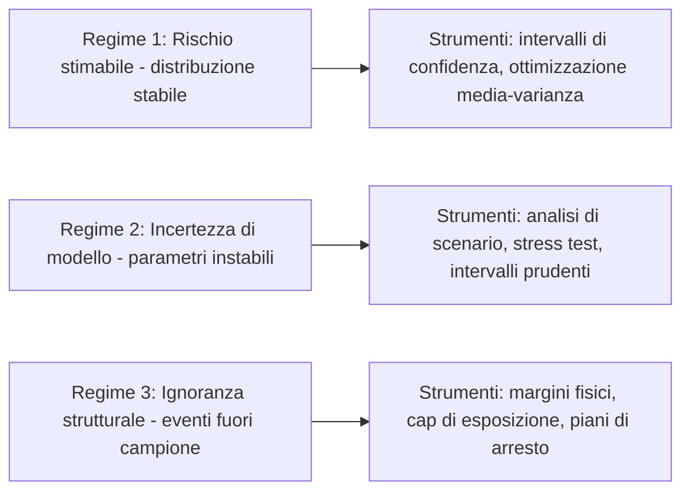

Considera uno scenario costruito con numeri di esempio per mettere alla prova il modo in cui interpretiamo i modelli previsionali. Il responsabile della pianificazione di un distributore manifatturiero riceve dal modello di serie storiche una stima rassicurante: la domanda mensile del componente principale ha una probabilità del 78% di restare compresa tra 9.500 e 10.500 unità, mentre il tempo di consegna del fornitore estero oscilla storicamente tra 6 e 9 giorni. Sulla base di questi intervalli nitidi, la direzione riduce le scorte di sicurezza in magazzino per liberare cassa e impegna la linea di credito in un'espansione commerciale. Tre mesi dopo, una chiusura improvvisa di un valico marittimo blocca le spedizioni per 19 giorni consecutivi: i contratti di penale verso i clienti industriali bruciano in quattro settimane tutto il margine dell'intero semestre.

Il modello non aveva commesso errori di calcolo aritmetico rispetto ai dati degli ultimi ventiquattro mesi. L'errore era filosofico prima ancora che statistico: scambiare la regolarità di un regime stazionario per l'intero spazio delle possibilità future, trattando un problema di **incertezza strutturale** e di **ignoranza** come se fosse un semplice esercizio di rischio calcolabile.

## Dal demone di Laplace alla probabilità nei sistemi reali

> **Idea chiave:** La previsione affidabile non consiste nel sostituire l'ignoto con un numero preciso, ma nel riconoscere se il problema appartiene al regime del rischio stimabile, dell'incertezza di modello o dell'ignoranza strutturale, scegliendo lo strumento di governo proporzionato al limite della nostra conoscenza.

Nel 1814 Pierre-Simon Laplace formulò la celebre immagine del determinismo classico: un'intelligenza capace di conoscere in un dato istante tutte le forze che animano la natura e le posizioni esatte di ogni particella non avrebbe nulla di incerto davanti a sé, e il futuro sarebbe trasparente quanto il passato. In quell'orizzonte filosofico, la probabilità era soltanto un espediente provvisorio dovuto alla nostra ignoranza umana dei dettagli microscopici.

Il Novecento ha demolito questa illusione su due fronti distinti. Da un lato, Henri Poincaré dimostrò nei sistemi dinamici non lineari che variazioni infinitesimali nelle condizioni iniziali crescono in modo esponenziale nel tempo, rendendo qualsiasi previsione puntuale a lungo termine praticamente impossibile anche in sistemi puramente deterministici. Dall'altro, nei sistemi sociali, economici e digitali, gli agenti osservano i modelli e modificano il proprio comportamento in risposta alle previsioni stesse, rendendo il processo generatore intrinsecamente contingente e non stazionario.

Anche all'interno della teoria della probabilità convivono tre significati filosofici diversi che l'analista deve saper distinguere prima di applicarli a un problema decisionale. La concezione **frequentista** identifica la probabilità con il limite della frequenza relativa in un numero molto grande di prove identiche e ripetibili, risultando ideale per i lanci di dadi, il controllo qualità su linee di produzione stabili o i test A/B controllati su grandi campioni. La concezione **bayesiana o epistemica** interpreta invece la probabilità come grado di credenza razionale aggiornato all'arrivo di nuove evidenze, permettendo di ragionare con rigore anche su eventi unici come il lancio di un nuovo prodotto o una variazione normativa. Accanto a queste due si colloca la concezione della **propensione**, difesa da Karl Popper, che vede la probabilità come una disposizione fisica reale del contesto sperimentale a generare certi esiti.

Confondere questi tre livelli porta a pretendere garanzie frequentiste dove disponiamo soltanto di stime soggettive su casi irripetibili, o a ignorare quando la struttura stessa del contesto è mutata rispetto al campione storico.

## Rischio, incertezza e ignoranza: la distinzione di Knight

Nel 1921 l'economista e filosofo Frank Knight introdusse nel trattato *Risk, Uncertainty, and Profit* una distinzione che rimane il pilastro concettuale per chiunque governi decisioni basate su dati. Per Knight, chiamiamo **rischio** una situazione in cui la distribuzione degli esiti futuri è nota e misurabile con affidabilità grazie a regolarità stabili o calcoli combinatori: conosciamo gli stati possibili e conosciamo le probabilità associate a ciascuno stato, proprio come in una polizza assicurativa su centomila automobili identiche o in una roulette non truccata.

Chiamiamo invece **incertezza** (spesso definita incertezza knightiana) una situazione in cui sappiamo quali scenari possono verificarsi, o sospettiamo la presenza di instabilità strutturali, ma i dati storici sono troppo scarsi, eterogenei o non stazionari per assegnare probabilità oggettive stabili a ciascun ramo. Qui i diversi modelli ragionevoli producono distribuzioni differenti, e la media delle stime passate può cambiare bruscamente al mutare delle condizioni al contorno.

Esiste poi un terzo regime ancora più severo: l'**ignoranza strutturale**. In questo stadio non ci limitiamo a non conoscere i pesi probabilistici degli esiti noti; ignoriamo addirittura parte dello spazio stesso degli eventi possibili, cioè gli shock tecnologici, geopolitici o operativi mai apparsi nel dataset di addestramento.

| Regime epistemico | Cosa conosciamo | Cosa manca | Modalità di fallimento tipica | Strumento di governo adeguato |
|---|---|---|---|---|
| Determinismo pratico | Legge stabile e condizioni iniziali con errore trascurabile | Nulla di rilevante sull'orizzonte breve | Guasto imprevisto di un vincolo esterno non modellato | Verifica automatica dei vincoli fisici e di capacità |
| Rischio stimabile | Spazio degli esiti e frequenze stabili su grandi numeri | L'esito del singolo evento futuro | Scambiare una probabilità alta (es. 90%) per certezza assoluta | Calcolo del valore atteso, assicurazione e diversificazione |
| Incertezza knightiana | Categorie principali di esito e meccanismi qualitativi | Parametri stabili e pesi probabilistici affidabili | Ottimizzare sui centesimi un modello calibrato su un regime passato | Scenari multipli, stress test pessimistici e flessibilità contrattuale |
| Ignoranza strutturale | Solo la nostra esposizione massima e i costi di rottura | Parte rilevante dello spazio degli stati futuri | Esposizione illimitata a eventi rari a coda pesante | Tetti massimi di perdita, riserve liquide e trigger di uscita |

## Valore atteso contro sopravvivenza: il calcolo svolto

Uno degli errori matematici più costosi nell'analisi delle decisioni nasce dall'applicare il criterio del valore atteso senza verificare l'ergodicità del sistema, cioè senza chiedersi se il decisore possa ripetere la scommessa infinite volte o se una singola perdita catastrofica lo espella per sempre dal mercato. Costruiamo un confronto numerico esplicito su un orizzonte annuale con **200.000 euro** di capitale operativo allocabile tra due politiche di gestione scorte e leva fornitori.

Consideriamo la **Strategia A (ottimizzazione snella sul valore atteso)**. In condizioni ordinarie (con probabilità stimata storica pari al **96%**), il risparmio sui costi di stoccaggio e il maggior volume finanziato generano un profitto netto di **+32.500 euro** all'anno. Tuttavia, se si verifica uno shock di filiera o un picco di penali contrattuali fuori regime (evento stimato al **4%** sui dati recenti, ma soggetto a forte incertezza strutturale), la mancanza di riserve provoca un blocco completo degli ordini e una perdita secca di **-180.000 euro**. Calcoliamo il valore atteso matematico della Strategia A:
- Contributo positivo atteso: 0,96 × (+32.500 euro) = **+31.200 euro**.
- Contributo negativo atteso: 0,04 × (-180.000 euro) = **-7.200 euro**.
- Valore atteso complessivo: 31.200 - 7.200 = **+24.000 euro** annui (+12,0% sul capitale).

Consideriamo ora la **Strategia B (governo prudente con riserva e tetto di esposizione)**. L'azienda immobilizza **45.000 euro** in una riserva di liquidità e scorte di sicurezza di base, accettando un minor profitto in regime normale. Negli scenari ordinari (96% di probabilità), il profitto netto scende a **+19.500 euro**. In caso di shock di filiera (4% di probabilità), la scorta tampone assorbe le prime due settimane di blocco e il tetto contrattuale di esposizione limita la perdita massima a **-30.500 euro**. Calcoliamo il valore atteso della Strategia B:
- Contributo positivo atteso: 0,96 × (+19.500 euro) = **+18.720 euro**.
- Contributo negativo atteso: 0,04 × (-30.500 euro) = **-1.220 euro**.
- Valore atteso complessivo: 18.720 - 1.220 = **+17.500 euro** annui (+8,75% sul capitale).

Guardando soltanto al valore atteso, la Strategia A batte la B per **6.500 euro** all'anno (24.000 contro 17.500, cioè +37,1% di rendimento atteso). Ma analizziamo cosa accade alla capacità di sopravvivenza: se lo shock del 4% colpisce una sola volta, la Strategia A perde **-180.000 euro** su 200.000 euro di capitale iniziale, azzerando il **90,0%** del patrimonio operativo e lasciando soli 20.000 euro, insufficienti persino a riavviare la produzione il mese successivo (rovina operativa). Al contrario, la Strategia B perde al massimo **-30.500 euro**, mantenendo intatto l'**84,75%** del capitale (169.500 euro) e restando pienamente operativa per recuperare nel trimestre seguente. Inoltre, se la vera probabilità di crisi fosse sottostimata e salisse dal 4% al **12%** in un anno geopoliticamente instabile, ricalcoliamo subito i due valori attesi: Strategia A = (0,88 × 32.500) - (0,12 × 180.000) = 28.600 - 21.600 = **+7.000 euro** (con probabilità di rovina triplicata); Strategia B = (0,88 × 19.500) - (0,12 × 30.500) = 17.160 - 3.660 = **+13.500 euro** → la Strategia B supera la A sia in sicurezza sia in valore atteso netto per quasi il doppio del guadagno.

## Il crollo di Long-Term Capital Management nel 1998

La distanza tra modello di rischio gaussiano e realtà knightiana ha un caso storico esemplare nella vicenda di **Long-Term Capital Management (LTCM)**, il fondo speculativo fondato nel 1994 da banchieri esperti insieme ai premi Nobel per l'economia Robert Merton e Myron Scholes. Per anni il fondo ottenne rendimenti straordinari sfruttando piccole divergenze di prezzo tra obbligazioni sovrane correlate, basando le proprie coperture su modelli statistici di volatilità e correlazione storica a coda sottile.

I modelli di LTCM consideravano le oscillazioni estreme eventi talmente improbabili da giustificare una leva finanziaria superiore a venticinque volte il capitale proprio, trattando un mercato fatto di attori umani interdipendenti come se fosse governato da un generatore stazionario di rumore gaussiano. Quando nell'agosto **1998** la Russia dichiarò il default sul proprio debito interno e svalutò il rublo, accadde ciò che i parametri storici escludevano: invece di restare indipendenti o compensarsi, tutte le posizioni su mercati diversi diventarono improvvisamente correlate nella stessa direzione perché ogni banca cercava liquidità simultaneamente.

In poche settimane LTCM perse oltre il 90% del capitale e accumulò un buco tale da minacciare la tenuta sistemica di Wall Street, rendendo necessario nel settembre 1998 un salvataggio coordinato dalla Federal Reserve di New York da **3,6 miliardi di dollari** con un consorzio di quattordici grandi banche. Come documentato da Roger Lowenstein (*When Genius Failed*, 2000), la fallacia non stava nell'algebra dei premi Nobel, bensì nell'aver trattato una crisi di liquidità sistemica e di panico collettivo (incertezza e ignoranza di regime) con equazioni calibrate sul rischio ordinario di mercato calmo.

## Tradurre l'incertezza in calibrazione e governo operativo

Quando un modello previsionale è indispensabile ma l'incertezza resta alta, la responsabilità dell'analista è spostare il baricentro dalla precisione cosmetica delle previsioni puntuali alla qualità della **calibrazione** e alla definizione di protocolli di azione. Una previsione si dice ben calibrata quando, tra tutte le volte in cui il modello assegna una probabilità del 70% a un evento, quell'evento si verifica effettivamente circa 70 volte su 100. Una previsione può essere molto precisa ma mal calibrata (troppo sicura di sé), generando un'illusione di controllo più pericolosa della dichiarazione esplicita di ignoranza.

> **Protocollo di governo sotto ignoranza e incertezza:**
> - **Scomposizione dei regimi:** specifica sempre quali variabili del modello appartengono al rischio stimabile e quali assunzioni (continuità fornitori, assenza di cambi normativi, stabilità delle correlazioni) poggiano invece sull'incertezza di regime.
> - **Tetto massimo di perdita accettabile:** fissa a priori la soglia di perdita economica o operativa oltre la quale la strategia non può spingersi neppure nello scenario peggiore di coda.
> - **Trigger numerici di cambio rotta:** stabilisci in anticipo due indicatori osservabili settimanalmente (ad esempio tempo di consegna medio superiore a 11 giorni o errore di previsione superiore al 15% per tre settimane consecutive) che attivano automaticamente il piano di contingenza senza attendere riunioni emergenziali.
> - **Cadenza di ricalibrazione:** programma una revisione periodica dei parametri ogni trimestre o immediatamente dopo qualsiasi shock esterno documentato.

Questo modo di lavorare libera i decisori dalla falsa dicotomia tra affidarsi ciecamente all'algoritmo e decidere "a sensazione". I numeri continuano a guidare ogni passo, ma invece di promettere l'impossibile eliminazione del caso, disegnano un perimetro di sicurezza dentro cui l'organizzazione può resistere agli errori e correggere la rotta prima che il danno diventi irreversibile.

## Tre errori comuni nel trattare probabilità e previsioni

### Scambiare la precisione di un intervallo per copertura dello spazio degli eventi

Il sintomo si nota nei report che offrono stime come "margine atteso tra 18,4% e 19,2% con confidenza al 95%" calcolate assumendo errori normalmente distribuiti e parametri fissi. Sembra rigoroso perché mostra decimale e livello di confidenza statistico. In realtà, quell'intervallo al 95% misura soltanto la variabilità campionaria **condizionata alla verità del modello**, e non include la probabilità che il modello stesso sia sbagliato o che cambi il contesto esterno. Si evita presentando accanto agli intervalli statistici almeno due scenari di stress fuori modello e dichiarando esplicitamente quali fattori non sono inclusi nel calcolo.

### Calibrare le soglie di rischio solo sulla volatilità recente (miopia di regime)

Il sintomo compare dopo lunghi periodi di stabilità commerciale o operativa, quando i team riducono progressivamente le riserve e le tolleranze perché negli ultimi dodici o ventiquattro mesi non si è verificato alcun evento estremo. Sembra efficiente perché migliora i margini di breve termine eliminando ciò che appare come capitale inutilizzato. Tuttavia, nei sistemi a code pesanti e cicli lunghi, l'assenza di crisi in una finestra corta non dimostra sicurezza: aumenta semplicemente l'accumulo di fragilità silenziosa, come accaduto a LTCM nel 1998. Si previene ancorando le riserve minime a finestre storiche estese che includano almeno una crisi severa e verificando i limiti di sopravvivenza su shock estremi plausibili.

### Ottimizzare la media ignorando la non-ergodicità del percorso singolo

Il sintomo si manifesta quando una decisione aziendale ad alto impatto irreversibile viene giustificata mostrando soltanto che "in media rende di più", senza calcolare cosa succede nella sequenza di un singolo anno sfortunato. Sembra razionale perché coincide con la regola scolastica della massimizzazione del valore atteso. In realtà, per un'azienda concreta o per un progetto con capitale finito, una perdita dell'80% o del 90% in un singolo periodo non si compensa con la media di mille vite parallele: chi esce di scena non partecipa ai recuperi futuri. Si evita imponendo prima di tutto un vincolo rigido di sopravvivenza (perdita massima tollerabile sul singolo scenario avverso) e ottimizzando il valore atteso soltanto tra le strategie che rispettano quel vincolo.

## Verifica decisionale in condizioni di rischio e ignoranza

1. Un modello di previsione della domanda commerciale ha ottenuto un errore medio del 3% negli ultimi 18 mesi e suggerisce di dimezzare le scorte tampone per risparmiare 80.000 euro all'anno. Tuttavia, due mesi fa un fornitore strategico è passato a un nuovo operatore logistico e il mercato sta entrando in una fase di alta instabilità tariffaria. In quale regime di Knight ti trovi e perché la decisione di tagliare le scorte è rischiosa?

Mostra risposta

Non ti trovi più nel regime del rischio stimabile, bensì in un regime di incertezza knightiana con componenti di ignoranza strutturale. Il campione degli ultimi 18 mesi riflette il vecchio assetto logistico e tariffe stabili, quindi il 3% di errore storico non garantisce la tenuta futura davanti al cambio di operatore e allo shock tariffario. Dimezzare le scorte ottimizza su un modello non stazionario esponendo l'azienda a rotture di stock molto più costose degli 80.000 euro risparmiati; conviene mantenere le riserve e definire trigger operativi di monitoraggio sui nuovi tempi di consegna.

2. Che differenza passa tra dire "il modello prevede un incremento dei ricavi del 10% ± 2% al 95% di confidenza" e valutare la **calibrazione** del modello?

Mostra risposta

L'intervallo ± 2% al 95% esprime una precisione interna condizionata al fatto che le assunzioni del modello (distribuzione, stazionarietà, assenza di rotture esterne) siano corrette. La calibrazione misura invece l'affidabilità empirica nel tempo: quante volte su 100 gli intervalli dichiarati al 95% contengono effettivamente il valore realizzato sui dati futuri. Un modello iper-preciso ma mal calibrato sottostima sistematicamente l'incertezza reale e porta a decisioni troppo aggressive.

3. Nel confronto numerico tra la Strategia A (valore atteso +24.000 euro con rischio di perdita -180.000 euro) e la Strategia B (valore atteso +17.500 euro con perdita limitata a -30.500 euro), perché la Strategia B diventa preferibile anche se rende meno in media in condizioni normali?

Mostra risposta

Per due ragioni combinate: la non-ergodicità del capitale aziendale e la fragilità rispetto alla stima della probabilità di crisi. Con 200.000 euro di capitale, subire una perdita di 180.000 euro nella Strategia A significa bruciare il 90% del capitale e compromettere la continuità operativa, mentre la Strategia B assicura sopravvivenza lasciando 169.500 euro attivi. Inoltre, se la frequenza reale dello shock sale dal 4% al 12%, anche il valore atteso della Strategia B (+13.500 euro) supera nettamente quello della Strategia A (+7.000 euro).

4. Quali tre elementi concreti devi inserire in un documento decisionale per gestire l'ignoranza strutturale senza rinunciare al rigore dei numeri?

Mostra risposta

Devi inserire: (1) un tetto massimo di esposizione o di perdita sostenibile che protegga la sopravvivenza del progetto anche fuori modello; (2) almeno due trigger numerici osservabili a cadenza frequente che facciano scattare automaticamente una riduzione del rischio o un cambio di piano; (3) una data prefissata di ricalibrazione periodica o straordinaria dopo ogni mutamento del contesto operativo.

