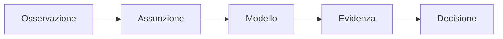

# Incertezza, rischio e ignoranza

Un forecast può dire che uno scenario ha il 72% di probabilità, ma la decisione deve fare i conti anche con quello che il modello non vede: uno shock esterno, un dato mancante, un cambiamento nei comportamenti. Distinguere incertezza, rischio e ignoranza serve esattamente a questo, a separare ciò che possiamo stimare da ciò che dobbiamo ancora imparare a governare.

## Il problema da risolvere

Capire questa distinzione risolve un problema concreto: riconoscere quando un dato sostiene davvero una decisione e quando invece nasconde un'assunzione, un bias o una causalità fragile. Non è un concetto da manuale, è uno strumento di lavoro per migliorare scelte reali. La differenza la fa il rischio, che possiamo quantificare, contro l'ignoranza, che non sappiamo nemmeno come mettere in conto.

## Come ragionare sul dato

Il ragionamento segue un ordine. Prima si formula la domanda, poi la si traduce in unità osservabili, si valuta la qualità del dato e infine si decide. Quando si salta un passaggio l'analisi può sembrare elegante e restare fragile, perché manca il controllo che la renderebbe affidabile.

| Passaggio | Domanda guida | Output atteso |
|---|---|---|
| Framing | Quale decisione deve cambiare? | Una scelta concreta |
| Misura | Quale segnale rappresenta il fenomeno? | Metrica, fonte, granularità |
| Confronto | Rispetto a quale baseline interpreto il risultato? | Benchmark o controfattuale |
| Azione | Che cosa faccio se il segnale supera la soglia? | Decisione, owner, prossimo controllo |

## I quattro elementi della misura

Possiamo descrivere il problema come una relazione tra quattro elementi: unità di analisi, segnale, baseline e decisione.

| Elemento | Definizione operativa |
|---|---|
| Unità | osservazione, ipotesi, variabile, meccanismo causale |
| Segnale | forza dell'evidenza, coerenza causale, robustezza delle assunzioni, costo dell'errore decisionale |
| Baseline | spiegazione alternativa, controfattuale, gruppo comparabile, scenario senza intervento |
| Decisione | accettare, rifiutare o riformulare una spiegazione prima dell'uso aziendale |

La regola pratica resta semplice: una misura serve solo se riduce l'incertezza su una decisione specifica. Se non cambia una scelta è documentazione; se cambia una scelta senza essere passata da controlli è un rischio.

## Un caso pratico

Prendi un comitato che legge una crescita della retention come prova del successo di una nuova iniziativa. Prima di agire conviene separare quello che si osserva, come lo si spiega, cosa si sta assumendo e cosa si decide.

| Evidenza | Interpretazione prudente | Decisione |
|---|---|---|
| Segnale positivo ma non isolato | Fenomeno esiste, ma causa incerta | Cercare baseline o holdout |
| Segmento con risposta diversa | Effetto medio nasconde eterogeneità | Analizzare coorti o sottogruppi |
| Costo operativo crescente | Valutare sul margine | Applicare soglie economiche |

## Esercizi per metterla in pratica

Comincia dal livello base. Descrivi una decisione reale che dipende dalla distinzione tra incertezza, rischio e ignoranza: obiettivo, metrica primaria, baseline, rischio principale e azione prevista.

Al livello intermedio costruisci una tabella con almeno tre segmenti o scenari, indicando per ognuno il segnale, una spiegazione alternativa plausibile e il controllo necessario prima di decidere.

Il livello research-grade chiede un piano di validazione vero: ipotesi, dati necessari, criteri di esclusione, soglia decisionale e un controllo da fare dopo la decisione. Aggiungi cosa ti farebbe cambiare idea, altrimenti stai solo raccogliendo conferme.

Come materiali usa case study decisionali, metriche di prodotto, esperimenti, DAG semplici, report analitici e serie storiche simulate. In assenza di dati reali, genera un dataset sintetico con almeno 200 righe e colonne per tempo, segmento, outcome e variabile di esposizione.

## L'errore da evitare

L'errore più comune è trattare questa distinzione come una definizione da ricordare invece che come un protocollo da seguire. Lo si riconosce quando arriva una metrica senza baseline, un grafico senza l'ipotesi che dovrebbe testare o una raccomandazione che non dice quanto costa sbagliare.

Il controllo è sempre lo stesso: se questo risultato fosse falso o instabile, quale decisione sbaglierei? Quando la risposta non è chiara, la lezione non è ancora diventata pratica.

## Domande di controllo

1. Qual è la decisione concreta che questa lezione dovrebbe migliorare?
2. Quale baseline rende interpretabile il risultato?
3. Quale assunzione, se sbagliata, cambierebbe la conclusione?
4. Quale controllo minimo useresti prima di presentare la raccomandazione?

## Riepilogo

Distinguere incertezza, rischio e ignoranza è una competenza che lega concetto, dato e decisione. Conviene allenarla partendo da un problema reale, dando forma al segnale, cercando una baseline credibile, lavorando su un esempio e chiudendo con un controllo concreto. È quello che ti permette di dire con onestà cosa il modello stima e cosa invece resta fuori dalla sua portata.
