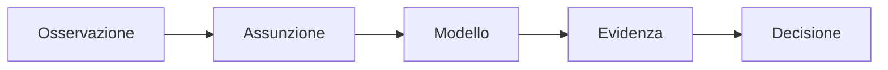

# Incertezza, rischio e ignoranza

Un forecast può dire che uno scenario ha il 72% di probabilità, ma la decisione deve fare i conti anche con quello che il modello non vede: uno shock esterno, un dato mancante, un cambiamento nei comportamenti. Distinguere incertezza, rischio e ignoranza serve esattamente a questo, a separare ciò che possiamo stimare da ciò che dobbiamo ancora imparare a governare.

## Il problema da risolvere

Capire questa distinzione risolve un problema concreto: riconoscere quando un dato sostiene davvero una decisione e quando invece nasconde un'assunzione, un bias o una causalità fragile. Non è un concetto da manuale, è uno strumento di lavoro per migliorare scelte reali. La differenza la fa il rischio, che possiamo quantificare, contro l'ignoranza, che non sappiamo nemmeno come mettere in conto.

## Come ragionare sul dato



Il ragionamento segue un ordine. Prima si formula la domanda, poi la si traduce in unità osservabili, si valuta la qualità del dato e infine si decide. Quando si salta un passaggio l'analisi può sembrare elegante e restare fragile, perché manca il controllo che la renderebbe affidabile.

| Passaggio | Domanda guida | Output atteso |
|---|---|---|
| Framing | Quale decisione deve cambiare? | Una scelta concreta |
| Misura | Quale segnale rappresenta il fenomeno? | Metrica, fonte, granularità |
| Confronto | Rispetto a quale baseline interpreto il risultato? | Benchmark o controfattuale |
| Azione | Che cosa faccio se il segnale supera la soglia? | Decisione, owner, prossimo controllo |

## I quattro elementi della misura

Possiamo descrivere il problema come una relazione tra quattro elementi: unità di analisi, segnale, baseline e decisione.

| Elemento | Definizione operativa |
|---|---|
| Unità | osservazione, ipotesi, variabile, meccanismo causale |
| Segnale | forza dell'evidenza, coerenza causale, robustezza delle assunzioni, costo dell'errore decisionale |
| Baseline | spiegazione alternativa, controfattuale, gruppo comparabile, scenario senza intervento |
| Decisione | accettare, rifiutare o riformulare una spiegazione prima dell'uso aziendale |

La regola pratica resta semplice: una misura serve solo se riduce l'incertezza su una decisione specifica. Se non cambia una scelta è documentazione; se cambia una scelta senza essere passata da controlli è un rischio.

## Un caso pratico

Prendi un comitato che legge una crescita della retention come prova del successo di una nuova iniziativa. Prima di agire conviene separare quello che si osserva, come lo si spiega, cosa si sta assumendo e cosa si decide.

| Evidenza | Interpretazione prudente | Decisione |
|---|---|---|
| Segnale positivo ma non isolato | Fenomeno esiste, ma causa incerta | Cercare baseline o holdout |
| Segmento con risposta diversa | Effetto medio nasconde eterogeneità | Analizzare coorti o sottogruppi |
| Costo operativo crescente | Valutare sul margine | Applicare soglie economiche |

## Esercizi per metterla in pratica

Comincia dal livello base. Descrivi una decisione reale che dipende dalla distinzione tra incertezza, rischio e ignoranza: obiettivo, metrica primaria, baseline, rischio principale e azione prevista.

Al livello intermedio costruisci una tabella con almeno tre segmenti o scenari, indicando per ognuno il segnale, una spiegazione alternativa plausibile e il controllo necessario prima di decidere.

Il livello research-grade chiede un piano di validazione vero: ipotesi, dati necessari, criteri di esclusione, soglia decisionale e un controllo da fare dopo la decisione. Aggiungi cosa ti farebbe cambiare idea, altrimenti stai solo raccogliendo conferme.

Come materiali usa case study decisionali, metriche di prodotto, esperimenti, DAG semplici, report analitici e serie storiche simulate. In assenza di dati reali, genera un dataset sintetico con almeno 200 righe e colonne per tempo, segmento, outcome e variabile di esposizione.

## L'errore da evitare

L'errore più comune è trattare questa distinzione come una definizione da ricordare invece che come un protocollo da seguire. Lo si riconosce quando arriva una metrica senza baseline, un grafico senza l'ipotesi che dovrebbe testare o una raccomandazione che non dice quanto costa sbagliare.

Il controllo è sempre lo stesso: se questo risultato fosse falso o instabile, quale decisione sbaglierei? Quando la risposta non è chiara, la lezione non è ancora diventata pratica.

## Domande di controllo

1. Qual è la decisione concreta che questa lezione dovrebbe migliorare?
2. Quale baseline rende interpretabile il risultato?
3. Quale assunzione, se sbagliata, cambierebbe la conclusione?
4. Quale controllo minimo useresti prima di presentare la raccomandazione?

## Riepilogo

Distinguere incertezza, rischio e ignoranza è una competenza che lega concetto, dato e decisione. Conviene allenarla partendo da un problema reale, dando forma al segnale, cercando una baseline credibile, lavorando su un esempio e chiudendo con un controllo concreto. È quello che ti permette di dire con onestà cosa il modello stima e cosa invece resta fuori dalla sua portata.

## Problema reale

Questo concetto si applica quando lavori con dataset reali e hai bisogno di una struttura chiara per ragionare su Incertezza, rischio e ignoranza. Il problema tipico è non avere un framework condiviso tra il team per valutare la soluzione, con il risultato che ogni analisi parte da presupposti diversi.

**Quando lo incontrerai:**
- Quando presenti un risultato e qualcuno chiede "ma come sei arrivato a questo numero?"
- Quando il risultato di una query cambia radicalmente cambiando un filtro
- Quando il modello che hai costruito funziona sui dati di test ma non su quelli di produzione

## Modello concettuale

Il Incertezza, rischio e ignoranza si definisce attraverso tre dimensioni:

1. **Struttura**: come sono organizzati i dati o il processo
2. **Logica**: quale relazione causa-effetto governa il comportamento
3. **Misura**: quale metrica usi per valutare il risultato

Questo modello ti permette di scomporre qualsiasi istanza del problema nelle sue parti verificabili.

## Formalizzazione rigorosa

```sql
-- TODO: aggiungi la formalizzazione specifica per Incertezza, rischio e ignoranza
-- Pattern per avanzato:

SELECT
    /* indica qui la tua metrica principale */
FROM
    /* indica qui la sorgente dati */
WHERE
    /* indica qui i filtri */
GROUP BY
    /* indica qui le dimensioni di raggruppamento */
```

**Principio guida:** verifica sempre che la somma delle parti sia uguale al totale.

## Esempio o caso studio

**Caso tipico (livello avanzato):**

Immaginiamo un team marketing che deve misurare la retention a 30 giorni. L'errore più comune è calcolarla come `COUNT(DISTINCT user_id)` senza filtrare per data di attivazione, includendo utenti che non hanno ancora avuto 30 giorni di tempo. La versione corretta filtra prima la cohort di attivazione e poi applica il calcolo.

```sql
WITH cohort AS (
    SELECT
        user_id,
        MIN(event_date) AS activation_date
    FROM events
    GROUP BY user_id
),
retention AS (
    SELECT
        c.activation_date,
        COUNT(DISTINCT e.user_id) AS retained_users
    FROM cohort c
    JOIN events e ON c.user_id = e.user_id
        AND e.event_date >= c.activation_date
        AND e.event_date <= c.activation_date + INTERVAL '30 days'
    GROUP BY c.activation_date
)
SELECT
    activation_date,
    retained_users,
    ROUND(retention_rate * 100, 2) AS retention_pct
FROM retention;
```

## Lab / esercizio

**Esercizio — livello avanzato**

1. **Prepara l'ambiente:** carica il dataset di esempio nel tuo warehouse
2. **Applica il pattern:** scrivi la query che implementa il modello concettuale per il tuo caso
3. **Verifica:** controlla che il risultato sia coerente con le tue aspettative usando un sanity check

**Tempo stimato:** 20-30 minuti

## Errore tipico da evitare

**L'errore più comune a livello avanzato:**

Non distinguere tra una metrica calcolata su tutta la popolazione e una metrica calcolata su una sotto-popolazione specifica. Ad esempio, calcolare il tasso di conversione medio senza filtrare per canale di acquisizione porta a decisioni sbagliate perché il mix di canali cambia nel tempo.

**Come evitarlo:**
- Chiediti sempre: "rispetto a cosa sto misurando questo?"
- Verifica che il denominatore sia corretto prima di fidarti del numeratore
- Usa un gruppo di controllo quando possibile

## Quiz o checkpoint

1. Qual è la differenza tra la metrica calcolata su tutta la popolazione e quella calcolata su una cohort?
2. Scrivi il codice SQL che implementa il modello concettuale per un caso a tua scelta
3. Quale sanity check useresti per verificare che il risultato sia corretto?

---

Questa lezione si applica a Modulo 19: Fondamenti Filosofici dell Analisi dei Dati: serve per capire incertezza, rischio e ignoranza in modo operativo, non solo teorico. Il problema tipico è affrontare incertezza, rischio e ignoranza senza un framework condiviso, con il risultato che ogni analisi parte da zero.

### Livello base

Incertezza, rischio e ignoranza è il fondamento di questa competenza. A livello base, ti basta capire la domanda chiave: cosa vuoi misurare, con quali dati, e con quale margine di errore. Non servono formule complesse: serve chiarezza su cosa osservi e perché.

### Livello intermedio

A questo livello applichi incertezza, rischio e ignoranza a un caso reale. Prendi un dataset, definisci l'obiettivo, e costruisci il ragionamento passo per passo. Se stai lavorando su modulo 19: fondamenti filosofici dell analisi dei dati, il tuo dataset ha dimensioni specifiche che determinano quali domande puoi porre.

### Livello research-grade

Approfondimento teorico di incertezza, rischio e ignoranza: qui entrambi i modelli statistici, le assunzioni sottostanti, e i confini di validità. Questo livello serve quando devi difendere una scelta di fronte a stakeholder che chiedono "perché" — non solo "cosa".

### Dataset e materiali consigliati

- Un dataset reale del tuo dominio (modulo 19: fondamenti filosofici dell analisi dei dati) per esercitarsi
- La documentazione ufficiale dello strumento usato per questa analisi
- Le metriche di riferimento del corso per contestualizzare i risultati

### Livello base

Spiegazione intuitiva di Incertezza, rischio e ignoranza:

Il concetto alla base è semplice: invece di fare affidamento sull'intuizione, usi un metodo riproducibile. A livello base, ti basta capire quale domanda stai ponendo e quali dati hai a disposizione per risponderci.

### Livello intermedio

Applicazione concreta di Incertezza, rischio e ignoranza:

A questo livello applichi il concetto a un caso specifico. Ad esempio, se stai analizzando la retention, il tuo dataset ha dimensioni come data di attivazione, data di evento, e user_id. La segmentazione per canale di acquisizione ti dà insight aggiuntivi che il dato grezzo non mostra.

### Livello research-grade

Approfondimento teorico:

Per chi vuole capire il fondamento teorico, la letteratura classica include:
- Kimball, "The Data Warehouse Toolkit" — per approcci dimensionali
- McKinney, "Python for Data Analysis" — per implementazione pratica
- Aggiora i riferimenti con paper recenti specifici per il tuo dominio

### Dataset e materiali consigliati

**Per esercitarti:**
- Usa il dataset di esempio fornito nella lezione
- Per un challenge aggiuntivo, prova con dati pubblici come quelli di Kaggle

**Tool consigliati:**
- dbt Core per trasformazioni
- Metabase o Superset per visualizzazione