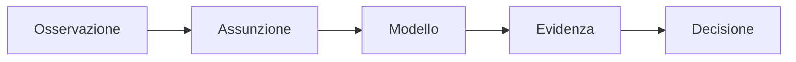

# Incertezza, rischio e ignoranza

Un forecast assegna il 72% di probabilità a uno scenario, ma la decisione deve comunque considerare ciò che il modello non sa: shock esterni, dati mancanti, cambiamenti di comportamento. **Incertezza, rischio e ignoranza** separa ciò che puoi stimare da ciò che devi ancora governare.

## Una scena da cui partire

Leggi questa lezione come educazione alla probabilità pratica. Non basta dire "incerto": devi distinguere variabilità misurabile, rischio modellabile e ignoranza che richiede opzioni, margini di sicurezza o decisioni reversibili.

- **Contesto:** Quale parte dell'incertezza puoi stimare e quale no?
- **Metodo:** Quale scenario estremo il modello non rappresenta bene?
- **Applicazione:** Quale decisione renderesti reversibile perché l'incertezza è alta?

## La Tassonomia della Conoscenza: Rischio, Incertezza e Ignoranza secondo Knight

Nel 1921, ben prima che i computer potessero processare terabyte di dati, l'economista Frank Knight, nel suo seminale lavoro *Risk, Uncertainty, and Profit*, tracciò una linea di demarcazione che ancora oggi definisce i confini della nostra professione. La sua non era una distinzione puramente accademica; era un avvertimento operativo su ciò che possiamo e non possiamo pretendere di sapere. Comprendere questa tassonomia è il primo passo per costruire modelli robusti e comunicare i risultati in modo onesto.

Il **rischio**, nella definizione di Knight, si riferisce a situazioni in cui conosciamo l'universo completo dei possibili risultati e possiamo assegnare una probabilità matematica a ciascuno di essi. Pensiamo a un casinò. Il banco conosce esattamente la probabilità che esca il rosso alla roulette (18/37, ovvero circa il 48.6%) o che un giocatore di blackjack superi il 21. Queste probabilità derivano dalla struttura stessa del gioco, da un modello del mondo chiuso e perfettamente definito. Nel nostro campo, il rischio è il dominio degli A/B test. Quando esponiamo 50.000 utenti alla versione A di un'interfaccia e 50.000 alla versione B, possiamo calcolare con precisione statistica la probabilità che la differenza osservata nelle conversioni sia dovuta al caso o a un reale effetto del cambiamento. Stiamo operando in un sistema chiuso, dove le variabili sono controllate e i risultati possono essere mappati su distribuzioni di probabilità note. La previsione del churn di un cliente basata su tre anni di dati storici su milioni di utenti si colloca in questa categoria: abbiamo un campione sufficientemente grande per stimare la probabilità di abbandono di un utente con determinate caratteristiche.

L'**incertezza**, o "incertezza Knightiana", è una bestia completamente diversa. Qui, l'universo dei possibili risultati potrebbe essere sconosciuto, e anche se lo fosse, non abbiamo alcuna base oggettiva per assegnare probabilità. L'incertezza emerge quando il contesto è unico, il fenomeno è nuovo o il sistema è troppo complesso e dinamico per essere ridotto a un modello probabilistico stabile. Qual era la probabilità di successo di Airbnb nel 2008? Qualsiasi numero sarebbe stato un'invenzione. Non esisteva una classe di riferimento di "startup che convincono sconosciuti a dormire nelle loro case". Lanciare un prodotto in una categoria completamente nuova, entrare in un mercato geografico con dinamiche culturali sconosciute, o prevedere l'impatto di una nuova tecnologia dirompente sono tutti problemi di incertezza. Il fallimento di Zillow Offers risiede qui: credevano di gestire il rischio (la probabilità che il prezzo di una casa scendesse del 2%), ma in realtà stavano navigando l'incertezza (un cambiamento sistemico nel comportamento del mercato guidato da fattori macroeconomici senza precedenti).

Infine, c'è l'**ignoranza**, che Nassim Nicholas Taleb avrebbe poi popolarizzato come il regno dei "Cigni Neri". L'ignoranza è non sapere nemmeno quale domanda porre. È l'universo degli "unknown unknowns". Non si tratta di non conoscere la probabilità di un evento; si tratta di non sapere nemmeno che quell'evento è una possibilità. Prima del 2020, quanti modelli di business includevano una variabile per una pandemia globale che avrebbe bloccato le catene di approvvigionamento e rivoluzionato il lavoro? Prima della crisi finanziaria del 2008, quanti modelli di rischio bancario consideravano la possibilità di un collasso correlato e simultaneo dei mercati immobiliari a livello nazionale? L'ignoranza non è un fallimento dell'analisi, ma un limite intrinseco della conoscenza umana. Il nostro compito non è eliminarla – è impossibile – ma costruire sistemi e strategie che siano resilienti al suo manifestarsi.

## L'Arroganza della Precisione: Quando l'Incertezza si Veste da Rischio

Il peccato capitale nel nostro campo è trattare l'incertezza come se fosse rischio. È un errore seducente, perché gli strumenti del rischio sono matematicamente eleganti, computazionalmente gestibili e producono risposte nette, precise. Un modello di regressione logistica sputerà sempre una probabilità puntuale, che il fenomeno sottostante sia stabile come la fisica di Newton o volatile come la politica. Il management chiede numeri, e noi, armati di Python e SQL, glieli forniamo. Il problema è che un numero preciso derivato da un modello errato non è solo sbagliato, è pericolosamente fuorviante.

L'esempio di WeWork è emblematico. Nel suo prospetto informativo per l'IPO del 2019, l'azienda non presentò scenari o intervalli di confidenza, ma proiezioni di una precisione sconcertante. Affermavano che il loro "Total Addressable Market" in una città come Calcutta fosse di 14.8 miliardi di dollari, un numero specifico fino all'ottava cifra significativa. Questa non era un'analisi; era una performance di certezza in un contesto di massima incertezza. Il loro modello di business non era mai stato testato in una recessione economica, la loro capacità di mantenere tassi di occupazione elevati era un'ipotesi non verificata su larga scala e la loro valutazione era basata su metriche da azienda tecnologica applicate a un business immobiliare tradizionale. Travestire queste enormi incertezze con numeri apparentemente precisi ha contribuito al catastrofico fallimento dell'IPO e alla successiva svalutazione di oltre 40 miliardi di dollari. La lezione è brutale: la precisione senza accuratezza è una forma di disinformazione.

Come si manifesta questo errore nel lavoro quotidiano?
1.  **Abuso delle distribuzioni normali**: Molti fenomeni di business, come i rendimenti azionari, le vendite di un prodotto di successo o la popolarità dei contenuti online, non seguono una distribuzione a campana. Seguono distribuzioni a coda lunga (power-law), dove gli eventi estremi sono molto più comuni di quanto un modello gaussiano suggerirebbe. Applicare un modello basato sul rischio (come il Value at Risk, o VaR, che spesso assume normalità) a un sistema dominato dall'incertezza (mercati finanziari) è stato uno dei motori della crisi del 2008.
2.  **Overfitting su dati storici**: Un modello può avere un R-quadro del 99% sui dati passati, ma fallire miseramente nel predire il futuro se le condizioni sottostanti del sistema cambiano. Questo è tipico quando si modella un mercato in crescita e si estrapola linearmente, ignorando l'incertezza legata alla saturazione del mercato, all'entrata di nuovi competitor o a cambiamenti normativi.
3.  **Confusione tra intervalli di confidenza e intervalli di predizione**: Un intervallo di confidenza al 95% si riferisce alla stima di un parametro (es. "siamo sicuri al 95% che la vera media della spesa per utente sia tra 50€ e 55€"). Un intervallo di predizione, molto più ampio, si riferisce a dove cadrà una singola osservazione futura (es. "prevediamo che il prossimo utente spenderà tra 10€ e 100€"). Comunicare il primo come se fosse il secondo dà una falsa sensazione di controllo su un futuro intrinsecamente incerto.

L'antidoto a questa arroganza è l'umiltà intellettuale, che si traduce in strumenti specifici: l'analisi di scenario, la sensitivity analysis e una comunicazione trasparente dei limiti e delle assunzioni di ogni modello.

## Caso Studio Netflix: Gestire il Rischio, Abbracciare l'Incertezza

Netflix offre un esempio magistrale di come un'organizzazione data-driven possa operare simultaneamente su entrambi i fronti: la gestione meticolosa del rischio e l'audace navigazione dell'incertezza. La loro strategia di dominio globale non è frutto di un singolo algoritmo onnisciente, ma di una cultura che sa quale problema risolvere con quale strumento.

**Nella gestione del Rischio**, Netflix è un maestro. Il loro celebre sistema di raccomandazione, che secondo l'azienda guida oltre l'80% delle ore di visione sulla piattaforma, è un esercizio di ottimizzazione del rischio su scala planetaria. Il "rischio" qui è che un utente apra l'app, non trovi nulla di interessante e chiuda, aumentando marginalmente la probabilità di churn. Per mitigarlo, Netflix non cerca di prevedere il prossimo "successo" dal nulla. Invece, modella le probabilità basandosi su dati storici sterminati. Usano tecniche come la collaborative filtering ("utenti simili a te hanno amato questo") e la content-based filtering (analizzando migliaia di tag per ogni titolo, il cosiddetto "Netflix Quantum Theory"). Ogni volta che un utente valuta un film, guarda un trailer o abbandona una serie dopo 10 minuti, fornisce un dato che affina il modello probabilistico. Quando Netflix decide di acquisire i diritti di una serie TV prodotta da terzi, la loro analisi non è un'ipotesi nel vuoto. Possono analizzare il comportamento di visione degli attori principali, del regista, del genere in specifici mercati, stimando un "tasso di successo" atteso. Questo è il dominio di Frank Knight: risultati multipli, probabilità calcolabili.

**Nell'affrontare l'Incertezza**, la strategia cambia radicalmente. Quando nel 2013 Netflix ha scommesso 100 milioni di dollari su due stagioni di *House of Cards*, un prodotto originale, non stava gestendo il rischio. Stava facendo un salto nell'incertezza Knightiana. Non esistevano dati storici affidabili sul successo di serie prodotte da una piattaforma di streaming e rilasciate tutte in una volta. Non potevano calcolare una probabilità oggettiva di successo. La decisione fu "data-informed", non "data-driven". Sapevano che i film di David Fincher e le performance di Kevin Spacey erano popolari tra i loro utenti, ma la sinergia di questi elementi in un nuovo formato di distribuzione era un'incognita totale. La loro strategia per gestire questa incertezza non fu un modello predittivo più complesso, ma un approccio di portafoglio. Invece di puntare tutto su un'unica, grande scommessa, hanno iniziato a finanziare un'ampia gamma di contenuti originali, diversi per genere, budget e target. Alcuni, come *Stranger Things*, sono diventati fenomeni globali. Altri sono falliti con perdite contenute. Questo approccio riconosce che è impossibile prevedere i singoli vincitori in un dominio di incertezza, ma è possibile costruire un sistema che nel suo complesso prosperi grazie a quella stessa imprevedibilità. L'obiettivo non è la previsione, ma la resilienza e l'opzionalità: la capacità di beneficiare enormemente dai successi inaspettati.

## Strategie Operative per l'Analista: Dalla Comunicazione alla Modellazione

Riconoscere la tassonomia di Knight è solo il primo passo. Il valore di un analista si misura nella sua capacità di tradurre questa comprensione in pratiche operative che guidino decisioni migliori. Questo significa cambiare il modo in cui modelliamo, comunichiamo e persino interroghiamo i nostri dati.

La prima e più importante strategia è abbandonare la tirannia della stima puntuale in contesti di incertezza. Invece di prevedere "venderemo 10.000 unità il prossimo trimestre", l'approccio corretto è l'**analisi di scenario**. Questa tecnica costringe noi e i nostri stakeholder a pensare in termini di futuri multipli e plausibili. Un'analisi di scenario ben fatta non si limita a un caso "pessimistico, base, ottimistico". Identifica i 2-3 driver di incertezza più critici (es. tasso di adozione del mercato, costo di acquisizione cliente, tasso di conversione) e costruisce una matrice di scenari basata sulle loro combinazioni. Per esempio, uno scenario potrebbe essere "alta adozione e basso costo di acquisizione" (il sogno), mentre un altro è "bassa adozione e alto costo" (il fallimento). A ogni scenario viene associato un output quantitativo (es. revenue, profitto) e, cosa ancora più importante, una serie di indicatori anticipatori (leading indicators) che ci aiutano a capire in quale scenario ci stiamo muovendo.

A livello pratico, questo può essere implementato direttamente nelle nostre query. Invece di calcolare una singola proiezione, possiamo usare il codice per generare più scenari. Immaginiamo di dover proiettare le revenue per una nuova feature basata su una stima di utenti attivi e un tasso di conversione incerto.

| Scenario | MAU esposti | Conversion rate ipotizzato | ARPU convertito | Revenue mensile proiettata |
|---|---:|---:|---:|---:|
| Pessimistico | 150.000 | 1,5% | 25 euro | 56.250 euro |
| Base | 150.000 | 2,5% | 25 euro | 93.750 euro |
| Ottimistico | 150.000 | 4,0% | 25 euro | 150.000 euro |

La previsione utile non promette un numero unico. Mostra un intervallo di futuri plausibili e rende esplicite le assunzioni che possono cambiare la decisione.

Questo semplice blocco di codice cambia la conversazione. Invece di un singolo numero, produce una tabella che mostra un range di risultati plausibili (in questo caso, da 56.250€ a 150.000€ di revenue mensile). La discussione si sposta da "questo numero è giusto?" a "cosa possiamo fare per evitare lo scenario pessimistico e aumentare le probabilità di quello ottimistico?".

Un'altra tecnica potente è il **pre-mortem**, un esercizio di pensiero controfattuale reso popolare dallo psicologo Gary Klein. Prima di lanciare un progetto, il team si riunisce e immagina di essere nel futuro: il progetto è fallito catastroficamente. Ognuno deve scrivere, in 5-10 minuti, le ragioni per cui è fallito. Questo processo fa emergere rischi e incertezze che il normale ottimismo progettuale tende a sopprimere. Fa emergere le "ignorance" latenti, le dipendenze nascoste e le assunzioni non dichiarate. Un analista può guidare questo processo, trasformando le ragioni qualitative del fallimento in metriche da monitorare o in rami specifici dell'analisi di scenario.

Infine, la comunicazione. L'onestà intellettuale è la nostra risorsa più preziosa. Dobbiamo essere espliciti sui limiti dei nostri modelli. Frasi come "questo modello assume che il comportamento dei clienti rimanga stabile come negli ultimi 12 mesi" o "questa proiezione non tiene conto di possibili risposte aggressive da parte dei competitor" non sono segni di debolezza, ma di rigore professionale. Visualizzare l'incertezza attraverso grafici come i fan chart o i box plot, invece di semplici linee, può comunicare la gamma di possibili risultati in modo molto più efficace di una tabella.

## Caso Studio Revolut: Prosperare sull'Ignoranza nel Fintech

Se Netflix dimostra la gestione duale di rischio e incertezza, l'unicorno fintech Revolut offre un caso studio su come costruire un'organizzazione per resistere e persino beneficiare dell'ignoranza. Nata nel 2015, Revolut ha navigato in un ambiente che non è semplicemente incerto, ma spesso sconosciuto: quello delle regolamentazioni finanziarie globali, delle criptovalute e dei comportamenti dei consumatori in rapida evoluzione.

La strategia di Revolut non si basa sulla previsione. Sarebbe impossibile prevedere la prossima mossa di un regolatore in Lituania, il fork di una criptovaluta o l'impatto di una crisi geopolitica sui flussi di rimesse. Invece, l'intera architettura tecnologica e organizzativa di Revolut è costruita per la velocità, la modularità e la sperimentazione. Questo è un approccio che abbraccia l'ignoranza. Non sapendo quale sarà il prossimo prodotto vincente o la prossima crisi normativa, costruiscono un sistema in grado di:
1.  **Lanciare rapidamente**: La loro capacità di lanciare nuove funzionalità (dal trading di azioni all'assicurazione per animali domestici) in tempi record è leggendaria. Questo permette loro di testare l'incertezza del mercato con esperimenti a basso costo. Se un prodotto non funziona, viene accantonato rapidamente. Se funziona, viene scalato. Si stima che il loro approccio basato su microservizi e team autonomi abbia ridotto il time-to-market per nuove feature di oltre il 60% rispetto a una banca tradizionale.
2.  **Essere resilienti agli shock**: Quando nel 2020 Wirecard, uno dei loro partner per l'emissione di carte, è collassato in uno scandalo finanziario (un classico "Cigno Nero", un evento dal dominio dell'ignoranza), Revolut è stata in grado di migrare i suoi clienti su un proprio sistema di elaborazione dei pagamenti in-house in sole 48 ore. Una banca tradizionale, con le sue dipendenze monolitiche, avrebbe subito un'interruzione di servizio per settimane, se non mesi. Questa resilienza non deriva dalla previsione del fallimento di Wirecard, ma dalla costruzione di un sistema con ridondanze e opzionalità.
3.  **Sfruttare le opportunità inattese**: L'esplosione di interesse per le criptovalute nel 2017 e di nuovo nel 2021 non era un evento prevedibile con modelli basati sul rischio. Revolut, grazie alla sua piattaforma flessibile, è stata una delle prime app finanziarie a integrare l'acquisto e la vendita di crypto, catturando un'enorme ondata di nuovi utenti e volumi di transazioni. Questo ha trasformato un evento incerto in un motore di crescita massiccio, aumentando l'acquisizione di nuovi utenti di quasi il 30% durante i picchi di interesse.

L'approccio di Revolut insegna all'analista una lezione profonda: a volte, il nostro ruolo più importante non è costruire un modello predittivo, ma fornire i dati e gli strumenti che aumentano la velocità di sperimentazione e la resilienza dell'organizzazione. Si tratta di misurare il "time to learn" e di creare dashboard che segnalino non solo le performance, ma anche la capacità del sistema di rispondere a eventi imprevisti.

## Laboratorio di Pensiero Critico: Dalla Teoria alla Pratica

Ora che abbiamo esplorato la teoria e analizzato casi reali, mettiamo alla prova la nostra capacità di applicare questi concetti. Affrontiamo insieme tre esercizi progressivi, pensati per affinare il nostro giudizio analitico di fronte a problemi concreti.

**Esercizio 1: Classificazione del Problema**
Per ciascuno dei seguenti scenari di business, classificalo come un problema di Rischio, Incertezza o Ignoranza. Giustifica brevemente la tua scelta.
a) Una compagnia di assicurazioni auto deve definire il prezzo della polizza per un neopatentato di 18 anni in una grande città.
b) Un'azienda farmaceutica deve decidere se investire 500 milioni di dollari nello sviluppo di un nuovo farmaco basato su una tecnologia di editing genetico mai testata prima sull'uomo.
c) Una catena di retail globale deve valutare l'impatto sulla sua catena di approvvigionamento di un'eruzione vulcanica in Islanda che blocchi il traffico aereo europeo.

*Riflessione guidata*: Per lo scenario (a), abbiamo decenni di dati attuariali su milioni di guidatori. Possiamo costruire un modello probabilistico molto accurato. Questo è il

## Laboratorio ed esercizi

Metti in pratica quanto appreso con esercizi a difficoltà crescente. Lavora su un dataset reale — se non hai accesso al tuo data warehouse aziendale, usa dataset pubblici come Google Analytics Sample su BigQuery o il dataset E-Commerce di Kaggle.

**Esercizio 1 — Implementazione base.** Riproduci la query o il modello descritto nella lezione, adattandolo al tuo dataset. Verifica che i risultati siano coerenti con le metriche attese: se il totale non quadra con una query di controllo, c'è un problema di grain.

**Esercizio 2 — Estensione.** Aggiungi una dimensione di analisi non coperta nella lezione: segmenta per paese, per device, per fascia oraria o per coorte. Dove emergono pattern inattesi? Cosa implicano per le decisioni operative?

**Esercizio 3 — Automazione.** Trasforma la query in una vista o in un modello dbt con test di integrità (unique, not_null) e documenta le colonne. Se il tuo stack lo permette, configura un alert che notifichi quando la metrica esce da 2 deviazioni standard dalla media mobile.

## Problema reale

Nel lavoro su fondamenti filosofici dell'analisi dati, **Incertezza, rischio e ignoranza** serve a risolvere un problema concreto: capire quando un dato sostiene davvero una decisione e quando invece nasconde assunzioni, bias, causalità fragile o una domanda formulata male. La domanda non è se il concetto sia interessante in astratto, ma quale decisione migliora quando lo applichi con dati affidabili e con una soglia di errore esplicita.

Questa lezione va studiata come uno strumento operativo: entro la fine devi saper Comprendere il problema analitico e il contesto decisionale; Applicare esempi, metriche e controlli a casi reali. Se non riesci a collegare il concetto a una scelta reale, la conoscenza resta decorativa e non diventa competenza.

## Modello concettuale

Il modello mentale e sequenziale: prima si formula la domanda, poi si traduce in unità osservabili, quindi si valuta la qualità del dato e solo alla fine si decide. Saltare un passaggio produce analisi eleganti ma fragili.

| Passaggio | Domanda guida | Output atteso |
|---|---|---|
| Framing | Quale decisione deve cambiare? | Una scelta concreta, non una curiosità |
| Misura | Quale segnale rappresenta il fenomeno? | Metrica, fonte e granularità |
| Confronto | Rispetto a quale baseline interpreto il risultato? | Benchmark o controfattuale plausibile |
| Azione | Che cosa faccio se il segnale supera la soglia? | Decisione, owner e prossimo controllo |

## Formalizzazione rigorosa

Formalizza **Incertezza, rischio e ignoranza** come una relazione tra quattro elementi: unità di analisi, segnale, baseline e decisione. Nel contesto di questa lezione l'unità principale e **osservazione, ipotesi, variabile, meccanismo causale o criterio di evidenza**. Il segnale da osservare deve essere collegato a **forza dell evidenza, coerenza causale, robustezza delle assunzioni e costo dell errore decisionale**, mentre la baseline deve essere scelta tra **spiegazione alternativa, controfattuale, gruppo comparabile o scenario senza intervento**.

Una formulazione robusta segue questa logica:

| Elemento | Definizione operativa per questa lezione |
|---|---|
| Unità | osservazione, ipotesi, variabile, meccanismo causale o criterio di evidenza |
| Segnale | forza dell evidenza, coerenza causale, robustezza delle assunzioni e costo dell errore decisionale |
| Baseline | spiegazione alternativa, controfattuale, gruppo comparabile o scenario senza intervento |
| Decisione | accettare, rifiutare o riformulare una spiegazione prima di usarla in un contesto aziendale |
| Rischio | Confondere correlazione, qualità del dato e causalità decisionale |

La regola pratica e semplice: una misura e utile solo se riduce l'incertezza su una decisione specifica. Se non cambia una scelta, e documentazione; se cambia una scelta senza controlli, e rischio.

## Esempio o caso studio

Un comitato interpreta una crescita di retention come prova che una nuova iniziativa abbia funzionato. La lezione costringe a distinguere osservazione, spiegazione, assunzione e decisione prima di trasformare il dato in azione.

Applicando **Incertezza, rischio e ignoranza**, il team costruisce una lettura in tre colonne: cosa sappiamo, cosa assumiamo e quale decisione prendiamo. Questo formato impedisce di presentare un numero come se fosse una conclusione autosufficiente.

| Evidenza | Interpretazione prudente | Decisione conseguente |
|---|---|---|
| Segnale positivo ma non isolato | Il fenomeno esiste, ma la causa e ancora incerta | Cercare baseline o holdout |
| Segmento con risposta diversa | L'effetto medio nasconde eterogeneita | Analizzare coorti o sottogruppi |
| Costo operativo crescente | Il risultato va valutato sul margine | Applicare soglie economiche |

## Lab / esercizio

### Livello base

Prendi una decisione reale collegata a **Incertezza, rischio e ignoranza** e scrivi in cinque righe: obiettivo, metrica primaria, baseline, rischio principale e azione prevista. Non usare più di una metrica primaria.

### Livello intermedio

Costruisci una tabella con almeno tre segmenti o scenari. Per ciascuno indica segnale, possibile spiegazione alternativa e controllo necessario prima di decidere.

### Livello research-grade

Disegna un piano di validazione: ipotesi, dati necessari, criterio di esclusione, soglia decisionale e controllo post-decisione. Specifica anche che cosa ti farebbe cambiare idea.

### Dataset e materiali consigliati

Usa case study decisionali, metriche prodotto, risultati di esperimenti, DAG semplici, report analitici e serie storiche simulate. Se non hai dati reali, crea un dataset sintetico con 200-500 righe e almeno una colonna temporale, una colonna segmento, una metrica di outcome e una variabile di esposizione.

## Errore tipico da evitare

L'errore più frequente e trattare **Incertezza, rischio e ignoranza** come una definizione da ricordare invece che come un protocollo decisionale. In pratica succede quando si presenta una metrica senza baseline, un grafico senza ipotesi, o una raccomandazione senza costo dell'errore.

Un controllo utile è chiedersi: "se questo risultato fosse falso o instabile, quale decisione sbaglierei?". Se la risposta non è chiara, la lezione non è ancora stata applicata davvero.

## Quiz o checkpoint

1. Qual è la decisione concreta che questa lezione dovrebbe migliorare?
2. Quale baseline rende interpretabile il risultato?
3. Quale assunzione, se sbagliata, cambierebbe la conclusione?
4. Quale controllo minimo useresti prima di presentare la raccomandazione?

## Riepilogo operativo

**Incertezza, rischio e ignoranza** e una competenza utile quando collega concetto, dato e decisione. Studiala partendo da un problema reale, formalizza il segnale, cerca una baseline credibile, costruisci un esempio e chiudi con un controllo pratico. Categoria: Fondamenti. Difficoltà: advanced. Tempo stimato: 18 min.
