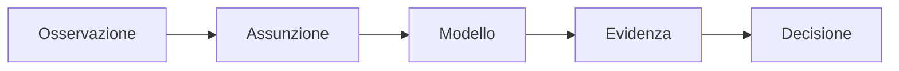

# Incertezza, rischio e ignoranza

Un forecast può indicare una probabilità del 72% per uno scenario, ma la decisione deve sempre tenere conto di ciò che il modello non conosce: shock esterni, dati mancanti, cambiamenti comportamentali. La distinzione tra **incertezza, rischio e ignoranza** è fondamentale per separare ciò che possiamo stimare da ciò che dobbiamo ancora governare.

## Problema reale

Nel lavoro sui fondamenti filosofici dell'analisi dati, comprendere **incertezza, rischio e ignoranza** serve a risolvere un problema concreto: capire quando un dato sostiene davvero una decisione e quando invece nasconde assunzioni, bias o causalità fragile. Non è un concetto astratto, ma uno strumento operativo per migliorare le scelte basate sui dati.

## Modello concettuale

Il processo mentale è sequenziale: prima si formula la domanda, poi si traduce in unità osservabili, si valuta la qualità del dato e infine si decide. Saltare un passaggio produce analisi eleganti ma fragili.

| Passaggio | Domanda guida | Output atteso |
|---|---|---|
| Framing | Quale decisione deve cambiare? | Una scelta concreta |
| Misura | Quale segnale rappresenta il fenomeno? | Metrica, fonte, granularità |
| Confronto | Rispetto a quale baseline interpreto il risultato? | Benchmark o controfattuale |
| Azione | Che cosa faccio se il segnale supera la soglia? | Decisione, owner, prossimo controllo |

## Formalizzazione rigorosa

Formalizziamo **incertezza, rischio e ignoranza** come relazione tra quattro elementi: unità di analisi, segnale, baseline e decisione.

| Elemento | Definizione operativa |
|---|---|
| Unità | osservazione, ipotesi, variabile, meccanismo causale |
| Segnale | forza dell'evidenza, coerenza causale, robustezza delle assunzioni, costo dell'errore decisionale |
| Baseline | spiegazione alternativa, controfattuale, gruppo comparabile, scenario senza intervento |
| Decisione | accettare, rifiutare o riformulare una spiegazione prima dell'uso aziendale |

Una regola pratica: una misura è utile solo se riduce l'incertezza su una decisione specifica. Se non cambia una scelta, è solo documentazione; se cambia una scelta senza controlli, è rischio.

## Esempio o caso studio

Un comitato interpreta una crescita della retention come prova del successo di una nuova iniziativa. La lezione insegna a distinguere osservazione, spiegazione, assunzione e decisione prima di agire.

| Evidenza | Interpretazione prudente | Decisione |
|---|---|---|
| Segnale positivo ma non isolato | Fenomeno esiste, ma causa incerta | Cercare baseline o holdout |
| Segmento con risposta diversa | Effetto medio nasconde eterogeneità | Analizzare coorti o sottogruppi |
| Costo operativo crescente | Valutare sul margine | Applicare soglie economiche |

## Lab / esercizio

### Livello base

Scrivi una decisione reale collegata a **incertezza, rischio e ignoranza**: obiettivo, metrica primaria, baseline, rischio principale e azione prevista.

### Livello intermedio

Costruisci una tabella con almeno tre segmenti o scenari. Per ciascuno indica segnale, possibile spiegazione alternativa e controllo necessario.

### Livello research-grade

Disegna un piano di validazione: ipotesi, dati necessari, criteri di esclusione, soglia decisionale e controllo post-decisione. Specifica cosa ti farebbe cambiare idea.

### Dataset e materiali consigliati

Usa case study decisionali, metriche prodotto, esperimenti, DAG semplici, report analitici e serie storiche simulate. Se non hai dati reali, crea un dataset sintetico con almeno 200 righe e colonne temporali, segmenti, outcome e variabili di esposizione.

## Errore tipico da evitare

Il più comune è trattare **incertezza, rischio e ignoranza** come definizioni da ricordare anziché come protocollo decisionale. Succede quando si presenta una metrica senza baseline, un grafico senza ipotesi o una raccomandazione senza costo dell'errore.

Un controllo utile è chiedersi: "Se questo risultato fosse falso o instabile, quale decisione sbaglierei?". Se la risposta non è chiara, la lezione non è stata applicata davvero.

## Quiz o checkpoint

1. Qual è la decisione concreta che questa lezione dovrebbe migliorare?
2. Quale baseline rende interpretabile il risultato?
3. Quale assunzione, se sbagliata, cambierebbe la conclusione?
4. Quale controllo minimo useresti prima di presentare la raccomandazione?

## Riepilogo operativo

**Incertezza, rischio e ignoranza** è una competenza che collega concetto, dato e decisione. Studiala partendo da un problema reale, formalizza il segnale, cerca una baseline credibile, costruisci un esempio e chiudi con un controllo pratico. Categoria: Fondamenti. Difficoltà: advanced. Tempo stimato: 18 min.
