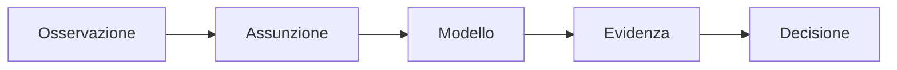

# Etica degli algoritmi e responsabilità analitica

Nel 2018, un data scientist di Amazon costruì un algoritmo di recruiting che avrebbe dovuto selezionare i migliori candidati. L'algoritmo fu addestrato su 10 anni di CV di candidati assunti — prevalentemente uomini, perché l'industria tech è prevalentemente maschile. L'algoritmo imparò che "essere donna" era un predittore negativo. Penalizzava i CV che contenevano parole come "women's chess club" o lauree in college femminili. Amazon scoprì il problema, cercò di correggerlo, e alla fine abbandonò il progetto. Non per malafede. Non per incompetenza tecnica. Ma perché nessuno, nel team di sviluppo, si era posto la domanda etica fondamentale: "Cosa significa 'miglior candidato'? Migliore per replicare il passato o migliore per costruire il futuro?"

## Le quattro dimensioni dell'etica dei dati

L'etica dei dati non è un corso di morale. È un framework operativo per evitare di fare danni con i numeri. Quattro domande strutturano il campo:

| Dimensione | Domanda | Esempio concreto |
|------------|---------|------------------|
| **Privacy** | I dati che uso appartengono davvero all'azienda? O alle persone? | Un analyst unisce dati CRM con dati di social media scraping per arricchire i profili cliente. Le persone hanno acconsentito? |
| **Fairness** | Il mio modello tratta gruppi diversi in modo diverso? È giustificato? | Un algoritmo di pricing offre prezzi più alti a utenti in quartieri ricchi. È discriminazione o segmentazione di mercato? |
| **Accountability** | Se il modello sbaglia, chi risponde? Il developer? Il manager? L'algoritmo? | Un modello di credit scoring nega un mutuo a una famiglia. Chi spiega la decisione? C'è un processo di appello? |
| **Transparency** | Le persone sanno che un algoritmo sta decidendo per loro? Sanno come funziona? | Un sistema di dynamic pricing cambia il prezzo in base al profilo utente. L'utente sa che il prezzo che vede non è lo stesso che vede un altro utente? |

## Fairness: il problema più spinoso

La fairness algoritmica è un campo di ricerca attivo perché non esiste UNA definizione di fairness. Ce ne sono almeno cinque, e sono matematicamente incompatibili tra loro. Non puoi soddisfarle tutte contemporaneamente:

1. **Demographic parity**: il tasso di approvazione deve essere uguale tra gruppi (es. stesso tasso di assunzione per uomini e donne)
2. **Equal opportunity**: il tasso di veri positivi deve essere uguale tra gruppi (tra i candidati "bravi", stessa probabilità di essere assunti)
3. **Predictive parity**: a parità di score, la probabilità di essere "bravi" deve essere uguale tra gruppi
4. **Individual fairness**: individui simili devono ricevere decisioni simili
5. **Counterfactual fairness**: la decisione non sarebbe cambiata se l'individuo appartenesse a un gruppo diverso

Il teorema di Kleinberg et al. (2017) dimostra che — tranne in casi degeneri — non puoi soddisfare contemporaneamente demographic parity, equal opportunity e predictive parity. Devi scegliere. E la scelta è etica, non tecnica.

## Caso reale: il credit scoring e la fairness

Una banca olandese fu indagata nel 2021 perché il suo algoritmo di credit scoring approvava il 73% dei richiedenti con nome olandese e solo il 58% dei richiedenti con nome straniero, a parità di reddito e impiego. L'algoritmo non usava la nazionalità come variabile. Usava il quartiere di residenza, che in Olanda è fortemente correlato all'etnia.

La banca si difese dicendo che l'algoritmo era "oggettivo". Ma oggettivo rispetto a cosa? Ai dati passati, che riflettevano disuguaglianze storiche. L'algoritmo stava semplicemente *automatizzando la discriminazione esistente*. Non la creava, ma la perpetuava e la rendeva invisibile dietro un numero.

L'autorità di regolamentazione olandese impose alla banca di:
1. Documentare esplicitamente quale definizione di fairness stavano usando
2. Testare l'algoritmo per tutte e cinque le definizioni e riportare i risultati
3. Permettere ai clienti rifiutati di ricevere una spiegazione comprensibile della decisione

## Il framework etico per l'analista

Ogni volta che costruisci o usi un modello che impatta persone reali, applica questa checklist:

1. **Consenso**: le persone sanno che stai usando i loro dati? Per cosa?
2. **Impatto differenziale**: il modello tratta gruppi diversi in modo diverso? È intenzionale e giustificato?
3. **Spiegabilità**: puoi spiegare a una persona non tecnica perché il modello ha preso questa decisione?
4. **Appellabilità**: esiste un processo umano di revisione per chi contesta la decisione?
5. **Monitoraggio continuo**: chi controlla che il modello non inizi a discriminare nel tempo?

---

*Riferimenti:*
- O'Neil, C. (2016). *Weapons of Math Destruction: How Big Data Increases Inequality.* Crown.
- Kleinberg, J., Mullainathan, S. & Raghavan, M. (2017). "Inherent Trade-Offs in Algorithmic Fairness." *Proceedings of ITCS 2017.*
- Barocas, S., Hardt, M. & Narayanan, A. (2019). *Fairness and Machine Learning.* fairmlbook.org.

## Controllo di qualità

Prima di usare etica degli algoritmi e responsabilità analitica in una decisione, controlla sempre completezza, duplicati, timezone, definizioni cambiate e segmenti esclusi. Molte analisi apparentemente sofisticate falliscono perché il dato di partenza misura un comportamento diverso da quello che il team crede di osservare.

## Interpretazione per segmenti

La media aggregata è solo il punto di partenza. Segmenta per canale, coorte, piano, paese, device e maturità dell'utente. Se due segmenti si muovono in direzioni opposte, la media non rappresenta nessuno dei due e può portare a una decisione sbagliata.

## Decisione operativa

Ogni analisi deve terminare con una scelta possibile: continuare, fermare, iterare, investire, rimuovere o approfondire. Se etica degli algoritmi e responsabilità analitica non cambia una decisione, probabilmente manca ancora il collegamento tra metrica e azione.

## Problema reale

Nel lavoro su fondamenti filosofici dell'analisi dati, **Etica degli algoritmi e responsabilità analitica** serve a risolvere un problema concreto: capire quando un dato sostiene davvero una decisione e quando invece nasconde assunzioni, bias, causalita fragile o una domanda formulata male. La domanda non e se il concetto sia interessante in astratto, ma quale decisione migliora quando lo applichi con dati affidabili e con una soglia di errore esplicita.

Questa lezione va studiata come uno strumento operativo: entro la fine devi saper Comprendere il problema analitico e il contesto decisionale; Applicare esempi, metriche e controlli a casi reali. Se non riesci a collegare il concetto a una scelta reale, la conoscenza resta decorativa e non diventa competenza.

## Modello concettuale

Il modello mentale e sequenziale: prima si formula la domanda, poi si traduce in unita osservabili, quindi si valuta la qualita del dato e solo alla fine si decide. Saltare un passaggio produce analisi eleganti ma fragili.

| Passaggio | Domanda guida | Output atteso |
|---|---|---|
| Framing | Quale decisione deve cambiare? | Una scelta concreta, non una curiosita |
| Misura | Quale segnale rappresenta il fenomeno? | Metrica, fonte e granularita |
| Confronto | Rispetto a quale baseline interpreto il risultato? | Benchmark o controfattuale plausibile |
| Azione | Che cosa faccio se il segnale supera la soglia? | Decisione, owner e prossimo controllo |

## Formalizzazione rigorosa

Formalizza **Etica degli algoritmi e responsabilità analitica** come una relazione tra quattro elementi: unita di analisi, segnale, baseline e decisione. Nel contesto di questa lezione l'unita principale e **osservazione, ipotesi, variabile, meccanismo causale o criterio di evidenza**. Il segnale da osservare deve essere collegato a **forza dell evidenza, coerenza causale, robustezza delle assunzioni e costo dell errore decisionale**, mentre la baseline deve essere scelta tra **spiegazione alternativa, controfattuale, gruppo comparabile o scenario senza intervento**.

Una formulazione robusta segue questa logica:

| Elemento | Definizione operativa per questa lezione |
|---|---|
| Unita | osservazione, ipotesi, variabile, meccanismo causale o criterio di evidenza |
| Segnale | forza dell evidenza, coerenza causale, robustezza delle assunzioni e costo dell errore decisionale |
| Baseline | spiegazione alternativa, controfattuale, gruppo comparabile o scenario senza intervento |
| Decisione | accettare, rifiutare o riformulare una spiegazione prima di usarla in un contesto aziendale |
| Rischio | Confondere correlazione, qualita del dato e causalita decisionale |

La regola pratica e semplice: una misura e utile solo se riduce l'incertezza su una decisione specifica. Se non cambia una scelta, e documentazione; se cambia una scelta senza controlli, e rischio.

## Esempio o caso studio

Un comitato interpreta una crescita di retention come prova che una nuova iniziativa abbia funzionato. La lezione costringe a distinguere osservazione, spiegazione, assunzione e decisione prima di trasformare il dato in azione.

Applicando **Etica degli algoritmi e responsabilità analitica**, il team costruisce una lettura in tre colonne: cosa sappiamo, cosa assumiamo e quale decisione prendiamo. Questo formato impedisce di presentare un numero come se fosse una conclusione autosufficiente.

| Evidenza | Interpretazione prudente | Decisione conseguente |
|---|---|---|
| Segnale positivo ma non isolato | Il fenomeno esiste, ma la causa e ancora incerta | Cercare baseline o holdout |
| Segmento con risposta diversa | L'effetto medio nasconde eterogeneita | Analizzare coorti o sottogruppi |
| Costo operativo crescente | Il risultato va valutato sul margine | Applicare soglie economiche |

## Lab / esercizio

### Livello base

Prendi una decisione reale collegata a **Etica degli algoritmi e responsabilità analitica** e scrivi in cinque righe: obiettivo, metrica primaria, baseline, rischio principale e azione prevista. Non usare piu di una metrica primaria.

### Livello intermedio

Costruisci una tabella con almeno tre segmenti o scenari. Per ciascuno indica segnale, possibile spiegazione alternativa e controllo necessario prima di decidere.

### Livello research-grade

Disegna un piano di validazione: ipotesi, dati necessari, criterio di esclusione, soglia decisionale e controllo post-decisione. Specifica anche che cosa ti farebbe cambiare idea.

### Dataset e materiali consigliati

Usa case study decisionali, metriche prodotto, risultati di esperimenti, DAG semplici, report analitici e serie storiche simulate. Se non hai dati reali, crea un dataset sintetico con 200-500 righe e almeno una colonna temporale, una colonna segmento, una metrica di outcome e una variabile di esposizione.

## Errore tipico da evitare

L'errore piu frequente e trattare **Etica degli algoritmi e responsabilità analitica** come una definizione da ricordare invece che come un protocollo decisionale. In pratica succede quando si presenta una metrica senza baseline, un grafico senza ipotesi, o una raccomandazione senza costo dell'errore.

Un controllo utile e chiedersi: "se questo risultato fosse falso o instabile, quale decisione sbaglierei?". Se la risposta non e chiara, la lezione non e ancora stata applicata davvero.

## Quiz o checkpoint

1. Qual e la decisione concreta che questa lezione dovrebbe migliorare?
2. Quale baseline rende interpretabile il risultato?
3. Quale assunzione, se sbagliata, cambierebbe la conclusione?
4. Quale controllo minimo useresti prima di presentare la raccomandazione?

## Riepilogo operativo

**Etica degli algoritmi e responsabilità analitica** e una competenza utile quando collega concetto, dato e decisione. Studiala partendo da un problema reale, formalizza il segnale, cerca una baseline credibile, costruisci un esempio e chiudi con un controllo pratico. Categoria: Fondamenti. Difficolta: advanced. Tempo stimato: 18 min.
