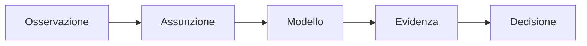

# Etica degli algoritmi e responsabilità analitica

Lavorare con i dati significa prendere decisioni sotto incertezza, e qui l'etica degli algoritmi non è un'aggiunta morale ma parte del mestiere. Migliorare una metrica non basta. Bisogna sapere chi ne beneficia, chi ne paga il prezzo e chi, di fronte a un risultato che lo riguarda, può contestarlo.

## Quando un modello tocca le persone

Ogni modello che entra in produzione ha effetti concreti su persone, processi e opportunità. Il punto è capire quando un dato sostiene davvero una decisione e quando invece copre assunzioni, bias o una causalità fragile. La domanda da tenere a mente è una sola: quale decisione migliora se applico questo concetto con dati affidabili e una soglia di errore dichiarata?

## Il percorso dall'osservazione alla scelta

Il percorso è sequenziale: si formula la domanda, la si traduce in unità osservabili, si valuta la qualità del dato e solo alla fine si decide. Saltare un passaggio produce analisi fragili.

| Passaggio | Domanda guida | Output atteso |
|---|---|---|
| Framing | Quale decisione deve cambiare? | Una scelta concreta, non una curiosità |
| Misura | Quale segnale rappresenta il fenomeno? | Metrica, fonte e granularità |
| Confronto | Rispetto a quale baseline interpreto il risultato? | Benchmark o controfattuale plausibile |
| Azione | Che cosa faccio se il segnale supera la soglia? | Decisione, responsabile e prossimo controllo |

## Quattro elementi da tenere insieme

Conviene leggere l'etica degli algoritmi come una relazione tra quattro elementi, ognuno con una definizione che puoi usare nel concreto.

| Elemento | Definizione operativa |
|---|---|
| Unità | osservazione, ipotesi, variabile, meccanismo causale o criterio di evidenza |
| Segnale | forza dell'evidenza, coerenza causale, robustezza delle assunzioni, costo dell'errore decisionale |
| Baseline | spiegazione alternativa, controfattuale, gruppo comparabile o scenario senza intervento |
| Decisione | accettare, rifiutare o riformulare una spiegazione prima di usarla |

La regola pratica è semplice: una misura serve solo se riduce l'incertezza su una decisione specifica. Se non cambia una scelta, resta documentazione. Se cambia una scelta senza controlli, diventa un rischio.

## Il caso della banca olandese

Una banca olandese finì sotto indagine perché il suo algoritmo di credit scoring approvava il 73% dei richiedenti con nome olandese e solo il 58% di quelli con nome straniero, a parità di reddito. L'algoritmo non usava la nazionalità, ma il quartiere di residenza, che risultava correlato all'etnia.

Il caso mostra come un modello che sembra oggettivo possa riprodurre discriminazioni storiche. L'autorità impose alla banca di documentare la definizione di fairness adottata, di testare il modello su più metriche e di garantire spiegazioni comprensibili ai clienti rifiutati.

## Esercizio su tre livelli

Al livello base scrivi in cinque righe una decisione reale collegata all'etica degli algoritmi: obiettivo, metrica primaria, baseline, rischio principale e azione prevista.

Al livello intermedio costruisci una tabella con almeno tre segmenti o scenari. Per ciascuno indica il segnale, una possibile spiegazione alternativa e il controllo necessario prima di decidere.

Al livello research-grade disegna un piano di validazione: ipotesi, dati necessari, criterio di esclusione, soglia decisionale e controllo post-decisione. Specifica cosa ti farebbe cambiare idea.

Come materiali usa case study decisionali, metriche prodotto, risultati di esperimenti, DAG semplici, report analitici e serie storiche simulate. Se non hai dati reali, crea un dataset sintetico con almeno 200 righe e colonne temporali, segmenti, outcome e variabili di esposizione.

## L'errore che svuota tutto

L'errore più frequente è trattare l'etica degli algoritmi come una definizione da ricordare invece che come un protocollo decisionale. Capita quando si presenta una metrica senza baseline, un grafico senza ipotesi o una raccomandazione che ignora il costo dell'errore.

Il controllo che lo smaschera è una domanda: "Se questo risultato fosse falso o instabile, quale decisione sbaglierei?". Se non sai rispondere, la lezione è rimasta sulla carta.

## Riepilogo operativo

L'etica degli algoritmi e la responsabilità analitica collegano concetto, dato e decisione. Si studiano partendo da un problema reale, formalizzando il segnale, cercando una baseline credibile, costruendo un esempio e chiudendo con un controllo pratico. È così che la conoscenza diventa una competenza che regge il confronto con persone reali e con chi può chiedere conto delle scelte.
