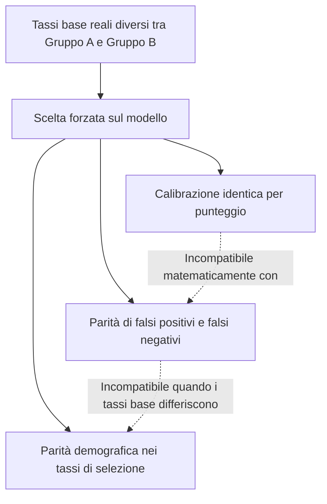

Sul binario tabellare ogni punteggio prodotto da un algoritmo finisce in una tabella di classificazione e, subito dopo, in una decisione che tocca la vita concreta delle persone: l'approvazione di un mutuo, il premio assicurativo, l'ordine di convocazione a un colloquio o la priorità di un controllo fiscale. Quando il modello migliora l'accuratezza globale di due punti o riduce i costi operativi, chi lo ha sviluppato tende a considerare chiuso il proprio compito tecnico.

Eppure decidere con i dati significa amministrare errori sotto incertezza, e nessun modello statistico distribuisce i propri errori in modo neutro. L'etica degli algoritmi non è un commento filosofico esterno al mestiere dell'analista, ma il criterio ingegneristico con cui verifichi chi riceve i benefici dell'automazione, chi paga il prezzo delle classificazioni sbagliate e attraverso quale meccanismo un cittadino o un cliente può contestare una scelta che lo penalizza.

## Quando l'accuratezza aggregata nasconde un danno selettivo

Esaminiamo un caso costruito con numeri di esempio ispirati a una tipica istruttoria bancaria automatizzata. Una finanziaria addestra un classificatore su tabelle storiche di richieste di microcredito per stimare la probabilità di insolvenza entro dodici mesi. In validazione il modello raggiunge un'accuratezza complessiva dell'84% e riduce le perdite attese su portafoglio rispetto alle regole manuali precedenti, guadagnando il via libera alla produzione.

Dopo tre mesi di operatività, tuttavia, l'ufficio reclami segnala una concentrazione anomala di rifiuti provenienti da due quartieri periferici, anche per richiedenti con reddito stabile e storico lavorativo regolare. Analizzando le feature usate dal classificatore, non compare alcuna variabile esplicita legata all'origine geografica o demografica, perché il team le aveva rimosse per prudenza. Il modello utilizza invece il modello di smartphone usato in fase di richiesta, l'orario della domanda e la frequenza di cambio domicilio negli ultimi cinque anni. Quelle variabili apparentemente neutre agiscono come sostituti statistici dello stato socioeconomico del territorio e trasferiscono sui richiedenti di quell'area un tasso di rifiuto ingiustificato molto più elevato.

> **Idea chiave:** Un modello accurato in media può essere sistematicamente iniquo su un sottogruppo identificabile; la responsabilità analitica richiede di dichiarare la definizione di equità scelta, disaggregare gli errori per gruppo e garantire a chi subisce la decisione un canale reale di contestazione.

Questa constatazione cambia radicalmente l'onere della prova. Non basta dimostrare che l'algoritmo massimizza una funzione obiettivo globale su un dataset di test; occorre rendere esplicito quale costo umano ed economico comporta ciascuna tipologia di errore e su quali spalle ricade.

## Il conflitto matematico tra le definizioni di equità

Chi si avvicina per la prima volta all'equità algoritmica immagina spesso che esista una formula universale capace di rendere un modello giusto sotto ogni profilo nello stesso momento. La ricerca matematica degli ultimi dieci anni, formalizzata in particolare da Alexandra Chouldechova nel 2017 e da Jon Kleinberg, Sendhil Mullainathan e Manish Raghavan nel 2016, ha dimostrato invece un risultato scomodo e inevitabile: quando due gruppi presentano tassi base reali differenti rispetto al fenomeno da prevedere, nessun classificatore imperfetto può soddisfare contemporaneamente tutte le principali definizioni di equità.

Questo teorema di impossibilità impone una scelta politica ed etica che non può essere delegata al software. Per orientarti con rigore, devi distinguere con precisione i tre criteri più adottati nei sistemi di decisione automatizzata.

La **parità demografica** richiede che la quota di esiti positivi assegnati dal modello sia identica nei diversi gruppi, indipendentemente dalle caratteristiche individuali o dal rischio osservato. Funziona quando l'obiettivo è garantire accesso proporzionale o compensare uno svantaggio storico strutturale, ma rischia di forzare approvazioni verso profili non qualificati in un gruppo o di respingere profili solidi nell'altro.

L'**uguaglianza di opportunità** (o *equalized odds* nella forma più restrittiva) richiede invece che i tassi di errore siano identici tra gruppi a parità di esito reale: due persone che nella realtà ripagheranno il debito devono avere la stessa probabilità di essere approvate, indipendentemente dal gruppo di appartenenza, oppure due persone che non commetteranno recidiva devono subire lo stesso tasso di falsi allarmi.

La **calibrazione per gruppo** stabilisce infine che un punteggio di rischio dichiarato debba significare la stessa probabilità reale in ogni sottogruppo: se il sistema assegna un punteggio di rischio pari al 20%, circa il 20% dei soggetti con quel punteggio nel Gruppo A e circa il 20% nel Gruppo B devono manifestare l'evento temuto.

| Criterio di equità | Requisito matematico | Beneficio principale | Limite e trade-off inevitabile |
|---|---|---|---|
| Parità demografica | Tasso di selezione positivo uguale tra i gruppi | Impedisce esclusioni sproporzionate all'ingresso | Ignora differenze reali nei tassi base e può danneggiare i singoli qualificati |
| Equalized odds | Tasso di falsi positivi e falsi negativi uguale tra i gruppi | Protegge persone innocenti o meritevoli dalla stessa quota di errori | Viola la calibrazione del punteggio quando i tassi base differiscono |
| Calibrazione per gruppo | Probabilità reale condizionata al punteggio identica | Mantiene il significato coerente dello score per il decisore umano | Genera tassi di falsi positivi più alti nel gruppo con tasso base maggiore |

Scegliere quale proprietà privilegiare non è un esercizio tecnico neutrale. In un sistema di screening medico o di erogazione di borse di studio il costo del falso negativo è molto diverso dal costo di un falso positivo in un sistema di sorveglianza giudiziaria.

## Disaggregare la matrice di confusione su numeri di esempio

Per vedere come l'impossibilità matematica si traduca in danni concreti alle persone, seguiamo un calcolo passo-passo su una popolazione simulata di 2.000 richiedenti prestito suddivisi equamente in due gruppi territoriali, Gruppo A e Gruppo B, con 1.000 domande ciascuno. Nel Gruppo A il tasso storico reale di insolvenza è del 10%, quindi vi sono 100 persone realmente insolventi e 900 persone che rimborserebbero regolarmente il prestito. Nel Gruppo B, colpito da maggiore precarietà lavorativa esterna, il tasso reale di insolvenza è del 25%, pari a 250 persone insolventi e 750 persone solvibili.

Supponiamo che la banca adotti un modello ben calibrato che assegna punteggi fedeli al rischio osservato e applichi un'unica soglia di rifiuto. Nel Gruppo A il modello intercetta correttamente 80 insolventi su 100 e sbaglia respingendo 90 richiedenti solvibili su 900. Il tasso di falsi positivi nel Gruppo A è quindi 90 / 900 = 0,10, ossia il 10,0% dei clienti affidabili respinti ingiustamente.

Nel Gruppo B, per mantenere la calibrazione coerente con una distribuzione di punteggi spostata verso l'alto a causa del maggior tasso base di rischio, lo stesso cut-off intercetta 200 insolventi su 250 ma finisce per respingere 165 richiedenti solvibili su 750. Il tasso di falsi positivi nel Gruppo B sale a 165 / 750 = 0,22, pari al 22,0%. Lo scarto tra i due gruppi è 22,0% - 10,0% = 12,0 punti percentuali (`12 pp`).

Consideriamo ora l'effetto combinato sui clienti meritevoli: su 750 persone perfettamente solvibili del Gruppo B, il 22% viene privato del credito pur avendo la capacità di rimborsarlo, più del doppio rispetto al 10% del Gruppo A. Se la banca avesse applicato il medesimo tasso di falsi positivi del 10% anche nel Gruppo B, i rifiuti ingiusti sarebbero stati 750 × 0,10 = 75 persone anziché 165, con 90 famiglie o piccole attività in più ammesse al credito. Valutando un margine medio netto di € 350 per prestito regolare erogato, respingere quei 90 clienti affidabili extra distrugge inoltre 90 × € 350 = € 31.500 di margine sano in una singola coorte, oltre a cristallizzare la disuguaglianza economica territoriale.

## Da COMPAS ad Apple Card: le lezioni dei casi pubblici

Questo dilemma non appartiene soltanto ai manuali teorici: negli ultimi dieci anni ha prodotto scandali pubblici, inchieste giornalistiche e interventi delle autorità di vigilanza finanziaria.

Nel 2016 i giornalisti Julia Angwin, Jeff Larson, Surya Mattu e Lauren Kirchner pubblicarono su ProPublica un'inchiesta sul software COMPAS, utilizzato in diversi tribunali statunitensi per stimare il rischio di recidiva degli imputati e orientare le decisioni sulla libertà su cauzione. Analizzando oltre settemila casi nella contea di Broward, in Florida, ProPublica mostrò che gli imputati afroamericani che non avrebbero poi commesso nuovi reati venivano classificati ad alto rischio quasi al doppio della frequenza rispetto agli imputati bianchi nella stessa condizione (44,9% contro 23,5%). L'azienda produttrice rispose che lo strumento era invece ben calibrato, poiché a parità di punteggio la percentuale di recidiva effettiva era simile tra i gruppi. Entrambe le affermazioni erano aritmeticamente vere allo stesso tempo, esattamente per effetto del conflitto tra calibrazione ed *equalized odds* in presenza di tassi base diversi nei dati storici di arresto.

Nello stesso 2016 la matematica Cathy O'Neil descrisse nel saggio *Weapons of Math Destruction* i tre tratti che rendono pericoloso un sistema algoritmico: opacità dei criteri, scala di applicazione massiva e circolo vizioso di feedback. Quando un algoritmo nega opportunità di credito, lavoro o istruzione sulla base di variabili correlate al passato, produce proprio la scarsità di risorse che convaliderà la previsione negativa al ciclo successivo.

Un terzo episodio emblematico riguarda l'indagine aperta nel novembre 2019 dal Dipartimento dei servizi finanziari dello Stato di New York (NYDFS) sui limiti di credito della carta Apple gestita da Goldman Sachs. Lo sviluppatore David Heinemeier Hansson e il cofondatore di Apple Steve Wozniak segnalarono pubblicamente che le rispettive mogli avevano ricevuto fidi fino a venti volte inferiori ai loro, nonostante patrimoni e dichiarazioni fiscali congiunte. Nel marzo 2021 il rapporto ufficiale del NYDFS concluse che non vi era stata violazione intenzionale o illegale delle norme sul credito equo, poiché il modello usava storie creditizie individuali e punteggi di bureau distinti. Eppure il regolatore sottolineò un fallimento grave sul piano della responsabilità operativa: i clienti colpiti da disparità evidenti non ricevevano alcuna spiegazione comprensibile dei fattori determinanti né disponevano di una procedura agile per contestare la valutazione e integrare il contesto familiare. Anche un algoritmo giuridicamente assolto fallisce il proprio dovere verso gli utenti se resta muto e inappellabile.

## Costruire contestabilità, governance e potere di arresto

Tradurre i principi etici in prassi professionale significa dotare ogni progetto analitico di artefatti di controllo verificabili prima del rilascio e durante l'esercizio ordinario. Un sistema predittivo che decide su risorse scarse o diritti delle persone dovrebbe superare tre cancelli di governance: dichiarazione preventiva della metrica di equità prioritaria, valutazione d'impatto disaggregata sui sottogruppi esposti e progettazione del diritto di replica.

La procedura operativa si articola in cinque passaggi vincolanti che affiancano il ciclo tecnico di sviluppo:

1. Mappa prima dell'addestramento tutti i soggetti toccati dalla decisione automatizzata, distinguendo chi cattura il guadagno economico da chi subisce il costo di un falso positivo o di un falso negativo.
2. Dichiara per iscritto quale definizione di equità adotti e giustifica perché quel trade-off è proporzionato al danno potenziale del dominio applicativo.
3. Esegui l'audit disaggregato delle matrici di confusione e dei tassi di selezione su segmenti sensibili o geografici utilizzando dati recenti e non soltanto lo split storico di sviluppo.
4. Implementa un canale di contestazione reale che fornisca al destinatario le motivazioni principali della decisione in linguaggio chiaro e consenta la revisione da parte di un operatore umano dotato di autonomia correttiva.
5. Pianifica revisioni periodiche trimestrali assegnando a un comitato o a un responsabile indipendente l'autorità formale di sospendere il modello se i divari superano la soglia tollerata.

Il documento di sintesi che accompagna il modello in produzione può seguire questa struttura essenziale di responsabilità.

> **Scheda di responsabilità algoritmica — Scoring microcredito v2**
> **Beneficiario diretto e costo dell'errore:** la banca riduce le perdite su insolvenze stimate al 12%, mentre il richiedente respinto per falso positivo perde accesso al capitale di lavoro immediato.
> **Criterio di equità dichiarato:** parità sui tassi di falsi positivi con scarto massimo tollerato inferiore a 3 punti percentuali tra fasce territoriali e di genere.
> **Canale di contestazione attivo:** comunicazione scritta dei tre fattori principali di rifiuto entro 24 ore ed esame umano vincolante su documentazione integrativa entro 5 giorni lavorativi.
> **Clausola di arresto automatico:** blocco immediato dell'erogazione automatica e passaggio a istruttoria manuale se l'audit mensile rileva una deriva dei divari oltre la soglia pattuita.

## Tre trappole etiche nei team di data science

Molti incidenti reputazionali e regolatori non nascono da malafede, ma da scorciatoie metodologiche che sembrano innocue durante la fase di modellazione.

### Rimuovere l'attributo protetto e credere il modello cieco

Il sintomo più diffuso è eliminare le colonne relative a genere, età o cittadinanza dal dataset di addestramento per poi dichiarare che l'algoritmo non può discriminare perché ignora tali caratteristiche. Questa strategia appare intuitiva e rassicurante sul piano formale. Tuttavia i dati comportamentali, geografici e di consumo sono fittamente correlati alle condizioni sociali e demografiche: codice di avviamento postale, dispositivo usato, fascia oraria o tipo di contratto ricostruiscono fedelmente gli attributi cancellati attraverso variabili proxy. Eliminare la colonna sensibile impedisce persino di misurare l'eventuale disparità in fase di test. La prevenzione corretta consiste nel mantenere gli attributi protetti in un ambiente separato e controllato esclusivamente per svolgere gli audit di equità disaggregati dopo l'addestramento.

### Calibrare l'equità sul laboratorio ignorando i dati distorti a monte

Un secondo errore si verifica quando si bilanciano le metriche sul dataset disponibile senza chiedersi come quel dataset sia stato generato. Sembra tecnicamente rigoroso applicare tecniche di post-processing o soglie differenziate sulle etichette storiche presenti in warehouse. Il problema è che le etichette storiche spesso riflettono decisioni umane già distorte o osservazioni parziali: nei dati bancari conosciamo l'esito reale soltanto per i clienti che furono approvati in passato, mai per quelli respinti. Regolare le soglie su un passato parziale può amplificare l'ingiustizia invece di ridurla. Per evitarlo, verifica sempre se la variabile bersaglio misura un comportamento oggettivo oppure una precedente decisione istituzionale e integra campioni esplorativi controllati dove possibile.

### Offrire spiegazioni opache invece di contestabilità reale

Il terzo vizio consiste nel collegare un grafico di importanza locale delle feature (come i valori di contribuzione delle variabili) e considerarlo sufficiente a garantire trasparenza verso l'utente finale. Sembra un passo avanti elegante rispetto alla scatola nera tradizionale. Ma dire a un cliente che la sua richiesta è stata respinta perché la variabile `rapporto_saldo_media_90g` aveva peso negativo non gli offre alcuno strumento pratico per verificare se un accredito recente non fosse stato ancora contabilizzato o per ottenere una rivalutazione umana. La trasparenza senza rimedio è solo retorica tecnica: accompagna sempre ogni decisione avversa ad alto impatto con istruzioni concrete per l'integrazione dei dati e con un percorso umano di appello.

## Controllo etico e di responsabilità prima del rilascio

Usa queste quattro domande come test finale prima di autorizzare il passaggio in produzione di un modello che orienta scelte su persone o gruppi.

1. Quale beneficio economico misura l'organizzazione dal rilascio di questo modello e su quali specifici sottogruppi ricade invece il costo dei falsi positivi e dei falsi negativi?

Mostra risposta

Occorre nominare esplicitamente il vantaggio per il decisore, come la riduzione dei costi di gestione o delle perdite attese, e quantificare separatemente chi subisce l'esclusione ingiusta da un'opportunità o l'attribuzione erronea di un rischio, disaggregando la matrice di confusione per fasce demografiche, territoriali o economiche rilevanti.

2. Perché non è matematicamente possibile garantire nello stesso modello sia l'uguaglianza dei tassi di falsi positivi tra due gruppi sia l'identica calibrazione dei punteggi quando i tassi base differiscono?

Mostra risposta

Per i teoremi di impossibilità dimostrati da Chouldechova e da Kleinberg, Mullainathan e Raghavan, se la prevalenza reale del fenomeno è diversa tra due popolazioni e il modello non è perfetto, mantenere identico il valore predittivo di ogni punteggio costringe inevitabilmente i tassi di falsi positivi e falsi negativi a divergere tra i due gruppi.

3. Perché eliminare le colonne su genere, etnia o età dal training set non rende automaticamente equo un modello tabellare?

Mostra risposta

Altre variabili presenti nelle tabelle, come il codice postale, il dispositivo di accesso, gli orari di attività o la tipologia di contratto, agiscono come variabili proxy fortemente correlate agli attributi protetti e permettono al modello di riprodurre disparità sistematiche pur senza leggere mai la colonna esplicita.

4. Quali due elementi trasformano una spiegazione tecnica di un punteggio in un reale meccanismo di contestabilità per la persona coinvolta?

Mostra risposta

Servono la comunicazione comprensibile dei motivi concreti e dei dati sottostanti su cui si basa la decisione, così da poter segnalare errori fattuali o contesti mancanti, e un canale effettivo di revisione umana dotato del potere di modificare l'esito algoritmico entro tempi certi.

