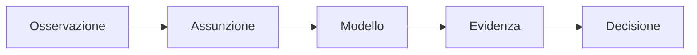

# Etica degli algoritmi e responsabilità analitica

Nel contesto della disciplina che insegna a prendere decisioni sotto incertezza, l'**etica degli algoritmi e la responsabilità analitica** rappresentano un passaggio fondamentale per trasformare dati e modelli in scelte consapevoli. Non basta migliorare una metrica: bisogna capire chi beneficia, chi paga e chi può contestare il risultato.

## Problema reale

Ogni modello operativo ha impatti concreti su persone, processi e opportunità. Il problema è capire quando un dato sostiene davvero una decisione e quando invece nasconde assunzioni, bias o causalità fragile. La domanda chiave è: quale decisione migliora applicando questo concetto con dati affidabili e una soglia di errore esplicita?

## Modello concettuale

Il processo è sequenziale: si formula la domanda, si traduce in unità osservabili, si valuta la qualità del dato e solo alla fine si decide. Saltare un passaggio produce analisi fragili.

| Passaggio | Domanda guida | Output atteso |
|---|---|---|
| Framing | Quale decisione deve cambiare? | Una scelta concreta, non una curiosità |
| Misura | Quale segnale rappresenta il fenomeno? | Metrica, fonte e granularità |
| Confronto | Rispetto a quale baseline interpreto il risultato? | Benchmark o controfattuale plausibile |
| Azione | Che cosa faccio se il segnale supera la soglia? | Decisione, responsabile e prossimo controllo |

## Formalizzazione rigorosa

Formalizziamo l'etica degli algoritmi come una relazione tra quattro elementi:

| Elemento | Definizione operativa |
|---|---|
| Unità | osservazione, ipotesi, variabile, meccanismo causale o criterio di evidenza |
| Segnale | forza dell'evidenza, coerenza causale, robustezza delle assunzioni, costo dell'errore decisionale |
| Baseline | spiegazione alternativa, controfattuale, gruppo comparabile o scenario senza intervento |
| Decisione | accettare, rifiutare o riformulare una spiegazione prima di usarla |

La regola pratica è semplice: una misura è utile solo se riduce l'incertezza su una decisione specifica. Se non cambia una scelta, serve documentazione; se cambia una scelta senza controlli, si rischia l'errore.

## Esempio o caso studio

Una banca olandese fu indagata perché il suo algoritmo di credit scoring approvava il 73% dei richiedenti con nome olandese e solo il 58% di quelli con nome straniero, a parità di reddito. L'algoritmo non usava la nazionalità ma il quartiere di residenza, correlato all'etnia. 

Questo caso mostra come un modello apparentemente oggettivo possa perpetuare discriminazioni storiche. L'autorità impose alla banca di documentare la definizione di fairness adottata, testare il modello su più metriche e garantire spiegazioni comprensibili ai clienti rifiutati.

## Lab / esercizio

### Livello base

Scrivi in cinque righe una decisione reale collegata all'etica degli algoritmi: obiettivo, metrica primaria, baseline, rischio principale e azione prevista.

### Livello intermedio

Costruisci una tabella con almeno tre segmenti o scenari. Per ciascuno indica segnale, possibile spiegazione alternativa e controllo necessario prima di decidere.

### Livello research-grade

Disegna un piano di validazione: ipotesi, dati necessari, criterio di esclusione, soglia decisionale e controllo post-decisione. Specifica cosa ti farebbe cambiare idea.

### Dataset e materiali consigliati

Usa case study decisionali, metriche prodotto, risultati di esperimenti, DAG semplici, report analitici e serie storiche simulate. Se non hai dati reali, crea un dataset sintetico con almeno 200 righe e colonne temporali, segmenti, outcome e variabili di esposizione.

## Errore tipico da evitare

L'errore più frequente è trattare l'etica degli algoritmi come una definizione da ricordare invece che come un protocollo decisionale. Succede quando si presenta una metrica senza baseline, un grafico senza ipotesi o una raccomandazione senza considerare il costo dell'errore.

Un controllo utile è chiedersi: "Se questo risultato fosse falso o instabile, quale decisione sbaglierei?". Se la risposta non è chiara, la lezione non è stata applicata davvero.

## Quiz o checkpoint

1. Qual è la decisione concreta che questa lezione dovrebbe migliorare?
2. Quale baseline rende interpretabile il risultato?
3. Quale assunzione, se sbagliata, cambierebbe la conclusione?
4. Quale controllo minimo useresti prima di presentare la raccomandazione?

## Riepilogo operativo

L'etica degli algoritmi e la responsabilità analitica sono competenze chiave per collegare concetto, dato e decisione. Studiale partendo da un problema reale, formalizza il segnale, cerca una baseline credibile, costruisci un esempio e chiudi con un controllo pratico. Solo così la conoscenza diventa competenza operativa.
