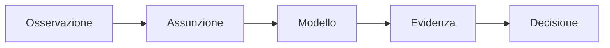

# Metodo scientifico applicato al lavoro sui dati

Il metodo scientifico non è roba da laboratorio. È una sequenza di passi che chiunque può applicare, e che trasforma il lavoro analitico da "guardare i numeri e sperare di trovare qualcosa" a un processo deliberato e falsificabile.

## I 5 passi del metodo scientifico per analyst

### Passo 1: Osservazione → "Cosa vedo?"
Parti da un dato, non da un'opinione. "Il tasso di conversione è calato del 5% nell'ultima settimana." NON "Mi sembra che il sito sia peggiorato."

### Passo 2: Ipotesi → "Cosa potrebbe spiegarlo?"
Formula ipotesi falsificabili, non narrative vaghe. "Il calo è causato da un bug nel form di pagamento introdotto lunedì." NON "Forse gli utenti sono meno interessati."

### Passo 3: Predizione → "Se l'ipotesi è vera, cosa dovrei vedere?"
"Se è il bug del form, il calo dovrebbe essere concentrato sulle pagine di checkout e sparire per gli utenti che pagano con PayPal (che bypassa il form)." Questa è la parte più importante e più spesso saltata.

### Passo 4: Esperimento / Verifica → "Cosa vedo realmente?"
Esegui la query, segmenta i dati, verifica la predizione. "Il calo del tasso di conversione è del 12% per utenti che usano il form di pagamento, 0% per utenti PayPal. Il bug è confermato."

### Passo 5: Iterazione → "Cosa faccio con questa conoscenza?"
Correggi il bug, monitora la metrica, e documenta l'apprendimento. "La prossima volta che deployiamo una modifica al form di pagamento, attiviamo un alert automatico sul tasso di conversione."

## Caso reale: il metodo scientifico in Spotify

Spotify usa un framework chiamato "DIBBs" (Data, Insight, Belief, Bet) per applicare il metodo scientifico alle decisioni di prodotto, descritto dal loro VP of Data. Ogni decisione segue quattro fasi:

1. **Data** — Quali dati abbiamo?
2. **Insight** — Cosa suggeriscono i dati?
3. **Belief** — Qual è la nostra ipotesi su come funziona il mondo?
4. **Bet** — Quale azione intraprendiamo per testare l'ipotesi?

La differenza tra DIBBs e l'approccio intuitivo è che ogni "bet" (scommessa) è esplicitamente collegata a un "belief" (ipotesi) che può essere verificato. Se la bet fallisce, non è un fallimento personale: è un'ipotesi falsificata, e questo è progresso scientifico.

## Checklist per applicare il metodo scientifico alle tue analisi

1. **Prima di cominciare un'analisi**, scrivi l'ipotesi che vuoi testare. Non "analizzare il revenue" ma "testare se il revenue è calato a causa della nuova homepage."

2. **Prima di guardare i dati**, definisci cosa ti farebbe dire "l'ipotesi è confermata" e cosa "l'ipotesi è smentita". Senza questa soglia, troverai sempre conferme (confirmation bias).

3. **Dopo l'analisi**, confronta il risultato con la tua predizione iniziale. Se corrisponde, hai un'evidenza a favore. Se non corrisponde, hai imparato qualcosa di più prezioso: che la tua intuizione era sbagliata.

---

*Riferimenti:*
- Gauthier, M. (2021). "Data-Informed Decision Making at Spotify." *Spotify R&D Blog.*
- Popper, K. (1959). *The Logic of Scientific Discovery.* Hutchinson.

## Controllo di qualità

Prima di usare metodo scientifico applicato al lavoro sui dati in una decisione, controlla sempre completezza, duplicati, timezone, definizioni cambiate e segmenti esclusi. Molte analisi apparentemente sofisticate falliscono perché il dato di partenza misura un comportamento diverso da quello che il team crede di osservare.

## Interpretazione per segmenti

La media aggregata è solo il punto di partenza. Segmenta per canale, coorte, piano, paese, device e maturità dell'utente. Se due segmenti si muovono in direzioni opposte, la media non rappresenta nessuno dei due e può portare a una decisione sbagliata.

## Decisione operativa

Ogni analisi deve terminare con una scelta possibile: continuare, fermare, iterare, investire, rimuovere o approfondire. Se metodo scientifico applicato al lavoro sui dati non cambia una decisione, probabilmente manca ancora il collegamento tra metrica e azione.

## Metriche di verifica

Dopo l'intervento, definisci una metrica primaria e due guardrail. La metrica primaria misura il miglioramento atteso; le guardrail impediscono di ottenere quel miglioramento distruggendo retention, fiducia, qualità del dato o sostenibilità operativa.

## Problema reale

Nel lavoro su fondamenti filosofici dell'analisi dati, **Metodo scientifico applicato al lavoro sui dati** serve a risolvere un problema concreto: capire quando un dato sostiene davvero una decisione e quando invece nasconde assunzioni, bias, causalita fragile o una domanda formulata male. La domanda non e se il concetto sia interessante in astratto, ma quale decisione migliora quando lo applichi con dati affidabili e con una soglia di errore esplicita.

Questa lezione va studiata come uno strumento operativo: entro la fine devi saper Comprendere il problema analitico e il contesto decisionale; Applicare esempi, metriche e controlli a casi reali. Se non riesci a collegare il concetto a una scelta reale, la conoscenza resta decorativa e non diventa competenza.

## Modello concettuale

Il modello mentale e sequenziale: prima si formula la domanda, poi si traduce in unita osservabili, quindi si valuta la qualita del dato e solo alla fine si decide. Saltare un passaggio produce analisi eleganti ma fragili.

| Passaggio | Domanda guida | Output atteso |
|---|---|---|
| Framing | Quale decisione deve cambiare? | Una scelta concreta, non una curiosita |
| Misura | Quale segnale rappresenta il fenomeno? | Metrica, fonte e granularita |
| Confronto | Rispetto a quale baseline interpreto il risultato? | Benchmark o controfattuale plausibile |
| Azione | Che cosa faccio se il segnale supera la soglia? | Decisione, owner e prossimo controllo |

## Formalizzazione rigorosa

Formalizza **Metodo scientifico applicato al lavoro sui dati** come una relazione tra quattro elementi: unita di analisi, segnale, baseline e decisione. Nel contesto di questa lezione l'unita principale e **osservazione, ipotesi, variabile, meccanismo causale o criterio di evidenza**. Il segnale da osservare deve essere collegato a **forza dell evidenza, coerenza causale, robustezza delle assunzioni e costo dell errore decisionale**, mentre la baseline deve essere scelta tra **spiegazione alternativa, controfattuale, gruppo comparabile o scenario senza intervento**.

Una formulazione robusta segue questa logica:

| Elemento | Definizione operativa per questa lezione |
|---|---|
| Unita | osservazione, ipotesi, variabile, meccanismo causale o criterio di evidenza |
| Segnale | forza dell evidenza, coerenza causale, robustezza delle assunzioni e costo dell errore decisionale |
| Baseline | spiegazione alternativa, controfattuale, gruppo comparabile o scenario senza intervento |
| Decisione | accettare, rifiutare o riformulare una spiegazione prima di usarla in un contesto aziendale |
| Rischio | Confondere correlazione, qualita del dato e causalita decisionale |

La regola pratica e semplice: una misura e utile solo se riduce l'incertezza su una decisione specifica. Se non cambia una scelta, e documentazione; se cambia una scelta senza controlli, e rischio.

## Esempio o caso studio

Un comitato interpreta una crescita di retention come prova che una nuova iniziativa abbia funzionato. La lezione costringe a distinguere osservazione, spiegazione, assunzione e decisione prima di trasformare il dato in azione.

Applicando **Metodo scientifico applicato al lavoro sui dati**, il team costruisce una lettura in tre colonne: cosa sappiamo, cosa assumiamo e quale decisione prendiamo. Questo formato impedisce di presentare un numero come se fosse una conclusione autosufficiente.

| Evidenza | Interpretazione prudente | Decisione conseguente |
|---|---|---|
| Segnale positivo ma non isolato | Il fenomeno esiste, ma la causa e ancora incerta | Cercare baseline o holdout |
| Segmento con risposta diversa | L'effetto medio nasconde eterogeneita | Analizzare coorti o sottogruppi |
| Costo operativo crescente | Il risultato va valutato sul margine | Applicare soglie economiche |

## Lab / esercizio

### Livello base

Prendi una decisione reale collegata a **Metodo scientifico applicato al lavoro sui dati** e scrivi in cinque righe: obiettivo, metrica primaria, baseline, rischio principale e azione prevista. Non usare piu di una metrica primaria.

### Livello intermedio

Costruisci una tabella con almeno tre segmenti o scenari. Per ciascuno indica segnale, possibile spiegazione alternativa e controllo necessario prima di decidere.

### Livello research-grade

Disegna un piano di validazione: ipotesi, dati necessari, criterio di esclusione, soglia decisionale e controllo post-decisione. Specifica anche che cosa ti farebbe cambiare idea.

### Dataset e materiali consigliati

Usa case study decisionali, metriche prodotto, risultati di esperimenti, DAG semplici, report analitici e serie storiche simulate. Se non hai dati reali, crea un dataset sintetico con 200-500 righe e almeno una colonna temporale, una colonna segmento, una metrica di outcome e una variabile di esposizione.

## Errore tipico da evitare

L'errore piu frequente e trattare **Metodo scientifico applicato al lavoro sui dati** come una definizione da ricordare invece che come un protocollo decisionale. In pratica succede quando si presenta una metrica senza baseline, un grafico senza ipotesi, o una raccomandazione senza costo dell'errore.

Un controllo utile e chiedersi: "se questo risultato fosse falso o instabile, quale decisione sbaglierei?". Se la risposta non e chiara, la lezione non e ancora stata applicata davvero.

## Quiz o checkpoint

1. Qual e la decisione concreta che questa lezione dovrebbe migliorare?
2. Quale baseline rende interpretabile il risultato?
3. Quale assunzione, se sbagliata, cambierebbe la conclusione?
4. Quale controllo minimo useresti prima di presentare la raccomandazione?

## Riepilogo operativo

**Metodo scientifico applicato al lavoro sui dati** e una competenza utile quando collega concetto, dato e decisione. Studiala partendo da un problema reale, formalizza il segnale, cerca una baseline credibile, costruisci un esempio e chiudi con un controllo pratico. Categoria: Fondamenti. Difficolta: advanced. Tempo stimato: 18 min.
