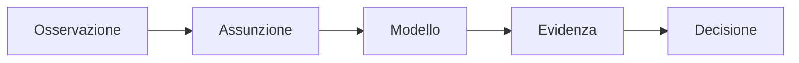

# Metodo scientifico applicato al lavoro sui dati

Nel lavoro analitico ci si imbatte di continuo in ipotesi attraenti ma mai verificate, come l'idea che "gli utenti attivi comprano di più perché amano il prodotto". Prima di trasformare un'intuizione del genere in strategia, serve un metodo che separi l'osservazione dalla spiegazione, e la predizione dalla verifica. Il metodo scientifico applicato ai dati è quello che impedisce a una storia plausibile di passare per prova.

## Quando un dato regge una decisione

Il problema concreto è capire quando un dato sostiene davvero una decisione e quando invece nasconde assunzioni implicite, bias cognitivi, una causalità fragile o una domanda mal posta. Non si tratta di discutere in astratto il valore del metodo, ma di migliorare decisioni reali applicando dati affidabili con una soglia di errore esplicita.

## Il percorso dall'osservazione alla scelta

Il modello mentale è sequenziale: si parte da una domanda concreta, si traducono i concetti in unità osservabili, si valuta la qualità del dato e solo alla fine si decide. Chi salta un passaggio ottiene analisi eleganti ma fragili.



| Passaggio | Domanda guida | Output atteso |
|---|---|---|
| Framing | Quale decisione deve cambiare? | Una scelta concreta, non una curiosità |
| Misura | Quale segnale rappresenta il fenomeno? | Metrica, fonte e granularità |
| Confronto | Rispetto a quale baseline interpreto il risultato? | Benchmark o controfattuale plausibile |
| Azione | Che cosa faccio se il segnale supera la soglia? | Decisione, owner e prossimo controllo |

## Quattro elementi da tenere insieme

Conviene leggere il metodo come una relazione tra quattro elementi, ciascuno con una definizione che puoi applicare subito.

| Elemento | Definizione operativa |
|---|---|
| Unità | Osservazione, ipotesi, variabile, meccanismo causale o criterio di evidenza |
| Segnale | Forza dell'evidenza, coerenza causale, robustezza delle assunzioni, costo dell'errore decisionale |
| Baseline | Spiegazione alternativa, controfattuale, gruppo comparabile o scenario senza intervento |
| Decisione | Accettare, rifiutare o riformulare una spiegazione prima di usarla in azienda |

La regola pratica è semplice: una misura serve solo se riduce l'incertezza su una decisione specifica. Se non cambia una scelta, resta documentazione. Se cambia una scelta senza controlli, diventa un rischio.

## I cinque passi del metodo per chi analizza i dati

Il primo passo è l'osservazione, cioè rispondere alla domanda "cosa vedo?". Si parte da un dato concreto, non da un'opinione. "Il tasso di conversione è calato del 5% nell'ultima settimana" è un'osservazione valida, mentre "mi sembra che il sito sia peggiorato" è vaga e soggettiva.

Poi viene l'ipotesi: "cosa potrebbe spiegarlo?". Formula ipotesi falsificabili, non narrative generiche. "Il calo è causato da un bug nel form di pagamento introdotto lunedì" è testabile, mentre "forse gli utenti sono meno interessati" non porta da nessuna parte.

Il terzo passo è la predizione, ed è quello che si salta più spesso: "se l'ipotesi è vera, cosa dovrei vedere?". Se davvero è il bug del form, il calo dovrebbe concentrarsi sulle pagine di checkout e sparire per gli utenti che pagano con PayPal, che bypassa il form.

Il quarto passo è la verifica: "cosa vedo realmente?". Segmenti i dati, esegui le query, controlli la predizione. Se il calo è del 12% per chi usa il form e dello 0% per chi paga con PayPal, il bug è confermato.

L'ultimo passo è l'iterazione: "cosa faccio con questa conoscenza?". Correggi il bug, monitori la metrica e documenti l'apprendimento, per esempio attivando un alert automatico sul tasso di conversione al prossimo deploy che tocca il form di pagamento.

## Il framework DIBBs di Spotify

Spotify applica il metodo scientifico attraverso il framework DIBBs (Data, Insight, Belief, Bet). Ogni decisione passa per quattro fasi:

1. Data: quali dati abbiamo?
2. Insight: cosa suggeriscono i dati?
3. Belief: qual è la nostra ipotesi su come funziona il mondo?
4. Bet: quale azione intraprendiamo per testare l'ipotesi?

Quello che cambia è il legame tra ogni "bet" e un "belief" falsificabile. Quando una scommessa fallisce non è un errore personale, ma un avanzamento di conoscenza.

## Una checklist prima di analizzare

1. Prima di cominciare, scrivi l'ipotesi da testare, non solo l'obiettivo generale.
2. Definisci cosa confermerebbe o smentirebbe l'ipotesi prima di guardare i dati.
3. Dopo l'analisi, confronta i risultati con la predizione iniziale e impara anche dagli errori.

## Controllo di qualità

Controlla sempre completezza, duplicati, timezone, definizioni cambiate e segmenti esclusi. Molte analisi falliscono perché il dato misura un comportamento diverso da quello che il team crede di osservare.

## Interpretazione per segmenti

La media aggregata è solo un punto di partenza. Segmenta per canale, coorte, piano, paese, device e maturità utente. Se due segmenti si muovono in direzioni opposte, la media fuorvia e porta a decisioni sbagliate.

## Decisione operativa

Ogni analisi deve chiudersi con una scelta concreta: continuare, fermare, iterare, investire, rimuovere o approfondire. Se il metodo non cambia una decisione, manca il collegamento tra metrica e azione.

## Metriche di verifica

Dopo l'intervento, definisci una metrica primaria e due guardrail. La metrica primaria misura il miglioramento atteso; le guardrail evitano di ottenerlo danneggiando retention, fiducia, qualità del dato o sostenibilità.

## Un caso di retention da leggere bene

Un comitato legge una crescita di retention come prova che una nuova iniziativa ha funzionato. Applicando il metodo, si distingue l'evidenza dalle assunzioni e dalla decisione, evitando di chiudere troppo in fretta.

| Evidenza | Interpretazione prudente | Decisione conseguente |
|---|---|---|
| Segnale positivo ma non isolato | Fenomeno esiste, ma causa incerta | Cercare baseline o holdout |
| Segmento con risposta diversa | Effetto medio nasconde eterogeneità | Analizzare coorti o sottogruppi |
| Costo operativo crescente | Valutare sul margine | Applicare soglie economiche |

## Esercizio su tre livelli

Al livello base scrivi in cinque righe obiettivo, metrica primaria, baseline, rischio principale e azione prevista per una decisione reale.

Al livello intermedio costruisci una tabella con almeno tre segmenti o scenari, indicando il segnale, una spiegazione alternativa e il controllo necessario.

Al livello research-grade disegna un piano di validazione: ipotesi, dati necessari, criteri di esclusione, soglia decisionale e controllo post-decisione. Specifica cosa ti farebbe cambiare idea. Per i materiali usa case study decisionali, metriche prodotto, esperimenti, DAG semplici, report analitici e serie storiche simulate. Se non hai dati reali, crea un dataset sintetico con almeno 200 righe.

## L'errore che svuota tutto

L'errore comune è trattare il metodo scientifico come una definizione da ricordare invece che come un protocollo decisionale. Presentare metriche senza baseline, grafici senza ipotesi o raccomandazioni che ignorano il costo dell'errore porta esattamente lì.

Il controllo che lo smaschera è una domanda: "Se questo risultato fosse falso o instabile, quale decisione sbaglierei?" Se non sai rispondere, il metodo è rimasto sulla carta.

## Quiz o checkpoint

1. Qual è la decisione concreta che questa lezione dovrebbe migliorare?
2. Quale baseline rende interpretabile il risultato?
3. Quale assunzione, se sbagliata, cambierebbe la conclusione?
4. Quale controllo minimo useresti prima di presentare la raccomandazione?

## Riepilogo operativo

Il metodo scientifico applicato ai dati collega concetto, dato e decisione. Si studia partendo da un problema reale, formalizzando il segnale, cercando una baseline credibile, costruendo un esempio e chiudendo con un controllo pratico. È questo che trasforma una storia plausibile in una conoscenza su cui puoi davvero decidere.

## Problema reale

Questo concetto si applica quando lavori con dataset reali e hai bisogno di una struttura chiara per ragionare su Metodo scientifico applicato al lavoro sui dati. Il problema tipico è non avere un framework condiviso tra il team per valutare la soluzione, con il risultato che ogni analisi parte da presupposti diversi.

**Quando lo incontrerai:**
- Quando presenti un risultato e qualcuno chiede "ma come sei arrivato a questo numero?"
- Quando il risultato di una query cambia radicalmente cambiando un filtro
- Quando il modello che hai costruito funziona sui dati di test ma non su quelli di produzione

## Modello concettuale

Il Metodo scientifico applicato al lavoro sui dati si definisce attraverso tre dimensioni:

1. **Struttura**: come sono organizzati i dati o il processo
2. **Logica**: quale relazione causa-effetto governa il comportamento
3. **Misura**: quale metrica usi per valutare il risultato

Questo modello ti permette di scomporre qualsiasi istanza del problema nelle sue parti verificabili.

## Formalizzazione rigorosa

```sql
-- TODO: aggiungi la formalizzazione specifica per Metodo scientifico applicato al lavoro sui dati
-- Pattern per avanzato:

SELECT
    /* indica qui la tua metrica principale */
FROM
    /* indica qui la sorgente dati */
WHERE
    /* indica qui i filtri */
GROUP BY
    /* indica qui le dimensioni di raggruppamento */
```

**Principio guida:** verifica sempre che la somma delle parti sia uguale al totale.

## Esempio o caso studio

**Caso tipico (livello avanzato):**

Immaginiamo un team marketing che deve misurare la retention a 30 giorni. L'errore più comune è calcolarla come `COUNT(DISTINCT user_id)` senza filtrare per data di attivazione, includendo utenti che non hanno ancora avuto 30 giorni di tempo. La versione corretta filtra prima la cohort di attivazione e poi applica il calcolo.

```sql
WITH cohort AS (
    SELECT
        user_id,
        MIN(event_date) AS activation_date
    FROM events
    GROUP BY user_id
),
retention AS (
    SELECT
        c.activation_date,
        COUNT(DISTINCT e.user_id) AS retained_users
    FROM cohort c
    JOIN events e ON c.user_id = e.user_id
        AND e.event_date >= c.activation_date
        AND e.event_date <= c.activation_date + INTERVAL '30 days'
    GROUP BY c.activation_date
)
SELECT
    activation_date,
    retained_users,
    ROUND(retention_rate * 100, 2) AS retention_pct
FROM retention;
```

## Lab / esercizio

**Esercizio — livello avanzato**

1. **Prepara l'ambiente:** carica il dataset di esempio nel tuo warehouse
2. **Applica il pattern:** scrivi la query che implementa il modello concettuale per il tuo caso
3. **Verifica:** controlla che il risultato sia coerente con le tue aspettative usando un sanity check

**Tempo stimato:** 20-30 minuti

## Errore tipico da evitare

**L'errore più comune a livello avanzato:**

Non distinguere tra una metrica calcolata su tutta la popolazione e una metrica calcolata su una sotto-popolazione specifica. Ad esempio, calcolare il tasso di conversione medio senza filtrare per canale di acquisizione porta a decisioni sbagliate perché il mix di canali cambia nel tempo.

**Come evitarlo:**
- Chiediti sempre: "rispetto a cosa sto misurando questo?"
- Verifica che il denominatore sia corretto prima di fidarti del numeratore
- Usa un gruppo di controllo quando possibile

### Livello base

Spiegazione intuitiva di Metodo scientifico applicato al lavoro sui dati:

Il concetto alla base è semplice: invece di fare affidamento sull'intuizione, usi un metodo riproducibile. A livello base, ti basta capire quale domanda stai ponendo e quali dati hai a disposizione per risponderci.

### Livello intermedio

Applicazione concreta di Metodo scientifico applicato al lavoro sui dati:

A questo livello applichi il concetto a un caso specifico. Ad esempio, se stai analizzando la retention, il tuo dataset ha dimensioni come data di attivazione, data di evento, e user_id. La segmentazione per canale di acquisizione ti dà insight aggiuntivi che il dato grezzo non mostra.

### Livello research-grade

Approfondimento teorico:

Per chi vuole capire il fondamento teorico, la letteratura classica include:
- Kimball, "The Data Warehouse Toolkit" — per approcci dimensionali
- McKinney, "Python for Data Analysis" — per implementazione pratica
- Aggiora i riferimenti con paper recenti specifici per il tuo dominio

### Dataset e materiali consigliati

**Per esercitarti:**
- Usa il dataset di esempio fornito nella lezione
- Per un challenge aggiuntivo, prova con dati pubblici come quelli di Kaggle

**Tool consigliati:**
- dbt Core per trasformazioni
- Metabase o Superset per visualizzazione