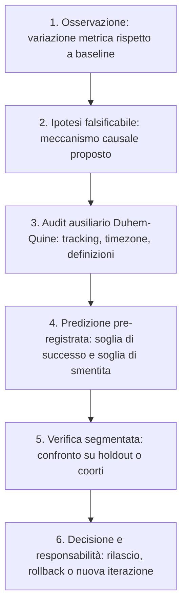

Nel lavoro quotidiano sui dati è facilissimo scambiare un racconto coerente dopo i fatti per una spiegazione scientifica. Considera questo scenario costruito con numeri di esempio: un team di crescita lancia una nuova checklist di benvenuto dentro un'applicazione B2B e, due settimane dopo il rilascio, presenta un incremento del 14,0% nell'attivazione al settimo giorno. La spiegazione fornita in riunione suona impeccabile: i nuovi utenti capiscono subito il valore dello strumento. Nessuno però ha verificato le conseguenze collaterali né fissato una soglia di smentita prima di guardare la dashboard. Sessanta giorni più tardi, il supporto clienti registra un aumento del 28,0% dei ticket per confusione sui permessi e la retention a novanta giorni cala di 6 punti percentuali, rivelando che la checklist spingeva gli utenti a cliccare passaggi obbligatori pur di sbloccare la schermata, senza creare reale comprensione.

La differenza tra l'analista che costruisce una storia plausibile sui numeri e lo scienziato dei dati che produce conoscenza affidabile sta tutta nel metodo: chiarisci cosa stai cercando di spiegare, dichiara in anticipo cosa ti darebbe torto, controlla gli strumenti con cui stai osservando e assumiti la responsabilità delle conseguenze pratiche di una conclusione sbagliata.

## Dall'osservazione alla spiegazione scientifica in azienda

> **Idea chiave:** Un'analisi dati produce conoscenza operativa e non storytelling retrospettivo soltanto quando l'ipotesi è falsificabile prima dell'estrazione, le assunzioni dello strumento di misura sono verificate separatamente e il risultato guida una scelta esplicita protetta da metriche di salvaguardia.

Nella filosofia della scienza del Novecento, spiegare un fenomeno non significa semplicemente descrivere una regolarità passata. Carl Hempel mostrò che una spiegazione scientifica rigorosa richiede di ricondurre il fenomeno osservato a leggi o meccanismi generali e condizioni iniziali verificabili, così da poter derivare l'evento atteso come conseguenza logica o altamente probabile. In altre parole, se la tua ipotesi spiega davvero perché le conversioni sono calate martedì scorso, deve riuscire a predire dove, su quali utenti e in quali altre circostanze il calo dovrebbe ripresentarsi o scomparire.

Karl Popper spinse questo criterio ancora più a fondo con il principio di demarcazione: ciò che distingue una congettura scientifica da un'opinione autoreferenziale non è la capacità di trovare conferme nei dati (qualunque racconto generico può trovare qualche grafico compatibile a posteriori), bensì la **falsificabilità**. Un'ipotesi è scientificamente utilizzabile solo se specifica con precisione quali osservazioni future la distruggerebbero. Dire che "gli utenti attivi comprano di più perché apprezzano l'ecosistema" non è un'ipotesi operativa, perché è compatibile con quasi qualunque configurazione di numeri. Dire invece che "introdurre un blocco sul form di pagamento ha causato il calo del 3% nelle conversioni, quindi il calo deve concentrarsi esclusivamente sugli utenti desktop che pagano con carta e non deve toccare chi paga con portafoglio digitale" espone la teoria al rischio reale di essere smentita al primo taglio dei dati.

Quando questo ciclo viene applicato con disciplina, l'errore di previsione smette di essere un incidente imbarazzante e diventa il motore principale dell'apprendimento organizzativo. Anche aziende di prodotto orientate alla sperimentazione continua come Spotify hanno formalizzato questa logica nel modello **DIBBs** (*Data, Insight, Belief, Bet*): i dati grezzi generano un'intuizione, l'intuizione viene tradotta in una credenza esplicita e falsificabile sul comportamento degli utenti, e ogni iniziativa di prodotto viene disegnata come una scommessa mirata a mettere alla prova quella specifica credenza, non a confermare l'ego di chi l'ha proposta.

## La trappola di Duhem-Quine e la fragilità delle ipotesi ausiliarie

Quando una verifica empirica smentisce la tua ipotesi di business, sorge un problema epistemologico fondamentale formulato da Pierre Duhem e Willard Van Orman Quine. Secondo la tesi di **Duhem-Quine**, nessuna ipotesi viene mai messa alla prova in isolamento davanti al tribunale dei dati; ciò che si scontra con l'osservazione è sempre un intero fascio di premesse formato dalla tua teoria principale più decine di **ipotesi ausiliarie** silenziose riguardanti gli strumenti di misura, le definizioni contabili, i fusi orari e il codice di tracciamento.

Immagina di aver ipotizzato che una nuova campagna promozionale aumenti i ricavi giornalieri in Europa e di osservare invece un crollo improvviso del 35% proprio alle 23:00 del giorno di lancio. L'ipotesi di marketing è davvero falsa, oppure una modifica al formato del timestamp ha spostato gli eventi dall'ora locale al tempo coordinato universale (UTC), tagliando parte degli ordini nella finestra del giorno successivo? Ogni volta che interroghi un database aziendale stai assumendo implicitamente che il pixel di tracking non sia stato bloccato da un aggiornamento del browser, che i bot di scansione siano stati filtrati in modo coerente rispetto al mese precedente, che la valuta sia stata convertita al tasso corretto e che nessuno abbia rinominato silenziosamente un evento in produzione.

Separare il lavoro tecnico di qualità del dato dalla teoria filosofica della conoscenza è quindi un errore grave. Eseguire controlli di completezza, unicità delle chiavi, allineamento dei fusi orari e stabilità delle definizioni prima di interpretare un risultato equivale esattamente a calibrare il telescopio prima di annunciare la scoperta di un nuovo pianeta. Senza questo controllo sulle ipotesi ausiliarie, qualsiasi confutazione o conferma sui dati rimane ambigua.

| Livello epistemico | Domanda guida | Criterio di validità | Rischio se ignorato |
|---|---|---|---|
| Osservazione empirica | Quale segnale emerge rispetto alla baseline storica? | Continuità dello schema, integrità del tracking e assenza di duplicati | Confondere un bug di pipeline con un comportamento umano |
| Ipotesi causale | Quale meccanismo genera lo scostamento osservato? | Capacità di generare almeno una predizione rischiosa e falsificabile | Raccontare storie plausibili a posteriori su qualunque grafico |
| Predizione quantitativa | Cosa devo osservare nei segmenti se l'ipotesi è vera e cosa la smentirebbe? | Soglie numeriche su metrica primaria e metriche guardrail prima della query | Spostare l'asticella del successo dopo aver visto i numeri |
| Decisione responsabile | Quale scelta cambia e chi risponde dell'errore residuo? | Owner nominato, analisi del costo dell'errore e piano di rollback | Produrre report decorativi che non guidano né proteggono l'azione |

## Come valutare una scommessa analitica con metriche guardrail: calcolo svolto

Vediamo in concreto come il metodo scientifico e la responsabilità decisionale si traducono in un calcolo rigoroso su una scommessa di prodotto. Supponiamo di gestire un esperimento controllato su **40.000 nuovi utenti**, divisi esattamente a metà tra gruppo di controllo (20.000 utenti con il vecchio flusso) e gruppo di trattamento (20.000 utenti con la nuova checklist di attivazione). Prima di lanciare il test, il team fissa due regole pre-registrate: la metrica primaria è il tasso di completamento del primo progetto entro 7 giorni, mentre le metriche **guardrail** di salvaguardia sono il tasso di apertura ticket al supporto entro 14 giorni e il tasso di retention a 60 giorni (il margine netto per singolo utente ritenuto a 60 giorni è pari a **50 euro**, mentre il costo medio di gestione di un ticket di supporto è pari a **12 euro**).

Al termine della finestra di osservazione arrivano i numeri dai due gruppi:
- Nel **gruppo di controllo** (20.000 utenti), completano il primo progetto 6.000 utenti, pari a un tasso di attivazione di 6.000 / 20.000 = **30,0%**. Aprono un ticket di supporto 1.000 utenti (1.000 / 20.000 = **5,0%**) e risultano ancora attivi a 60 giorni 4.400 utenti (4.400 / 20.000 = **22,0%**).
- Nel **gruppo di trattamento** (20.000 utenti), completano il primo progetto 6.800 utenti, pari a un tasso di attivazione di 6.800 / 20.000 = **34,0%** → un guadagno netto di **+4,0 punti percentuali** sulla metrica primaria. Tuttavia, aprono un ticket di supporto 2.200 utenti (2.200 / 20.000 = **11,0%**, cioè +6,0 pp rispetto al controllo) e risultano ancora attivi a 60 giorni soltanto 4.100 utenti (4.100 / 20.000 = **20,5%**, cioè -1,5 pp rispetto al controllo).

Calcoliamo il bilancio economico e di valore reale derivante da questi numeri per verificare se l'aumento dell'attivazione iniziale sia sostenibile. Nel controllo, i 4.400 utenti attivi a 60 giorni generano 4.400 × 50 euro = **220.000 euro** di margine lordo, da cui vanno sottratti i costi di assistenza pari a 1.000 × 12 euro = **12.000 euro**, ottenendo un valore netto di 220.000 - 12.000 = **208.000 euro** (pari a 10,40 euro netti per utente iscritto). Nel trattamento, i 4.100 utenti attivi a 60 giorni generano 4.100 × 50 euro = **205.000 euro**, mentre i costi di assistenza salgono a 2.200 × 12 euro = **26.400 euro**; il risultato netto scende quindi a 205.000 - 26.400 = **178.600 euro** (pari a 8,93 euro netti per utente). La variazione netta dell'esperimento è 178.600 - 208.000 = **-29.400 euro** su questo campione, cioè una perdita di **-14,1%** del valore netto rispetto alla baseline.

Se l'analista si fosse fermato alla metrica primaria (+4,0 pp sull'attivazione a 7 giorni), avrebbe raccomandato un lancio che distrugge valore economico e sovraccarica il servizio clienti. L'inserimento preventivo di metriche guardrail trasforma una vittoria illusoria in una chiara falsificazione dell'ipotesi di partenza: la checklist induceva clic frettolosi senza creare valore duraturo.

## Ignaz Semmelweis e la responsabilità oltre il calcolo

Nel 1847, all'Ospedale Generale di Vienna, il medico ungherese Ignaz Semmelweis si trovò davanti a una drammatica anomalia statistica tra due reparti di maternità gemelli. Nel primo reparto, seguito dai medici e dagli studenti di medicina, la mortalità delle partorienti per febbre puerperale oscillava intorno al **18%**, con picchi mensili ancora più alti. Nel secondo reparto, gestito interamente dalle ostetriche, la mortalità si attestava stabilmente intorno al **2%**.

Semmelweis affrontò il problema con il rigore di un moderno analista sperimentale. Scartò progressivamente le spiegazioni ambientali allora di moda (come l'affollamento o l'aria corrotta dai "miasmi"), perché i due reparti condividevano lo stesso edificio e lo stesso clima cittadino. Dopo la morte di un collega feritosi accidentalmente con un bisturi durante un'autopsia e deceduto con sintomi identici alla febbre puerperale, Semmelweis formulò un'ipotesi causale precisa e falsificabile: studenti e medici trasportavano sulle mani particelle cadaveriche dalla sala autopsie alla sala parto, cosa che le ostetriche non facevano.

Da quell'ipotesi derivò una predizione netta: se gli studenti si fossero lavati le mani con una soluzione di cloruro di calce prima di visitare le pazienti, la mortalità del primo reparto sarebbe dovuta precipitare al livello del secondo. Nel maggio 1847 impose il protocollo igienico e la mortalità crollò rapidamente dal 18% a meno del **2%**. Eppure, nonostante la schiacciante evidenza empirica, l'establishment medico viennese respinse il risultato per decenni, perché quella spiegazione violava il paradigma medico dominante dell'epoca e implicava una responsabilità morale diretta da parte dei medici stessi.

Come sottolineò poi Thomas Kuhn nel descrivere le rivoluzioni scientifiche (1962), i dati da soli faticano a persuadere chi ragiona dentro un paradigma opposto quando mancano regole condivise su cosa costituisca prova sufficiente e chi porti la responsabilità della decisione. Per chi lavora oggi con i dati in azienda, il caso Semmelweis ricorda due doveri inseparabili: primo, verificare e documentare le prove con rigore tale da sopravvivere alle pressioni gerarchiche; secondo, tradurre la conoscenza in un protocollo di sicurezza operativo (come un controllo automatico, una guardrail o un criterio di arresto), perché un'analisi brillante che resta chiusa in un cassetto o non riesce a cambiare una prassi dannosa fallisce sul piano della responsabilità pubblica.

## Protocollo di pre-registrazione prima di eseguire la query

Prima di aprire l'editor SQL o il notebook di esplorazione davanti a un nuovo quesito strategico, conviene compilare un breve contratto epistemico condiviso con il decisore che richiede l'analisi.

> **Scheda di pre-registrazione analitica:**
> - **Decisione collegata:** quale scelta concreta (lanciare, ritirare, riallocare budget, cambiare prezzo) cambierà in base all'esito dell'analisi e chi ne è il responsabile ultimo.
> - **Ipotesi e predizione rischiosa:** quale meccanismo ipotizziamo e quali due sotto-gruppi dovrebbero mostrare comportamenti opposti o differenziati se il meccanismo è reale.
> - **Controlli Duhem-Quine:** quali verifiche tecniche (integrità storica, fuso orario, filtri bot, continuità di schema) devono passare prima di considerare leggibili i dati.
> - **Criterio di smentita e guardrail:** quale soglia sulla metrica primaria e quale soglia massima di peggioramento sulle metriche di salvaguardia impongono di dichiarare falsa l'ipotesi senza negoziati successivi.

Scrivere queste quattro righe prima di vedere i numeri elimina sul nascere il rischio di innamorarsi di una correlazione casuale emersa durante l'esplorazione. L'esplorazione libera resta preziosa per generare nuove idee nella fase di scoperta, ma una congettura nata esplorando un dataset deve sempre essere testata su dati nuovi o su una partizione tenuta separata prima di autorizzare un investimento rilevante.

## Tre errori epistemici che svuotano il metodo scientifico sui dati

### Formulare l'ipotesi dopo aver visto i dati (HARKing)

Il sintomo si presenta quando un analista ispeziona decine di segmenti in un report, individua una variazione curiosa (magari un picco di acquisti il mercoledì pomeriggio tra gli utenti iOS in una regione specifica) e costruisce retroattivamente una teoria psicologica impeccabile presentandola poi come l'ipotesi originaria dell'analisi. Sembra ragionevole perché la storia costruita a posteriori spiega perfettamente i numeri osservati. Tuttavia, su abbastanza dimensioni e tagli casuali, il rumore produce sempre qualche anomalia apparentemente significativa: spacciare una scoperta esplorativa per una verifica confermativa distrugge il valore probabilistico di qualsiasi test. Si evita separando nettamente i due momenti: i pattern scoperti in esplorazione vanno classificati come **nuove ipotesi da verificare** su un campione indipendente o su un periodo successivo, mai come prove definitive.

### Scambiare un guasto di misurazione per un cambiamento di comportamento (trappola di Duhem-Quine)

Il sintomo emerge quando un grafico mostra un salto o un crollo improvviso e tutto il team di business corre a formulare teorie sulle campagne pubblicitarie o sulla concorrenza, saltando la verifica delle ipotesi ausiliarie tecniche. Sembra naturale perché chi guida il business legge i cruscotti dando per scontato che il sensore di misura sia neutro e costante nel tempo. In realtà, una modifica alle regole di consenso cookie, un deploy che rinomina un evento applicativo o uno sfasamento di fuso orario tra server diversi generano variazioni molto più grandi e brusche del comportamento umano reale. Si previene imponendo una checklist automatica di integrità delle serie temporali (volumi per piattaforma, percentuale di valori nulli, continuità delle definizioni) come primo passo non negoziabile di ogni indagine.

### Valutare una decisione sulla sola metrica primaria ignorando i costi collaterali

Il sintomo si manifesta quando un'analisi dichiara successo basandosi esclusivamente sull'aumento di una metrica locale (click, visualizzazioni, registrazioni giornaliere, attivazioni a breve termine) senza misurare il costo imposto ad altri reparti o al valore di lungo periodo dell'utente. Sembra efficiente perché offre un numero singolo, pulito e facile da comunicare ai vertici aziendali. In realtà, qualunque sistema complesso reagisce alle ottimizzazioni forzate spostando il costo altrove (la legge di Goodhart applicata al prodotto: quando una misura diventa un bersaglio, smette di essere una buona misura). Si evita affiancando obbligatoriamente a ogni metrica primaria almeno due metriche guardrail che rappresentino l'integrità del sistema, la sostenibilità economica e il benessere dell'utente finale.

## Controllo epistemico prima di presentare un'analisi

1. Hai appena estratto i dati dell'ultimo mese e noti che gli utenti che hanno visitato almeno tre volte la pagina prezzi convertono quattro volte di più rispetto alla media. Un manager vuole inviare subito un popup aggressivo per forzare tutti i visitatori ad aprire la pagina prezzi tre volte. Come applichi il criterio di Popper e la distinzione tra esplorazione e conferma davanti a questa richiesta?

Mostra risposta

Riconosci subito che l'osservazione è solo una correlazione esplorativa soggetta a causalità inversa o autoselezione (chi è già intenzionato a comprare visita più volte i prezzi), non una prova di efficacia del popup. Prima di lanciare su tutti gli utenti, formuli un'ipotesi falsificabile di intervento ("mostrare il riepilogo prezzi aumenta le conversioni reali senza far crescere il rimbalzo immediato"), dichiari le metriche guardrail (tasso di abbandono immediato e reclami utente) e proponi un test controllato su un gruppo campione per verificare se il meccanismo causale regge alla smentita empirica.

2. Nel primo giorno di test di un nuovo algoritmo di ricerca interna su un sito e-commerce, il tasso di conversione del gruppo variante crolla del 19% rispetto al controllo. Quale controllo ispirato alla tesi di Duhem-Quine esegui prima di annunciare che l'algoritmo di ricerca danneggia le vendite?

Mostra risposta

Verifichi tutte le ipotesi ausiliarie della catena di misura prima di condannare l'algoritmo: controlli che l'assegnazione tra variante e controllo sia bilanciata al 50/50 (assenza di Sample Ratio Mismatch), che il tracciamento degli eventi di acquisto scatti correttamente sulla nuova pagina dei risultati, che non vi siano errori di latenza o timeout sul server della variante e che i fusi orari o i filtri anti-bot siano applicati in modo identico ai due rami.

3. Nel calcolo economico mostrato per il caso della checklist di onboarding su 40.000 utenti, perché l'incremento di +4,0 punti percentuali nell'attivazione a 7 giorni non è stato sufficiente a giustificare il lancio della funzionalità?

Mostra risposta

Perché le metriche guardrail hanno smentito l'ipotesi che una maggiore attivazione iniziale generasse maggiore valore reale. La retention a 60 giorni è scesa dal 22,0% al 20,5% e i ticket di supporto sono più che raddoppiati (dal 5,0% all'11,0%), trasformando un aumento apparente di attivazione in una perdita netta di valore economico pari a 29.400 euro sul campione analizzato.

4. Perché la vicenda storica di Ignaz Semmelweis a Vienna nel 1847 riguarda direttamente il lavoro di chi analizza dati nelle organizzazioni moderne?

Mostra risposta

Mostra che produrre un'evidenza numerica solida (un crollo della mortalità dal 18% a meno del 2% dopo l'intervento di disinfezione) non basta automaticamente a cambiare una decisione collettiva quando i risultati contraddicono il paradigma dominante o minacciano responsabilità consolidate. L'analista ha quindi il compito non solo di fare calcoli corretti, ma di strutturare protocolli verificabili, pre-registrare criteri decisionali condivisi tra i reparti e rendere trasparenti i rischi di non agire.

