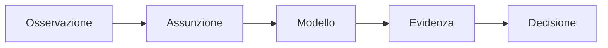

# Francis Bacon: induzione e idoli della mente

Bacon rende operativo un punto che resta attuale: prima di fidarti dei dati, controlla i pregiudizi che hanno guidato la domanda. In questa lezione gli idoli della mente diventano strumenti concreti per difendere decisioni, metriche e analisi dalle conferme troppo comode.

## A cosa serve Bacon in un'analisi

Nei fondamenti filosofici dell'analisi dati, il contributo di Bacon risolve un problema preciso: distinguere quando un dato sostiene davvero una decisione e quando invece nasconde assunzioni implicite, bias cognitivi, una causalità fragile o una domanda mal posta. Non è un concetto astratto, ma un criterio operativo per migliorare le scelte basate sui dati, dichiarando la soglia di errore e la robustezza delle evidenze.

## Il percorso dall'osservazione alla scelta

Il processo decisionale sotto incertezza si articola in fasi sequenziali:

Una domanda ben formulata si traduce in unità osservabili, da cui si valuta la qualità del dato e solo alla fine si decide. Chi salta uno di questi passaggi ottiene analisi eleganti ma fragili.

| Passaggio | Domanda guida | Output atteso |
|---|---|---|
| Framing | Quale decisione deve cambiare? | Una scelta concreta, non una curiosità |
| Misura | Quale segnale rappresenta il fenomeno? | Metrica, fonte e granularità |
| Confronto | Rispetto a quale baseline interpreto il risultato? | Benchmark o controfattuale plausibile |
| Azione | Che cosa faccio se il segnale supera la soglia? | Decisione, owner e prossimo controllo |

## Quattro elementi da tenere insieme

Conviene leggere il contributo di Bacon come una relazione tra quattro elementi, ciascuno con una definizione che puoi applicare subito.

| Elemento | Definizione operativa |
|---|---|
| Unità | osservazione, ipotesi, variabile, meccanismo causale o criterio di evidenza |
| Segnale | forza dell'evidenza, coerenza causale, robustezza delle assunzioni e costo dell'errore decisionale |
| Baseline | spiegazione alternativa, controfattuale, gruppo comparabile o scenario senza intervento |
| Decisione | accettare, rifiutare o riformulare una spiegazione prima di usarla in un contesto aziendale |

La regola pratica è semplice: una misura serve solo se riduce l'incertezza su una decisione specifica. Se non cambia una scelta, è mera documentazione. Se cambia una scelta senza controlli, è rischio.

## I quattro idoli della mente

Bacon individua quattro distorsioni cognitive che minano l'analisi dei dati e le chiama idoli della mente.

| Idolo | Fonte della distorsione | Manifestazione nell'analisi dati moderna |
|-------|------------------------|------------------------------------------|
| Idola Tribus (della tribù) | Natura umana, tendenza a vedere pattern ovunque | Apofenia: vedere trend in pochi punti dati, confondere rumore con segnale |
| Idola Specus (della caverna) | Bias individuali legati a formazione e abitudini | Preferenze interpretative legate al background professionale |
| Idola Fori (del mercato) | Ambiguità e imprecisione del linguaggio | Definizioni diverse per metriche apparentemente uguali |
| Idola Theatri (del teatro) | Dogmi, autorità e convenzioni non messe in discussione | Accettazione acritica di regole e framework consolidati |

## Il caso del budget spostato su TikTok

Nel 2021 un'azienda spostò il 40% del budget marketing da Facebook a TikTok basandosi su tre mesi di dati che mostravano un calo di Facebook e una crescita di TikTok. Era un caso da manuale di Idola Tribus: il presunto trend era in realtà rumore stagionale e honeymoon effect. Sei mesi dopo il ROAS di TikTok era crollato e Facebook era tornato ai livelli precedenti.

Un comitato di analisi applicò il metodo baconiano costruendo una tabella che teneva separate evidenza, interpretazione prudente e decisione, cioè osservazione, assunzione e azione.

| Evidenza | Interpretazione prudente | Decisione conseguente |
|---|---|---|
| Segnale positivo ma non isolato | Il fenomeno esiste, ma la causa è incerta | Cercare baseline o holdout |
| Segmento con risposta diversa | L'effetto medio nasconde eterogeneità | Analizzare coorti o sottogruppi |
| Costo operativo crescente | Il risultato va valutato sul margine | Applicare soglie economiche |

## Esercizio su tre livelli

Al livello base scegli una decisione reale e descrivi in cinque righe obiettivo, metrica primaria, baseline, rischio principale e azione prevista. Limita a una metrica primaria.

Al livello intermedio costruisci una tabella con almeno tre segmenti o scenari. Per ciascuno indica il segnale, una possibile spiegazione alternativa e il controllo necessario prima di decidere.

Al livello research-grade disegna un piano di validazione: ipotesi, dati necessari, criteri di esclusione, soglia decisionale e controllo post-decisione. Specifica cosa ti farebbe cambiare idea. Per i materiali usa case study decisionali, metriche prodotto, risultati di esperimenti, DAG semplici, report analitici e serie storiche simulate. Se non hai dati reali, crea un dataset sintetico con 200-500 righe e almeno una colonna temporale, una colonna segmento, una metrica di outcome e una variabile di esposizione.

## L'errore che svuota tutto

L'errore più comune è trattare il concetto di Bacon come una definizione da ricordare invece che come un protocollo decisionale. Capita quando si presenta una metrica senza baseline, un grafico senza ipotesi o una raccomandazione che ignora il costo dell'errore.

Il controllo che lo smaschera è una domanda: "Se questo risultato fosse falso o instabile, quale decisione sbaglierei?" Se non sai rispondere, la lezione è rimasta sulla carta.

## Quiz o checkpoint

1. Qual è la decisione concreta che questa lezione dovrebbe migliorare?
2. Quale baseline rende interpretabile il risultato?
3. Quale assunzione, se sbagliata, cambierebbe la conclusione?
4. Quale controllo minimo useresti prima di presentare la raccomandazione?

## Riepilogo operativo

Bacon ci ricorda che l'analisi dei dati richiede rigore nel collegare concetto, dato e decisione. Applicare i suoi principi significa partire da un problema reale, formalizzare il segnale, cercare una baseline credibile, costruire esempi concreti e chiudere con controlli pratici che tengono lontani gli errori cognitivi e i dogmi. È così che l'incertezza diventa una decisione consapevole.

---

*Riferimenti:* Bacon, F. (1620). *Novum Organum Scientiarum.* Kahneman, D. (2011). *Thinking, Fast and Slow.* Klein, G. (2007). "Francis Bacon." *Stanford Encyclopedia of Philosophy.*
