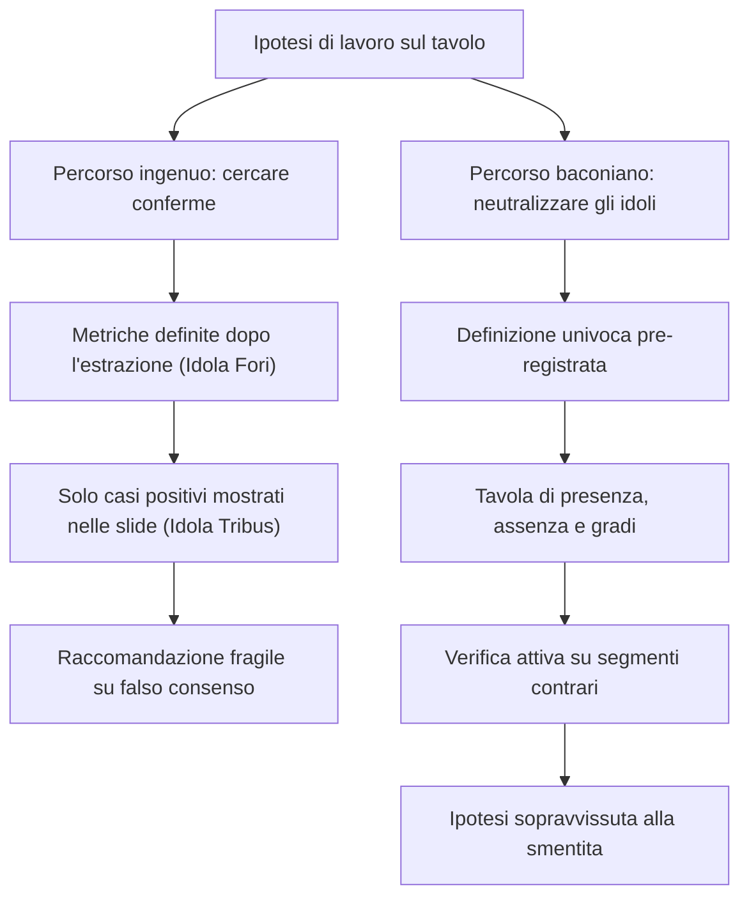

Esaminiamo uno scenario costruito ma familiare in qualsiasi azienda digitale: dopo tre mesi di test su una nuova sequenza di notifiche push in app, il team crescita presenta un grafico convincente che mostra un aumento della permanenza degli utenti a trenta giorni. La presentazione fila liscia perché tutti in sala vogliono credere alla bontà della funzione appena rilasciata, i commenti qualitativi raccolti dai clienti più entusiasti confermano il grafico e il sistema di incentivi trimestrali premia il lancio. Nessuno però ha verificato se tre team diversi usino definizioni incompatibili di "utente attivo", né qualcuno ha cercato i segmenti in cui quelle stesse notifiche stanno spingendo gli utenti a disattivare per sempre il canale.

Nel 1620, pubblicando il *Novum Organum*, Francis Bacon lanciò un avvertimento che anticipa di quattro secoli i moderni bias cognitivi della data science. Bacon notò che l'intelletto umano lasciato a sé stesso non è uno specchio piano che riflette fedelmente i dati, ma uno specchio deformante che piega le osservazioni alle proprie aspettative. Prima ancora di costruire teorie o modelli, l'analista deve riconoscere le distorsioni mentali — gli *idola* — e sostituire la raccolta disordinata di conferme con un metodo rigoroso di eliminazione.

## Perché accumulare conferme non produce conoscenza affidabile

La forma più debole di ragionamento sui dati si chiama **induzione per semplice enumerazione**: raccogliere esempi in cui una certa regola sembra funzionare ("la campagna A ha funzionato su Milano, su Roma e sul segmento giovani") e dichiararla vera finché non si incontra un ostacolo. Bacon giudicava questo approccio infantile, perché l'essere umano ricorda e nota naturalmente gli esempi positivi mentre ignora o giustifica quelli negativi. Nel lavoro sui dataset moderni questa inclinazione si traduce nella ricerca selettiva dei grafici che confermano l'ipotesi dello sponsor, escludendo settimane "anomale" o segmenti scomodi.

> **Idea chiave:** Nel metodo di Francis Bacon la conoscenza nasce dall'induzione per eliminazione: non vince l'ipotesi sostenuta dal maggior numero di esempi favorevoli, ma quella che resiste alla ricerca sistematica dei casi negativi dopo aver neutralizzato i quattro idoli della mente.

Invece di inseguire nuove conferme, Bacon propose di organizzare le osservazioni in tre tavole ordinate: la *tabula praesentiae* (dove il fenomeno si presenta), la *tabula absentiae in proximitate* (casi molto simili in cui il fenomeno manca) e la *tabula graduum* (come varia l'intensità dell'effetto al variare della causa presunta). Lo scopo delle tre tavole è respingere le spiegazioni false: un'unica istanza negativa ben documentata pesa più di cento esempi favorevoli ripetuti.

## I quattro idoli della mente nella pratica analitica moderna

Nel libro primo del *Novum Organum*, Bacon classificò le fonti di autoinganno in quattro famiglie. La tabella seguente traduce ciascun idolo dal contesto filosofico del Seicento ai problemi quotidiani di SQL, dashboard e modellazione tabellare, associandovi il test concreto necessario a disinnescarlo.

| Idolo baconiano | Origine della distorsione nel 1620 | Come si manifesta oggi in analisi dati | Contromisura operativa verificabile |
| --- | --- | --- | --- |
| Idola Tribus (della tribù) | Limiti universali della mente umana: cercare ordine, ignorare casi contrari | Apofenia nei grafici rumorosi, selection bias e dimenticanza del tasso base | Cercare esplicitamente le istanze negative e i mancati effetti prima di concludere |
| Idola Specus (della spelonca) | Esperienze personali, abitudini professionali e gusti dell'individuo | Preferire le feature o le tecniche familiari del proprio reparto ignorando alternative | Revisione incrociata cieca e test di modelli semplici come benchmark obbligato |
| Idola Fori (del foro) | Ambiguità del linguaggio condiviso nelle piazze e nei rapporti sociali | Termini come "utente attivo", "churn" o "lead" calcolati con formule diverse tra SQL e BI | Dizionario metrico univoco con query canonica bloccata prima del test |
| Idola Theatri (del teatro) | Dogmi di scuole filosofiche o sistemi teorici accettati per autorità | Adottare architetture complesse o framework di moda per inerzia senza test su holdout | Confronto su baseline elementare e valutazione dei costi reali di errore |

Il contrasto tra il flusso analitico ingenuo e l'induzione per eliminazione emerge con chiarezza confrontando i due percorsi decisionali dalla formulazione della domanda fino alla scelta finale.

Quando un team adotta il percorso inferiore, smette di chiedere "quali dati ci danno ragione" e inizia a chiedere "quale test organizzato potrebbe far crollare la nostra ipotesi entro venerdì".

## Il caso Literary Digest del 1936: milioni di schede e un campione distorto

La storia della statistica del Novecento conserva una dimostrazione da manuale di cosa accade quando gli *Idola Tribus* e gli *Idola Specus* sostituiscono il controllo del campione con la fiducia cieca nei grandi numeri. Nel 1936, in vista delle elezioni presidenziali statunitensi tra Alf Landon e Franklin Delano Roosevelt, la celebre rivista *Literary Digest* organizzò il più imponente sondaggio postale mai tentato fino ad allora: spedì circa 10 milioni di cartoline-sondaggio e ricevette indietro circa 2,4 milioni di risposte compilate. Forte di quel volume gigantesco di dati — avendo azzeccato le elezioni precedenti dal 1916 — la rivista previde una netta vittoria dello sfidante Alf Landon con circa il 57% dei voti contro il 43% di Roosevelt.

Alle urne accadde l'esatto opposto: Franklin Delano Roosevelt vinse con il 60,8% del voto popolare nazionale e conquistò 46 Stati su 48, ottenendo 523 grandi elettori contro gli 8 di Landon. Contemporaneamente, il giovane sondaggista George Gallup previde correttamente la vittoria di Roosevelt usando un campione probabilistico per quote molto più piccolo — circa 50.000 intervistati — e dichiarò addirittura di poter anticipare l'errore della *Literary Digest* con un campione mirato di poche migliaia di persone estratto con lo stesso metodo difettoso della rivista.

Dove fallirono i due milioni e quattrocentomila schede della *Literary Digest*? Per costruire gli elenchi dei dieci milioni di destinatari, la rivista attinse soprattutto agli elenchi telefonici e ai registri automobilistici, che nel 1936 durante la Grande Depressione rappresentavano in misura sproporzionata le famiglie benestanti più inclini a votare repubblicano (bias di selezione). Inoltre, rispose soltanto un quarto degli interpellati, introducendo un ulteriore bias di autoselezione legato alla motivazione politica. La fiducia acritica nella mole enorme di risposte (*Idola Tribus*) e nel prestigio del metodo tradizionale della testata (*Idola Theatri*) accecò la redazione davanti a un errore strutturale che un campione cinquanta volte più piccolo, ma correttamente bilanciato, smascherò subito.

## Come un'aggregazione inganna due team: esempio numerico sugli idoli

Torniamo ora allo scenario con numeri di esempio delle notifiche push per misurare quanto possono deformare il verdetto due errori tipici insieme: l'ambiguità linguistica (*Idola Fori*) e il mancato controllo dei casi negativi (*Idola Tribus* attraverso la *tabula absentiae*). Immaginiamo un esperimento controllato su 20.000 utenti totali divisi equamente: 10.000 utenti nel gruppo trattato ricevono la nuova sequenza di notifiche push e 10.000 utenti nel gruppo di controllo ricevono il flusso precedente.

Al termine dei trenta giorni, due reparti interrogano il database sullo stesso esperimento usando però due definizioni diverse sotto lo stesso nome di "utente attivo a 30 giorni":
1. **Lettura del Team Growth (definizione permissiva):** conta come attivo chiunque apra l'app almeno una volta in finestra, inclusi gli sblocchi accidentali generati toccando la notifica push stessa. Con questa regola emergono 4.800 utenti attivi su 10.000 nei trattati (48,0%) contro 4.200 su 10.000 nel controllo (42,0%). Il differenziale apparente è di +600 utenti attivi, pari a +6,0 punti percentuali, sufficiente per festeggiare il successo.
2. **Lettura del Team Prodotto (definizione operativa rigorosa):** conta come attivo soltanto chi completa almeno un'azione intenzionale di valore all'interno della sessione, escludendo aperture vuote sotto i cinque secondi. Applicando questa definizione univoca, i trattati attivi scendono a 4.050 su 10.000 (40,5%) contro 4.100 su 10.000 nel controllo (41,0%). Il guadagno scompare del tutto e diventa una lieve variazione negativa di -50 utenti (-0,5 punti percentuali).

Ma l'indagine baconiana non si ferma alla risoluzione dell'*Idola Fori*: applica ora la *tabula absentiae* cercando attivamente il segmento in cui la spinta delle notifiche potrebbe creare danni. Isolando gli 8.000 utenti a bassa frequenza storica (4.000 trattati e 4.000 controllo), si scopre che il tasso di revoca definitiva del permesso alle notifiche passa dal 2,5% nel controllo (100 utenti su 4.000) al 9,0% nei trattati (360 utenti su 4.000). L'eccesso è di 360 - 100 = +260 utenti persi per sempre dal canale di contatto (+6,5 punti percentuali, pari a un incremento relativo del +260% delle disiscrizioni).

Senza smascherare prima l'ambiguità lessicale di "utente attivo" e senza cercare esplicitamente l'istanza negativa sui segmenti deboli, il team avrebbe lanciato una funzione che non produce valore reale e distrugge il proprio canale di comunicazione con gli utenti fragili.

## Protocollo delle tre tavole prima di firmare una raccomandazione

Per rendere operativo il metodo del *Novum Organum* senza trasformarlo in burocrazia lenta, è sufficiente adottare un breve controllo strutturato in quattro punti prima di presentare qualsiasi raccomandazione in sede di review.

> **Checklist delle tre tavole baconiane pre-rilascio:**
> - Neutralizzazione dell'Idola Fori: una sola query canonica approvata per ogni KPI primario e di guardia, con nomi distinti per metriche diverse.
> - Tavola di presenza: elencare i segmenti e i periodi in cui l'effetto positivo si manifesta rispetto a un gruppo di controllo pulito.
> - Tavola di assenza in prossimità: indicare almeno due sottogruppi simili o periodi adiacenti in cui l'effetto si azzera o si inverte, verificando i danni collaterali.
> - Tavola dei gradi: controllare se a maggiore esposizione o dose dell'intervento corrisponde una risposta coerente oppure un rumore piatto.

Questo quarto passaggio — la *tabula graduum* — è particolarmente potente nell'analisi tabellare: se pensi che le notifiche aumentino l'uso dell'app, chi ne riceve quattro a settimana dovrebbe mostrare una risposta diversa da chi ne riceve una, oppure rivelare chiaramente la soglia oltre la quale scatta la saturazione e il rifiuto.

## Tre errori quando si riducono i bias a buone intenzioni

### Credere che l'autoconsapevolezza basti a eliminare i bias

Il sintomo è la convinzione espressa in riunione che "noi conosciamo bene i bias cognitivi, quindi stiamo attenti a non farci influenzare". Ciò inganna perché gli *Idola Tribus* operano a livello automatico e inconscio, proprio mentre pensi di essere obiettivo. Nessuna buona intenzione sostituisce vincoli esterni di processo: pre-registrazione delle ipotesi, definizioni bloccate prima dell'estrazione e revisione incrociata da parte di colleghi non coinvolti nel successo del progetto.

### Lasciare implicite le definizioni delle metriche nei fogli condivisi

Il sintomo compare quando marketing, finanza e prodotto usano la stessa etichetta — "cliente attivo", "ricavo netto", "tasso di risposta" — ma estrapolano colonne o filtri temporali leggermente diversi. L'inganno dell'*Idola Fori* fa sembrare che i reparti discutano della realtà aziendale mentre stanno discutendo definizioni incompatibili. Imponi un glossario tecnico dove ogni nome corrisponde a un'unica espressione verificabile e rifiuta qualsiasi confronto tra grafici privi della nota definitoria esplicita.

### Fermarsi all'analisi esplorativa spacciandola per test di ipotesi

Il sintomo si verifica quando si esplorano cinquanta tagli di un dataset finché emerge una differenza con `p < 0,05` e la si presenta come prova confermata dell'ipotesi originaria. Questo ribaltamento trasforma la ricerca casuale di pattern in pseudo-conferma, moltiplicando i falsi positivi a dismisura. Separa sempre in modo netto la fase esplorativa (che genera nuove ipotesi da testare su dati futuri o su uno split tenuto chiuso) dalla fase confermativa su ipotesi pre-specificate.

## Verifica di controllo contro gli idoli prima del rilascio

1. Che differenza separa l'induzione per semplice enumerazione dall'induzione per eliminazione proposta da Francis Bacon nel *Novum Organum*?

Mostra risposta

L'induzione per semplice enumerazione accumula soltanto casi favorevoli a una tesi, risultando vulnerabile alla prima eccezione ignorata. L'induzione per eliminazione organizza invece i dati nelle tavole di presenza, assenza in prossimità e gradi per cercare sistematicamente le istanze contrarie che scartano le ipotesi false, lasciando in piedi solo la spiegazione che sopravvive ai tentativi di smentita.

2. Perché la rivista *Literary Digest* sbagliò la previsione delle presidenziali USA del 1936 nonostante avesse raccolto circa 2,4 milioni di schede, mentre George Gallup indovinò con circa 50.000 interviste?

Mostra risposta

Perché i destinatari della *Literary Digest* provenivano da elenchi telefonici e registri automobilistici che nel 1936 sovrarappresentavano i cittadini più abbienti, combinati con un forte bias di autoselezione di chi rispondeva per posta. Milioni di osservazioni non correggono un errore sistematico di campionamento, mentre il campione stratificato di Gallup rappresentava correttamente la struttura dell'elettorato reale.

3. Nell'esempio sulle notifiche push (20.000 utenti totali), quali due idoli baconiani hanno trasformato un effetto negativo (-0,5 punti percentuali) in un apparente trionfo (+6,0 punti percentuali) e occultato i danni sul canale?

Mostra risposta

L'*Idola Fori* (ambiguità linguistica sul termine "utente attivo", che includeva sblocchi accidentali sulle notifiche nella query Growth anziché azioni intenzionali) ha prodotto il falso +6,0 punti percentuali. L'*Idola Tribus* (cercare conferme aggregate ignorando le istanze negative) ha occultato il balzo delle disiscrizioni dal 2,5% al 9,0% tra gli 8.000 utenti a bassa frequenza (+260 revoche nette del canale).

4. Come si applica concretamente la *tabula graduum* (tavola dei gradi) durante la valutazione di una nuova funzionalità di prodotto o di una campagna?

Mostra risposta

Verificando come varia la metrica di risultato al variare dell'intensità o della frequenza dell'esposizione tra sottogruppi comparabili (per esempio da una a quattro notifiche settimanali, o diversi livelli di esposizione a una novità): se la risposta cresce in modo coerente entro una soglia prima di saturare o invertirsi, l'ipotesi di un meccanismo reale si rafforza; se il gradiente è piatto o contraddittorio, l'effetto iniziale è probabilmente spurio.

