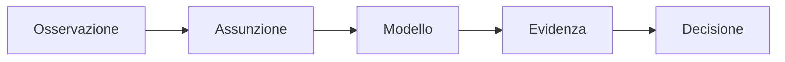

# Francis Bacon: induzione e idoli della mente

Bacon rende operativo un punto ancora attuale: prima di fidarsi dei dati, bisogna controllare i pregiudizi che guidano la domanda. In questa lezione gli idoli della mente diventano strumenti per proteggere decisioni, metriche e analisi da conferme troppo comode.

## Problema reale

Nel lavoro sui fondamenti filosofici dell'analisi dati, il contributo di Francis Bacon serve a risolvere un problema concreto: distinguere quando un dato supporta davvero una decisione e quando invece nasconde assunzioni implicite, bias cognitivi, causalità fragile o una domanda mal formulata. Non si tratta di un concetto astratto, ma di un criterio operativo per migliorare le scelte basate sui dati, esplicitando la soglia di errore e la robustezza delle evidenze.

## Modello concettuale

Il processo decisionale sotto incertezza si articola in quattro fasi sequenziali:

Una domanda ben formulata si traduce in unità osservabili, da cui si valuta la qualità del dato e solo infine si prende una decisione. Saltare uno di questi passaggi produce analisi eleganti ma fragili.

| Passaggio | Domanda guida | Output atteso |
|---|---|---|
| Framing | Quale decisione deve cambiare? | Una scelta concreta, non una curiosità |
| Misura | Quale segnale rappresenta il fenomeno? | Metrica, fonte e granularità |
| Confronto | Rispetto a quale baseline interpreto il risultato? | Benchmark o controfattuale plausibile |
| Azione | Che cosa faccio se il segnale supera la soglia? | Decisione, owner e prossimo controllo |

## Formalizzazione rigorosa

Formalizziamo il contributo di Bacon come una relazione tra quattro elementi fondamentali:

| Elemento | Definizione operativa |
|---|---|
| Unità | osservazione, ipotesi, variabile, meccanismo causale o criterio di evidenza |
| Segnale | forza dell'evidenza, coerenza causale, robustezza delle assunzioni e costo dell'errore decisionale |
| Baseline | spiegazione alternativa, controfattuale, gruppo comparabile o scenario senza intervento |
| Decisione | accettare, rifiutare o riformulare una spiegazione prima di usarla in un contesto aziendale |

La regola pratica è semplice: una misura è utile solo se riduce l'incertezza su una decisione specifica. Se non cambia una scelta, è mera documentazione; se cambia una scelta senza controlli, è rischio.

## I quattro idoli della mente secondo Bacon

Bacon individua quattro distorsioni cognitive che minano l'analisi dati, chiamate "idoli della mente":

| Idolo | Fonte della distorsione | Manifestazione nell'analisi dati moderna |
|-------|------------------------|------------------------------------------|
| **Idola Tribus** (della tribù) | Natura umana, tendenza a vedere pattern ovunque | Apofenia: vedere trend in pochi punti dati, confondere rumore con segnale |
| **Idola Specus** (della caverna) | Bias individuali legati a formazione e abitudini | Preferenze interpretative legate al background professionale |
| **Idola Fori** (del mercato) | Ambiguità e imprecisione del linguaggio | Definizioni diverse per metriche apparentemente uguali |
| **Idola Theatri** (del teatro) | Dogmi, autorità e convenzioni non messe in discussione | Accettazione acritica di regole e framework consolidati |

## Esempio o caso studio

Un'azienda nel 2021 spostò il 40% del budget marketing da Facebook a TikTok basandosi su tre mesi di dati che mostravano un calo di Facebook e una crescita di TikTok. Questo era un classico caso di Idola Tribus: il presunto trend era in realtà rumore stagionale e honeymoon effect. Sei mesi dopo, il ROAS di TikTok era crollato e Facebook era tornato ai livelli precedenti.

Un comitato di analisi dati applicò il metodo baconiano costruendo una tabella con evidenza, interpretazione prudente e decisione conseguente, distinguendo chiaramente osservazione, assunzione e azione:

| Evidenza | Interpretazione prudente | Decisione conseguente |
|---|---|---|
| Segnale positivo ma non isolato | Il fenomeno esiste, ma la causa è incerta | Cercare baseline o holdout |
| Segmento con risposta diversa | L'effetto medio nasconde eterogeneità | Analizzare coorti o sottogruppi |
| Costo operativo crescente | Il risultato va valutato sul margine | Applicare soglie economiche |

## Lab / esercizio

### Livello base

Scegli una decisione reale e descrivi in cinque righe: obiettivo, metrica primaria, baseline, rischio principale e azione prevista. Limita a una metrica primaria.

### Livello intermedio

Costruisci una tabella con almeno tre segmenti o scenari. Per ciascuno indica segnale, possibile spiegazione alternativa e controllo necessario prima di decidere.

### Livello research-grade

Disegna un piano di validazione: ipotesi, dati necessari, criteri di esclusione, soglia decisionale e controllo post-decisione. Specifica cosa ti farebbe cambiare idea.

### Dataset e materiali consigliati

Usa case study decisionali, metriche prodotto, risultati di esperimenti, DAG semplici, report analitici e serie storiche simulate. Se non hai dati reali, crea un dataset sintetico con 200-500 righe e almeno una colonna temporale, una colonna segmento, una metrica di outcome e una variabile di esposizione.

## Errore tipico da evitare

Il più comune è trattare il concetto di Bacon come una definizione da ricordare anziché un protocollo decisionale. Succede quando si presenta una metrica senza baseline, un grafico senza ipotesi o una raccomandazione senza considerare il costo dell'errore.

Un controllo utile è chiedersi: "Se questo risultato fosse falso o instabile, quale decisione sbaglierei?" Se la risposta non è chiara, la lezione non è stata applicata davvero.

## Quiz o checkpoint

1. Qual è la decisione concreta che questa lezione dovrebbe migliorare?
2. Quale baseline rende interpretabile il risultato?
3. Quale assunzione, se sbagliata, cambierebbe la conclusione?
4. Quale controllo minimo useresti prima di presentare la raccomandazione?

## Riepilogo operativo

Francis Bacon ci insegna che l'analisi dati è una disciplina che richiede rigore nel collegare concetto, dato e decisione. Applicare i suoi principi significa partire da un problema reale, formalizzare il segnale, cercare una baseline credibile, costruire esempi concreti e chiudere con controlli pratici per evitare errori cognitivi e dogmatici. Solo così l'incertezza si trasforma in decisione consapevole.

---

*Riferimenti:* Bacon, F. (1620). *Novum Organum Scientiarum.* Kahneman, D. (2011). *Thinking, Fast and Slow.* Klein, G. (2007). "Francis Bacon." *Stanford Encyclopedia of Philosophy.*
