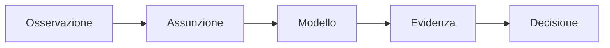

# Francis Bacon: induzione e idoli della mente

Immagina un analista che non vuole scambiare correlazione, misura e causalita per verita assolute quando un dato sembra evidente, ma la domanda vera e cosa possiamo legittimamente concludere. Sul tavolo non c'è un esercizio astratto: c'è la pressione concreta di rendere esplicite assunzioni, limiti e responsabilita. **Francis Bacon: induzione e idoli della mente** entra qui, nel punto in cui una scelta deve diventare più chiara, più misurabile e più difendibile.

## Una scena da cui partire

La lezione va letta con questo atteggiamento: non collezionare frasi da ricordare, ma cercare il passaggio che trasforma un pensiero critico che rende l'analisi più onesta in lavoro reale. Trattala come una lente mentale: il valore sta nel cambiare il modo in cui osservi un problema prima ancora di aprire un tool. Il livello è avanzato: non cercare una ricetta unica, cerca i vincoli che cambiano la risposta.

- **Contesto:** Quale intuizione deve restare dopo la lettura?
- **Metodo:** Quale esempio rende concreto il concetto?
- **Applicazione:** Quale errore diventa più facile evitare?

## I quattro idoli di Bacon

| Idolo | Fonte della distorsione | Nell'analisi dati moderna |
|-------|------------------------|--------------------------|
| **Idola Tribus** (della tribù) | La natura umana stessa | Tendiamo a vedere pattern anche dove non esistono (apofenia). Un analyst "vede" una tendenza in 3 punti dati. |
| **Idola Specus** (della caverna) | L'individuo, la sua educazione e abitudini | Ognuno ha i propri bias personali. Un analyst con background ingegneristico privilegia spiegazioni tecniche; uno con background marketing privilegia spiegazioni comportamentali. |
| **Idola Fori** (del mercato) | Il linguaggio e la comunicazione | Le parole creano realtà. "Utente attivo", "lead qualificato", "churn" — ognuno le definisce in modo diverso, ma tutti pensano di significare la stessa cosa. |
| **Idola Theatri** (del teatro) | I dogmi, le autorità, i framework accettati | "Si è sempre fatto così." "Google Analytics è la fonte di verità." "Il p-value &lt; 0.05 significa che il test è riuscito." Dogmi non messi in discussione. |

## Idola Tribus: il pattern dove non c'è

L'uomo è un animale che cerca pattern. È un vantaggio evolutivo (riconoscere la tigre tra i cespugli), ma un disastro statistico. L'analista che guarda un grafico di revenue con 3 mesi di calo vede subito un "trend negativo". Ma 3 punti non fanno un trend: potrebbero essere rumore. Solo un test statistico (es. Mann-Kendall) può distinguere un trend reale da una fluttuazione casuale.

**Caso reale:** nel 2021, un'azienda spostò il 40% del budget marketing da Facebook a TikTok perché "i dati mostravano che Facebook era in declino e TikTok in crescita." Tre mesi di dati. Il declino di Facebook era stagionale (Q1 post-natalizio), la crescita di TikTok era l'honeymoon iniziale. Sei mesi dopo, il ROAS di TikTok era crollato e Facebook era tornato ai livelli precedenti. L'idolo della tribù aveva creato un pattern inesistente in 3 punti.

## Idola Specus: la caverna personale

Bacon prese l'immagine dalla *Repubblica* di Platone. Ogni analista è prigioniero della propria caverna di esperienze, formazione, convinzioni. Il modo per uscirne non è negare di avere una caverna, ma esplicitarla.

**Esercizio:** scrivi in cima a ogni analisi le tue assunzioni personali. "Sono un analyst con background in economia, tendo a privilegiare spiegazioni basate su incentivi e costi. Le mie raccomandazioni potrebbero sottostimare fattori tecnici o psicologici." Questa dichiarazione non rende l'analisi debole: la rende onesta e, paradossalmente, più robusta.

## Idola Fori: quando le parole uccidono i numeri

"Monthly Active Users." Tre parole. In un'azienda con 200 dipendenti, potrebbero esserci 5 definizioni diverse. Il team marketing conta chi ha aperto un'email. Il team prodotto conta chi ha aperto l'app. Il CEO conta chi ha fatto login. Tre numeri diversi per la stessa parola. Nessuno mente: il linguaggio è ambiguo per sua natura.

Soluzione baconiana: **definisci ogni termine operativamente prima di usarlo.** Non "utente attivo", ma "utente che ha eseguito almeno un evento di tipo 'login' o 'app_open' negli ultimi 30 giorni, misurato alle 23:59 UTC". Scritta. Visibile. Non negoziabile.

## Idola Theatri: i dogmi che non vedi

"Si è sempre fatto così" è la frase più costosa in analisi dati. I dogmi sono framework talmente accettati che nessuno pensa più di metterli in discussione. "Il net promoter score misura la fedeltà dei clienti" (no, misura la probabilità di raccomandare). "Un p-value &lt; 0.05 significa che l'effetto è reale" (no, significa che è improbabile osservare quei dati se l'ipotesi nulla è vera — non è la stessa cosa). "Più dati = più verità" (no, più dati mal campionati = più certezza nell'errore).

Il metodo per distruggere gli idola theatri è una domanda: **"Qual è l'esperimento che dimostrerebbe che questo dogma è falso?"** Se non riesci a immaginare un esperimento che potrebbe falsificare il dogma, allora il dogma non è scienza: è fede.

## Come applicare Bacon al tuo workflow

1. **Prima di ogni analisi:** scrivi i tuoi idola specus (bias personali) e idola theatri (dogmi che stai assumendo). 5 minuti, massimo impatto sulla qualità.

2. **Durante l'analisi:** ogni volta che "vedi un trend", chiediti: è un idolo della tribù? Tre punti fanno un pattern o ho bisogno di una verifica statistica?

3. **Prima di presentare:** verifica gli idola fori. Le metriche che citi sono definite operativamente? Il tuo stakeholder usa la stessa definizione?

---

*Riferimenti:*
- Bacon, F. (1620). *Novum Organum Scientiarum.*
- Kahneman, D. (2011). *Thinking, Fast and Slow.* Farrar, Straus and Giroux.
- Klein, G. (2007). "Francis Bacon." *Stanford Encyclopedia of Philosophy.*

## Controllo di qualità

Prima di usare \"francis bacon: induzione e idoli della mente\ in una decisione, controlla sempre completezza, duplicati, timezone, definizioni cambiate e segmenti esclusi. Molte analisi apparentemente sofisticate falliscono perché il dato di partenza misura un comportamento diverso da quello che il team crede di osservare.

## Problema reale

Nel lavoro su fondamenti filosofici dell'analisi dati, **Francis Bacon: induzione e idoli della mente** serve a risolvere un problema concreto: capire quando un dato sostiene davvero una decisione e quando invece nasconde assunzioni, bias, causalità fragile o una domanda formulata male. La domanda non e se il concetto sia interessante in astratto, ma quale decisione migliora quando lo applichi con dati affidabili e con una soglia di errore esplicita.

Questa lezione va studiata come uno strumento operativo: entro la fine devi saper Comprendere il problema analitico e il contesto decisionale; Applicare esempi, metriche e controlli a casi reali. Se non riesci a collegare il concetto a una scelta reale, la conoscenza resta decorativa e non diventa competenza.

## Modello concettuale

Il modello mentale e sequenziale: prima si formula la domanda, poi si traduce in unità osservabili, quindi si valuta la qualità del dato e solo alla fine si decide. Saltare un passaggio produce analisi eleganti ma fragili.

| Passaggio | Domanda guida | Output atteso |
|---|---|---|
| Framing | Quale decisione deve cambiare? | Una scelta concreta, non una curiosita |
| Misura | Quale segnale rappresenta il fenomeno? | Metrica, fonte e granularita |
| Confronto | Rispetto a quale baseline interpreto il risultato? | Benchmark o controfattuale plausibile |
| Azione | Che cosa faccio se il segnale supera la soglia? | Decisione, owner e prossimo controllo |

## Formalizzazione rigorosa

Formalizza **Francis Bacon: induzione e idoli della mente** come una relazione tra quattro elementi: unità di analisi, segnale, baseline e decisione. Nel contesto di questa lezione l'unità principale e **osservazione, ipotesi, variabile, meccanismo causale o criterio di evidenza**. Il segnale da osservare deve essere collegato a **forza dell evidenza, coerenza causale, robustezza delle assunzioni e costo dell errore decisionale**, mentre la baseline deve essere scelta tra **spiegazione alternativa, controfattuale, gruppo comparabile o scenario senza intervento**.

Una formulazione robusta segue questa logica:

| Elemento | Definizione operativa per questa lezione |
|---|---|
| Unità | osservazione, ipotesi, variabile, meccanismo causale o criterio di evidenza |
| Segnale | forza dell evidenza, coerenza causale, robustezza delle assunzioni e costo dell errore decisionale |
| Baseline | spiegazione alternativa, controfattuale, gruppo comparabile o scenario senza intervento |
| Decisione | accettare, rifiutare o riformulare una spiegazione prima di usarla in un contesto aziendale |
| Rischio | Confondere correlazione, qualità del dato e causalità decisionale |

La regola pratica e semplice: una misura e utile solo se riduce l'incertezza su una decisione specifica. Se non cambia una scelta, e documentazione; se cambia una scelta senza controlli, e rischio.

## Esempio o caso studio

Un comitato interpreta una crescita di retention come prova che una nuova iniziativa abbia funzionato. La lezione costringe a distinguere osservazione, spiegazione, assunzione e decisione prima di trasformare il dato in azione.

Applicando **Francis Bacon: induzione e idoli della mente**, il team costruisce una lettura in tre colonne: cosa sappiamo, cosa assumiamo e quale decisione prendiamo. Questo formato impedisce di presentare un numero come se fosse una conclusione autosufficiente.

| Evidenza | Interpretazione prudente | Decisione conseguente |
|---|---|---|
| Segnale positivo ma non isolato | Il fenomeno esiste, ma la causa e ancora incerta | Cercare baseline o holdout |
| Segmento con risposta diversa | L'effetto medio nasconde eterogeneita | Analizzare coorti o sottogruppi |
| Costo operativo crescente | Il risultato va valutato sul margine | Applicare soglie economiche |

## Lab / esercizio

### Livello base

Prendi una decisione reale collegata a **Francis Bacon: induzione e idoli della mente** e scrivi in cinque righe: obiettivo, metrica primaria, baseline, rischio principale e azione prevista. Non usare più di una metrica primaria.

### Livello intermedio

Costruisci una tabella con almeno tre segmenti o scenari. Per ciascuno indica segnale, possibile spiegazione alternativa e controllo necessario prima di decidere.

### Livello research-grade

Disegna un piano di validazione: ipotesi, dati necessari, criterio di esclusione, soglia decisionale e controllo post-decisione. Specifica anche che cosa ti farebbe cambiare idea.

### Dataset e materiali consigliati

Usa case study decisionali, metriche prodotto, risultati di esperimenti, DAG semplici, report analitici e serie storiche simulate. Se non hai dati reali, crea un dataset sintetico con 200-500 righe e almeno una colonna temporale, una colonna segmento, una metrica di outcome e una variabile di esposizione.

## Errore tipico da evitare

L'errore più frequente e trattare **Francis Bacon: induzione e idoli della mente** come una definizione da ricordare invece che come un protocollo decisionale. In pratica succede quando si presenta una metrica senza baseline, un grafico senza ipotesi, o una raccomandazione senza costo dell'errore.

Un controllo utile e chiedersi: "se questo risultato fosse falso o instabile, quale decisione sbaglierei?". Se la risposta non e chiara, la lezione non e ancora stata applicata davvero.

## Quiz o checkpoint

1. Qual e la decisione concreta che questa lezione dovrebbe migliorare?
2. Quale baseline rende interpretabile il risultato?
3. Quale assunzione, se sbagliata, cambierebbe la conclusione?
4. Quale controllo minimo useresti prima di presentare la raccomandazione?

## Riepilogo operativo

**Francis Bacon: induzione e idoli della mente** e una competenza utile quando collega concetto, dato e decisione. Studiala partendo da un problema reale, formalizza il segnale, cerca una baseline credibile, costruisci un esempio e chiudi con un controllo pratico. Categoria: Fondamenti. Difficoltà: advanced. Tempo stimato: 18 min.
