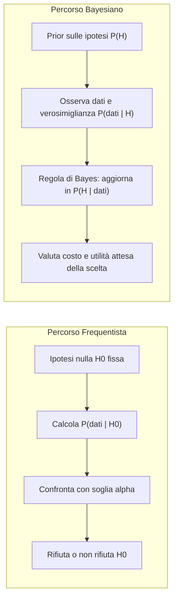

Dietro quasi ogni lite attorno a un esperimento aziendale si nasconde una domanda che pochi esplicitano: cosa significa davvero dire che una variazione è "probabile"? Frequentismo e bayesianismo non sono due formule concorrenti per lo stesso problema, ma due concezioni filosofiche distinte su cosa sia l'incertezza, dove risieda la casualità e quale domanda debba guidare una decisione sotto rischio.

## Un p-value a 0,041 e una decisione da centomila euro

Considera questo scenario costruito che divide regolarmente i team di prodotto e finanza. Un'azienda SaaS testa una riprogettazione radicale del flusso di rinnovo annuale: l'implementazione definitiva e la migrazione contrattuale richiedono circa centomila euro tra sviluppo e supporto legale. Dopo tre settimane di A/B test, l'analista porta in riunione un risultato con `p-value = 0,041`. Il capo del prodotto esulta dicendo che c'è quasi il `96%` di probabilità che la nuova pagina aumenti il fatturato. La direttrice finanziaria frena: nelle ultime venti proposte simili testate in azienda, diciotto non hanno portato alcun beneficio duraturo e molte idee brillanti si sono rivelate rumore.

Entrambe le voci stanno reagendo allo stesso numero, ma parlano da sponde filosofiche opposte. Il product manager legge un indice frequentista — progettato per rispondere a una domanda sui dati nell'ipotesi che non ci sia alcun effetto — come se fosse la probabilità bayesiana che la sua idea funzioni davvero. La direttrice finanziaria ragiona invece come una bayesiana intuitiva, pesando il nuovo segnale sperimentale contro il tasso storico di successo delle iniziative passate.

> **Idea chiave:** Il `p-value` frequentista misura quanto sarebbero sorprendenti i dati osservati se l'effetto reale fosse zero, mentre il decisore vuole quasi sempre conoscere la probabilità contraria: quanto è credibile che l'effetto esista davvero alla luce dei dati appena visti.

Scambiare queste due probabilità condizionate l'una per l'altra — la celebre *fallacia dell'inverso condizionato* — è una delle fonti di spreco più silenziose della data science moderna.

## Due definizioni di probabilità per due domande diverse

Per oltre due secoli la statistica ha ospitato due scuole di pensiero con assiomi identici nel calcolo delle probabilità, ma con significati radicalmente diversi assegnati ai simboli.

Nell'**approccio frequentista**, consolidato nel Novecento da Ronald Fisher, Jerzy Neyman ed Egon Pearson, la probabilità è una proprietà fisica del processo che genera i dati: è la frequenza relativa con cui un evento si presenterebbe se potessi ripetere lo stesso esperimento all'infinito in condizioni identiche. In questa cornice i parametri del mondo — per esempio il vero tasso di conversione di un sito o la vera differenza tra due varianti — sono costanti fisse ma sconosciute. Non ha alcun senso logico dire che "c'è il 90% di probabilità che il parametro vero stia dentro questo intervallo", perché il parametro non è una variabile casuale: o ci sta dentro o non ci sta. La casualità risiede esclusivamente nei *campioni* che estrai di volta in volta. Perciò il test frequentista si concentra su `P(dati estremi | H0)`, garantendo che, se seguissi la stessa procedura per tutta la carriera, sbaglieresti al massimo in una frazione controllata `alpha` dei casi in cui l'ipotesi nulla `H0` è vera.

Nell'**approccio bayesiano**, che affonda le radici nel saggio postumo del reverendo Thomas Bayes del 1763 e nella formalizzazione di Pierre-Simon Laplace, la probabilità non misura soltanto frequenze ripetibili, ma rappresenta un *grado di fiducia razionale* coerente sullo stato del mondo, aggiornato man mano che arrivano nuove evidenze. Qui i dati osservati sono il fatto fisso e certo, mentre i parametri sconosciuti del modello vengono descritti come distribuzioni di probabilità. Parti da una *distribuzione a priori* (*prior*) che riassume la conoscenza disponibile prima del test, moltiplichi per la *verosimiglianza* dei dati osservati rispetto a ciascun valore possibile del parametro e ottieni la *distribuzione a posteriori* (*posterior*), da cui puoi finalmente leggere direttamente `P(effetto > soglia | dati)`.

Le conseguenze pratiche di questa divergenza emergono in modo nitido confrontando il funzionamento dei due paradigmi sulle attività quotidiane di analisi.

| Dimensione di confronto | Paradigma frequentista | Paradigma bayesiano |
|---|---|---|
| Significato della probabilità | Frequenza limite su infinite ripetizioni ideali | Grado di incertezza razionale su un'affermazione |
| Natura dei parametri | Costanti fisse sconosciute | Variabili descritte da una distribuzione di probabilità |
| Ruolo della conoscenza pregressa | Esclusa dal calcolo formale del p-value | Esplicitata nel prior e aggiornata con il teorema di Bayes |
| Risultato tipico | p-value e intervallo di confidenza al 95% | Distribuzione a posteriori e intervallo di credibilità |
| Monitoraggio sequenziale | Richiede correzioni rigorose contro il peeking | Aggiorna naturalmente il posterior man mano che arrivano i dati |
| Punto di vulnerabilità | Fraintendimento di `P(dati \| H0)` e cecità al tasso di base | Scelta arbitraria o nascosta di prior troppo influenti su pochi dati |

## La trappola del p-value e l'aggiornamento con il teorema di Bayes

La differenza tra rispondere a `P(dati | H0)` e rispondere a `P(H1 | dati)` diventa netta appena la traduci in numeri concreti attraverso il teorema di Bayes. Costruiamo un esempio numerico realistico su un programma di sperimentazione digitale che esamina 100 casi di test in un anno (con costi di implementazione attorno a 100.000 euro per i lanci approvati) usando criteri frequentisti classici: soglia di significatività `alpha = 0,05` e potenza statistica dell'80 per cento.

Immagina, come suggerito dall'esperienza storica della direttrice finanziaria e dai tassi registrati nelle grandi piattaforme tecnologiche, che soltanto 10 casi su 100 producano un vero miglioramento economico apprezzabile (`H1` vera in 10 casi), mentre i restanti 90 casi siano modifiche neutre prive di effetto reale (`H0` vera in 90 casi). Vediamo cosa accade al termine dei 100 casi esaminati.

Nel gruppo dei 10 casi veramente efficaci, con una potenza dell'80 per cento, i test statistici riconoscono correttamente l'effetto in `10 * 0,80 = 8 casi` (*veri positivi*), mentre mancano gli altri 2 casi (*falsi negativi*). Nel gruppo dei 90 casi inefficaci, accettando una soglia di falsi allarmi di `0,05`, il caso produce comunque falsi allarmi in `90 * 0,05 = 4,5 casi` in media (*falsi positivi*).

Mettiamo insieme tutti i test che si chiudono con un `p-value` inferiore a `0,05` e sembrano vittoriosi sulla dashboard: sono in totale `8 + 4,5 = 12,5 casi` statisticamente significativi. Ora poniti la domanda bayesiana decisiva: scelto un test significativo tra questi `12,5` casi, qual è la probabilità reale che l'idea funzioni davvero? Dividiamo i veri positivi per tutti i positivi osservati: `8 / 12,5 = 0,64`, cioè esattamente 64,0 pp su 100 (`64,0%`). Malgrado la soglia di significatività fosse al 5 per cento, oltre un terzo delle vittorie apparenti (`36,0%`) in questo portafoglio è in realtà un falso positivo.

E la situazione peggiora drasticamente se la qualità iniziale delle ipotesi scende. Se in un anno di idee immature soltanto 5 casi su 100 contengono un effetto vero (5 casi validi e 95 casi nulli), con gli stessi parametri avremmo `5 * 0,80 = 4 casi` veri positivi contro `95 * 0,05 = 4,75 casi` falsi positivi. I test significativi totali sarebbero `4 + 4,75 = 8,75 casi`, e il valore predittivo positivo scenderebbe a `4 / 8,75 = 0,457`, cioè appena il `45,7%`. In altri termini, anche ottenendo un `p-value` sotto `0,05`, saresti davanti a meno di una probabilità su due che la modifica porti benefici reali. Il calcolo bayesiano rende trasparente questa realtà perché obbliga a combinare l'evidenza del test con il tasso di base del dominio.

## La crisi di replicabilità del 2015 e il risveglio statistico

Questa discrepanza matematica non è rimasta confinata alle lavagne teoriche: ha scosso intere discipline empiriche. Nell'agosto 2015 l'Open Science Collaboration, coordinata da Brian Nosek e composta da oltre duecento ricercatori, pubblicò sulla rivista *Science* i risultati del *Reproducibility Project*, il tentativo sistematico di replicare esattamente 100 studi pubblicati nelle tre principali riviste internazionali di psicologia.

I dati originali delle 100 ricerche riportavano un risultato statisticamente significativo nel `97%` dei casi. Eppure, quando i team indipendenti ripeterono gli esperimenti con protocolli rigorosi e campioni spesso più ampi, soltanto il `36%` delle repliche raggiunse di nuovo la significatività statistica, e la dimensione media dell'effetto misurato si dimezzò rispetto alle pubblicazioni iniziali. Nel 2016 l'American Statistical Association intervenne con una dichiarazione storica ufficiale per avvertire che un `p-value` sotto `0,05` non misura né la probabilità che l'ipotesi sia vera né l'importanza pratica di un risultato.

Le lezioni di quel terremoto metodologico, approfondite anche da statistici come Bradley Efron, Trevor Hastie e Richard McElreath, convergono su un punto operativo chiaro: i metodi frequentisti e bayesiani non sono religioni rivali, ma strumenti complementari. L'errore fatale nasce quando usi un numero frequentista isolato per prendere decisioni ad alto costo ignorando completamente il tasso di base delle ipotesi, la potenza reale del campione e l'asimmetria economica tra sbagliare lanciando una modifica inutile e sbagliare scartandone una buona.

## Quando scegliere l'approccio frequentista e quando quello bayesiano

Nella pratica quotidiana di un team di analisi o di machine learning, la scelta tra i due quadri non dovrebbe dipendere dalle preferenze ideologiche di chi ha scritto la libreria software, bensì dalla struttura del problema decisionale che hai davanti. Puoi valutare ogni nuovo progetto passando attraverso una breve scheda di orientamento condivisa prima di impostare il test.

> **Scheda decisionale frequentista-bayesiana:**
> Regime ad alto volume e controllo del tasso d'errore: se esegui migliaia di test automatizzati o controlli di qualità regolamentari dove serve garantire tassi massimi di falsi allarmi sul lungo periodo, il controllo frequentista del rischio resta diretto e trasparente.
> Regime a campioni ridotti o monitoraggio continuo: se disponi di pochi dati costosi (mercati B2B, lanci regionali, diagnostica su nicchie) o devi aggiornare continuamente le stime con informazioni pregresse solide, il quadro bayesiano evita verdetti binari fragili e quantifica l'intera incertezza.
> Decisione economica esplicita: ogni volta che il costo di un falso positivo differisce di ordini di grandezza dal costo di un falso negativo, integra la distribuzione a posteriori con una matrice di costi monetari reali.

Un punto di forza straordinario dell'approccio bayesiano in azienda sta proprio nella leggibilità delle risposte per chi guida il business. Dire a un dirigente "non possiamo rifiutare l'ipotesi nulla con `p = 0,08`" lascia la riunione nel limbo dell'incomprensione. Dire invece "alla luce dello storico aziendale e delle ultime tre settimane di dati, c'è il 78% di probabilità che il nuovo flusso generi un incremento positivo, ma solo il 22% di probabilità che superi la soglia di pareggio di 40.000 euro" trasforma immediatamente la statistica in una decisione finanziaria razionale.

## Tre fraintendimenti che distorcono i test in azienda

Anche i team più attrezzati commettono errori ricorrenti quando mescolano il lessico di una scuola con i calcoli dell'altra. Ecco le tre distorsioni più frequenti da intercettare in revisione.

### Leggere `P(dati | H0)` come se fosse `P(H0 | dati)`

Il sintomo si presenta ogni volta che senti affermare che "`p = 0,03` significa che c'è solo il 3% di probabilità che il risultato sia dovuto al caso, quindi siamo sicuri al 97%". Sembra una parafrasi intuitiva e innocua della soglia statistica, ma ribalta il condizionamento logico: ignora completamente quanto fosse plausibile l'effetto prima dell'esperimento e ignora la potenza del campione. Per evitare questo errore, vieta nei documenti interni l'espressione "probabilità che il risultato sia dovuto al caso" e sostituiscila con la definizione esatta oppure accompagna sempre il `p-value` con una stima esplicita del valore predittivo positivo basata sul tasso storico di successo dei test precedenti.

### Confondere la significatività statistica con la rilevanza economica

Accade nei prodotti digitali con milioni di utenti al giorno, dove anche una variazione minuscola dello `0,02%` sulla conversione raggiunge facilmente un `p-value` inferiore a `0,001`. Sembra un trionfo inequivocabile perché l'evidenza contro lo zero esatto è schiacciante, ma statisticamente significativo significa soltanto "probabilmente diverso da zero", non "abbastanza grande da ripagare sviluppo, complessità e manutenzione". Correggi la rotta definendo prima del test una *soglia minima di rilevanza pratica* (MDE o *ROPE*, Region of Practical Equivalence nel quadro bayesiano) e valutando se l'intero intervallo di stima supera il costo operativo della novità.

### Usare un prior informativo nascosto fingendo neutralità

Anche il fronte bayesiano ha la propria tentazione speculare: su dataset molto piccoli con appena trenta o quaranta osservazioni, un *prior* ottimistico o costruito senza documentarne l'origine può dominare completamente la *likelihood* e produrre un *posterior* rassicurante anche quando i dati recenti non mostrano alcun segnale. Sembra conveniente sfruttare "l'esperienza degli esperti" per accelerare una decisione difficile, ma senza analisi di sensibilità trasforma l'inferenza in conferma delle opinioni del dirigente più anziano. Eviti questa trappola mostrando sempre in affiancamento almeno due risultati: uno ottenuto con un prior debolmente informativo o scettico e uno con il prior di dominio dichiarato e giustificato.

## Controllo epistemologico prima di fidarti di un test

Metti alla prova la tua capacità di leggere correttamente numeri frequentisti e bayesiani affrontando queste quattro situazioni pratiche.

1. Un test medico ha sensibilità (potenza) del 90% e tasso di falsi positivi del 5%, e viene applicato a una popolazione in cui la malattia colpisce solo 1 persona su 100 (`prior = 1%`): se un individuo risulta positivo, perché la probabilità che sia davvero malato resta molto bassa, attorno al 15%?

Mostra risposta

Su 1.000 persone esaminate, in media 10 sono malate e 990 sono sane. Il test individua correttamente `10 * 0,90 = 9` veri malati tra i malati, ma genera anche `990 * 0,05 = 49,5` falsi positivi tra le 990 persone sane. Su un totale di `9 + 49,5 = 58,5` risultati positivi, solo `9 / 58,5 = 15,4%` corrisponde a persone effettivamente malate: i falsi allarmi nella grande maggioranza sana superano di oltre cinque volte i veri positivi.

2. Qual è l'errore concettuale nell'affermazione: "L'intervallo di confidenza frequentista al 95% è [2%, 8%], quindi c'è il 95% di probabilità che il vero incremento stia tra il 2% e l'8%"?

Mostra risposta

Nel quadro frequentista il vero incremento è una costante fissa sconosciuta, non una variabile casuale: o appartiene a [2%, 8%] oppure no. Il 95% non riguarda quel singolo intervallo già calcolato, ma la proprietà della procedura di campionamento sul lungo periodo: ripetendo l'esperimento infinite volte su nuovi campioni, il 95% degli intervalli costruiti con quella formula conterrà il valore vero fisso. La lettura diretta sulla probabilità dell'intervallo appartiene invece all'intervallo di credibilità bayesiano.

3. Un team B2B ha soltanto 120 clienti enterprise nel proprio mercato totale indirizzabile e deve valutare se un nuovo servizio di assistenza riduce il churn: perché in questo contesto il quadro bayesiano offre spesso vantaggi decisivi rispetto a un classico test frequentista con `alpha = 5%`?

Mostra risposta

Con soli 120 clienti complessivi, un test frequentista classico avrebbe pochissima potenza statistica e quasi certamente restituirebbe un verdetto non significativo a meno che l'effetto non sia enorme, spingendo a buttare via innovazioni utili. Il modello bayesiano consente di integrare conoscenze storiche ragionevoli su settori comparabili, aggiornare la distribuzione di probabilità con l'evidenza dei 120 clienti e calcolare direttamente il rischio atteso di perdita economica rispetto al costo di erogazione del servizio.

4. Come si comportano in modo diverso frequentismo e bayesianismo quando vuoi controllare ogni settimana l'andamento di una campagna in corso per decidere se fermarla prima del previsto?

Mostra risposta

Nel frequentismo classico fondato sul `p-value` a orizzonte fisso, controllare i dati ogni settimana e fermarsi al primo superamento della soglia distrugge la garanzia sul tasso di falsi positivi, rendendo obbligatori confini di arresto sequenziali specifici (come i metodi alpha-spending). Nel quadro bayesiano, invece, la regola di Bayes aggiorna legittimamente il *posterior* a ogni nuova osservazione indipendentemente dal numero di controlli intermedi, a patto che la decisione di arresto sia basata sul superamento di una soglia di utilità attesa o di probabilità posteriore anziché su un trucco di selezione sul `p-value`.

