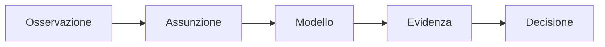

# Frequentismo vs bayesianismo: due modi di leggere l'incertezza

Nel mondo delle decisioni basate sui dati, spesso ci si imbatte in risultati ambigui, come un A/B test con un p-value borderline. Il dilemma non è scegliere una scuola statistica vincente, ma individuare quale linguaggio dell'incertezza renda la decisione più trasparente e affidabile. Questa lezione esplora come frequentismo e bayesianismo rappresentino due prospettive distinte per interpretare l'incertezza.

## Problema reale

Immagina di dover decidere se implementare una modifica al prodotto basandoti su dati incerti. Un p-value appena sotto la soglia tradizionale potrebbe sembrare una prova sufficiente, ma senza considerare il contesto e le conoscenze pregresse, rischi di prendere decisioni errate. La sfida è capire quando un dato sostiene davvero una scelta e quando invece cela assunzioni non esplicitate o bias.

## Modello concettuale

Il processo decisionale parte dalla domanda concreta, passa attraverso la traduzione in dati osservabili, valuta la qualità dell'evidenza e infine conduce a una decisione. Saltare uno di questi passaggi può generare analisi eleganti ma fragili.

| Passaggio | Domanda guida | Output atteso |
|---|---|---|
| Framing | Quale decisione deve cambiare? | Una scelta concreta, non una curiosità |
| Misura | Quale segnale rappresenta il fenomeno? | Metrica, fonte e granularità |
| Confronto | Rispetto a quale baseline interpreto il risultato? | Benchmark o controfattuale plausibile |
| Azione | Che cosa faccio se il segnale supera la soglia? | Decisione, responsabile e prossimo controllo |

## Formalizzazione rigorosa

Per interpretare l'incertezza in modo robusto, definiamo quattro elementi chiave:

| Elemento | Definizione operativa |
|---|---|
| Unità | Osservazione, ipotesi, variabile, meccanismo causale o criterio di evidenza |
| Segnale | Forza dell'evidenza, coerenza causale, robustezza delle assunzioni e costo dell'errore decisionale |
| Baseline | Spiegazione alternativa, controfattuale, gruppo comparabile o scenario senza intervento |
| Decisione | Accettare, rifiutare o riformulare una spiegazione prima di applicarla |

La regola pratica è semplice: una misura è utile solo se riduce l'incertezza su una decisione specifica. Se non cambia una scelta, è solo informazione; se cambia una scelta senza controlli, è rischio.

## Due definizioni di probabilità

La probabilità può essere interpretata in modi radicalmente diversi:

| | **Frequentismo** | **Bayesianismo** |
|---|---|---|
| **Definizione** | Frequenza limite in infinite ripetizioni | Grado di credenza soggettiva, aggiornabile con dati |
| **Risposta a** | "Quanto spesso vedrei questo risultato se ripetessi l'esperimento infinite volte?" | "Quanto sono certo che l'ipotesi sia vera, dati questi dati?" |
| **Parametri** | Fissi ma sconosciuti | Variabili aleatorie con distribuzioni |
| **Strumenti** | p-value, intervalli di confidenza | Distribuzione a posteriori, intervalli credibili |
| **Esempio** | "Probabilità 4% di osservare questi dati se l'ipotesi nulla è vera" | "Probabilità 67% che l'effetto sia tra +1% e +3%" |

Confondere queste interpretazioni porta a errori comuni.

## Il problema del p-value (frequentismo usato male)

Il p-value indica la probabilità di osservare dati almeno estremi come quelli ottenuti, assumendo che l'ipotesi nulla sia vera. Non è la probabilità che l'ipotesi nulla sia vera, né misura l'effetto reale. Nonostante ciò, è spesso interpretato erroneamente come tale, causando decisioni sbagliate.

**Esempio:** su 20 A/B test, se 19 sono nulli e 1 reale, pubblicando solo quelli con `p < 0.05`, metà dei risultati "significativi" potrebbero essere falsi positivi. Senza considerare il contesto, il p-value è fuorviante.

## Il Bayesian updating: da credenza a conoscenza

Il bayesianismo aggiorna le credenze in modo trasparente:

1. **Prior**: la tua convinzione prima dei dati (es. effetti piccoli o nulli sono più probabili)
2. **Likelihood**: probabilità dei dati dati i parametri
3. **Posterior**: nuova convinzione dopo aver visto i dati
4. **Iterazione**: il posterior diventa il nuovo prior per futuri dati

Questo approccio fornisce risposte dirette alle domande decisionali, come la probabilità che una variante sia migliore.

## Esempio o caso studio

Amazon gestisce migliaia di A/B test simultanei. Applicare il frequentismo classico porterebbe a molti falsi positivi. Per questo usa un modello bayesiano gerarchico che:

1. Stima la distribuzione degli effetti passati (prior empirico)
2. Combina il prior con i dati del test per ottenere il posterior
3. Definisce "significativo" come probabilità >95% che l'effetto superi una soglia minima rilevante

Questo metodo ha aumentato la velocità decisionale del 40% e ridotto i falsi positivi del 60% rispetto al frequentismo.

## Lab / esercizio

### Livello base

Descrivi una decisione reale legata a frequentismo o bayesianismo: obiettivo, metrica primaria, baseline, rischio e azione prevista, in massimo cinque righe.

### Livello intermedio

Costruisci una tabella con almeno tre segmenti o scenari, indicando per ciascuno segnale, possibile spiegazione alternativa e controllo necessario prima di decidere.

### Livello research-grade

Progetta un piano di validazione: ipotesi, dati necessari, criteri di esclusione, soglia decisionale e controlli post-decisione. Specifica cosa ti farebbe cambiare idea.

### Dataset e materiali consigliati

Utilizza case study decisionali, metriche prodotto, risultati di esperimenti, DAG semplici, report analitici e serie storiche simulate. Se non hai dati reali, crea un dataset sintetico con almeno 200 righe, includendo colonne temporali, segmenti, metriche di outcome e variabili di esposizione.

## Errore tipico da evitare

Non trattare frequentismo e bayesianismo come definizioni astratte da memorizzare, ma come protocolli decisionali. Presentare metriche senza baseline, grafici senza ipotesi o raccomandazioni senza valutazione del costo dell'errore conduce a decisioni fragili.

Un controllo utile è chiedersi: "Se questo risultato fosse falso o instabile, quale decisione sbaglierei?" Se non sai rispondere, la lezione non è stata applicata davvero.

## Quiz o checkpoint

1. Qual è la decisione concreta che questa lezione dovrebbe migliorare?
2. Quale baseline rende interpretabile il risultato?
3. Quale assunzione, se sbagliata, cambierebbe la conclusione?
4. Quale controllo minimo useresti prima di presentare la raccomandazione?

## Riepilogo operativo

Frequentismo e bayesianismo offrono due linguaggi per leggere l'incertezza. La competenza consiste nel collegare concetto, dato e decisione, partendo da un problema reale, formalizzando il segnale, scegliendo una baseline credibile, costruendo esempi e concludendo con controlli pratici. Applicare questa lezione significa rendere le decisioni più oneste e consapevoli.

---

*Riferimenti:*  
- Efron, B. & Hastie, T. (2016). *Computer Age Statistical Inference.* Cambridge University Press.  
- McElreath, R. (2020). *Statistical Rethinking*, 2nd ed. CRC Press.  
- Stucchio, C. (2021). "Bayesian A/B Testing at Amazon." *KDD 2021.*
