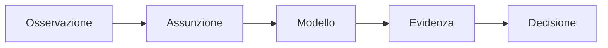

# Frequentismo vs bayesianismo

Immagina un analista che non vuole scambiare correlazione, misura e causalita per verita assolute quando un dato sembra evidente, ma la domanda vera e cosa possiamo legittimamente concludere. Sul tavolo non c'è un esercizio astratto: c'è la pressione concreta di rendere esplicite assunzioni, limiti e responsabilita. **Frequentismo vs bayesianismo: due modi di leggere l'incertezza** entra qui, nel punto in cui una scelta deve diventare più chiara, più misurabile e più difendibile.

## Una scena da cui partire

La lezione va letta con questo atteggiamento: non collezionare frasi da ricordare, ma cercare il passaggio che trasforma un pensiero critico che rende l'analisi più onesta in lavoro reale. Trattala come una lente mentale: il valore sta nel cambiare il modo in cui osservi un problema prima ancora di aprire un tool. Il livello è avanzato: non cercare una ricetta unica, cerca i vincoli che cambiano la risposta.

- **Contesto:** Quale intuizione deve restare dopo la lettura?
- **Metodo:** Quale esempio rende concreto il concetto?
- **Applicazione:** Quale errore diventa più facile evitare?

## Due definizioni di probabilità

La probabilità non è un concetto univoco. Esistono (almeno) due interpretazioni filosofiche radicalmente diverse:

| | **Frequentismo** | **Bayesianismo** |
|---|---|---|
| **Definizione di probabilità** | Frequenza limite in infinite ripetizioni | Grado di credenza soggettiva (ma aggiornabile) |
| **Cosa risponde** | "Se ripetessi l'esperimento infinite volte, quanto spesso vedrei questo risultato?" | "Quanto sono certo che l'ipotesi sia vera, dati questi dati?" |
| **Parametri** | Fissi ma sconosciuti | Variabili aleatorie con distribuzioni |
| **Strumento principe** | p-value, intervalli di confidenza | Posterior distribution, credible intervals |
| **Esempio** | "C'è una probabilità del 4% di vedere questi dati se l'ipotesi nulla è vera" | "C'è una probabilità del 67% che l'effetto sia tra +1% e +3%" |

Nessuno dei due è "giusto" o "sbagliato". Sono strumenti diversi per domande diverse. Il problema nasce quando li si confonde.

## Il problema del p-value (frequentismo usato male)

Il p-value è la probabilità di osservare dati estremi almeno quanto quelli osservati, *assumendo che l'ipotesi nulla sia vera*. NON è la probabilità che l'ipotesi nulla sia vera. NON è la probabilità che l'effetto sia reale. NON è una misura della dimensione dell'effetto.

Eppure, il 90% degli analisti lo interpreta esattamente così. Kahneman e Tversky hanno documentato questa "fallacia del p-value": anche ricercatori esperti cadono nell'equivoco.

**Esempio:** esegui 20 A/B test. Per 19, la variante B non ha effetto reale. Per 1, ce l'ha. Pubblicando tutti i test con p&lt;0.05, quanti falsi positivi ti aspetti? Circa 1 su 20 — cioè, tra i test "significativi", il 50% potrebbero essere falsi positivi! Se avessi fatto solo quel test, il p-value sembrerebbe probatorio. Ma nel contesto di tutti i test eseguiti (che nessuno pubblica), è rumore.

## Il Bayesian updating: da credenza a conoscenza

L'approccio bayesiano è semplice e potente:

1. **Prior**: cosa credevi PRIMA di vedere i dati? (es. "La maggior parte delle modifiche UI non cambia la retention; prior: effetto ~0 ± 2%")
2. **Likelihood**: quanto sono probabili i dati osservati, data la tua ipotesi?
3. **Posterior**: cosa credi DOPO aver visto i dati? (aggiornamento della credenza)
4. **Ripeti**: il posterior diventa il nuovo prior per il prossimo esperimento

Il vantaggio chiave: il bayesianismo ti dà esattamente la risposta che vuoi. "Qual è la probabilità che la variante B sia migliore di A?" L'output è una distribuzione di probabilità sull'effetto. Puoi dire: "C'è una probabilità dell'87% che B sia migliore di A, e l'effetto più probabile è un aumento tra 0.5% e 2.8%."

## Caso reale: come Amazon usa i Bayesian methods per gli A/B test

Amazon esegue migliaia di A/B test simultaneamente. Usare il frequentismo classico (p&lt;0.05 per ogni test) sarebbe un disastro di falsi positivi. Amazon usa un approccio bayesiano gerarchico:

1. Stima la distribuzione degli effetti di tutti gli esperimenti passati (prior empirico)
2. Per ogni nuovo test, combina il prior con i dati del test per ottenere il posterior
3. "Significativo" = P(effetto > soglia minima praticamente rilevante | dati) >95%

Questo approccio riduce drasticamente i falsi positivi perché incorpora la conoscenza a priori che "la maggior parte degli esperimenti ha effetto zero o molto piccolo". Un test "significativo" deve superare questa barriera.

Amazon ha pubblicato la propria metodologia in un paper del 2021 su *KDD*, mostrando che questo approccio ha aumentato la velocità decisionale del 40% e ridotto i falsi positivi del 60% rispetto al frequentismo classico.

## Checklist per scegliere l'approccio giusto

| Situazione | Approccio migliore | Perché |
|------------|-------------------|--------|
| Test singolo con sample size pre-calcolata | Frequentismo | Semplice, basta p&lt;0.05 |
| Molti test simultanei | Bayesianismo | Correzione automatica per multiple comparisons |
| Dati che arrivano in sequenza (streaming) | Bayesianismo | Aggiorni il posterior a ogni nuovo dato |
| Stakeholder vuole "probabilità che funzioni" | Bayesianismo | L'output è esattamente quello |
| Pubblicazione accademica | Frequentismo | Standard del campo |

---

*Riferimenti:*
- Efron, B. & Hastie, T. (2016). *Computer Age Statistical Inference.* Cambridge University Press.
- McElreath, R. (2020). *Statistical Rethinking*, 2nd ed. CRC Press.
- Stucchio, C. (2021). "Bayesian A/B Testing at Amazon." *KDD 2021.*

## Controllo di qualità

Prima di usare \"frequentismo vs bayesianismo: due modi di leggere l'incertezza\ in una decisione, controlla sempre completezza, duplicati, timezone, definizioni cambiate e segmenti esclusi. Molte analisi apparentemente sofisticate falliscono perché il dato di partenza misura un comportamento diverso da quello che il team crede di osservare.

## Interpretazione per segmenti

La media aggregata è solo il punto di partenza. Segmenta per canale, coorte, piano, paese, device e maturità dell'utente. Se due segmenti si muovono in direzioni opposte, la media non rappresenta nessuno dei due e può portare a una decisione sbagliata.

## Problema reale

Nel lavoro su fondamenti filosofici dell'analisi dati, **Frequentismo vs bayesianismo: due modi di leggere l'incertezza** serve a risolvere un problema concreto: capire quando un dato sostiene davvero una decisione e quando invece nasconde assunzioni, bias, causalità fragile o una domanda formulata male. La domanda non e se il concetto sia interessante in astratto, ma quale decisione migliora quando lo applichi con dati affidabili e con una soglia di errore esplicita.

Questa lezione va studiata come uno strumento operativo: entro la fine devi saper Comprendere il problema analitico e il contesto decisionale; Applicare esempi, metriche e controlli a casi reali. Se non riesci a collegare il concetto a una scelta reale, la conoscenza resta decorativa e non diventa competenza.

## Modello concettuale

Il modello mentale e sequenziale: prima si formula la domanda, poi si traduce in unità osservabili, quindi si valuta la qualità del dato e solo alla fine si decide. Saltare un passaggio produce analisi eleganti ma fragili.

| Passaggio | Domanda guida | Output atteso |
|---|---|---|
| Framing | Quale decisione deve cambiare? | Una scelta concreta, non una curiosita |
| Misura | Quale segnale rappresenta il fenomeno? | Metrica, fonte e granularita |
| Confronto | Rispetto a quale baseline interpreto il risultato? | Benchmark o controfattuale plausibile |
| Azione | Che cosa faccio se il segnale supera la soglia? | Decisione, owner e prossimo controllo |

## Formalizzazione rigorosa

Formalizza **Frequentismo vs bayesianismo: due modi di leggere l'incertezza** come una relazione tra quattro elementi: unità di analisi, segnale, baseline e decisione. Nel contesto di questa lezione l'unità principale e **osservazione, ipotesi, variabile, meccanismo causale o criterio di evidenza**. Il segnale da osservare deve essere collegato a **forza dell evidenza, coerenza causale, robustezza delle assunzioni e costo dell errore decisionale**, mentre la baseline deve essere scelta tra **spiegazione alternativa, controfattuale, gruppo comparabile o scenario senza intervento**.

Una formulazione robusta segue questa logica:

| Elemento | Definizione operativa per questa lezione |
|---|---|
| Unità | osservazione, ipotesi, variabile, meccanismo causale o criterio di evidenza |
| Segnale | forza dell evidenza, coerenza causale, robustezza delle assunzioni e costo dell errore decisionale |
| Baseline | spiegazione alternativa, controfattuale, gruppo comparabile o scenario senza intervento |
| Decisione | accettare, rifiutare o riformulare una spiegazione prima di usarla in un contesto aziendale |
| Rischio | Confondere correlazione, qualità del dato e causalità decisionale |

La regola pratica e semplice: una misura e utile solo se riduce l'incertezza su una decisione specifica. Se non cambia una scelta, e documentazione; se cambia una scelta senza controlli, e rischio.

## Esempio o caso studio

Un comitato interpreta una crescita di retention come prova che una nuova iniziativa abbia funzionato. La lezione costringe a distinguere osservazione, spiegazione, assunzione e decisione prima di trasformare il dato in azione.

Applicando **Frequentismo vs bayesianismo: due modi di leggere l'incertezza**, il team costruisce una lettura in tre colonne: cosa sappiamo, cosa assumiamo e quale decisione prendiamo. Questo formato impedisce di presentare un numero come se fosse una conclusione autosufficiente.

| Evidenza | Interpretazione prudente | Decisione conseguente |
|---|---|---|
| Segnale positivo ma non isolato | Il fenomeno esiste, ma la causa e ancora incerta | Cercare baseline o holdout |
| Segmento con risposta diversa | L'effetto medio nasconde eterogeneita | Analizzare coorti o sottogruppi |
| Costo operativo crescente | Il risultato va valutato sul margine | Applicare soglie economiche |

## Lab / esercizio

### Livello base

Prendi una decisione reale collegata a **Frequentismo vs bayesianismo: due modi di leggere l'incertezza** e scrivi in cinque righe: obiettivo, metrica primaria, baseline, rischio principale e azione prevista. Non usare più di una metrica primaria.

### Livello intermedio

Costruisci una tabella con almeno tre segmenti o scenari. Per ciascuno indica segnale, possibile spiegazione alternativa e controllo necessario prima di decidere.

### Livello research-grade

Disegna un piano di validazione: ipotesi, dati necessari, criterio di esclusione, soglia decisionale e controllo post-decisione. Specifica anche che cosa ti farebbe cambiare idea.

### Dataset e materiali consigliati

Usa case study decisionali, metriche prodotto, risultati di esperimenti, DAG semplici, report analitici e serie storiche simulate. Se non hai dati reali, crea un dataset sintetico con 200-500 righe e almeno una colonna temporale, una colonna segmento, una metrica di outcome e una variabile di esposizione.

## Errore tipico da evitare

L'errore più frequente e trattare **Frequentismo vs bayesianismo: due modi di leggere l'incertezza** come una definizione da ricordare invece che come un protocollo decisionale. In pratica succede quando si presenta una metrica senza baseline, un grafico senza ipotesi, o una raccomandazione senza costo dell'errore.

Un controllo utile e chiedersi: "se questo risultato fosse falso o instabile, quale decisione sbaglierei?". Se la risposta non e chiara, la lezione non e ancora stata applicata davvero.

## Quiz o checkpoint

1. Qual e la decisione concreta che questa lezione dovrebbe migliorare?
2. Quale baseline rende interpretabile il risultato?
3. Quale assunzione, se sbagliata, cambierebbe la conclusione?
4. Quale controllo minimo useresti prima di presentare la raccomandazione?

## Riepilogo operativo

**Frequentismo vs bayesianismo: due modi di leggere l'incertezza** e una competenza utile quando collega concetto, dato e decisione. Studiala partendo da un problema reale, formalizza il segnale, cerca una baseline credibile, costruisci un esempio e chiudi con un controllo pratico. Categoria: Fondamenti. Difficoltà: advanced. Tempo stimato: 18 min.
