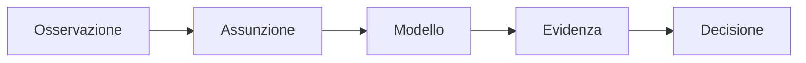

# Immanuel Kant: causalità come categoria dell'intelletto

Nel 1781, Kant pubblicò la *Critica della ragion pura* e fece una mossa filosofica che chiamò "rivoluzione copernicana". Invece di chiedersi "come fa la mente a conoscere la realtà?", Kant invertì la domanda: "come fa la realtà a essere conoscibile dalla mente?" La sua risposta sconvolgente fu che spazio, tempo e causalità non sono proprietà del mondo esterno, ma *categorie della mente umana* che imponiamo al mondo per renderlo comprensibile. Noi non "scopriamo" la causalità nei dati: la *proiettiamo* nei dati perché la nostra mente non può fare altrimenti. Per un analyst, questa idea è tanto destabilizzante quanto liberatoria.

## La rivoluzione copernicana di Kant

Prima di Kant, il dibattito era tra razionalisti (la conoscenza viene dalla ragione) ed empiristi (la conoscenza viene dall'esperienza). Kant propose una terza via: la conoscenza nasce dall'incontro tra esperienza e strutture mentali innate.

L'analogia: gli occhiali. Non puoi toglierli mai. Vedi il mondo *attraverso* quegli occhiali, e non puoi sapere com'è il mondo *senza* occhiali. Spazio, tempo e causalità sono le lenti dei tuoi occhiali mentali. Non sono "là fuori": sono "qui dentro", ma sono universali (tutti gli esseri umani li hanno).

**Implicazione per i dati:** quando guardi un grafico e "vedi" che X causa Y, non stai osservando una proprietà oggettiva del dataset. Stai applicando la categoria mentale della causalità ai dati. È inevitabile — non puoi non farlo. Ma saperlo cambia tutto.

## Cosa significa per l'analisi dati

### 1. La causalità è una scelta di framing, non un dato di fatto

Due analyst guardano lo stesso dataset: vendite di gelati e annegamenti. L'analyst A "vede" che i gelati causano annegamenti (assurdo, ma statisticamente supportato). L'analyst B "vede" che una terza variabile — il caldo — causa entrambi. Stessi dati, due strutture causali diverse. Kant direbbe: entrambi stanno imponendo una categoria causale ai dati. La differenza è che uno ha un modello migliore dell'altro.

### 2. Ogni modello è una "forma a priori" imposta ai dati

Un modello di regressione lineare, un albero decisionale, una rete neurale — sono tutte strutture che la tua mente (via matematica) impone ai dati. Nessuna è "naturale" o "oggettiva". Sono lenti diverse attraverso cui guardi lo stesso dataset. Scegliere il modello giusto è scegliere la lente giusta per il fenomeno — non trovare "la verità".

### 3. Non puoi non interpretare

Kant è il filosofo anti-"lascia parlare i dati". I dati non parlano mai da soli. Parlano solo attraverso le categorie con cui li interpreti. Un analyst che dice "stiamo solo riportando i dati" sta semplicemente usando categorie implicite (e probabilmente inconsapevoli) invece di esplicite. L'onestà intellettuale richiede di dichiarare le proprie categorie.

## Caso reale: l'algoritmo di COMPAS e il bias razziale

Nel 2016, ProPublica pubblicò un'inchiesta devastante sull'algoritmo COMPAS, usato nei tribunali americani per predire la probabilità di recidiva. L'algoritmo era "razzialmente neutro" — non usava la razza come variabile. Eppure produceva risultati discriminatori: i neri erano classificati come ad alto rischio il doppio delle volte rispetto ai bianchi, a parità di altri fattori.

Cosa era successo? L'algoritmo non "vedeva" la razza, ma "vedeva" proxy della razza: quartiere di residenza, livello di istruzione, storico lavorativo. La causalità che gli sviluppatori avevano imposto ai dati ("queste variabili predicono la recidiva") era in realtà una causalità sociale ("queste variabili sono correlate alla povertà, che è correlata alla criminalizzazione, che è correlata alla razza"). La categoria mentale kantiana era sbagliata, ma era invisibile agli sviluppatori perché non avevano mai messo in discussione la loro stessa lente.

La lezione kantiana: l'algoritmo non era "oggettivo". Era l'applicazione inconsapevole di una struttura causale socialmente costruita a dati che, senza quella struttura, non significavano nulla.

## Come applicare Kant al tuo lavoro

1. **Esplicita le tue categorie.** In ogni analisi, dichiara: "Sto assumendo che le seguenti variabili siano cause, e queste altre siano effetti. Sto usando questa struttura temporale. Sto ignorando queste altre possibili cause." Non rende l'analisi più debole: la rende falsificabile.

2. **Ruota le lenti.** Analizza lo stesso dataset con due modelli diversi. Una regressione lineare E un albero decisionale. Se le conclusioni divergono, non sei davanti a un "problema tecnico" ma a un "problema kantiano": le tue categorie stanno producendo realtà diverse.

3. **Chiedi: cosa non vedo?** Se la causalità è una lente, ogni lente ha un angolo morto. Cosa sta fuori dal tuo frame? Quali variabili non hai misurato?

---

*Riferimenti:*
- Kant, I. (1781/1787). *Critica della ragion pura.* (In particolare l'Estetica Trascendentale e l'Analitica Trascendentale.)
- Angwin, J. et al. (2016). "Machine Bias." *ProPublica.*
- Rohlf, M. (2020). "Immanuel Kant." *Stanford Encyclopedia of Philosophy.*

## Controllo di qualità

Prima di usare \"immanuel kant: causalità come categoria dell'intelletto\ in una decisione, controlla sempre completezza, duplicati, timezone, definizioni cambiate e segmenti esclusi. Molte analisi apparentemente sofisticate falliscono perché il dato di partenza misura un comportamento diverso da quello che il team crede di osservare.

## Interpretazione per segmenti

La media aggregata è solo il punto di partenza. Segmenta per canale, coorte, piano, paese, device e maturità dell'utente. Se due segmenti si muovono in direzioni opposte, la media non rappresenta nessuno dei due e può portare a una decisione sbagliata.

## Decisione operativa

Ogni analisi deve terminare con una scelta possibile: continuare, fermare, iterare, investire, rimuovere o approfondire. Se \"immanuel kant: causalità come categoria dell'intelletto\ non cambia una decisione, probabilmente manca ancora il collegamento tra metrica e azione.

## Problema reale

Nel lavoro su fondamenti filosofici dell'analisi dati, **Immanuel Kant: causalità come categoria dell'intelletto** serve a risolvere un problema concreto: capire quando un dato sostiene davvero una decisione e quando invece nasconde assunzioni, bias, causalita fragile o una domanda formulata male. La domanda non e se il concetto sia interessante in astratto, ma quale decisione migliora quando lo applichi con dati affidabili e con una soglia di errore esplicita.

Questa lezione va studiata come uno strumento operativo: entro la fine devi saper Comprendere il problema analitico e il contesto decisionale; Applicare esempi, metriche e controlli a casi reali. Se non riesci a collegare il concetto a una scelta reale, la conoscenza resta decorativa e non diventa competenza.

## Modello concettuale

Il modello mentale e sequenziale: prima si formula la domanda, poi si traduce in unita osservabili, quindi si valuta la qualita del dato e solo alla fine si decide. Saltare un passaggio produce analisi eleganti ma fragili.

| Passaggio | Domanda guida | Output atteso |
|---|---|---|
| Framing | Quale decisione deve cambiare? | Una scelta concreta, non una curiosita |
| Misura | Quale segnale rappresenta il fenomeno? | Metrica, fonte e granularita |
| Confronto | Rispetto a quale baseline interpreto il risultato? | Benchmark o controfattuale plausibile |
| Azione | Che cosa faccio se il segnale supera la soglia? | Decisione, owner e prossimo controllo |

## Formalizzazione rigorosa

Formalizza **Immanuel Kant: causalità come categoria dell'intelletto** come una relazione tra quattro elementi: unita di analisi, segnale, baseline e decisione. Nel contesto di questa lezione l'unita principale e **osservazione, ipotesi, variabile, meccanismo causale o criterio di evidenza**. Il segnale da osservare deve essere collegato a **forza dell evidenza, coerenza causale, robustezza delle assunzioni e costo dell errore decisionale**, mentre la baseline deve essere scelta tra **spiegazione alternativa, controfattuale, gruppo comparabile o scenario senza intervento**.

Una formulazione robusta segue questa logica:

| Elemento | Definizione operativa per questa lezione |
|---|---|
| Unita | osservazione, ipotesi, variabile, meccanismo causale o criterio di evidenza |
| Segnale | forza dell evidenza, coerenza causale, robustezza delle assunzioni e costo dell errore decisionale |
| Baseline | spiegazione alternativa, controfattuale, gruppo comparabile o scenario senza intervento |
| Decisione | accettare, rifiutare o riformulare una spiegazione prima di usarla in un contesto aziendale |
| Rischio | Confondere correlazione, qualita del dato e causalita decisionale |

La regola pratica e semplice: una misura e utile solo se riduce l'incertezza su una decisione specifica. Se non cambia una scelta, e documentazione; se cambia una scelta senza controlli, e rischio.

## Esempio o caso studio

Un comitato interpreta una crescita di retention come prova che una nuova iniziativa abbia funzionato. La lezione costringe a distinguere osservazione, spiegazione, assunzione e decisione prima di trasformare il dato in azione.

Applicando **Immanuel Kant: causalità come categoria dell'intelletto**, il team costruisce una lettura in tre colonne: cosa sappiamo, cosa assumiamo e quale decisione prendiamo. Questo formato impedisce di presentare un numero come se fosse una conclusione autosufficiente.

| Evidenza | Interpretazione prudente | Decisione conseguente |
|---|---|---|
| Segnale positivo ma non isolato | Il fenomeno esiste, ma la causa e ancora incerta | Cercare baseline o holdout |
| Segmento con risposta diversa | L'effetto medio nasconde eterogeneita | Analizzare coorti o sottogruppi |
| Costo operativo crescente | Il risultato va valutato sul margine | Applicare soglie economiche |

## Lab / esercizio

### Livello base

Prendi una decisione reale collegata a **Immanuel Kant: causalità come categoria dell'intelletto** e scrivi in cinque righe: obiettivo, metrica primaria, baseline, rischio principale e azione prevista. Non usare piu di una metrica primaria.

### Livello intermedio

Costruisci una tabella con almeno tre segmenti o scenari. Per ciascuno indica segnale, possibile spiegazione alternativa e controllo necessario prima di decidere.

### Livello research-grade

Disegna un piano di validazione: ipotesi, dati necessari, criterio di esclusione, soglia decisionale e controllo post-decisione. Specifica anche che cosa ti farebbe cambiare idea.

### Dataset e materiali consigliati

Usa case study decisionali, metriche prodotto, risultati di esperimenti, DAG semplici, report analitici e serie storiche simulate. Se non hai dati reali, crea un dataset sintetico con 200-500 righe e almeno una colonna temporale, una colonna segmento, una metrica di outcome e una variabile di esposizione.

## Errore tipico da evitare

L'errore piu frequente e trattare **Immanuel Kant: causalità come categoria dell'intelletto** come una definizione da ricordare invece che come un protocollo decisionale. In pratica succede quando si presenta una metrica senza baseline, un grafico senza ipotesi, o una raccomandazione senza costo dell'errore.

Un controllo utile e chiedersi: "se questo risultato fosse falso o instabile, quale decisione sbaglierei?". Se la risposta non e chiara, la lezione non e ancora stata applicata davvero.

## Quiz o checkpoint

1. Qual e la decisione concreta che questa lezione dovrebbe migliorare?
2. Quale baseline rende interpretabile il risultato?
3. Quale assunzione, se sbagliata, cambierebbe la conclusione?
4. Quale controllo minimo useresti prima di presentare la raccomandazione?

## Riepilogo operativo

**Immanuel Kant: causalità come categoria dell'intelletto** e una competenza utile quando collega concetto, dato e decisione. Studiala partendo da un problema reale, formalizza il segnale, cerca una baseline credibile, costruisci un esempio e chiudi con un controllo pratico. Categoria: Fondamenti. Difficolta: advanced. Tempo stimato: 18 min.
