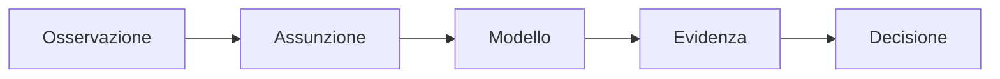

# Immanuel Kant: causalità come categoria dell'intelletto

Kant entra nel percorso come promemoria metodologico: i dati non parlano mai da soli, perche vengono letti attraverso categorie, ipotesi e forme di giudizio. Per decidere bene, bisogna rendere visibile quel filtro prima di trattare una relazione come causale.

## Problema reale

Nel lavoro sui fondamenti filosofici dell'analisi dati, il concetto di causalità come categoria dell'intelletto di Immanuel Kant aiuta a risolvere un problema cruciale: capire quando un dato sostiene davvero una decisione e quando invece nasconde assunzioni implicite, bias o una domanda formulata male. Non basta osservare correlazioni o pattern nei dati; bisogna riconoscere che ogni interpretazione è filtrata da categorie mentali che strutturano la nostra percezione e comprensione. La sfida è trasformare questa consapevolezza in uno strumento operativo che migliori le scelte basate sui dati.

## Modello concettuale

Questo modello sequenziale ricorda che l'analisi dati non è un processo lineare che parte dai dati per arrivare a una verità oggettiva. Prima si formula la domanda, poi si definiscono le unità osservabili, si valuta la qualità del dato e solo alla fine si decide. Saltare uno di questi passaggi produce analisi apparentemente sofisticate ma fragili.

| Passaggio | Domanda guida | Output atteso |
|---|---|---|
| Framing | Quale decisione deve cambiare? | Una scelta concreta, non una curiosità |
| Misura | Quale segnale rappresenta il fenomeno? | Metrica, fonte e granularità |
| Confronto | Rispetto a quale baseline interpreto il risultato? | Benchmark o controfattuale plausibile |
| Azione | Che cosa faccio se il segnale supera la soglia? | Decisione, owner e prossimo controllo |

## Formalizzazione rigorosa

Formalizziamo la causalità kantiana come una relazione tra quattro elementi chiave:

| Elemento | Definizione operativa |
|---|---|
| Unità | osservazione, ipotesi, variabile, meccanismo causale o criterio di evidenza |
| Segnale | forza dell'evidenza, coerenza causale, robustezza delle assunzioni, costo dell'errore decisionale |
| Baseline | spiegazione alternativa, controfattuale, gruppo comparabile o scenario senza intervento |
| Decisione | accettare, rifiutare o riformulare una spiegazione prima di usarla |

La regola pratica è semplice: una misura è utile solo se riduce l'incertezza su una decisione specifica. Se non cambia una scelta, è documentazione; se cambia una scelta senza controlli, è rischio.

## Esempio o caso studio

Considera un comitato che interpreta una crescita della retention come prova del successo di una nuova iniziativa. Applicando la lente kantiana, il team distingue chiaramente tra osservazione, spiegazione, assunzione e decisione, evitando di trasformare un dato isolato in una conclusione autosufficiente.

| Evidenza | Interpretazione prudente | Decisione conseguente |
|---|---|---|
| Segnale positivo ma non isolato | Il fenomeno esiste, ma la causa è incerta | Cercare baseline o holdout |
| Segmento con risposta diversa | L'effetto medio nasconde eterogeneità | Analizzare coorti o sottogruppi |
| Costo operativo crescente | Il risultato va valutato sul margine | Applicare soglie economiche |

## Lab / esercizio

### Livello base

Scrivi in cinque righe una decisione reale collegata a questa lezione: obiettivo, metrica primaria, baseline, rischio principale e azione prevista. Usa una sola metrica primaria.

### Livello intermedio

Costruisci una tabella con almeno tre segmenti o scenari. Per ciascuno indica segnale, possibile spiegazione alternativa e controllo necessario prima di decidere.

### Livello research-grade

Progetta un piano di validazione: ipotesi, dati necessari, criterio di esclusione, soglia decisionale e controllo post-decisione. Specifica cosa ti farebbe cambiare idea.

### Dataset e materiali consigliati

Utilizza case study decisionali, metriche prodotto, risultati di esperimenti, DAG semplici, report analitici e serie storiche simulate. Se non hai dati reali, crea un dataset sintetico con almeno 200-500 righe, una colonna temporale, una colonna segmento, una metrica di outcome e una variabile di esposizione.

## Errore tipico da evitare

Il rischio più comune è trattare la causalità kantiana come una definizione astratta da ricordare, anziché come un protocollo decisionale. Succede quando si presenta una metrica senza baseline, un grafico senza ipotesi o una raccomandazione senza valutazione del costo dell'errore. Un controllo utile è chiedersi: "Se questo risultato fosse falso o instabile, quale decisione sbaglierei?" Se la risposta non è chiara, la lezione non è stata applicata davvero.

## Quiz o checkpoint

1. Qual è la decisione concreta che questa lezione dovrebbe migliorare?
2. Quale baseline rende interpretabile il risultato?
3. Quale assunzione, se sbagliata, cambierebbe la conclusione?
4. Quale controllo minimo useresti prima di presentare la raccomandazione?

## Riepilogo operativo

La causalità come categoria dell'intelletto di Kant è una competenza fondamentale per collegare concetto, dato e decisione. Studiala partendo da un problema reale, formalizza il segnale, cerca una baseline credibile, costruisci un esempio e chiudi con un controllo pratico. Solo così la conoscenza filosofica diventa uno strumento per prendere decisioni migliori sotto incertezza.

---

## Contesto e riflessioni

Kant ci ricorda che non incontriamo i dati "puri": li organizziamo sempre attraverso categorie mentali come spazio, tempo e causalità. Queste categorie non sono proprietà oggettive del mondo, ma lenti universali attraverso cui interpretiamo ogni fenomeno. Nel lavoro con i dati, questo significa che ogni modello, ogni pattern, ogni relazione causale è una costruzione mentale, una scelta di framing. 

Per esempio, due analisti possono vedere lo stesso dataset e trarre conclusioni causalmente opposte. Questo non è un errore tecnico, ma un problema epistemologico: quale lente applicare? Sapere questo cambia tutto: non si tratta di trovare la verità assoluta, ma di scegliere consapevolmente la lente più adatta al contesto e agli obiettivi decisionali.

## Caso reale: l'algoritmo COMPAS

Nel 2016, l'inchiesta di ProPublica sul sistema COMPAS ha mostrato come un algoritmo apparentemente neutro potesse produrre discriminazioni razziali. L'algoritmo non usava la variabile razza, ma proxy come quartiere o livello di istruzione. La causalità che gli sviluppatori avevano imposto ai dati era in realtà una causalità sociale, invisibile perché mai messa in discussione. Questo è un classico esempio di come la lente kantiana, se non esplicitata, può nascondere bias profondi e rischi decisionali.

## Come applicare Kant al tuo lavoro

1. Esplicita sempre le tue categorie e assunzioni.
2. Confronta modelli diversi per ruotare le lenti interpretative.
3. Chiediti cosa non stai vedendo, quali variabili o fattori sono fuori dal frame.
4. Controlla sempre la qualità e la coerenza del dato prima di prendere decisioni.

Solo così la disciplina di prendere decisioni sotto incertezza diventa una pratica consapevole e robusta.
