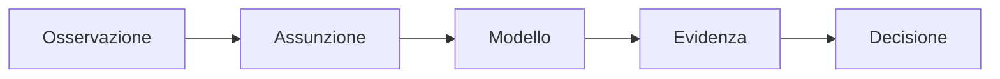

# Immanuel Kant: causalità come categoria dell'intelletto

Kant serve qui come promemoria di metodo. I dati non parlano mai da soli, perche li leggiamo sempre attraverso categorie, ipotesi e forme di giudizio. Per decidere bene devi rendere visibile quel filtro prima di trattare una relazione come causale, altrimenti scambi una tua scelta interpretativa per una proprietà del mondo.

## Problema reale

L'idea kantiana della causalità come categoria dell'intelletto aiuta a risolvere un problema preciso: capire quando un dato sostiene davvero una decisione e quando invece nasconde assunzioni implicite, un bias o una domanda formulata male. Osservare correlazioni e pattern non basta. Ogni interpretazione passa attraverso categorie mentali che strutturano cosa vediamo, e il punto è trasformare questa consapevolezza in uno strumento concreto che migliori le scelte sui dati.

## Modello concettuale



Questo modello ricorda che l'analisi dati non parte dai numeri per arrivare a una verità oggettiva. Prima si formula la domanda, poi si definiscono le unità osservabili, si valuta la qualità del dato e solo alla fine si decide. Quando si salta uno di questi passaggi si ottengono analisi che sembrano sofisticate ma sono fragili.

| Passaggio | Domanda guida | Output atteso |
|---|---|---|
| Framing | Quale decisione deve cambiare? | Una scelta concreta, non una curiosità |
| Misura | Quale segnale rappresenta il fenomeno? | Metrica, fonte e granularità |
| Confronto | Rispetto a quale baseline interpreto il risultato? | Benchmark o controfattuale plausibile |
| Azione | Che cosa faccio se il segnale supera la soglia? | Decisione, owner e prossimo controllo |

## Quattro elementi della causalità kantiana

La causalità kantiana si può leggere come una relazione tra quattro elementi:

| Elemento | Definizione operativa |
|---|---|
| Unità | osservazione, ipotesi, variabile, meccanismo causale o criterio di evidenza |
| Segnale | forza dell'evidenza, coerenza causale, robustezza delle assunzioni, costo dell'errore decisionale |
| Baseline | spiegazione alternativa, controfattuale, gruppo comparabile o scenario senza intervento |
| Decisione | accettare, rifiutare o riformulare una spiegazione prima di usarla |

La regola pratica è semplice: una misura serve a qualcosa solo se riduce l'incertezza su una decisione precisa. Se non cambia una scelta resta documentazione. Se cambia una scelta senza controlli a monte, diventa rischio.

## Esempio o caso studio

Prendi un comitato che legge una crescita della retention come prova del successo di una nuova iniziativa. Con la lente kantiana il team tiene separati osservazione, spiegazione, assunzione e decisione, così evita di trasformare un dato isolato in una conclusione che si regge da sola.

| Evidenza | Interpretazione prudente | Decisione conseguente |
|---|---|---|
| Segnale positivo ma non isolato | Il fenomeno esiste, ma la causa è incerta | Cercare baseline o holdout |
| Segmento con risposta diversa | L'effetto medio nasconde eterogeneità | Analizzare coorti o sottogruppi |
| Costo operativo crescente | Il risultato va valutato sul margine | Applicare soglie economiche |

## Lab / esercizio

### Livello base

Scrivi in cinque righe una decisione reale collegata a questa lezione: obiettivo, metrica primaria, baseline, rischio principale e azione prevista. Usa una sola metrica primaria.

### Livello intermedio

Costruisci una tabella con almeno tre segmenti o scenari. Per ciascuno indica segnale, possibile spiegazione alternativa e controllo necessario prima di decidere.

### Livello research-grade

Progetta un piano di validazione: ipotesi, dati necessari, criterio di esclusione, soglia decisionale e controllo post-decisione. Specifica cosa ti farebbe cambiare idea.

### Dataset e materiali consigliati

Usa case study decisionali, metriche prodotto, risultati di esperimenti, DAG semplici, report analitici e serie storiche simulate. Se non hai dati reali, crea un dataset sintetico con almeno 200-500 righe, una colonna temporale, una colonna segmento, una metrica di outcome e una variabile di esposizione.

## Errore tipico da evitare

Il rischio più comune è trattare la causalità kantiana come una definizione da ricordare invece che come un protocollo decisionale. Capita quando si presenta una metrica senza baseline, un grafico senza ipotesi o una raccomandazione senza stimare il costo dell'errore. Il controllo che conviene farsi è questo: se questo risultato fosse falso o instabile, quale decisione sbaglierei? Se la risposta non è chiara, la lezione è rimasta sulla carta.

## Quiz o checkpoint

1. Qual è la decisione concreta che questa lezione dovrebbe migliorare?
2. Quale baseline rende interpretabile il risultato?
3. Quale assunzione, se sbagliata, cambierebbe la conclusione?
4. Quale controllo minimo useresti prima di presentare la raccomandazione?

## Perche le categorie contano nei dati

Kant ci ricorda che non incontriamo mai i dati "puri": li organizziamo sempre attraverso categorie mentali come spazio, tempo e causalità. Queste categorie non sono proprietà del mondo, sono le lenti con cui leggiamo ogni fenomeno. Sui dati questo vuol dire che ogni modello, ogni pattern, ogni relazione causale che vedi è in parte una tua costruzione, una scelta di framing.

Due analisti possono guardare lo stesso dataset e arrivare a conclusioni causali opposte. Non è un errore tecnico ma una questione epistemologica: quale lente stai applicando? Saperlo sposta l'obiettivo. Non cerchi la verità assoluta, scegli con cognizione di causa la lente più adatta al contesto e a cosa devi decidere.

## Caso reale: l'algoritmo COMPAS

Nel 2016 l'inchiesta di ProPublica sul sistema COMPAS ha mostrato come un algoritmo all'apparenza neutro potesse produrre discriminazioni razziali. Il modello non usava la variabile razza, ma proxy come quartiere o livello di istruzione. La causalità che gli sviluppatori avevano imposto ai dati era in realtà una causalità sociale, invisibile proprio perche nessuno l'aveva mai messa in discussione. È il caso da manuale di una lente kantiana lasciata implicita che finisce per nascondere un bias e un rischio decisionale.

## Come applicare Kant al tuo lavoro

Rendi esplicite le tue categorie e le tue assunzioni invece di darle per scontate. Confronta modelli diversi per ruotare le lenti interpretative e vedere cosa cambia. Chiediti cosa non stai vedendo, quali variabili restano fuori dal frame. E controlla la qualità e la coerenza del dato prima di decidere qualunque cosa.

## Riepilogo operativo

La causalità come categoria dell'intelletto serve per collegare concetto, dato e decisione. Si parte da un problema reale, si formalizza il segnale, si cerca una baseline credibile, si costruisce un esempio e si chiude con un controllo pratico. Quando lavori così, la filosofia smette di essere decorativa e diventa un modo per decidere meglio sotto incertezza.

## Formalizzazione rigorosa

```sql
-- TODO: aggiungi la formalizzazione specifica per Immanuel Kant: causalità come categoria dell'intelletto
-- Pattern per avanzato:

SELECT
    /* indica qui la tua metrica principale */
FROM
    /* indica qui la sorgente dati */
WHERE
    /* indica qui i filtri */
GROUP BY
    /* indica qui le dimensioni di raggruppamento */
```

**Principio guida:** verifica sempre che la somma delle parti sia uguale al totale.