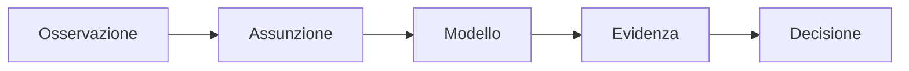

# Indice: fondamenti filosofici dell'analisi dei dati

Prima ancora di aprire un notebook o un dashboard, l'analista porta con sé idee implicite su evidenza, causa, misura, incertezza e responsabilità. Se restano implicite guidano comunque il lavoro, ma senza alcun controllo critico, e fanno crescere il rischio di sbagliare le decisioni.

Questo modulo è una cassetta degli attrezzi mentale. Organizza un percorso per affrontare il mestiere di decidere sotto incertezza e aiuta a riconoscere quando un dato sostiene davvero una scelta e quando invece nasconde assunzioni fragili o un bias.

## Problema reale

Nel lavoro quotidiano il problema non è raccogliere numeri ma capire quando quei numeri servono davvero a decidere meglio. Un dato che sembra solido spesso nasconde assunzioni mai verificate, una causalità incerta o un'interpretazione sbagliata. Questa lezione serve a trasformare la filosofia in uno strumento concreto che collega concetto, dato e scelta, così che la conoscenza non resti decorativa.

## Modello concettuale



Il processo parte da una domanda ben formulata, la traduce in unità osservabili, valuta la qualità del dato e solo alla fine arriva a una decisione. Quando si saltano passaggi le analisi diventano fragili e rischiose.

| Passaggio | Domanda guida | Output atteso |
|---|---|---|
| Framing | Quale decisione deve cambiare? | Una scelta concreta, non una curiosità |
| Misura | Quale segnale rappresenta il fenomeno? | Metrica, fonte e granularità |
| Confronto | Rispetto a quale baseline interpreto il risultato? | Benchmark o controfattuale plausibile |
| Azione | Che cosa faccio se il segnale supera la soglia? | Decisione, responsabile e prossimo controllo |

## Quattro elementi del metodo

Il percorso si regge su quattro elementi:

| Elemento | Definizione operativa |
|---|---|
| Unità | Osservazione, ipotesi, variabile, meccanismo causale o criterio di evidenza |
| Segnale | Forza dell'evidenza, coerenza causale, robustezza delle assunzioni, costo dell'errore decisionale |
| Baseline | Spiegazione alternativa, controfattuale, gruppo comparabile o scenario senza intervento |
| Decisione | Accettare, rifiutare o riformulare una spiegazione prima di usarla in azienda |

La regola pratica è semplice: una misura serve a qualcosa solo se riduce l'incertezza su una decisione precisa. Se non cambia una scelta resta documentazione. Se cambia una scelta senza controlli a monte, diventa rischio.

## Esempio o caso studio

Un comitato legge una crescita della retention come prova del successo di una nuova iniziativa. Usando questo metodo, il team tiene separate osservazione, assunzione e decisione:

| Evidenza | Interpretazione prudente | Decisione conseguente |
|---|---|---|
| Segnale positivo ma non isolato | Il fenomeno esiste, ma la causa è incerta | Cercare baseline o gruppo di controllo |
| Segmento con risposta diversa | L'effetto medio nasconde eterogeneità | Analizzare coorti o sottogruppi |
| Costo operativo crescente | Valutare il risultato sul margine economico | Applicare soglie di costo-beneficio |

Così nessun numero passa per conclusione definitiva, e si resta su un terreno critico e responsabile.

## Lab / esercizio

### Livello base

Scrivi in cinque righe una decisione reale collegata all'indice: obiettivo, metrica primaria, baseline, rischio principale e azione prevista. Usa una sola metrica primaria.

### Livello intermedio

Costruisci una tabella con almeno tre segmenti o scenari. Per ciascuno indica segnale, possibile spiegazione alternativa e controllo necessario prima di decidere.

### Livello research-grade

Disegna un piano di validazione: ipotesi, dati necessari, criteri di esclusione, soglia decisionale e controllo post-decisione. Specifica cosa ti farebbe cambiare idea.

### Dataset e materiali consigliati

Utilizza case study decisionali, metriche prodotto, risultati di esperimenti, DAG semplici, report analitici e serie storiche simulate. Se non hai dati reali, crea un dataset sintetico con almeno 200 righe, includendo una colonna temporale, una di segmento, una metrica di outcome e una variabile di esposizione.

## Errore tipico da evitare

Il più comune è trattare questo metodo come una definizione da memorizzare invece che come un protocollo decisionale. Capita quando si presenta una metrica senza baseline, un grafico senza ipotesi o una raccomandazione senza considerare il costo dell'errore.

Il controllo che conviene farsi è questo: se questo risultato fosse falso o instabile, quale decisione sbaglierei? Se non c'è una risposta chiara, la lezione è rimasta sulla carta.

## Quiz o checkpoint

1. Qual è la decisione concreta che questa lezione dovrebbe migliorare?
2. Quale baseline rende interpretabile il risultato?
3. Quale assunzione, se errata, cambierebbe la conclusione?
4. Quale controllo minimo useresti prima di presentare la raccomandazione?

## Riepilogo operativo

Questo modulo serve a collegare concetto, dato e decisione in modo rigoroso e responsabile. Si parte da un problema reale, si formalizza il segnale, si cerca una baseline credibile, si costruisce un esempio e si chiude con un controllo pratico. Quando lavori così, la filosofia diventa uno strumento per decidere meglio sotto incertezza.

Categoria: Indice. Difficoltà: advanced. Tempo stimato: 5 minuti.

## Formalizzazione rigorosa

```sql
-- TODO: aggiungi la formalizzazione specifica per Indice — Fondamenti filosofici dell'analisi dei dati
-- Pattern per avanzato:

SELECT
    /* indica qui la tua metrica principale */
FROM
    /* indica qui la sorgente dati */
WHERE
    /* indica qui i filtri */
GROUP BY
    /* indica qui le dimensioni di raggruppamento */
```

**Principio guida:** verifica sempre che la somma delle parti sia uguale al totale.