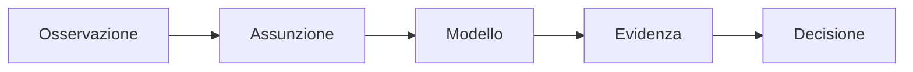

# Indice — Fondamenti filosofici dell'analisi dei dati

Questo modulo non è un corso di storia della filosofia. È una cassetta degli attrezzi concettuale per l'analista che vuole capire *perché* i dati a volte mentono, *quando* un modello è davvero evidenza, e *come* evitare di essere la persona che presenta numeri corretti ma conclusioni sbagliate.

Ogni lezione segue lo stesso schema: un problema reale di analisi dati → il concetto filosofico che lo illumina → un caso applicato → uno strumento pratico da portare a casa.

## Mappa delle lezioni

| # | Lezione | Filosofo/Concetto | Domanda chiave |
|---|---------|-------------------|----------------|
| 1 | Che cosa conta come evidenza | Introduzione | Perché a un analista serve la filosofia? |
| 2 | Aristotele e le quattro cause | Aristotele | *Perché* succede quello che vedo nei dati? |
| 3 | Esperienza, abitudine e scetticismo | David Hume | Posso davvero fidarmi dell'induzione? |
| 4 | Induzione e idoli della mente | Francis Bacon | Quali bias distorcono la mia lettura dei dati? |
| 5 | Causalità come categoria dell'intelletto | Immanuel Kant | La causalità è nei dati o nella mia mente? |
| 6 | Falsificabilità e sperimentazione | Karl Popper | Come progetto un test che può davvero smentirmi? |
| 7 | Paradigmi scientifici e cultura del dato | Thomas Kuhn | Perché la mia azienda crede a metriche sbagliate? |
| 8 | Judea Pearl, DAG e rivoluzione causale | Judea Pearl | Come passo da "correlato" a "causato da"? |
| 9 | Frequentismo vs bayesianismo | Statistica filosofica | Due modi opposti di leggere l'incertezza |
| 10 | Epistemologia dei dati | Teoria della conoscenza | Cosa posso davvero sapere dai miei dati? |
| 11 | Etica degli algoritmi e responsabilità analitica | Etica applicata | Cosa *devo* fare con quello che so? |
| 12 | Correlazione, causalità e controfattuali | Causalità | Perché "correlazione non è causalità" non basta |
| 13 | Modelli, assunzioni e misspecification | Filosofia della modellazione | Cosa assumo senza saperlo quando costruisco un modello? |
| 14 | Measurement theory: cosa significa misurare bene | Teoria della misurazione | Sto davvero misurando quello che penso di misurare? |
| 15 | Simpson's paradox e confounding | Statistica filosofica | Perché i dati aggregati e quelli disaggregati raccontano storie opposte |
| 16 | Come leggere criticamente dashboard e report | Critical thinking | Checklist per non farti ingannare dai numeri |
| 17 | Metodo scientifico applicato al lavoro sui dati | Filosofia della scienza | Come applico il metodo scientifico alle dashboard? |
| 18 | Incertezza, rischio e ignoranza | Epistemologia | Cosa so di non sapere? |
| 19 | Dalla causalità classica al futuro dell'analisi | Sintesi | Dove sta andando l'analisi dei dati? |
| 20 | Caso studio: pensiero filosofico e business decision | Laboratorio | Applicare tutto il modulo a un caso reale |

## Come usare questo modulo

Non serve leggere tutto in ordine. Se hai un problema concreto, vai direttamente alla lezione che lo affronta:

- *"Il mio modello ha R² alto ma fallisce in produzione"* → Lezione 13 (Modelli e misspecification)
- *"Due team hanno dashboard con numeri diversi per la stessa metrica"* → Lezione 15 (Simpson's paradox)
- *"Devo decidere se un A/B test è conclusivo"* → Lezione 6 (Popper) + Lezione 8 (Pearl)
- *"Il mio capo vuole un numero ma io so che è fuorviante"* → Lezione 11 (Etica) + Lezione 16 (Critical thinking)
- *"Voglio capire perché certi insight vengono ignorati in azienda"* → Lezione 7 (Kuhn)

## Controllo di qualità

Prima di usare indice — fondamenti filosofici dell''analisi dei dati in una decisione, controlla sempre completezza, duplicati, timezone, definizioni cambiate e segmenti esclusi. Molte analisi apparentemente sofisticate falliscono perché il dato di partenza misura un comportamento diverso da quello che il team crede di osservare.

## Interpretazione per segmenti

La media aggregata è solo il punto di partenza. Segmenta per canale, coorte, piano, paese, device e maturità dell'utente. Se due segmenti si muovono in direzioni opposte, la media non rappresenta nessuno dei due e può portare a una decisione sbagliata.

## Decisione operativa

Ogni analisi deve terminare con una scelta possibile: continuare, fermare, iterare, investire, rimuovere o approfondire. Se indice — fondamenti filosofici dell''analisi dei dati non cambia una decisione, probabilmente manca ancora il collegamento tra metrica e azione.

## Metriche di verifica

Dopo l'intervento, definisci una metrica primaria e due guardrail. La metrica primaria misura il miglioramento atteso; le guardrail impediscono di ottenere quel miglioramento distruggendo retention, fiducia, qualità del dato o sostenibilità operativa.

## Rischi e assunzioni

Le assunzioni vanno scritte prima di guardare il risultato finale. Quale comportamento deve cambiare? In quale segmento? In quale finestra temporale? Quale spiegazione alternativa potrebbe produrre lo stesso pattern? Questo rende l'analisi falsificabile.

## Problema reale

Nel lavoro su fondamenti filosofici dell'analisi dati, **Indice — Fondamenti filosofici dell'analisi dei dati** serve a risolvere un problema concreto: capire quando un dato sostiene davvero una decisione e quando invece nasconde assunzioni, bias, causalita fragile o una domanda formulata male. La domanda non e se il concetto sia interessante in astratto, ma quale decisione migliora quando lo applichi con dati affidabili e con una soglia di errore esplicita.

Questa lezione va studiata come uno strumento operativo: entro la fine devi saper Comprendere il problema analitico e il contesto decisionale; Applicare esempi, metriche e controlli a casi reali. Se non riesci a collegare il concetto a una scelta reale, la conoscenza resta decorativa e non diventa competenza.

## Modello concettuale

Il modello mentale e sequenziale: prima si formula la domanda, poi si traduce in unita osservabili, quindi si valuta la qualita del dato e solo alla fine si decide. Saltare un passaggio produce analisi eleganti ma fragili.

| Passaggio | Domanda guida | Output atteso |
|---|---|---|
| Framing | Quale decisione deve cambiare? | Una scelta concreta, non una curiosita |
| Misura | Quale segnale rappresenta il fenomeno? | Metrica, fonte e granularita |
| Confronto | Rispetto a quale baseline interpreto il risultato? | Benchmark o controfattuale plausibile |
| Azione | Che cosa faccio se il segnale supera la soglia? | Decisione, owner e prossimo controllo |

## Formalizzazione rigorosa

Formalizza **Indice — Fondamenti filosofici dell'analisi dei dati** come una relazione tra quattro elementi: unita di analisi, segnale, baseline e decisione. Nel contesto di questa lezione l'unita principale e **osservazione, ipotesi, variabile, meccanismo causale o criterio di evidenza**. Il segnale da osservare deve essere collegato a **forza dell evidenza, coerenza causale, robustezza delle assunzioni e costo dell errore decisionale**, mentre la baseline deve essere scelta tra **spiegazione alternativa, controfattuale, gruppo comparabile o scenario senza intervento**.

Una formulazione robusta segue questa logica:

| Elemento | Definizione operativa per questa lezione |
|---|---|
| Unita | osservazione, ipotesi, variabile, meccanismo causale o criterio di evidenza |
| Segnale | forza dell evidenza, coerenza causale, robustezza delle assunzioni e costo dell errore decisionale |
| Baseline | spiegazione alternativa, controfattuale, gruppo comparabile o scenario senza intervento |
| Decisione | accettare, rifiutare o riformulare una spiegazione prima di usarla in un contesto aziendale |
| Rischio | Confondere correlazione, qualita del dato e causalita decisionale |

La regola pratica e semplice: una misura e utile solo se riduce l'incertezza su una decisione specifica. Se non cambia una scelta, e documentazione; se cambia una scelta senza controlli, e rischio.

## Esempio o caso studio

Un comitato interpreta una crescita di retention come prova che una nuova iniziativa abbia funzionato. La lezione costringe a distinguere osservazione, spiegazione, assunzione e decisione prima di trasformare il dato in azione.

Applicando **Indice — Fondamenti filosofici dell'analisi dei dati**, il team costruisce una lettura in tre colonne: cosa sappiamo, cosa assumiamo e quale decisione prendiamo. Questo formato impedisce di presentare un numero come se fosse una conclusione autosufficiente.

| Evidenza | Interpretazione prudente | Decisione conseguente |
|---|---|---|
| Segnale positivo ma non isolato | Il fenomeno esiste, ma la causa e ancora incerta | Cercare baseline o holdout |
| Segmento con risposta diversa | L'effetto medio nasconde eterogeneita | Analizzare coorti o sottogruppi |
| Costo operativo crescente | Il risultato va valutato sul margine | Applicare soglie economiche |

## Lab / esercizio

### Livello base

Prendi una decisione reale collegata a **Indice — Fondamenti filosofici dell'analisi dei dati** e scrivi in cinque righe: obiettivo, metrica primaria, baseline, rischio principale e azione prevista. Non usare piu di una metrica primaria.

### Livello intermedio

Costruisci una tabella con almeno tre segmenti o scenari. Per ciascuno indica segnale, possibile spiegazione alternativa e controllo necessario prima di decidere.

### Livello research-grade

Disegna un piano di validazione: ipotesi, dati necessari, criterio di esclusione, soglia decisionale e controllo post-decisione. Specifica anche che cosa ti farebbe cambiare idea.

### Dataset e materiali consigliati

Usa case study decisionali, metriche prodotto, risultati di esperimenti, DAG semplici, report analitici e serie storiche simulate. Se non hai dati reali, crea un dataset sintetico con 200-500 righe e almeno una colonna temporale, una colonna segmento, una metrica di outcome e una variabile di esposizione.

## Errore tipico da evitare

L'errore piu frequente e trattare **Indice — Fondamenti filosofici dell'analisi dei dati** come una definizione da ricordare invece che come un protocollo decisionale. In pratica succede quando si presenta una metrica senza baseline, un grafico senza ipotesi, o una raccomandazione senza costo dell'errore.

Un controllo utile e chiedersi: "se questo risultato fosse falso o instabile, quale decisione sbaglierei?". Se la risposta non e chiara, la lezione non e ancora stata applicata davvero.

## Quiz o checkpoint

1. Qual e la decisione concreta che questa lezione dovrebbe migliorare?
2. Quale baseline rende interpretabile il risultato?
3. Quale assunzione, se sbagliata, cambierebbe la conclusione?
4. Quale controllo minimo useresti prima di presentare la raccomandazione?

## Riepilogo operativo

**Indice — Fondamenti filosofici dell'analisi dei dati** e una competenza utile quando collega concetto, dato e decisione. Studiala partendo da un problema reale, formalizza il segnale, cerca una baseline credibile, costruisci un esempio e chiudi con un controllo pratico. Categoria: Indice. Difficolta: advanced. Tempo stimato: 5 min.
