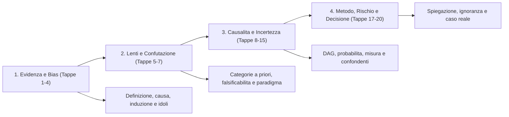

Immagina uno scenario costruito ma quotidiano per chi lavora su tabelle e dashboard: un team prodotto gestisce una piattaforma con 85.000 clienti attivi, osserva un calo delle conversioni settimanali del 2,4% e in quarantotto ore propone tre spiegazioni incompatibili tra loro, tutte sostenute dallo stesso export CSV. Il reparto vendite invoca un cambio di prezzi, il marketing punta il dito sul traffico mobile e l'area tecnica sospetta un aggiornamento recente del checkout. Nessuno ha sbagliato una query SQL, eppure la riunione si blocca perché mancano i criteri condivisi su cosa renda un numero una prova.

Prima ancora di aprire un notebook o impostare un grafico, l'analista porta con sé assunzioni silenziose su evidenza, causalità, misura, probabilità e responsabilità. Se queste assunzioni restano implicite, continuano comunque a guidare le scelte ma senza alcuna verifica critica; renderle esplicite trasforma il pensiero filosofico in una cassetta degli attrezzi di controllo prima che un grafico orienti budget, modelli o prodotto.

> **Idea chiave:** Una misura serve a qualcosa soltanto se riduce l'incertezza su una decisione precisa con soglia di errore e controllo di distorsione dichiarati in anticipo; senza controlli a monte, più dati producono soltanto errori più veloci.

## Perché la filosofia tecnica entra nel flusso di lavoro sui dati

L'errore più diffuso nei team analitici consiste nel separare il rigore tecnico dalla riflessione sui presupposti della conoscenza. Chi costruisce una pipeline verifica con cura i tipi di colonna, i valori nulli e le latenze di caricamento, ma accetta senza attrito la prima correlazione leggibile su una dashboard trimestrale. In realtà ogni passaggio quantitativo incorpora una scelta filosofica: quando selezioni una metrica stai adottando una teoria della misura; quando estrapoli un trend trimestrale stai facendo una scommessa induttiva alla David Hume; quando attribuisci un incremento di ricavi a una campagna pubblicitaria stai formulando un'ipotesi causale alla Judea Pearl.

Nel 1973 lo statistico Francis Anscombe pubblicò su *The American Statistician* il celebre quartetto che porta il suo nome: quattro insiemi di undici coppie `(x, y)` costruiti apposta per avere statistiche riassuntive quasi identiche — stessa media di `x` pari a 9,0, stessa media di `y` pari a 7,50, stessa varianza, stessa correlazione lineare pari a 0,816 e stessa retta di regressione `y = 3,00 + 0,500x` — ma distribuzioni geometriche completamente diverse. Chi si fida dei soli indicatori aggregati vede quattro fenomeni identici, mentre uno sguardo critico alla forma dei dati rivela una relazione lineare rumorosa, una curva parabolica, una retta perfetta alterata da un singolo outlier e un punto anomalo isolato che genera da solo tutta la pendenza.

| Dataset di Anscombe (1973) | Media di `x` e `y` | Correlazione e retta stimata | Geometria reale osservabile | Rischio decisionale se ti fermi alla media |
| --- | --- | --- | --- | --- |
| Serie I | `x = 9,0`, `y = 7,50` | `r = 0,816`, `y = 3,00 + 0,500x` | Relazione lineare con dispersione regolare | Modello lineare adeguato entro l'intervallo osservato |
| Serie II | `x = 9,0`, `y = 7,50` | `r = 0,816`, `y = 3,00 + 0,500x` | Curva non lineare parabolica netta | Previsione lineare sistematicamente distorta agli estremi |
| Serie III | `x = 9,0`, `y = 7,50` | `r = 0,816`, `y = 3,00 + 0,500x` | Retta rigida più un singolo outlier verticale | Pendenza tirata in alto da una singola anomalia di misura |
| Serie IV | `x = 9,0`, `y = 7,50` | `r = 0,816`, `y = 3,00 + 0,500x` | Dieci punti su `x = 8` e un punto su `x = 19` | Tutta la correlazione dipende da un solo record estremo |

Il quartetto di Anscombe mostra sul piano numerico perché l'epistemologia non è ornamento culturale: la struttura di ciò che misuri precede sempre la tecnica usata per riassumerlo. Il Modulo 19 organizza esattamente questa disciplina in quattro blocchi progressivi, dal criterio di evidenza fino alla decisione aziendale verificabile.

## Architettura delle diciannove tappe lungo il binario tabellare

Il modulo si articola in diciannove tappe operative oltre a questa mappa iniziale, procedendo dalle domande fondative al laboratorio applicato finale. Gli autori non seguono la mera cronologia storica: sono ordinati secondo la sequenza di controlli utile davanti a un problema aziendale ambiguo.

Nel primo blocco (tappe 1-4) fissi cosa conta come prova prima di aprire i file (tappa 1), scomponi le metriche secondo le quattro cause di Aristotele (tappa 2), esamini la fragilità dell'induzione con David Hume (tappa 3) e disinneschi i bias cognitivi e lessicali con Francis Bacon (tappa 4).

Nel secondo blocco (tappe 5-7) riconosci con Immanuel Kant le categorie di schema e finestra che imponi ai dati (tappa 5), pretendi criteri di falsificabilità con Karl Popper (tappa 6) e osservi con Thomas Kuhn come i paradigmi di reparto nascondano le anomalie (tappa 7).

Nel terzo blocco (tappe 8-15) affronti grafi causali DAG con Judea Pearl (tappa 8), approccio frequentista e bayesiano (tappa 9), limiti epistemici tra proxy e costrutto (tappa 10), etica algoritmica (tappa 11), controfattuali (tappa 12), specificazione dei modelli (tappa 13), teoria della misura (tappa 14) e paradosso di Simpson (tappa 15).

Nel quarto blocco (tappe 17-20) applichi il metodo scientifico ai dati (tappa 17), separi rischio calcolabile e ignoranza non probabilistica (tappa 18), colleghi la causalità classica alle architetture tabellari moderne (tappa 19) e chiudi con un caso studio integrato di business decision (tappa 20).

| Blocco del percorso | Tappe e ordini | Autori o concetti cardine | Controllo operativo introdotto |
| --- | --- | --- | --- |
| 1. Evidenza e Bias | Tappe 1-4 | Criterio di evidenza, Aristotele, Hume, Bacon | Dichiarare soglia ex ante, scomporre cause, testare drift e casi negativi |
| 2. Lenti e Confutazione | Tappe 5-7 | Kant, Popper, Kuhn | Esplicitare categorie a priori, disegnare test falsificabili, monitorare anomalie |
| 3. Causalità e Incertezza | Tappe 8-15 | Pearl, bayesiano vs frequentista, misura, Simpson | Disegnare DAG, evitare proxy fragili, verificare scale, assunzioni e confondenti |
| 4. Metodo e Decisione | Tappe 17-20 | Metodo scientifico, ignoranza, causalità, caso studio | Documentare protocolli riproducibili, gestire shock non modellabili e decidere |

## Calcolare se un dato muove davvero una scelta aziendale

Per osservare come questi controlli cambino subito un verdetto numerico, consideriamo uno scenario costruito su una campagna di riattivazione. L'azienda seleziona 12.000 utenti inattivi da 30 giorni e li divide in 6.000 utenti trattati via email e 6.000 utenti di controllo senza invio.

I parametri economici sono fissati prima dell'invio: il margine unitario per utente riattivato vale 40 €, mentre il costo operativo della campagna è di 3 € per contatto trattato, per una spesa totale di 6.000 × 3 € = 18.000 €.

A fine mese si riattivano 450 utenti nei trattati (7,5%) contro 252 utenti nel controllo (4,2%). Fermarsi alle percentuali mostra un incremento di +3,3 punti percentuali e spinge a estendere la campagna a tutta la base.

Il controllo della soglia decisionale rovescia il giudizio: gli utenti davvero incrementali sono 450 - 252 = 198, che generano 198 × 40 € = 7.920 € di margine lordo. Sottraendo i 18.000 € spesi, il saldo netto è 7.920 € - 18.000 € = -10.080 € (-56% sul capitale speso); per il solo pareggio servirebbero 18.000 € / 40 € = 450 utenti incrementali (+7,5 punti sul controllo, cioè 11,7% nei trattati).

## Come studiare questo percorso e usarlo nei progetti reali

Ogni tappa parte da un caso concreto o da un paradosso documentato, isola il principio epistemologico, lo traduce in passaggi verificabili su tabelle reali e chiude con domande di autoverifica a risposta ragionata. Conviene leggere ciascuna tappa tenendo aperta una dashboard o un'analisi che hai già concluso, per vedere subito dove un'assunzione implicita avrebbe cambiato la raccomandazione.

Sulle verifiche tattiche quotidiane bastano i controlli su dati grezzi, definizioni e baseline; quando invece la scelta muove prezzi, budget rilevanti o modelli in produzione, conviene attraversare l'intera sequenza fino ai cambi di regime e ai confondenti.

> **Brief operativo di avvio analisi:**
> 1. Decisione e soglia: scrivi quale scelta cambia se la metrica supera una soglia numerica fissata prima di guardare i file.
> 2. Causa e misura: verifica se il fenomeno deriva dai dati grezzi, da uno spostamento di mix tra segmenti o da un meccanismo causale reale.
> 3. Fragilità induttiva: testa la conclusione su un periodo temporale diverso e cerca almeno un sottogruppo in cui la regola fallisce.
> 4. Confondenti e governance: disegna le variabili terze plausibili e verifica chi paga il costo di un falso positivo prima di distribuire il report.

## Errori frequenti di chi affronta l'epistemologia dei dati

### Fermarsi alla media aggregata o al singolo test statistico

Il sintomo è l'entusiasmo per un valore globale favorevole, come un tasso di conversione superiore o una correlazione elevata, accompagnato dal rifiuto di ispezionare la distribuzione per segmenti. Ciò inganna perché medie identiche nascondono geometrie opposte, come dimostra il quartetto di Anscombe, oppure ribaltano completamente il segno di un effetto per paradosso di Simpson. Per evitarlo, affianca sempre agli indicatori sintetici la segmentazione per le variabili strutturali chiave e una verifica visiva della distribuzione prima di pronunciare qualsiasi diagnosi.

### Trattare i principi filosofici come citazioni decorative

Il sintomo compare quando un analista nomina Popper, Hume o Aristotele nelle slide di apertura ma continua poi a selezionare post-hoc le metriche più comode per confermare la tesi dello sponsor interno. Questo atteggiamento svuota il metodo perché trasforma un vincolo operativo in un esercizio di stile innocuo. La difesa consiste nel convertire ogni concetto in un artefatto scritto e verificabile: una tabella delle quattro cause compilata, una soglia numerica registrata prima dell'estrazione dati o un elenco esplicito di condizioni che invaliderebbero l'ipotesi.

### Saltare dall'esplorazione descrittiva all'intervento causale

Il sintomo emerge quando un grafico esplorativo ottenuto su dati storici osservazionali viene presentato subito come prova di ciò che accadrà intervenendo su prezzi, prodotto o campagne. L'errore nasce dal confondere ciò che co-varia passivamente in un regime stabile con ciò che cambia quando modifichi attivamente il sistema. Prima di raccomandare un'azione, disegna sempre l'alternativa controfattuale, identifica i confondenti possibili e dichiara quale esperimento o controllo naturale separerebbe la correlazione dall'effetto causale.

## Controllo iniziale prima di aprire il notebook

1. Perché il quartetto di Anscombe del 1973 dimostra che gli indicatori statistici sintetici non bastano a garantire la comprensione di un dataset?

Mostra risposta

Perché quattro dataset con media di `x`, media di `y`, varianza, correlazione lineare (`r = 0,816`) e retta di regressione pressoché identiche possono avere forme geometriche radicalmente diverse: una relazione lineare rumorosa, una curva parabolica, una retta rigida perturbata da un outlier verticale e una concentrazione su un singolo valore di `x` trainata da un punto estremo isolato. Affidarsi ai soli aggregati nasconde errori di specificazione e anomalie di misura.

2. Nell'esempio della campagna su 12.000 utenti inattivi (6.000 trattati al 7,5% e 6.000 controllo al 4,2%, margine 40 € e costo 3 € a contatto), perché l'incremento di +3,3 punti percentuali produce comunque una perdita economica?

Mostra risposta

Perché l'incremento netto è di 450 - 252 = 198 utenti riattivati, che a 40 € di margine unitario generano 7.920 € lordi. Avendo speso 6.000 × 3 € = 18.000 €, il saldo netto è 7.920 € - 18.000 € = -10.080 €. Per il solo pareggio servirebbero 450 utenti incrementali (+7,5 punti percentuali sul controllo), quindi l'effetto osservato è reale ma insufficiente rispetto alla soglia economica fissata ex ante.

3. Quale differenza pratica separa i blocchi iniziali del modulo (evidenza, cause, induzione, idoli) dai blocchi centrali dedicati a Pearl, probabilità e confounding?

Mostra risposta

I primi quattro moduli costruiscono l'igiene della domanda e dei dati prima del modello: chiariscono cosa conta come prova, distinguono la qualità del dato grezzo dai segmenti e neutralizzano i bias cognitivi o l'eccesso di fiducia nell'estrapolazione storica. I blocchi centrali formalizzano invece la struttura matematica e causale della relazione tra variabili tramite DAG, confronto tra inferenza frequentista e bayesiana, teoria della misura e controllo dei confondenti.

4. In quale ordine minimo conviene applicare i controlli di questo modulo quando un team ti chiede di valutare se un nuovo flusso di onboarding ha davvero ridotto gli abbandoni?

Mostra risposta

Prima si dichiara la decisione e la soglia economica minima ex ante (tappa 1) insieme alla definizione univoca di abbandono e integrità dei log (cause materiale e formale, tappa 2, evitando l'*Idola Fori* della tappa 4). Poi si controllano eventuali confondenti tra vecchi e nuovi utenti (DAG e paradosso di Simpson, tappe 8 e 15), si verifica la tenuta dell'effetto su un periodo temporale successivo (scetticismo induttivo di Hume, tappa 3) e si disegna un test o un criterio di smentita chiaro (Popper, tappa 6) prima di dichiarare l'intervento riuscito.

