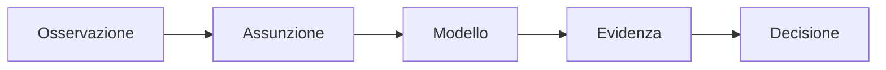
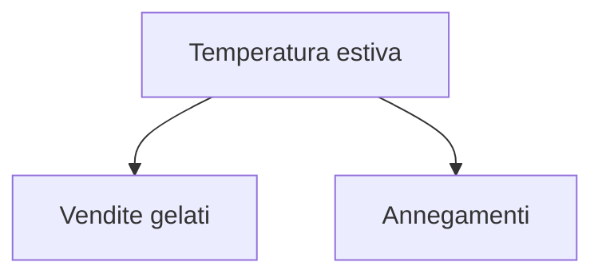
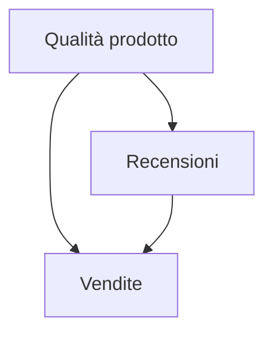

# Judea Pearl, DAG e rivoluzione causale

Per decidere sotto incertezza non basta osservare correlazioni: serve un metodo per distinguere associazione e causalità. Il lavoro di Judea Pearl, con i DAG e quella che lui chiama la rivoluzione causale, dà gli strumenti per rendere esplicite le assunzioni, riconoscere i confondenti e ragionare sugli interventi.

## Problema reale

Mettiamo che tu voglia capire se uno sconto aumenta la retention dei clienti. I clienti più fedeli ricevono offerte diverse e comprano già di più, quindi una semplice tabella non basta. Ti serve una mappa delle relazioni causali per non leggere male i numeri. Questa lezione serve proprio a capire quando i dati sostengono davvero una decisione e quando invece nascondono un bias o una domanda formulata male.

## Modello concettuale

Il processo corretto parte da una domanda concreta, definisce variabili osservabili e assunzioni, valuta la qualità del dato e arriva a una decisione. Quando si salta un passaggio si ottengono analisi eleganti ma fragili.

| Passaggio | Domanda guida | Output atteso |
|---|---|---|
| Framing | Quale decisione deve cambiare? | Una scelta concreta, non una curiosità |
| Misura | Quale segnale rappresenta il fenomeno? | Metrica, fonte e granularità |
| Confronto | Rispetto a quale baseline interpreto il risultato? | Benchmark o controfattuale plausibile |
| Azione | Che cosa faccio se il segnale supera la soglia? | Decisione, owner e prossimo controllo |

## Gli elementi della causalità

La causalità qui si legge come relazione tra unità di analisi, segnale, baseline e decisione:

| Elemento | Definizione operativa |
|---|---|
| Unità | osservazione, ipotesi, variabile, meccanismo causale o criterio di evidenza |
| Segnale | forza dell evidenza, coerenza causale, robustezza delle assunzioni, costo dell errore decisionale |
| Baseline | spiegazione alternativa, controfattuale, gruppo comparabile o scenario senza intervento |
| Decisione | accettare, rifiutare o riformulare una spiegazione prima di usarla |
| Rischio | confondere correlazione, qualità del dato e causalità decisionale |

Una misura serve a qualcosa solo se riduce l'incertezza su una decisione precisa. Se non cambia la scelta è decorativa. Se cambia la scelta senza controlli a monte, è rischiosa.

## I tre livelli della causalità di Pearl

| Livello | Nome | Domanda | Strumento |
|---------|------|---------|-----------|
| **L1** | Associazione | *Cosa vedo?* | Probabilità condizionale, correlazione, regressione |
| **L2** | Intervento | *Cosa succede se faccio X?* | DAG + do-calculus, esperimenti randomizzati |
| **L3** | Controfattuale | *Cosa sarebbe successo se avessi fatto Y invece di X?* | Modelli strutturali causali (SCM) |

Non puoi rispondere a domande di L2 o L3 usando solo strumenti di L1. Un modello di regressione può dirti solo associazioni. Per passare a "cosa succede se faccio X?" devi avere un modello causale esplicito.

## I DAG: Directed Acyclic Graphs

Un DAG è un grafo diretto aciclico che rappresenta relazioni causali tra variabili. Una freccia indica causalità diretta; l'assenza di freccia è un'assunzione altrettanto importante di non causalità.

**Esempio: gelati e annegamenti**

La temperatura estiva causa sia le vendite di gelati sia gli annegamenti. Non c'è freccia tra gelati e annegamenti: assumiamo che non ci sia causalità diretta. Controllando per la temperatura, la correlazione sparisce.

**Esempio: onboarding di un'app**

Due percorsi causali dall'onboarding alla retention: uno mediato dall'attivazione, uno diretto. Il DAG mostra quali variabili controllare per isolare l'effetto.

## Il do-operator: distinguere "vedere" da "fare"

P(Y | X) è la probabilità di Y *dato che ho osservato* X (L1).
P(Y | do(X)) è la probabilità di Y *se forzo* X (L2).

Esempio: chi usa la feature search ha retention più alta. P(retention | search) è alta, ma P(retention | do(search)), cioè cosa succede se forzi un utente a usare la search, potrebbe essere tutt'altra cosa. Forzare è esattamente ciò che fa un A/B test. Senza esperimenti puoi approssimare do(X) con la backdoor adjustment formula, ma ti serve conoscere il DAG.

## Esempio o caso studio

Amazon osserva che prodotti con più recensioni vendono di più. La domanda è: se forzi un prodotto ad avere più recensioni, le vendite aumentano?

Il DAG rivela un confondente:

La qualità del prodotto causa sia le recensioni sia le vendite. Controllando per la qualità, l'effetto delle recensioni sulle vendite si rivela molto più piccolo di quanto lasci credere la correlazione grezza. Amazon ha fatto degli esperimenti e ha calibrato il budget delle campagne su questo effetto reale, non su quello apparente.

## Come applicare Pearl oggi

Disegna il DAG prima di modellare, anche solo con carta e penna, e chiediti quali variabili causano quali e cosa confonde cosa. Poi individua il livello della tua analisi: se la domanda è di tipo L2 ma stai usando strumenti L1, stai rispondendo male alla domanda sbagliata. Infine applica il criterio della backdoor: per stimare l'effetto causale di X su Y, controlla tutte le variabili che causano sia X sia Y.

## Lab / esercizio

### Livello base

Scrivi in cinque righe: obiettivo, metrica primaria, baseline, rischio principale e azione prevista per una decisione reale legata a questa lezione.

### Livello intermedio

Costruisci una tabella con almeno tre segmenti o scenari. Per ciascuno indica segnale, possibile spiegazione alternativa e controllo necessario prima di decidere.

### Livello research-grade

Disegna un piano di validazione: ipotesi, dati necessari, criterio di esclusione, soglia decisionale e controllo post-decisione. Specifica cosa ti farebbe cambiare idea.

### Dataset e materiali consigliati

Usa case study decisionali, metriche prodotto, risultati di esperimenti, DAG semplici, report analitici e serie storiche simulate. Se non hai dati reali, crea un dataset sintetico con almeno 200 righe, una colonna temporale, una colonna segmento, una metrica di outcome e una variabile di esposizione.

## Errore tipico da evitare

Questa lezione non è una definizione da ricordare, è un protocollo decisionale. Evita di presentare metriche senza baseline, grafici senza ipotesi o raccomandazioni senza stimare il costo dell'errore. Chiediti sempre: se questo risultato fosse falso, quale decisione sbaglierei? Se non sai rispondere, devi approfondire prima di decidere.

## Quiz o checkpoint

1. Qual è la decisione concreta che questa lezione dovrebbe migliorare?
2. Quale baseline rende interpretabile il risultato?
3. Quale assunzione, se sbagliata, cambierebbe la conclusione?
4. Quale controllo minimo useresti prima di presentare la raccomandazione?

## Riepilogo operativo

Il metodo di Pearl, con i DAG e il do-calculus, serve a collegare concetto, dato e decisione. Si parte da un problema reale, si formalizza il segnale, si cerca una baseline credibile, si costruisce un esempio e si chiude con un controllo pratico. Quando lavori così, i dati diventano decisioni su cui puoi davvero contare sotto incertezza.

---

*Riferimenti:* 
- Pearl, J. (2000). *Causality: Models, Reasoning, and Inference.* Cambridge University Press.
- Pearl, J. & Mackenzie, D. (2018). *The Book of Why: The New Science of Cause and Effect.* Basic Books.
- Pearl, J., Glymour, M. & Jewell, N.P. (2016). *Causal Inference in Statistics: A Primer.* Wiley.
