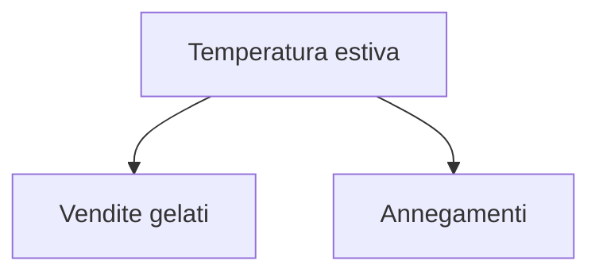
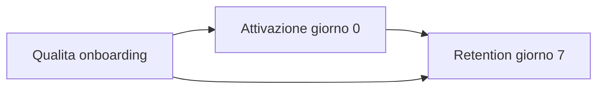
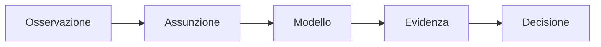

# Judea Pearl, DAG e rivoluzione causale

Vuoi sapere se uno sconto aumenta retention, ma sai che clienti più fedeli ricevono offerte diverse e comprano già di più. Una tabella non basta: serve una mappa delle relazioni possibili. **Judea Pearl, DAG e rivoluzione causale** mostra come rendere visibili confondenti, interventi e percorsi causali.

## Una scena da cui partire

Leggi la lezione come passaggio dal "controlliamo tutto" al "controlliamo ciò che il grafo richiede". Il DAG obbliga a dichiarare una teoria del fenomeno prima di stimare effetti e scegliere variabili.

- **Contesto:** Quale confondente rende ambigua la relazione osservata?
- **Metodo:** Quale freccia del DAG rappresenta un'assunzione forte?
- **Applicazione:** Quale variabile non controlleresti perché aprirebbe bias?

## I tre livelli della causalità di Pearl

Riprendendo e formalizzando la gerarchia già introdotta:

| Livello | Nome | Domanda | Strumento |
|---------|------|---------|-----------|
| **L1** | Associazione | *Cosa vedo?* | Probabilità condizionale, correlazione, regressione |
| **L2** | Intervento | *Cosa succede se faccio X?* | DAG + do-calculus, esperimenti randomizzati |
| **L3** | Controfattuale | *Cosa sarebbe successo se avessi fatto Y invece di X?* | Modelli strutturali causali (SCM) |

Il punto cruciale: **non puoi rispondere a domande di L2 o L3 usando solo strumenti di L1.** Un modello di regressione, per quanto sofisticato, può dirti solo associazioni. Per passare a "cosa succede se faccio X?" devi avere un modello causale esplicito.

## I DAG: Directed Acyclic Graphs

Un DAG è un grafo diretto aciclico che rappresenta le relazioni causali tra variabili. Un nodo causa un altro se c'è una freccia che li collega. L'assenza di freccia è importante quanto la presenza: significa assunzione di NON causalità diretta.

**Esempio: DAG per il problema "gelati e annegamenti"**

La temperatura estiva causa entrambi. Non c'è freccia tra gelati e annegamenti: stiamo assumendo che NON ci sia causalità diretta. Questo DAG dice esplicitamente: se controlli per la temperatura, la correlazione gelati-annegamenti sparisce. E infatti sparisce.

**Esempio: DAG per l'onboarding di un'app**

Due percorsi causali dall'onboarding alla retention: uno via attivazione (mediato), uno diretto. Il DAG rende esplicita la struttura e ti dice quali variabili devi controllare per isolare l'effetto dell'onboarding.

## Il do-operator: cosa distingue "vedere" da "fare"

P(Y | X) = probabilità di Y *dato che ho osservato* X. È L1.
P(Y | do(X)) = probabilità di Y *se forzo* X. È L2.

Esempio: vedo che chi usa la feature search ha retention più alta. P(retention | search) è alta. Ma P(retention | do(search)) — se *forzo* un utente a usare la search — potrebbe essere diversa. Magari chi usa la search è già un power user che avrebbe retention alta comunque.

Il do-operator è ciò che un A/B test implementa: forzi casualmente alcuni utenti a vedere la variante B (do(treatment)), e misuri l'effetto. Senza esperimento, puoi approssimare il do-operator con la backdoor adjustment formula di Pearl — ma devi conoscere il DAG.

## Caso reale: Amazon e l'effetto delle recensioni

Amazon sa che i prodotti con più recensioni vendono di più. Domanda: se *forzo* un prodotto ad avere più recensioni (es. campagna "lascia una recensione"), le vendite aumentano?

L'analisi L1 direbbe di sì: c'è una forte correlazione. Ma il DAG rivela un confondente:

Se controlli per la qualità del prodotto, l'effetto delle recensioni sulle vendite potrebbe essere molto più piccolo. Le recensioni sono in parte una *conseguenza* della qualità, non una *causa* delle vendite.

Amazon ha condotto esperimenti (do-calculus applicato) e ha scoperto che l'effetto incrementale di una recensione aggiuntiva è positivo ma modesto — molto più piccolo di quanto la correlazione grezza suggerirebbe. Il budget per campagne di recensioni è stato calibrato su questo effetto reale, non sulla correlazione spuria.

## Come applicare Pearl oggi

1. **Disegna il DAG prima di modellare.** Non serve software: carta e penna bastano. Chiediti: quali variabili causano quali? Cosa confonde cosa?

2. **Per ogni analisi, identifica il livello:** sto facendo L1 (associazione), L2 (intervento) o L3 (controfattuale)? Se la domanda di business è L2 e la tua analisi è L1, stai rispondendo alla domanda sbagliata.

3. **Backdoor criterion:** per stimare l'effetto causale di X su Y, devi controllare (aggiustare per) tutte le variabili che causano sia X che Y.

---

*Riferimenti:*
- Pearl, J. (2000). *Causality: Models, Reasoning, and Inference.* Cambridge University Press.
- Pearl, J. & Mackenzie, D. (2018). *The Book of Why: The New Science of Cause and Effect.* Basic Books.
- Pearl, J., Glymour, M. & Jewell, N.P. (2016). *Causal Inference in Statistics: A Primer.* Wiley.

## Controllo di qualità

Prima di usare judea pearl, dag e rivoluzione causale in una decisione, controlla sempre completezza, duplicati, timezone, definizioni cambiate e segmenti esclusi. Molte analisi apparentemente sofisticate falliscono perché il dato di partenza misura un comportamento diverso da quello che il team crede di osservare.

## Interpretazione per segmenti

La media aggregata è solo il punto di partenza. Segmenta per canale, coorte, piano, paese, device e maturità dell'utente. Se due segmenti si muovono in direzioni opposte, la media non rappresenta nessuno dei due e può portare a una decisione sbagliata.

## Problema reale

Nel lavoro su fondamenti filosofici dell'analisi dati, **Judea Pearl, DAG e rivoluzione causale** serve a risolvere un problema concreto: capire quando un dato sostiene davvero una decisione e quando invece nasconde assunzioni, bias, causalità fragile o una domanda formulata male. La domanda non è se il concetto sia interessante in astratto, ma quale decisione migliora quando lo applichi con dati affidabili e con una soglia di errore esplicita.

Questa lezione va studiata come uno strumento operativo: entro la fine devi saper Comprendere il problema analitico e il contesto decisionale; Applicare esempi, metriche e controlli a casi reali. Se non riesci a collegare il concetto a una scelta reale, la conoscenza resta decorativa e non diventa competenza.

## Modello concettuale

Il modello mentale e sequenziale: prima si formula la domanda, poi si traduce in unità osservabili, quindi si valuta la qualità del dato e solo alla fine si decide. Saltare un passaggio produce analisi eleganti ma fragili.

| Passaggio | Domanda guida | Output atteso |
|---|---|---|
| Framing | Quale decisione deve cambiare? | Una scelta concreta, non una curiosità |
| Misura | Quale segnale rappresenta il fenomeno? | Metrica, fonte e granularità |
| Confronto | Rispetto a quale baseline interpreto il risultato? | Benchmark o controfattuale plausibile |
| Azione | Che cosa faccio se il segnale supera la soglia? | Decisione, owner e prossimo controllo |

## Formalizzazione rigorosa

Formalizza **Judea Pearl, DAG e rivoluzione causale** come una relazione tra quattro elementi: unità di analisi, segnale, baseline e decisione. Nel contesto di questa lezione l'unità principale e **osservazione, ipotesi, variabile, meccanismo causale o criterio di evidenza**. Il segnale da osservare deve essere collegato a **forza dell evidenza, coerenza causale, robustezza delle assunzioni e costo dell errore decisionale**, mentre la baseline deve essere scelta tra **spiegazione alternativa, controfattuale, gruppo comparabile o scenario senza intervento**.

Una formulazione robusta segue questa logica:

| Elemento | Definizione operativa per questa lezione |
|---|---|
| Unità | osservazione, ipotesi, variabile, meccanismo causale o criterio di evidenza |
| Segnale | forza dell evidenza, coerenza causale, robustezza delle assunzioni e costo dell errore decisionale |
| Baseline | spiegazione alternativa, controfattuale, gruppo comparabile o scenario senza intervento |
| Decisione | accettare, rifiutare o riformulare una spiegazione prima di usarla in un contesto aziendale |
| Rischio | Confondere correlazione, qualità del dato e causalità decisionale |

La regola pratica e semplice: una misura e utile solo se riduce l'incertezza su una decisione specifica. Se non cambia una scelta, e documentazione; se cambia una scelta senza controlli, e rischio.

## Esempio o caso studio

Un comitato interpreta una crescita di retention come prova che una nuova iniziativa abbia funzionato. La lezione costringe a distinguere osservazione, spiegazione, assunzione e decisione prima di trasformare il dato in azione.

Applicando **Judea Pearl, DAG e rivoluzione causale**, il team costruisce una lettura in tre colonne: cosa sappiamo, cosa assumiamo e quale decisione prendiamo. Questo formato impedisce di presentare un numero come se fosse una conclusione autosufficiente.

| Evidenza | Interpretazione prudente | Decisione conseguente |
|---|---|---|
| Segnale positivo ma non isolato | Il fenomeno esiste, ma la causa e ancora incerta | Cercare baseline o holdout |
| Segmento con risposta diversa | L'effetto medio nasconde eterogeneita | Analizzare coorti o sottogruppi |
| Costo operativo crescente | Il risultato va valutato sul margine | Applicare soglie economiche |

## Lab / esercizio

### Livello base

Prendi una decisione reale collegata a **Judea Pearl, DAG e rivoluzione causale** e scrivi in cinque righe: obiettivo, metrica primaria, baseline, rischio principale e azione prevista. Non usare più di una metrica primaria.

### Livello intermedio

Costruisci una tabella con almeno tre segmenti o scenari. Per ciascuno indica segnale, possibile spiegazione alternativa e controllo necessario prima di decidere.

### Livello research-grade

Disegna un piano di validazione: ipotesi, dati necessari, criterio di esclusione, soglia decisionale e controllo post-decisione. Specifica anche che cosa ti farebbe cambiare idea.

### Dataset e materiali consigliati

Usa case study decisionali, metriche prodotto, risultati di esperimenti, DAG semplici, report analitici e serie storiche simulate. Se non hai dati reali, crea un dataset sintetico con 200-500 righe e almeno una colonna temporale, una colonna segmento, una metrica di outcome e una variabile di esposizione.

## Errore tipico da evitare

L'errore più frequente e trattare **Judea Pearl, DAG e rivoluzione causale** come una definizione da ricordare invece che come un protocollo decisionale. In pratica succede quando si presenta una metrica senza baseline, un grafico senza ipotesi, o una raccomandazione senza costo dell'errore.

Un controllo utile è chiedersi: "se questo risultato fosse falso o instabile, quale decisione sbaglierei?". Se la risposta non è chiara, la lezione non è ancora stata applicata davvero.

## Quiz o checkpoint

1. Qual è la decisione concreta che questa lezione dovrebbe migliorare?
2. Quale baseline rende interpretabile il risultato?
3. Quale assunzione, se sbagliata, cambierebbe la conclusione?
4. Quale controllo minimo useresti prima di presentare la raccomandazione?

## Riepilogo operativo

**Judea Pearl, DAG e rivoluzione causale** e una competenza utile quando collega concetto, dato e decisione. Studiala partendo da un problema reale, formalizza il segnale, cerca una baseline credibile, costruisci un esempio e chiudi con un controllo pratico. Categoria: Fondamenti. Difficoltà: advanced. Tempo stimato: 18 min.
