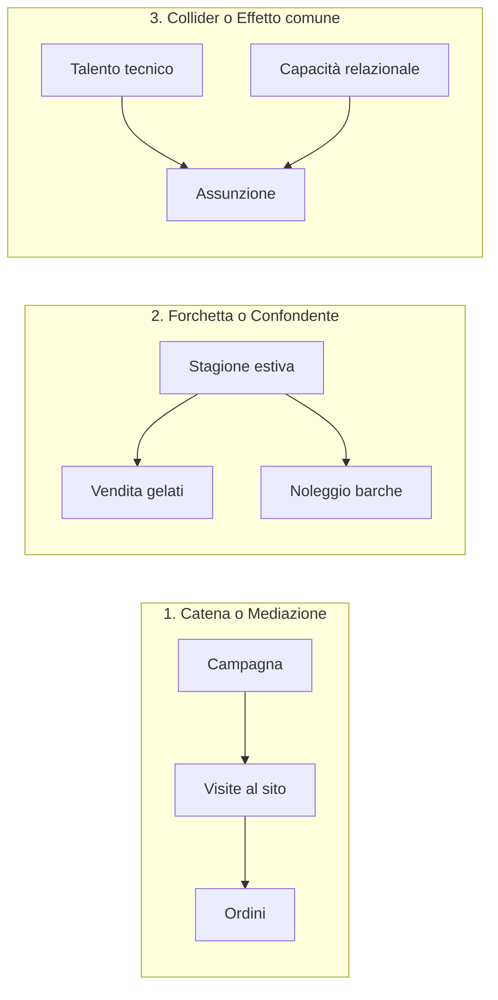

Per quasi un secolo la statistica ufficiale ha evitato la parola "causa" come un tabù metodologico, rifugiandosi nella prudente formula "correlazione non implica causalità" senza offrire alcun linguaggio matematico per rappresentare cosa invece la implichi. La rivoluzione causale avviata da Judea Pearl ha spezzato quel blocco dotando gli analisti di una grammatica visiva e algebrica rigorosa per decidere quando i dati osservazionali bastano a prevedere gli effetti di un'azione e quando invece ingannano chi guarda soltanto le medie grezze.

## La funzione che sembrava raddoppiare la ritenzione finché non l'hai promossa

Immagina questo scenario costruito che manda in crisi molti team di prodotto. Analizzando i log degli ultimi sei mesi di un'app finanziaria, scopri che gli utenti che attivano la funzione di reportistica avanzata mostrano una ritenzione a novanta giorni superiore di venti punti percentuali rispetto a chi non la tocca mai. Entusiasta del numero, il product manager lancia un tutorial obbligatorio durante la registrazione per spingere tutti i nuovi iscritti ad aprire almeno un report avanzato il primo giorno. Dopo tre mesi di esperimento controllato, il tasso di attivazione della funzione triplica, ma la ritenzione complessiva non si muove di un decimo di punto.

Il dato iniziale non era sbagliato sul piano descrittivo: chi usava la reportistica restava davvero molto più a lungo. L'errore stava nell'aver letto una semplice fotografia osservazionale come se descrivesse la conseguenza di un intervento forzato sul prodotto. A generare sia l'uso del report avanzato sia la lunga permanenza era una variabile a monte — l'intenzione d'uso professionale del cliente — che nessun clic forzato poteva creare dal nulla.

> **Idea chiave:** Nessuna quantità di dati puramente osservazionali e nessun algoritmo predittivo possono rispondere a una domanda causale senza un modello esplicito di come le variabili si influenzano nel mondo reale.

Per passare dalla previsione passiva alla decisione attiva serve cambiare piano logico, salendo da ciò che accade quando guardi a ciò che succede quando modifichi il sistema.

## La Scala della Causalità: vedere, fare, immaginare

Nel suo lavoro fondativo *Causality* del 2000 e poi nell'opera divulgativa *The Book of Why* del 2018 insieme a Dana Mackenzie, l'informatico Judea Pearl organizza ogni ragionamento sui dati in una gerarchia a tre gradini chiamata *Scala della Causalità*. La distinzione non è filosofica nel senso vago del termine: dimostra matematicamente che nessuna tecnica confinabile al primo gradino può risolvere un problema appartenente al secondo o al terzo senza assumere informazioni strutturali esterne ai dati grezzi.

Il primo gradino è l'**associazione**, sintetizzata dal verbo *vedere*: osservi che due variabili si muovono insieme nella distribuzione congiunta passiva. Qui risiedono quasi tutte le regressioni standard, gli alberi decisionali e le reti neurali addestrate per predire un esito a partire dalle caratteristiche osservate. Il secondo gradino è l'**intervento**, espresso dal verbo *fare* e formalizzato da Pearl con l'operatore `do(X)`: non ti chiedi quale sia il valore medio di `Y` tra chi ha scelto spontaneamente `X`, bensì cosa accadrebbe alla distribuzione di `Y` se imponessi `X` dall'esterno recidendo le cause naturali che prima determinavano `X`. Il terzo gradino è il **controfattuale**, governato dal verbo *immaginare*: dato un evento già accaduto e osservato, chiedi quale sarebbe stato l'esito per quel singolo caso specifico se una scelta passata fosse stata diversa.

| Gradino di Pearl | Operatore concettuale | Domanda tipica sui dati | Esempio in azienda | Strumenti sufficienti |
|---|---|---|---|---|
| Livello 1: Associazione | `P(Y \| X)` | Cosa vedo su Y se osservo X? | I clienti che usano l'app mobile rinnovano di più? | Statistica descrittiva, ML predittivo standard |
| Livello 2: Intervento | `P(Y \| do(X))` | Cosa succede a Y se cambio X? | Se spingo tutti sull'app mobile, il rinnovo sale? | Esperimenti randomizzati o DAG con aggiustamento causale |
| Livello 3: Controfattuale | `P(Y_x \| X', Y')` | Cosa sarebbe accaduto senza X, visto come è andata? | Quel cliente che ha abbandonato sarebbe rimasto senza aumento di prezzo? | Modelli causali strutturali (SCM) completi |

Comprendere questa scala spiega perché modelli di machine learning accuratissimi nel predire il churn spesso falliscano miseramente quando vengono usati per decidere a chi inviare uno sconto o una telefonata di recupero. Il modello predittivo conosce perfettamente `P(Abbandono | Sconto ricevuto nel passato)` — magari alta se gli sconti venivano dati solo ai clienti già sull'orlo della disdetta — ma non ha idea di `P(Abbandono | do(Sconto))` finché non spezzi la regola storica di assegnazione.

## Grammatica dei DAG: catene, forchette e collider

Per formalizzare la struttura causale che collega il livello 1 al livello 2, Pearl adotta i **DAG** (*Directed Acyclic Graphs*, grafi aciclici orientati). Un DAG è una mappa trasparente delle tue assunzioni sul mondo: ogni nodo rappresenta una variabile rilevante, ogni freccia orientata `A -> B` afferma che `A` può causare direttamente `B`, e l'aggettivo *aciclico* garantisce che nessun effetto possa viaggiare all'indietro nel tempo fino a causare sé stesso nello stesso istante.

La regola più sottovalutata dei DAG riguarda ciò che *manca* nel disegno. Un'assenza di freccia tra due nodi non significa ignoranza o prudenza, bensì rappresenta l'assunzione più forte che puoi fare: dichiari che non esiste alcun legame causale diretto tra quelle due grandezze. Proprio perché rende esplicite le assunzioni attraverso le frecce assenti e presenti, il grafo trasforma una discussione confusa sulle correlazioni in una verifica visiva controllabile da tutto il team.

Ogni DAG complesso si scompone in tre mattoni elementari, ciascuno con regole opposte rispetto all'operazione di controllo statistico (cioè filtrare o inserire una variabile di aggiustamento in una regressione).

Nella **catena** (`A -> M -> B`), `M` è un mediatore lungo il percorso che porta la causa all'effetto. Qui l'informazione fluisce liberamente da `A` a `B`, ed è esattamente ciò che vuoi misurare se studi l'effetto totale di `A`: se però controlli statisticamente per `M`, blocchi la trasmissione e cancelli artificialmente l'effetto di `A` che passa attraverso `M`.

Nella **forchetta** (`A <- C -> B`), `C` è una causa comune, o *confondente*, sia di `A` sia di `B`. Anche se `A` non causa in alcun modo `B`, i due nodi appaiono fortemente correlati nei dati grezzi perché ricevono entrambi una spinta da `C`. Per chiudere questa porta di distorsione — chiamata da Pearl *cammino backdoor* perché entra dal retro della freccia di `A` — devi controllare statisticamente per `C`, confrontando cioè `A` e `B` a parità di livello di `C`.

Nel **collider** (`A -> K <- B`), due cause indipendenti convergono su un effetto comune `K`. Nei dati naturali dell'intera popolazione, un collider blocca naturalmente il flusso di associazione tra `A` e `B`: talento tecnico e capacità relazionale possono essere del tutto indipendenti tra i candidati generali. Tuttavia, nel momento esatto in cui condizioni su `K` — per esempio analizzando soltanto i candidati effettivamente assunti — apri artificialmente una correlazione spuria tra `A` e `B`: tra gli assunti, chi ha capacità relazionali più basse tende ad avere talento tecnico altissimo per aver superato comunque la selezione, creando l'illusione di una correlazione negativa tra le due qualità. Questa trappola prende il nome di *bias del collider* o paradosso di Berkson.

## Dal grafo ai numeri: calcolare l'effetto con il criterio backdoor

Vediamo come il criterio backdoor di Pearl risolva un celebre rompicapo numerico noto come paradosso di Simpson, usando numeri di esempio costruiti su un programma di formazione clienti B2B. Supponiamo di osservare 2.000 aziende clienti lungo un anno: alcune hanno partecipato al programma di onboarding assistito (`X = 1`), altre no (`X = 0`), e misuriamo se hanno rinnovato l'abbonamento (`Y = 1`).

Disegniamo ora il grafo causale dell'organizzazione commerciale. I clienti si dividono equamente in due segmenti naturali: 1.000 piccole imprese (`Z = PMI`) e 1.000 grandi gruppi (`Z = Enterprise`), cosicché ciascun segmento rappresenta esattamente il `50%` della base totale. Sappiamo che i grandi gruppi rinnovano strutturalmente di meno rispetto alle PMI per via di gare d'appalto più rigide, ma allo stesso tempo il team commerciale assegna molto più spesso l'onboarding assistito proprio ai grandi gruppi perché i contratti valgono di più. La dimensione aziendale `Z` agisce quindi da forchetta confondente su trattamento ed esito (`X <- Z -> Y`).

Apriamo i numeri dentro ciascuno strato della forchetta. Tra le 1.000 PMI, soltanto 200 ricevono l'onboarding assistito e 180 di esse rinnovano, ottenendo un tasso del `90,0%` (`180 / 200 = 0,900`), mentre le 800 PMI senza onboarding ottengono 640 rinnovi, cioè l'`80,0%` (`640 / 800 = 0,800`): nel segmento PMI il programma produce quindi un guadagno di `+10,0 punti percentuali`. Tra i 1.000 clienti Enterprise, 800 ricevono l'onboarding assistito ottenendo 410 rinnovi (`410 / 800 = 51,25%`), mentre 200 non lo ricevono ottenendo 90 rinnovi (`90 / 200 = 45,0%`): nel segmento Enterprise il programma produce un guadagno di `+6,25 punti percentuali`. Controllando ora i totali aggregati senza distinguere gli strati, i trattati totali sono `200 + 800 = 1.000` con `180 + 410 = 590` rinnovi, pari al `59,0%`, mentre i controlli totali sono `800 + 200 = 1.000` con `640 + 90 = 730` rinnovi, pari al `73,0%`. Nei dati grezzi sembra che l'onboarding riduca il rinnovo di ben `-14,0 punti percentuali` (`59,0% - 73,0% = -14,0 pp`), eppure in *entrambi* i segmenti il programma aumenta nettamente i rinnovi.

Applichiamo ora la formula di aggiustamento backdoor di Pearl per calcolare l'effetto di un intervento globale `do(X=1)` contro `do(X=0)` ponderando ciascun segmento per il suo peso reale nella popolazione (`50%` PMI e `50%` Enterprise). Se imponessimo l'onboarding a tutta la base (`do(X=1)`), il tasso di rinnovo atteso sarebbe la media pesata dei tassi trattati nei due strati: `(0,50 * 90,0%) + (0,50 * 51,25%) = 45,0% + 25,625% = 70,625%`. Se invece togliessimo l'onboarding a tutta la base (`do(X=0)`), il tasso atteso sarebbe `(0,50 * 80,0%) + (0,50 * 45,0%) = 40,0% + 22,5% = 62,5%`. La differenza causale vera dell'intervento è quindi `70,625% - 62,5% = +8,125 punti percentuali`. L'inversione completa da `-14,0 pp` osservazionali a `+8,125 pp` causali avviene perché il DAG ha individuato la forchetta `Z`, imponendo di bloccare il cammino backdoor mediante standardizzazione sugli strati.

## John Snow a Soho nel 1854 e la forza dell'intervento

Prima che esistessero i computer e i grafi formali di Pearl, l'importanza decisiva di ragionare al livello dell'intervento trovò una dimostrazione storica drammatica nella Londra vittoriana. Nell'agosto del 1854 un'esplosione violenta di colera colpì il quartiere di Soho intorno a Broad Street, provocando oltre 500 decessi fatali in soli dieci giorni. All'epoca il paradigma medico dominante attribuiva il colera ai "miasmi", ovvero esalazioni nocive trasportate dall'aria.

Il medico John Snow sospettava invece che la causa viaggiasse nell'acqua contaminata da scarichi fognari. Snow non si limitò a mappare i decessi per via di strada: incrociò i dati sulle compagnie idriche che rifornivano le abitazioni (Southwark and Vauxhall contro Lambeth, due gestori che servivano vicini di casa identici per reddito e qualità dell'aria ma prelevavano acqua da punti diversi del Tamigi) sfruttando di fatto un esperimento naturale che isolava il cammino causale dell'acqua da quello dei presunti miasmi.

L'8 settembre 1854 Snow convinse le autorità locali a compiere un intervento fisico netto, equivalente a un `do(Acqua_Broad_Street = 0)` nel linguaggio moderno: rimuovere la leva della pompa pubblica di Broad Street. L'epidemia era già in lieve declino per via della fuga dei residenti, ma la rimozione della leva tagliò bruscamente l'esposizione residua, mentre le indagini successive su un birrificio locale i cui operai non bevevano acqua della pompa (preferendo la birra e un pozzo privato) e su una vedova di Hampstead che si faceva recapitare l'acqua proprio da Broad Street completarono la catena causale.

Per tradurre questa disciplina nella pratica quotidiana dei tuoi modelli, conviene sottoporre ogni analisi causale osservazionale a una lista di controllo strutturale prima di scrivere la regressione o l'albero decisionale.

> **Checklist pre-modello di un DAG causale:**
> Domanda formulata al livello giusto: sto stimando un valore previsto osservazionale (`P(Y | X)`) o l'effetto di una modifica attiva (`P(Y | do(X))`)?
> Confondenti chiusi: tutte le cause comuni note tra trattamento ed esito sono state misurate e incluse nel set di aggiustamento?
> Collider e mediatori protetti: ho verificato che nessuna variabile di controllo inserita nel modello sia in realtà un effetto comune o un passaggio intermedio del trattamento?

## Tre errori mortali quando si controllano le variabili

Nella statistica applicata e nel machine learning tabellare sopravvive spesso la pessima abitudine di "buttare dentro tutte le colonne disponibili" come variabili di controllo, convinti che aggiungere covariate possa solo rendere più precisa la stima. I DAG dimostrano che controllare la variabile sbagliata può creare errori peggiori dell'omissione.

### Condizionare su un collider e fabbricare bias di selezione

Il sintomo compare ogni volta che filtri i dati in base a un evento avvenuto *dopo* o *a causa di* ciò che vuoi studiare: per esempio, analizzi l'effetto di uno sconto sulla soddisfazione esaminando solo i clienti che hanno risposto a un sondaggio opzionale, oppure studi i fattori di successo delle startup guardando solo quelle che hanno raccolto un round di finanziamento. Sembra ragionevole lavorare sui record completi disponibili, ma se sia il trattamento sia l'esito influenzano la probabilità di entrare nel campione, il filtro apre un collider nascosto e crea correlazioni spurie inesistenti nella popolazione reale. Eviti questa distorsione disegnando nel DAG anche il nodo `Inclusione nel campione` per controllare se le frecce convergono su di esso.

### Controllare un mediatore bloccando l'effetto che vuoi misurare

Accade spesso quando valuti l'impatto di una campagna di formazione per i venditori sul fatturato finale, ma inserisci nella regressione anche il "numero di chiamate effettuate" o "numero di demo prenotate" come variabile di controllo. Sembra prudente tenere fermo il volume di attività per fare un confronto "a parità di sforzo", ma se la formazione migliora le vendite *proprio* aiutando i venditori a fissare più demo, bloccare quel mediatore cancella dal coefficiente il meccanismo centrale della politica aziendale. Correggi il modello distinguendo prima nel grafo ciò che precede temporalmente il trattamento (possibili confondenti da controllare) da ciò che lo segue (mediatori e collider da escludere quando cerchi l'effetto totale).

### Chiamare causale una regressione senza dichiarare gli archi mancanti

Il sintomo si legge nei report in cui l'importanza delle feature di una random forest o i coefficienti di una regressione multipla vengono presentati direttamente come leve di intervento ("aumentando X di una unità, Y sale di Z"). Sembra efficiente sfruttare subito le stime di un modello già addestrato per l'accuratezza predittiva, ma l'algoritmo ottimizza la correlazione al livello 1 scegliendo pesi che assorbono indistintamente cause reali, proxy e conseguenze inverse. Previeni questo salto illegittimo vietando nei documenti di lavoro qualsiasi interpretazione prescrittiva dei coefficienti finché il team non abbia allegato il DAG esplicito e dichiarato quali confondenti non misurati potrebbero ancora distorcere i cammini backdoor.

## Verifica sulla struttura del tuo grafo causale

Metti alla prova la tua padronanza dei DAG e della Scala della Causalità rispondendo a queste quattro domande prima di aprire le soluzioni.

1. Un modello di machine learning prevede con grande precisione quali clienti chiederanno un rimborso basandosi sul numero di email inviate all'assistenza: perché questo modello non ti autorizza a concludere che bloccare l'accesso all'email dell'assistenza ridurrà i rimborsi?

Mostra risposta

Perché il modello opera al livello 1 (associazione osservazionale) e non conosce la direzione causale né gli effetti di un intervento al livello 2 (`do`). In realtà sia le email all'assistenza sia la richiesta di rimborso sono effetti comuni di un difetto del prodotto o dell'insoddisfazione del cliente (forchetta): chiudere il canale email non elimina il problema a monte e spinge probabilmente i clienti a chiedere chargeback o abbandonare direttamente.

2. Nel triangolo `Velocità di consegna -> Soddisfazione cliente <- Qualità del prodotto`, cosa succede se filtri la tua analisi considerando esclusivamente i clienti che hanno lasciato una recensione con voto massimo (`Soddisfazione = 5`)?

Mostra risposta

La soddisfazione è un collider tra velocità di consegna e qualità del prodotto. Filtrando solo i clienti molto soddisfatti apri una correlazione spuria negativa tra le due cause: a parità di soddisfazione alta, i casi con consegna più lenta tenderanno ad avere una qualità del prodotto eccezionale per compensare il ritardo, falsando l'eventuale stima statistica tra qualità e tempi logistici.

3. Stai valutando l'effetto di una nuova interfaccia di ricerca sulla spesa finale dell'utente; l'analisi include "numero di prodotti aggiunti al carrello" tra le variabili di controllo di una regressione: perché questa scelta rischia di sottostimare l'effetto reale della nuova ricerca?

Mostra risposta

Perché "prodotti aggiunti al carrello" è un mediatore collocato nella catena tra la nuova ricerca e la spesa finale (`Ricerca -> Aggiunte al carrello -> Spesa`). Controllare statisticamente per un mediatore blocca la trasmissione dell'effetto totale, lasciando visibile soltanto l'eventuale effetto residuo diretto non legato al carrello.

4. Come spieghi a un manager non tecnico l'essenza del criterio backdoor usando parole quotidiane?

Mostra risposta

Per capire se un'azione funziona davvero senza ingannarti sui totali aggregati, devi confrontare persone o aziende simili rispetto a tutti i fattori che influenzavano sia chi ha ricevuto l'azione sia il risultato finale, e poi pesare quei confronti parziali secondo la composizione reale dell'intera popolazione anziché secondo la composizione sbilanciata del campione storico.

