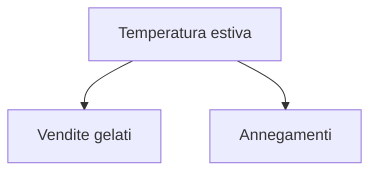

# Judea Pearl, DAG e rivoluzione causale

Per gran parte del Novecento la statistica ha trattato la causalità come un tabù. I manuali insegnavano che la correlazione non implica la causalità, e lì si fermavano: la disciplina si occupava di associazioni, e chi voleva parlare di cause doveva arrangiarsi. Judea Pearl, informatico e filosofo, ha rotto questo tabù. Con i modelli grafici causali — i DAG — e il do-calculus ha mostrato che la causalità non è un lusso filosofico ma un linguaggio preciso, con una sintassi, delle regole di inferenza e condizioni verificabili sotto cui i dati osservazionali bastano a rispondere a domande causali.

La posta in gioco è pratica. "Se aumentiamo lo sconto, la retention cresce?" è una domanda causale: chiede cosa succederebbe se intervenissimo, non cosa è successo finora. Un'analisi che risponde con una correlazione sta rispondendo a un'altra domanda, e le decisioni costruite su quella risposta falliscono in modo sistematico. In questa lezione vediamo i tre livelli della causalità secondo Pearl, il linguaggio dei DAG, il do-operator, il criterio della backdoor e un esempio numerico in cui l'aggiustamento cambia persino il segno dell'effetto.

## I tre livelli della causalità

Pearl organizza la conoscenza causale in tre livelli, che chiama la "scala della causalità". Ogni livello risponde a una domanda diversa e richiede strumenti diversi; il peccato capitale è usare gli strumenti di un livello per rispondere alle domande di un altro.

| Livello | Nome | Domanda | Strumenti |
|---|---|---|---|
| **L1** | Associazione | *Cosa vedo?* | Correlazione, probabilità condizionale, regressione |
| **L2** | Intervento | *Cosa succede se faccio X?* | DAG + do-calculus, esperimenti randomizzati |
| **L3** | Controfattuale | *Cosa sarebbe successo se avessi fatto Y invece di X?* | Modelli strutturali causali (SCM) |

La regressione vive al livello 1: descrive come le variabili si muovono insieme nei dati che hai. La domanda "se forzo X, Y cambia?" è di livello 2, e nessuna quantità di regressione può rispondervi da sola, perché i dati osservazionali sono stati generati da un processo che non controllavi. Il livello 3 è il più profondo: il controfattuale individuale — "questo cliente avrebbe comprato se non avesse ricevuto lo sconto?" — è la domanda che sta dietro l'attribuzione e la personalizzazione, e richiede un modello strutturale completo. La scala di Pearl è anche una gerarchia di difficoltà: salire di livello richiede più assunzioni, e le assunzioni vanno dichiarate.

## I DAG: il linguaggio delle assunzioni

Un DAG — *directed acyclic graph* — è un grafo in cui ogni nodo è una variabile e ogni freccia indica una relazione causale diretta: X → Y significa "X causa Y". L'aciclicità vieta i loop: nessuna variabile può causare se stessa, nemmeno attraverso catene. La potenza del DAG sta in ciò che rende esplicito: ogni freccia disegnata è un'ipotesi causale, e ogni freccia assente è un'ipotesi di non-causalità altrettanto forte. Disegnare un DAG prima di modellare è il modo più onesto di dichiarare le proprie assunzioni, perché le rende visibili e criticabili.

Il caso classico è il confondente. Vendite di gelato e annegamenti sono fortemente correlati, ma nessuno dei due causa l'altro: entrambi sono causati dalla temperatura estiva.



La temperatura è un confondente: una variabile che causa sia l'esposizione sia l'outcome, aprendo un percorso di associazione non causale tra i due. Controllando per la temperatura, la correlazione sparisce. Il DAG rende visibile ciò che la correlazione nasconde: il percorso B ← A → C è il "percorso backdoor" che collega gelato e annegamenti passando da dietro, e la sua esistenza spiega perché l'associazione grezza inganna.

Un secondo esempio, più vicino al lavoro quotidiano: l'onboarding di un'app. La qualità dell'onboarding causa l'attivazione al giorno 0, e l'attivazione causa la retention al giorno 7; ma la qualità dell'onboarding causa anche direttamente la retention, perché un buon inizio fidelizza a prescindere dall'attivazione.


Qui ci sono due percorsi causali da A a C: uno diretto e uno mediato da B. Se vuoi l'effetto totale dell'onboarding sulla retention, non devi controllare per B: lo chiuderesti il percorso mediato e stimeresti solo l'effetto diretto. Il DAG ti dice esattamente quali variabili controllare e quali no — un'informazione che nessun test statistico può darti.

## Il do-operator: distinguere "vedere" da "fare"

Il contributo più celebre di Pearl è il do-operator. P(Y | X) è la probabilità di Y *dato che ho osservato* X: è il linguaggio dell'associazione. P(Y | do(X)) è la probabilità di Y *se forzo* X: è il linguaggio dell'intervento. La differenza è tutto.

Prendi la feature di ricerca di un'app: gli utenti che la usano hanno retention più alta. P(retention | search) è alta, ma questo non dice che forzare tutti a usare la ricerca aumenterebbe la retention — anzi, potrebbe distruggerla, perché chi la usa oggi è probabilmente un utente più motivato. Forzare è esattamente ciò che fa un A/B test: assegna l'esposizione a caso, rompendo ogni percorso backdoor, e quindi stima P(Y | do(X)) direttamente. Quando l'esperimento non è possibile, il do-calculus fornisce le regole per trasformare P(Y | do(X)) in una formula che usa solo probabilità osservabili, a patto di conoscere il DAG.

La formula più importante è la backdoor adjustment. Se un insieme di variabili Z blocca tutti i percorsi backdoor da X a Y — cioè tutte le variabili che causano sia X sia Y — allora:

```
P(Y | do(X)) = Σ_z P(Y | X, z) × P(z)
```

In parole: l'effetto causale di X su Y si ottiene mediando le probabilità condizionali per la distribuzione di Z, non per la distribuzione di Z condizionata a X. È la differenza tra "confronta utenti simili" e "confronta utenti che hanno scelto cose simili", e la seconda è contaminata dalla selezione.

## Un esempio numerico: quando l'aggiustamento cambia il segno

Mettiamo il caso di una campagna sconto. Il DAG è semplice: il segmento del cliente (nuovo o esistente) causa sia la probabilità di ricevere l'offerta sia la probabilità di acquistare. I nuovi clienti ricevono l'offerta più spesso (50% contro 20%), ma comprano meno (10% contro 30% a parità di offerta). I dati osservazionali:

| Segmento | % clienti | P(acquisto \| offerta) | P(acquisto \| no offerta) | P(offerta) |
|---|---|---|---|---|
| Nuovi | 40% | 0.10 | 0.08 | 0.50 |
| Esistenti | 60% | 0.30 | 0.25 | 0.20 |

L'associazione grezza si calcola condizionando alla distribuzione di segmento *dentro* ciascun gruppo di esposizione. Poiché chi ha ricevuto l'offerta è in maggioranza nuovo, la media grezza è distorta:

```python
# Associazione grezza: P(Y | X) — condiziona alla distribuzione di Z *osservata* in X
# P(Z=Nuovi | X=1) = 0.5*0.4 / (0.5*0.4 + 0.2*0.6) = 0.625
# P(Y | X=1) = 0.625*0.10 + 0.375*0.30 = 0.175
# P(Y | X=0) = 0.4*0.08 + 0.6*0.25 = 0.182  →  differenza grezza: -0.7 punti
```

L'associazione grezza dice che l'offerta *riduce* gli acquisti di 0.7 punti percentuali. Ma è un artefatto: i nuovi clienti, che comprano poco, hanno ricevuto l'offerta più spesso. L'effetto causale si ottiene con la backdoor adjustment, mediando sulla distribuzione *marginale* del segmento:

```python
# Effetto causale: P(Y | do(X)) = Σ_z P(Y | X, z) P(z)
# P(Y | do(X=1)) = 0.4*0.10 + 0.6*0.30 = 0.22
# P(Y | do(X=0)) = 0.4*0.08 + 0.6*0.25 = 0.182  →  effetto causale: +3.8 punti
```

L'effetto causale è positivo: +3.8 punti percentuali, in linea con gli effetti dentro ogni segmento (+2 e +5 punti). La correlazione grezza aveva il segno sbagliato. Questo è il paradosso di Simpson nella sua forma più pura, e la backdoor adjustment è la cura: senza il DAG non sapresti nemmeno quale variabile aggiustare, e aggiustare la variabile sbagliata — un collider, per esempio — può creare distorsioni invece di rimuoverle.

## Il criterio della backdoor e i suoi limiti

Il criterio della backdoor è la regola operativa: per stimare l'effetto causale di X su Y, controlla un insieme di variabili Z tale che (1) nessun elemento di Z sia un discendente di X, e (2) Z blocchi ogni percorso backdoor da X a Y. Nel nostro esempio, il segmento soddisfa entrambe le condizioni. La regola ha però un corollario che sorprende chi viene dalla regressione: *non* controllare mai per un mediatore se vuoi l'effetto totale, e *non* controllare mai per un collider — una variabile causata sia da X sia da Y — perché condizionare su un collider apre un percorso di associazione spuria. Il DAG non è un dettaglio tecnico: è ciò che distingue un aggiustamento corretto da uno disastroso.

E i limiti vanno detti con chiarezza. La backdoor adjustment funziona solo se il DAG è corretto: se esiste un confondente non osservato, la formula produce comunque un numero, ma quel numero non è l'effetto causale. I DAG non eliminano la necessità di pensare: la spostano a monte, dove le assunzioni vengono dichiarate invece di restare nascoste. Per questo Pearl insiste che la rivoluzione causale è anche culturale: la statistica classica ha insegnato per un secolo a evitare la parola "causa", e il primo passo è riprendere a usarla con rigore.

## Conclusioni

La rivoluzione causale di Pearl ha cambiato il mestiere dell'analista. Prima di Pearl, la causalità era o un tabù o un'intuizione; dopo Pearl, è un linguaggio con regole precise. I DAG rendono le assunzioni visibili e criticabili, il do-operator separa il vedere dal fare, e la backdoor adjustment permette di stimare effetti causali da dati osservazionali — quando il DAG è corretto e i confondenti sono misurati. La scala dei tre livelli è il promemoria permanente: prima di scegliere lo strumento, sappi a quale domanda stai rispondendo.

Per chi lavora con i dati, la pratica è chiara: disegna il DAG prima di modellare, anche a mano; identifica il livello della tua domanda; controlla i confondenti e non toccare mediatori e collider; e tratta ogni stima causale come condizionata alle assunzioni del grafo. La causalità non è più il territorio dell'intuizione: è il territorio della disciplina, e la disciplina si paga in assunzioni dichiarate.

---

*Riferimenti:*
- Pearl, J. (2000). *Causality: Models, Reasoning, and Inference.* Cambridge University Press.
- Pearl, J. & Mackenzie, D. (2018). *The Book of Why: The New Science of Cause and Effect.* Basic Books.
- Pearl, J., Glymour, M. & Jewell, N.P. (2016). *Causal Inference in Statistics: A Primer.* Wiley.
